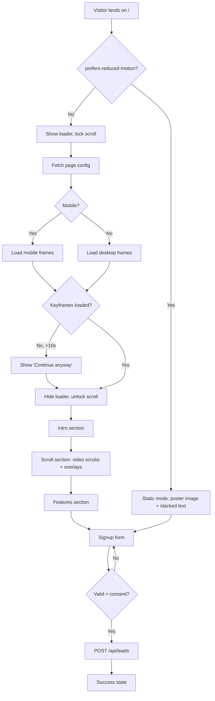
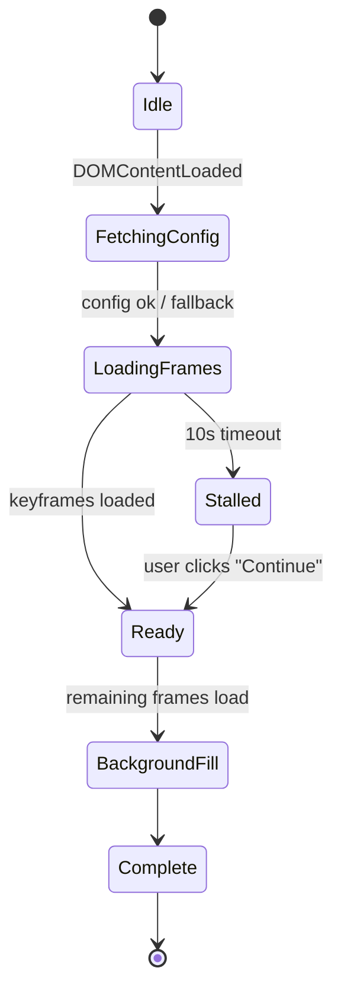
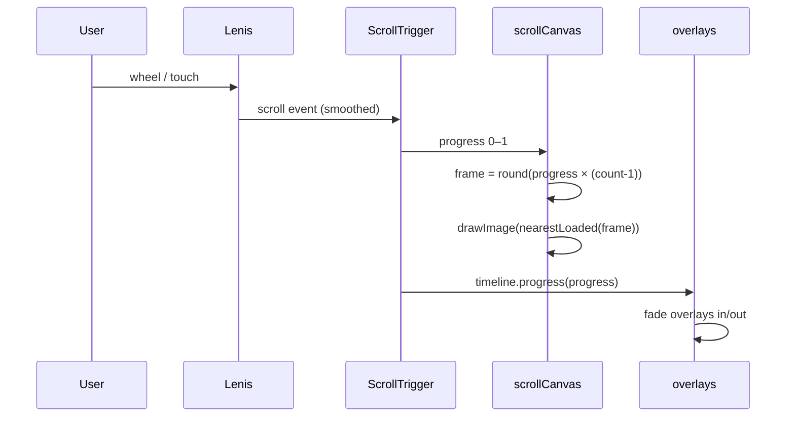
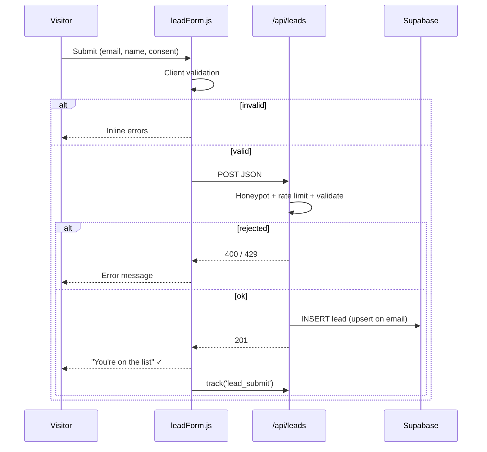
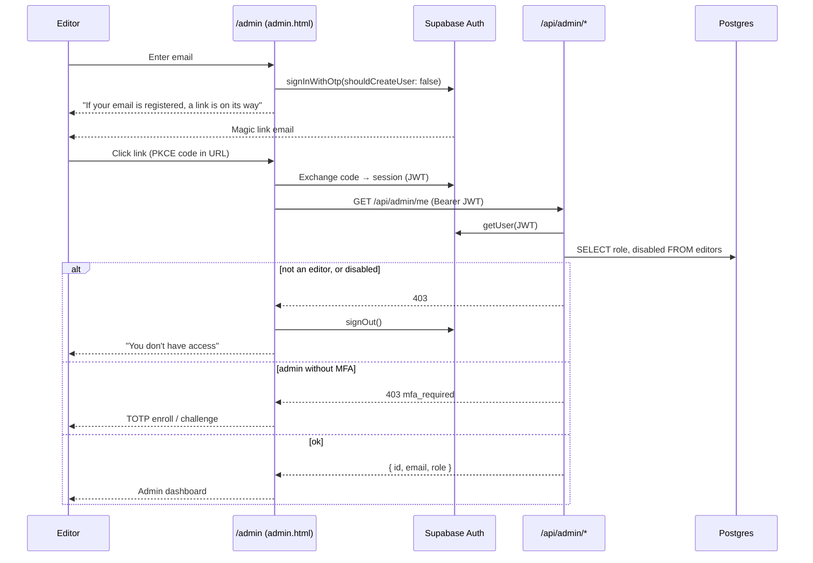
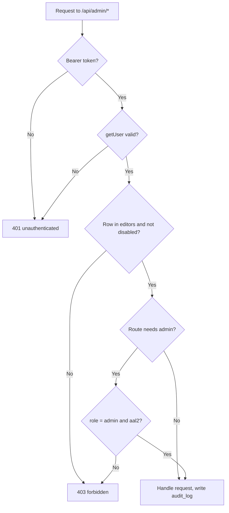
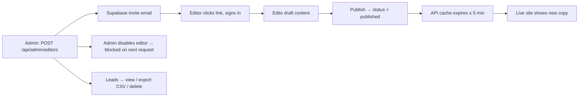

<!-- Reusable source-format document. Treat this as a STRUCTURE AND COVERAGE REFERENCE. -->
<!-- Adapt all project-specific names, dates, providers, architecture, limits and examples to the current website brief. -->
<!-- Do not copy a sample technology decision unless it fits the current project. Mark unknown facts as TBD and explain applicability. -->

# 03 — App Flow

# App Flow
**Related:** [PRD](./01-PRD.md) · [TRD](./02-TRD.md) · [Authentication](./06-AUTHENTICATION.md)

## 1. Site Map
```
/ (Home)
├── #intro           Hero title + scroll hint
├── #scroll-section  Sticky canvas + overlays (the main experience)
├── #features        Static feature content
├── #signup          Lead capture form
└── footer           Links: Privacy, Terms
/privacy
/terms

/admin            Sign-in + dashboard (noindex, not linked from the public site)
/admin/leads      Leads viewer (admin)
/admin/audit      Audit log (admin)
```

## 2. Visitor Journey


## 3. Loader State Machine


## 4. Scroll → Render Loop


## 5. Scroll Section Timeline (default content)
```
progress  0.0 ──── 0.25 ──── 0.50 ──── 0.75 ──── 1.0
frames    1 ───────────────────────────────────── 150
overlay1  [██ Introducing X ██]
overlay2            [██ Designed for performance ██]
overlay3                      [██ Every detail ██]
overlay4                                [██ Available now + CTA ██]
canvas                                        [scale 1 → 0.85]
analytics ▲25%       ▲50%       ▲75%       ▲100%   (scroll_milestone)
```

## 6. Lead Form Flow


## 7. Editor & Admin Flow

### 7.1 Sign-in


### 7.2 Request authorization


### 7.3 Editor lifecycle


Until FR-12 to FR-16 ship, editors use the Supabase dashboard instead (FR-11): edit the `overlays` table, set the page `status = published`, export leads as CSV.

## 8. Error & Edge States
| Situation | What the user sees |
|---|---|
| JS disabled | `<noscript>` poster + all text |
| API unavailable | Normal experience from static JSON |
| Slow network | Progress bar → "Continue anyway" button |
| Window resized mid-scroll | Canvas resizes, frame redrawn, ScrollTrigger refreshes |
| Rotating a mobile device | Same as resize; frame set does not switch mid-session |
| Duplicate email | Success message (no leak of existing emails) |
| Not signed in at `/admin` | Sign-in form |
| Unknown or unregistered email at sign-in | Same message as a registered email |
| Disabled editor, or not in `editors` | "You don't have access", then signed out |
| Admin without MFA | TOTP enroll / challenge step |
| Expired session | Silent refresh; if that fails, back to sign-in |

---
