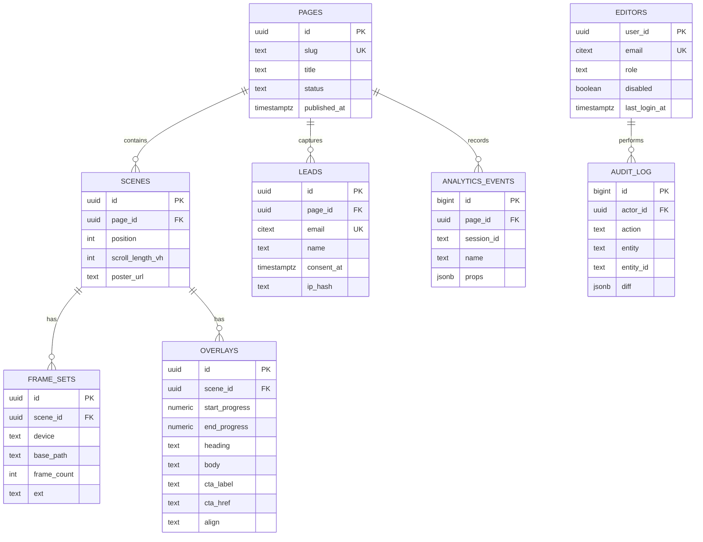

<!-- Reusable source-format document. Treat this as a STRUCTURE AND COVERAGE REFERENCE. -->
<!-- Adapt all project-specific names, dates, providers, architecture, limits and examples to the current website brief. -->
<!-- Do not copy a sample technology decision unless it fits the current project. Mark unknown facts as TBD and explain applicability. -->

# 05 — Backend Schema

# Backend Schema
**Stack:** Supabase (Postgres 15 + Auth) + Vercel Serverless Functions
**Related:** [TRD](./02-TRD.md) · [Authentication](./06-AUTHENTICATION.md) · [Deployment Runbook](./08-DEPLOYMENT-RUNBOOK.md) · [Privacy & Legal](./11-PRIVACY-AND-LEGAL.md)

## 1. Entity Relationship Diagram

`EDITORS.user_id` references Supabase's `auth.users(id)`.

## 2. SQL

### Migration `001_init.sql`
```sql
create extension if not exists citext;
create extension if not exists pgcrypto;

-- ---------- Enums ----------
create type page_status   as enum ('draft', 'published', 'archived');
create type device_type   as enum ('desktop', 'mobile');
create type overlay_align as enum ('center', 'left', 'right');

-- ---------- Pages ----------
create table pages (
  id               uuid primary key default gen_random_uuid(),
  slug             text not null unique check (slug ~ '^[a-z0-9-]+$'),
  title            text not null,
  meta_description text,
  og_image_url     text,
  status           page_status not null default 'draft',
  published_at     timestamptz,
  created_at       timestamptz not null default now(),
  updated_at       timestamptz not null default now()
);

-- ---------- Scenes ----------
create table scenes (
  id               uuid primary key default gen_random_uuid(),
  page_id          uuid not null references pages(id) on delete cascade,
  position         int  not null default 0,
  scroll_length_vh int  not null default 400 check (scroll_length_vh between 100 and 1500),
  poster_url       text not null,
  created_at       timestamptz not null default now(),
  unique (page_id, position)
);

-- ---------- Frame sets ----------
create table frame_sets (
  id          uuid primary key default gen_random_uuid(),
  scene_id    uuid not null references scenes(id) on delete cascade,
  device      device_type not null,
  base_path   text not null,               -- e.g. /frames/hero-desktop
  frame_count int  not null check (frame_count > 0),
  ext         text not null default 'webp' check (ext in ('webp', 'avif', 'jpg')),
  total_bytes bigint,
  unique (scene_id, device)
);

-- ---------- Overlays ----------
create table overlays (
  id             uuid primary key default gen_random_uuid(),
  scene_id       uuid not null references scenes(id) on delete cascade,
  start_progress numeric(4,3) not null check (start_progress between 0 and 1),
  end_progress   numeric(4,3) not null check (end_progress between 0 and 1),
  heading        text not null check (char_length(heading) <= 80),
  body           text check (char_length(body) <= 240),
  cta_label      text,
  cta_href       text,
  align          overlay_align not null default 'center',
  created_at     timestamptz not null default now(),
  check (end_progress > start_progress),
  check ((cta_label is null) = (cta_href is null))
);
create index overlays_scene_start_idx on overlays (scene_id, start_progress);

-- ---------- Leads ----------
create table leads (
  id          uuid primary key default gen_random_uuid(),
  page_id     uuid references pages(id) on delete set null,
  email       citext not null unique check (email ~* '^[^@\s]+@[^@\s]+\.[^@\s]+$'),
  name        text check (char_length(name) <= 100),
  consent_at  timestamptz not null,
  source      text,                         -- utm_source
  utm         jsonb not null default '{}',
  ip_hash     text,
  user_agent  text,
  created_at  timestamptz not null default now()
);
create index leads_created_idx on leads (created_at desc);

-- ---------- Analytics ----------
create table analytics_events (
  id          bigint generated always as identity primary key,
  page_id     uuid references pages(id) on delete cascade,
  session_id  text not null,
  name        text not null check (name in
                ('page_view','loader_complete','loader_stalled',
                 'scroll_milestone','cta_click','lead_submit','reduced_motion')),
  props       jsonb not null default '{}',
  device      device_type,
  created_at  timestamptz not null default now()
);
create index analytics_page_name_time_idx on analytics_events (page_id, name, created_at desc);

-- ---------- updated_at trigger ----------
create or replace function set_updated_at() returns trigger as $$
begin new.updated_at = now(); return new; end;
$$ language plpgsql;

create trigger pages_updated_at before update on pages
  for each row execute function set_updated_at();
```

### Migration `002_auth.sql`
```sql
create type editor_role as enum ('editor', 'admin');

create table editors (
  user_id       uuid primary key references auth.users(id) on delete cascade,
  email         citext not null unique,
  role          editor_role not null default 'editor',
  disabled      boolean not null default false,
  invited_by    uuid references auth.users(id) on delete set null,
  created_at    timestamptz not null default now(),
  last_login_at timestamptz
);

create table audit_log (
  id         bigint generated always as identity primary key,
  actor_id   uuid references auth.users(id) on delete set null,
  action     text not null,                 -- e.g. 'page.publish', 'lead.delete'
  entity     text not null,                 -- e.g. 'page', 'overlay', 'lead', 'editor'
  entity_id  text,
  diff       jsonb not null default '{}',
  ip_hash    text,
  created_at timestamptz not null default now()
);
create index audit_log_created_idx on audit_log (created_at desc);

alter table editors   enable row level security;
alter table audit_log enable row level security;
-- No policies: only the service role can read or write these tables.
```

**First admin** (run once, after creating the user in the Supabase Auth dashboard):
```sql
insert into editors (user_id, email, role)
select id, email, 'admin' from auth.users where email = 'you@company.com';
```

## 3. Row Level Security
The client never connects directly. All writes go through serverless functions that use the service-role key. RLS stays enabled as defense-in-depth.

```sql
alter table pages            enable row level security;
alter table scenes           enable row level security;
alter table frame_sets       enable row level security;
alter table overlays         enable row level security;
alter table leads            enable row level security;
alter table analytics_events enable row level security;

-- Anonymous users may read published content only
create policy "public read published pages" on pages
  for select using (status = 'published');

create policy "public read scenes of published pages" on scenes
  for select using (exists (select 1 from pages p where p.id = page_id and p.status = 'published'));

create policy "public read frame_sets" on frame_sets
  for select using (exists (
    select 1 from scenes s join pages p on p.id = s.page_id
    where s.id = scene_id and p.status = 'published'));

create policy "public read overlays" on overlays
  for select using (exists (
    select 1 from scenes s join pages p on p.id = s.page_id
    where s.id = scene_id and p.status = 'published'));

-- leads, analytics_events, editors, audit_log: no policies → only the service role can access
```

**Do not add policies for the `authenticated` role.** A signed-in editor holds the public anon key and a valid JWT. Without policies, that still cannot read `leads`, `editors` or `audit_log` directly. Everything privileged goes through `/api/admin/*`.

## 4. Page Config View (used by `GET /api/page/:slug`)
```sql
create or replace view page_config as
select
  p.slug,
  p.title,
  jsonb_agg(
    jsonb_build_object(
      'id', s.id,
      'scrollLengthVh', s.scroll_length_vh,
      'posterUrl', s.poster_url,
      'frames', (
        select jsonb_object_agg(f.device, jsonb_build_object(
          'basePath', f.base_path, 'count', f.frame_count, 'ext', f.ext))
        from frame_sets f where f.scene_id = s.id),
      'overlays', coalesce((
        select jsonb_agg(jsonb_build_object(
          'id', o.id, 'start', o.start_progress, 'end', o.end_progress,
          'heading', o.heading, 'body', o.body, 'align', o.align,
          'cta', case when o.cta_label is null then null
                 else jsonb_build_object('label', o.cta_label, 'href', o.cta_href) end
        ) order by o.start_progress)
        from overlays o where o.scene_id = s.id), '[]'::jsonb)
    ) order by s.position
  ) as scenes
from pages p
join scenes s on s.page_id = p.id
where p.status = 'published'
group by p.id;
```

## 5. API Endpoints

### `GET /api/page/:slug`
- **Cache:** `Cache-Control: public, s-maxage=300, stale-while-revalidate=600`
- **200:** `PageConfig` (see TRD §3.1) · **404:** `{ "error": "not_found" }`

### `POST /api/leads`
**Request**
```json
{
  "email": "jane@example.com",
  "name": "Jane",
  "consent": true,
  "pageSlug": "home",
  "utm": { "source": "instagram", "campaign": "launch" },
  "website": ""
}
```
> `website` is a honeypot. If it is filled, the server returns 201 but does not save anything.

| Status | Body | When |
|---|---|---|
| 201 | `{ "ok": true }` | Created, or duplicate email (no info leak) |
| 400 | `{ "error": "invalid_email" \| "consent_required" }` | Validation failed |
| 429 | `{ "error": "rate_limited" }` | > 5 requests/min per IP hash |

### `POST /api/events`
```json
{
  "pageSlug": "home",
  "sessionId": "c1f9…",
  "device": "mobile",
  "events": [
    { "name": "scroll_milestone", "props": { "pct": 50 } },
    { "name": "cta_click", "props": { "overlayId": "…" } }
  ]
}
```
- Max 20 events per batch. Sent with `navigator.sendBeacon`. Returns **204**.

### `/api/admin/*`
Authenticated, role-checked routes. Full contract, error codes and rules are in [Authentication §4](./06-AUTHENTICATION.md). Every mutation writes a row to `audit_log`.

## 6. Example Serverless Function
```js
// api/leads.js
import { createClient } from '@supabase/supabase-js';
import crypto from 'node:crypto';

const db = createClient(process.env.SUPABASE_URL, process.env.SUPABASE_SERVICE_ROLE_KEY);
const EMAIL_RE = /^[^@\s]+@[^@\s]+\.[^@\s]+$/;

export default async function handler(req, res) {
  if (req.method !== 'POST') return res.status(405).end();
  const { email, name, consent, pageSlug = 'home', utm = {}, website } = req.body ?? {};

  if (website) return res.status(201).json({ ok: true });                 // honeypot
  if (!EMAIL_RE.test(email ?? '')) return res.status(400).json({ error: 'invalid_email' });
  if (consent !== true) return res.status(400).json({ error: 'consent_required' });

  const ip = req.headers['x-forwarded-for']?.split(',')[0] ?? '';
  const ipHash = crypto.createHash('sha256').update(ip + process.env.IP_HASH_SALT).digest('hex');

  const since = new Date(Date.now() - 60_000).toISOString();
  const { count } = await db.from('leads')
    .select('id', { count: 'exact', head: true })
    .eq('ip_hash', ipHash).gte('created_at', since);
  if (count >= 5) return res.status(429).json({ error: 'rate_limited' });

  const { data: page } = await db.from('pages').select('id').eq('slug', pageSlug).single();

  await db.from('leads').upsert({
    page_id: page?.id ?? null,
    email: email.trim().toLowerCase(),
    name: name?.trim() || null,
    consent_at: new Date().toISOString(),
    source: utm.source ?? null,
    utm,
    ip_hash: ipHash,
    user_agent: req.headers['user-agent']?.slice(0, 300),
  }, { onConflict: 'email', ignoreDuplicates: true });

  return res.status(201).json({ ok: true });
}
```

## 7. Seed Data (`seed.sql`)
```sql
with p as (
  insert into pages (slug, title, status, published_at)
  values ('home', 'Introducing X', 'published', now()) returning id
), s as (
  insert into scenes (page_id, position, scroll_length_vh, poster_url)
  select id, 0, 400, '/frames/desktop/frame_0150.webp' from p returning id
), f as (
  insert into frame_sets (scene_id, device, base_path, frame_count, ext)
  select id, 'desktop', '/frames/desktop', 150, 'webp' from s
  union all
  select id, 'mobile',  '/frames/mobile',  120, 'webp' from s
)
insert into overlays (scene_id, start_progress, end_progress, heading, cta_label, cta_href)
select s.id, v.start_p, v.end_p, v.heading, v.cta_label, v.cta_href
from s, (values
  (0.05, 0.25, 'Introducing X',            null,      null),
  (0.30, 0.50, 'Designed for performance', null,      null),
  (0.55, 0.75, 'Every detail matters',     null,      null),
  (0.80, 1.00, 'Available now',            'Buy Now', '#signup')
) as v(start_p, end_p, heading, cta_label, cta_href);
```

## 8. Storage
| Bucket | Public | Contents |
|---|---|---|
| `posters` | Yes | Poster / OG images uploaded by editors |

> Frame sequences ship in `/public/frames` and are served by the Vercel CDN with immutable caching. That is faster and cheaper than DB storage for hundreds of small files.

## 9. Data Retention
| Table | Retention |
|---|---|
| `leads` | Until the user unsubscribes / requests deletion (GDPR). Admins delete via `DELETE /api/admin/leads/:id`. |
| `analytics_events` | 13 months (monthly cron `delete … where created_at < now() - interval '13 months'`) |
| `audit_log` | 24 months (monthly cron, same pattern) |
| `editors` | While the person has access; deleted on offboarding |

The cron jobs that enforce these retention periods are in the [Deployment Runbook](./08-DEPLOYMENT-RUNBOOK.md) §8.

---
