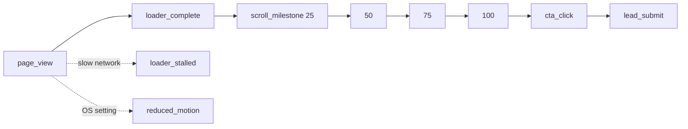

<!-- Reusable source-format document. Treat this as a STRUCTURE AND COVERAGE REFERENCE. -->
<!-- Adapt all project-specific names, dates, providers, architecture, limits and examples to the current website brief. -->
<!-- Do not copy a sample technology decision unless it fits the current project. Mark unknown facts as TBD and explain applicability. -->

# 12 — Analytics Spec

# Analytics Spec
**Related:** [PRD](./01-PRD.md) (G1, G2, FR-10) · [App Flow](./03-APP-FLOW.md) §5 · [Backend Schema](./05-BACKEND-SCHEMA.md) (`analytics_events`, `POST /api/events`) · [Privacy & Legal](./11-PRIVACY-AND-LEGAL.md)

## 1. Principles
- **No personal data in events.** Never send an email, name or free text.
- **No cookies.** A random session id lives in `sessionStorage` and ends with the tab.
- **Fire and forget.** Analytics must never block scrolling or show an error.
- **Small and fixed.** Only the events in §2. The database rejects any other name.

## 2. Event Catalog
The names match the `check` constraint on `analytics_events.name`.

| Event | Fires when | `props` |
|---|---|---|
| `page_view` | Once per page load, after the config is loaded | `referrerHost?` (host only), `utmSource?` |
| `loader_complete` | Keyframes are loaded and scroll unlocks | `ms` (time since page load), `keyframes` (count) |
| `loader_stalled` | The 10-second stall message appears | `loadedPct` (0–100) |
| `scroll_milestone` | The scroll section reaches 25, 50, 75 or 100% for the first time in this page load | `pct` (25, 50, 75 or 100) |
| `cta_click` | A CTA is clicked | `target` (`overlay` or `signup`), `overlayId?` |
| `lead_submit` | The server confirms a lead (201) | none |
| `reduced_motion` | Static mode is chosen because of the OS setting | none |

`scroll_milestone` measures progress of the **scroll section** (0–1), the same scale used for overlays.

## 3. Payload and Delivery
- The `session_id` and `device` (`desktop` or `mobile`) are sent once per batch, not per event.
- Events are queued and sent in batches of up to 20, after 2 seconds of quiet, when the tab is hidden, and on `pagehide`.
- Delivery uses `navigator.sendBeacon`. The server answers 204 ([Backend Schema §5](./05-BACKEND-SCHEMA.md)).
- Keep each event's `props` under 1 KB. The server should drop oversize props.

```js
// src/analytics.js
const ENDPOINT = '/api/events';
const SLUG = import.meta.env.VITE_PAGE_SLUG ?? 'home';
const MAX_BATCH = 20;

const sessionId = (() => {
  try {
    let id = sessionStorage.getItem('sid');
    if (!id) { id = crypto.randomUUID(); sessionStorage.setItem('sid', id); }
    return id;
  } catch {
    return crypto.randomUUID();
  }
})();

const device = matchMedia('(max-width: 768px)').matches ? 'mobile' : 'desktop';
const queue = [];
let timer;

export function track(name, props = {}) {
  queue.push({ name, props });
  if (queue.length >= MAX_BATCH) return flush();
  clearTimeout(timer);
  timer = setTimeout(flush, 2000);
}

function flush() {
  if (!queue.length) return;
  const body = JSON.stringify({ pageSlug: SLUG, sessionId, device, events: queue.splice(0, MAX_BATCH) });
  navigator.sendBeacon(ENDPOINT, new Blob([body], { type: 'application/json' }));
}

addEventListener('visibilitychange', () => { if (document.visibilityState === 'hidden') flush(); });
addEventListener('pagehide', flush);
```

Milestones fire once each per page load:
```js
const fired = new Set();
export function onSectionProgress(p) {
  for (const pct of [25, 50, 75, 100]) {
    if (p * 100 >= pct && !fired.has(pct)) { fired.add(pct); track('scroll_milestone', { pct }); }
  }
}
```

## 4. Funnel


## 5. Metrics and Queries
| Metric | Definition | Goal |
|---|---|---|
| Average scroll depth | Highest milestone per session (0 when none), averaged over sessions with a `page_view` | ≥ 70% (G1) |
| CTA conversion | Sessions with `lead_submit` ÷ sessions with `page_view` | ≥ 3% (G2) |
| Loader stall rate | Sessions with `loader_stalled` ÷ sessions with `page_view` | Watch for increases |
| Loader time (median) | Median `ms` of `loader_complete` | ≤ 3000 desktop, ≤ 4000 mobile |

Depth only has four steps, so the average is an approximation. Read it as a trend.

```sql
-- Conversion rate, last 30 days
select
  count(distinct session_id) filter (where name = 'lead_submit')::numeric
  / nullif(count(distinct session_id) filter (where name = 'page_view'), 0) as conversion
from analytics_events
where created_at > now() - interval '30 days';

-- Average scroll depth, last 30 days
with views as (
  select distinct session_id from analytics_events
  where name = 'page_view' and created_at > now() - interval '30 days'
), depth as (
  select session_id, max((props->>'pct')::int) as pct
  from analytics_events
  where name = 'scroll_milestone' and created_at > now() - interval '30 days'
  group by session_id
)
select avg(coalesce(d.pct, 0)) as avg_depth
from views v left join depth d using (session_id);

-- Loader stall rate and median loader time by device
select device,
  count(distinct session_id) filter (where name = 'loader_stalled')::numeric
    / nullif(count(distinct session_id) filter (where name = 'page_view'), 0) as stall_rate,
  percentile_cont(0.5) within group (order by (props->>'ms')::numeric)
    filter (where name = 'loader_complete') as median_ms
from analytics_events
where created_at > now() - interval '30 days'
group by device;
```

## 6. Verifying Events
```sql
select name, props, created_at
from analytics_events
where session_id = '<id from sessionStorage "sid">'
order by created_at;
```
Expected for a full visit: `page_view`, `loader_complete`, four `scroll_milestone` rows, then `cta_click` and `lead_submit` if the form was used. This is check E-01 in the [QA Checklist](./09-QA-CHECKLIST.md).

## 7. Limits and Retention
- Ad blockers and privacy tools will drop some events. Treat the numbers as a floor.
- Bots may create `page_view` rows. Filter obvious ones by user agent if the numbers look inflated.
- Rows are deleted after 13 months ([Deployment Runbook](./08-DEPLOYMENT-RUNBOOK.md) §8).
- Plausible (optional, cookieless) can run alongside. It is not a replacement for the lead and funnel data above.

---
