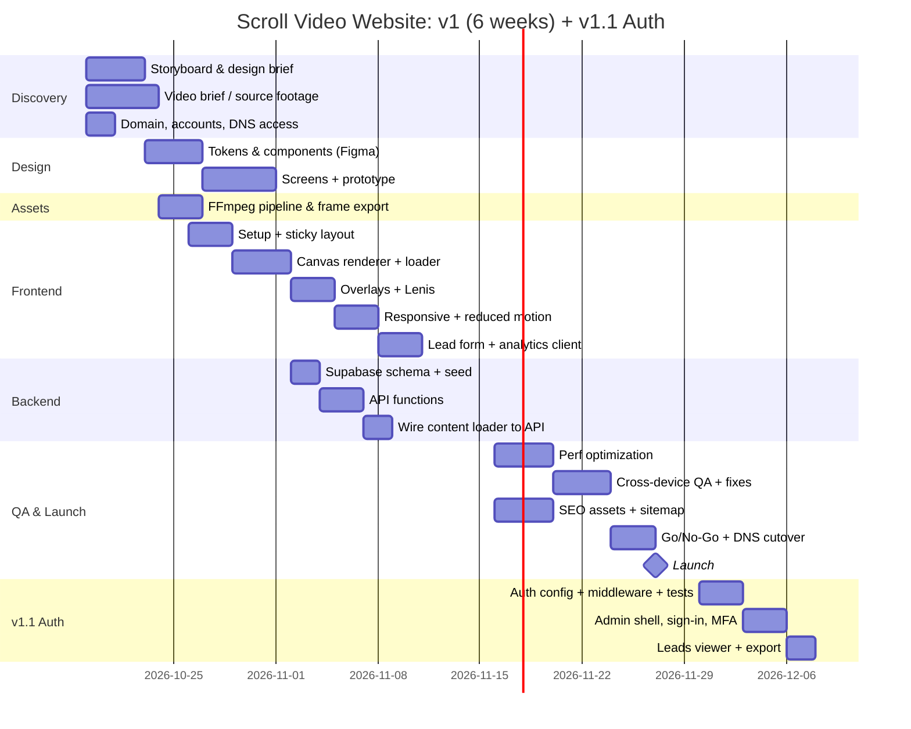

<!-- Reusable source-format document. Treat this as a STRUCTURE AND COVERAGE REFERENCE. -->
<!-- Adapt all project-specific names, dates, providers, architecture, limits and examples to the current website brief. -->
<!-- Do not copy a sample technology decision unless it fits the current project. Mark unknown facts as TBD and explain applicability. -->

# 35 — Implementation Plan

# Implementation Plan
**Duration:** 6 weeks for v1, plus about 2 weeks for v1.1 auth · **Team:** 1 Designer, 1–2 Frontend Devs, 1 Backend/DevOps (part-time), 1 QA (part-time)
**Covers:** every file in this set: the [Build Guide](../README.md), [CHANGELOG](../CHANGELOG.md) and documents [01](./01-PRD.md) to [16](./16-MAINTENANCE-AND-OPERATIONS.md). Section 9 maps each one to a phase.

## 1. Timeline Overview

## 2. Phases & Tasks

### Phase 0: Discovery (Week 1)
| Task | Owner | Output |
|---|---|---|
| Kickoff, confirm PRD scope | PM | Signed-off PRD |
| Scroll storyboard (progress % → frame → copy) | Designer | Storyboard doc |
| Video art-direction brief (safe zones, length), production process per [Asset Pipeline](./07-ASSET-PIPELINE.md) §10 | Designer | Brief for the videographer |
| Repo scaffolded per the [Build Guide](../README.md) Phases 0–1; Vercel and Supabase projects created per the [Deployment Runbook](./08-DEPLOYMENT-RUNBOOK.md) §2 | DevOps | Access for team, `npm run dev` works |
| Domain registered in the company's name, DNS access secured, access register started ([Domain, DNS & Email](./13-DOMAIN-DNS-EMAIL.md) §2–3, [Maintenance](./16-MAINTENANCE-AND-OPERATIONS.md) §1) | PM + DevOps | Domain in DNS, 2FA on the registrar |

**Exit criteria:** PRD approved, source video ordered or received.

### Phase 1: Design (Weeks 1–2)
| Task | Owner | Output |
|---|---|---|
| Design tokens + component library | Designer | Figma library |
| Desktop + mobile screens (incl. 0/25/50/75/100% states) | Designer | Figma screens |
| Clickable/scroll prototype | Designer | Prototype link |
| Admin screens (desktop 1440): sign-in, MFA, dashboard, leads, audit log. Can slip to Week 6, but must be done before Phase 8. | Designer | Figma screens |
| Design review & sign-off | PM + Stakeholders | Approved designs |

### Phase 2: Asset Pipeline (Week 2)
| Task | Owner | Output |
|---|---|---|
| `scripts/export-frames.sh` (desktop + mobile, WebP + AVIF) per the [Asset Pipeline](./07-ASSET-PIPELINE.md) | Frontend | Repeatable script |
| Frame count/size audit vs. budget (`scripts/audit-frames.mjs`) | Frontend | Passing audit and manifest |
| Poster + OG image export | Designer | `/public/posters` |

### Phase 3: Frontend Core (Weeks 2–3) → *Build Guide Phases 3–9*
| Task | Owner | Done when |
|---|---|---|
| Vite setup, folder structure, lint/prettier | FE | `npm run dev` works |
| HTML structure + sticky layout | FE | Section pins correctly |
| `scrollCanvas.js` (cover-fit, DPR, progressive load) | FE | 60 fps scrub on desktop |
| Loader with stall fallback | FE | State machine matches App Flow §3 |
| `overlays.js` driven by config | FE | Overlays match storyboard timing |
| Lenis integration | FE | No jitter, anchors smooth-scroll |

### Phase 4: Backend (Week 3)
| Task | Owner | Done when |
|---|---|---|
| Run `001_init.sql`, RLS, `page_config` view | BE | Migration in repo |
| Seed data | BE | `/api/page/home` returns config |
| `/api/page/:slug`, `/api/leads`, `/api/events` | BE | Contract tests pass |
| Static JSON fallback generated from DB | BE | `npm run export:content` |

### Phase 5: Integration & Features (Week 4) → *Build Guide Phases 10–11*
| Task | Owner | Done when |
|---|---|---|
| `contentLoader.js` wired to the API | FE | Copy changes in DB appear on the site |
| Mobile frame set + `svh` fixes | FE | Works on iOS Safari & Android |
| Reduced-motion mode | FE | Static layout verified |
| Lead form (validation, honeypot, consent text per [Privacy & Legal](./11-PRIVACY-AND-LEGAL.md) §3, states) | FE | E2E test passes |
| Analytics client per the [Analytics Spec](./12-ANALYTICS-SPEC.md) | FE | Events visible in DB; QA check E-01 passes |

### Phase 6: Optimization (Week 5) → *Build Guide Phase 12*
| Task | Owner | Done when |
|---|---|---|
| AVIF with WebP fallback (probe per [Asset Pipeline](./07-ASSET-PIPELINE.md) §6) | FE | ~30% payload reduction |
| `ImageBitmap` decoding | FE | Main thread ≤ 8 ms/frame |
| Cache headers & CSP (`vercel.json`, [Deployment Runbook](./08-DEPLOYMENT-RUNBOOK.md) §4) | DevOps | Headers verified |
| Lighthouse CI budgets in GitHub Actions | DevOps | Pipeline fails on regression |
| SEO assets: `inject-content` build step, head tags, `robots.txt`, `sitemap.xml`, favicons, `404.html` ([SEO & Discoverability](./14-SEO-AND-DISCOVERABILITY.md)) | FE | QA checks S-01 to S-09 pass |

### Phase 7: QA & Launch (Weeks 5–6) → *Build Guide Phase 13*
| Task | Owner | Done when |
|---|---|---|
| Device matrix testing (see §3) and the [QA Checklist](./09-QA-CHECKLIST.md) | QA | All P0 pass, sign-off block complete |
| Accessibility audit (axe + manual keyboard/screen reader) | QA | WCAG 2.2 AA |
| Visual regression screenshots | QA | Baselines approved |
| Content freeze, editor training with the [Content Editor Guide](./10-CONTENT-EDITOR-GUIDE.md) (Supabase dashboard) | PM | Editor can update copy unaided |
| `/privacy`, `/terms` and consent text written and reviewed by counsel ([Privacy & Legal](./11-PRIVACY-AND-LEGAL.md) §9) | PM | Pages live, legal checklist complete |
| Domain mailboxes and email authentication: SPF, DKIM, DMARC ([Domain, DNS & Email](./13-DOMAIN-DNS-EMAIL.md) §5.1–5.2) | DevOps | Test emails pass authentication |
| Go/No-Go meeting, DNS cutover, 72-hour watch ([Launch & Go-Live](./15-LAUNCH-AND-GO-LIVE.md)) | PM + DevOps | Cutover done, watch complete |
| Production deploy, domain, monitoring and retention jobs per the [Deployment Runbook](./08-DEPLOYMENT-RUNBOOK.md) | DevOps | Live, smoke test passes |
| Handover: access register, cost register, routines ([Maintenance & Operations](./16-MAINTENANCE-AND-OPERATIONS.md) §1–3) | PM | Owners named, routines scheduled |

### Phase 8: Authentication & Admin (v1.1, Weeks 7–8)
Starts after launch, so the 2026-11-27 date is unaffected. Until it ships, editors use the Supabase dashboard (FR-11).

| Task | Owner | Done when |
|---|---|---|
| Custom SMTP sender on the domain ([Domain, DNS & Email](./13-DOMAIN-DNS-EMAIL.md) §5.3) configured and tested | BE + DevOps | Magic link arrives from the domain and passes SPF, DKIM and DMARC |
| Supabase Auth config (sign-up off, magic link, TOTP, CAPTCHA, redirect allow-list), first admin seeded | BE | Admin can sign in |
| `002_auth.sql` migration (`editors`, `audit_log`) | BE | Migration in repo |
| `requireRole` middleware plus unit tests | BE | All role/MFA cases pass |
| `/api/admin/me`, `pages`, `publish`, `editors`, `audit` | BE | Contract tests pass (401/403 on every route) |
| `admin.html` as a second Vite entry: sign-in, guard, MFA | FE | Editor signs in and out; admin forced through TOTP |
| Leads viewer, CSV export, delete (admin only) | FE + BE | Covered by E2E |
| Admin CSP, `noindex`, `no-store` headers | DevOps | Headers verified |
| Audit log write on every admin mutation | BE | A row appears for each action |

## 3. Device Test Matrix
| Device | Browser | Priority |
|---|---|---|
| MacBook (Retina) | Safari, Chrome | P0 |
| Windows laptop | Chrome, Edge, Firefox | P0 |
| iPhone 13+ | Safari | P0 |
| Pixel 7 / Galaxy A54 | Chrome | P0 |
| iPad | Safari | P1 |
| Low-end Android (4GB RAM) | Chrome | P1 |

## 4. Milestones
| # | Milestone | Date | Criteria |
|---|---|---|---|
| M1 | Design approved | 2026-10-30 | Figma signed off |
| M2 | Scroll experience demo | 2026-11-06 | Canvas + overlays on preview URL |
| M3 | Feature complete | 2026-11-13 | All P0 FRs done |
| M4 | Release candidate and Go/No-Go | 2026-11-24 | QA passed, budgets met, Go/No-Go criteria met ([Launch & Go-Live](./15-LAUNCH-AND-GO-LIVE.md) §3) |
| M5 | Launch | 2026-11-27 | Live on production domain |
| M6 | Auth & admin live (v1.1) | 2026-12-10 | FR-12 to FR-16 pass E2E; security checks in Authentication §7 pass |

## 5. Definition of Done (per task)
- [ ] Code reviewed and merged via PR
- [ ] Unit/E2E tests added where relevant
- [ ] Works on the P0 device matrix
- [ ] No Lighthouse budget regressions
- [ ] Accessibility checked (keyboard + contrast)
- [ ] Docs updated if behavior changed
- [ ] Every new admin route has a 401 and a 403 test; no secret in the client bundle; an audit row is written for each mutation

## 6. Risk Register
| Risk | Likelihood | Impact | Owner | Mitigation |
|---|---|---|---|---|
| Source video late | Medium | High | PM | Build with placeholder footage (stock clip) |
| Frame payload over budget | Medium | High | FE | Lower fps, AVIF, mobile set |
| iOS rendering bugs | Medium | Medium | FE | Test on real devices from Week 3 |
| Scope creep (more scenes) | High | Medium | PM | Multi-scene moved to v2 |
| Lead spam | Low | Medium | BE | Honeypot + rate limit, add Turnstile if needed |
| Auth check missed on one admin route | Medium | High | BE | Single `requireRole` helper; contract test fails if a route lacks a 401 case |
| Service-role key leak | Low | Critical | DevOps | Server env only; rotate on staff changes |

## 7. Post-Launch (Weeks 7+)
- Monitor analytics: scroll depth, loader stall rate, conversion
- Day-7 and day-30 reviews ([Launch & Go-Live](./15-LAUNCH-AND-GO-LIVE.md) §8) and the routine tasks in [Maintenance & Operations](./16-MAINTENANCE-AND-OPERATIONS.md) §3
- A/B test overlay copy (v2)
- Multi-scene pages and i18n (v2)
- Content revisions and staging for live pages (v2, see [Content Editor Guide](./10-CONTENT-EDITOR-GUIDE.md) §8)
- Weekly lead export / CRM integration (HubSpot / Mailchimp webhook)

## 8. Option: Pull Auth Into v1
Auth and admin add about 8 working days of mostly serial work. Shipping it before launch moves M4 and M5 out by roughly 1.5 weeks, unless a second backend developer joins. The v1.1 plan above is the default because it matches the PRD scope (FR-9 and FR-11 are already v1.1).

## 9. Coverage Map
Every document and requirement in this file maps to a phase, so nothing is left unscheduled.

### 9.1 Files → phases
| File | Built or verified in |
|---|---|
| `README.md` (Build Guide) | Phases 0 to 7 (the Build Guide phases map as listed in its §5) |
| `CHANGELOG.md` | Updated at each release (Runbook §6) |
| 01-PRD | Phase 0 (scope sign-off), Phase 7 (release criteria) |
| 02-TRD | Phases 3 and 5 (modules, rendering, security headers), Phase 6 (budgets, CI/CD) |
| 03-APP-FLOW | Phases 3 and 5 (visitor flows, loader, lead form), Phase 8 (editor and admin flow) |
| 04-UI-UX-DESIGN-BRIEF | Phase 1 (tokens, screens, admin screens), Phases 3 and 5 (implementation), Phase 7 (accessibility audit) |
| 05-BACKEND-SCHEMA | Phase 4 (`001_init.sql`, RLS, endpoints, seed), Phase 8 (`002_auth.sql`) |
| 06-AUTHENTICATION | Phase 8 (all of it), release gate in M6 |
| 07-ASSET-PIPELINE | Phase 0 (production process §10), Phase 2 (export and audit), Phase 6 (AVIF probe) |
| 08-DEPLOYMENT-RUNBOOK | Phase 0 (setup), Phase 6 (headers), Phase 7 (release, monitoring, jobs), Phase 8 (admin headers) |
| 09-QA-CHECKLIST | Phase 7 (full run and sign-off), Phase 8 (admin checks U-01 to U-09) |
| 10-CONTENT-EDITOR-GUIDE | Phase 7 (editor training), updated when `/admin` ships in Phase 8 |
| 11-PRIVACY-AND-LEGAL | Phase 5 (consent text), Phase 7 (policy pages and checklist) |
| 12-ANALYTICS-SPEC | Phase 4 (events API), Phase 5 (client), Phase 7 (QA check E-01) |
| 13-DOMAIN-DNS-EMAIL | Phase 0 (registration, DNS access), Phase 7 (mailboxes, authentication, cutover records), Phase 8 (custom SMTP) |
| 14-SEO-AND-DISCOVERABILITY | Phase 6 (build-time injection, head tags, sitemap, icons, 404), Phase 7 (Search Console after launch) |
| 15-LAUNCH-AND-GO-LIVE | Phase 7 (Go/No-Go at M4, cutover, 72-hour watch, handover) |
| 16-MAINTENANCE-AND-OPERATIONS | Phase 7 (handover), then ongoing after launch |
| 17-IMPLEMENTATION-PLAN | This document |

### 9.2 Requirements → phases
| Requirement | Phase | Version |
|---|---|---|
| FR-1 Scroll-to-frame mapping | 3 | v1 |
| FR-2 Canvas renderer | 3 | v1 |
| FR-3 Preloader, scroll lock | 3 | v1 |
| FR-4 Overlay timeline | 3 | v1 |
| FR-5 Smooth scrolling | 3 | v1 |
| FR-6 Mobile frame set | 2 (export), 5 (integration) | v1 |
| FR-7 Reduced-motion fallback | 5 | v1 |
| FR-8 Lead capture | 4 (API), 5 (form) | v1 |
| FR-9 Content from API with fallback | 4, 5 | v1.1 in the PRD; built in v1 in this plan (see the mismatch note below) |
| FR-10 Analytics events | 4 (API), 5 (client) | v1 |
| FR-11 Supabase dashboard access | 7 (editor training) | v1.1 |
| FR-12 Invite-only sign-in | 8 | v1.1 |
| FR-13 Role-based authorization | 8 | v1.1 |
| FR-14 Admin MFA | 8 | v1.1 |
| FR-15 Audit log | 8 | v1.1 |
| FR-16 Leads viewer, export, delete | 8 | v1.1 |

> **Mismatch to resolve:** the PRD marks FR-9 as v1.1, while Phases 4 and 5 build it before launch. Either change the PRD scope to v1, or move the wiring out of Phase 5.

### 9.3 Cross-cutting checks
| Check | Where it is enforced |
|---|---|
| Performance budgets | Phase 6 Lighthouse CI; release criteria in the PRD |
| Accessibility (WCAG 2.2 AA), public and admin | Phase 7 audit; per-task Definition of Done |
| Security headers (public CSP, admin CSP, `noindex`) | Phase 6 (public), Phase 8 (admin) |
| Auth tests (401/403 on every admin route, anon key cannot read `leads`) | Phase 8; Definition of Done; M6 |
| Data retention crons ([Runbook](./08-DEPLOYMENT-RUNBOOK.md) §8) | Phase 7 (analytics), Phase 8 (audit log) |
| Legal pages, consent text, processor agreements | Phase 7 ([Privacy & Legal](./11-PRIVACY-AND-LEGAL.md) §9) |
| Release sign-off | Phase 7 ([QA Checklist](./09-QA-CHECKLIST.md) §12) |
| Domain, DNS and email authentication | Phase 0 (registration), Phase 7 (mailboxes, SPF/DKIM/DMARC), Phase 8 (custom SMTP); QA checks D-01 to D-05 |
| SEO | Phase 6; QA checks S-01 to S-09 |
| Costs, renewals and access ownership | Phase 7 handover ([Maintenance & Operations](./16-MAINTENANCE-AND-OPERATIONS.md) §1–2, §7) |

---
