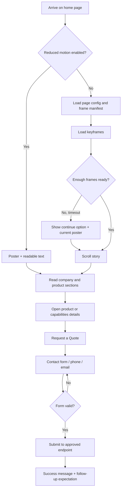

# Modern Guideways — Complete Website Documentation Master File
**Project:** Modern Guideways corporate website  
**Version:** 1.0  
**Status:** Draft for owner review  
**Last updated:** 2026-11-04  
**Owner:** To be assigned  

**Documentation set:** 35 numbered documents + `README.md` + `CHANGELOG.md` + templates, with a separate `SKILLS-AND-AGENT-MAP.md` companion.  
**Website type:** B2B manufacturing/service company website with a scroll-controlled image-sequence hero.  
**Existing asset status:** video generation and frame splitting are already complete; frame audit/integration remains.

## Master index

| Reading order | File | Document |
|---:|---|---|
| 01 | [`01-PRD.md`](docs/01-PRD.md) | Product Requirements Document |
| 02 | [`02-TRD.md`](docs/02-TRD.md) | Technical Requirements Document |
| 03 | [`03-APP-FLOW.md`](docs/03-APP-FLOW.md) | Application Flow |
| 04 | [`04-UI-UX-DESIGN-BRIEF.md`](docs/04-UI-UX-DESIGN-BRIEF.md) | UI/UX Design Brief |
| 05 | [`05-BACKEND-SCHEMA.md`](docs/05-BACKEND-SCHEMA.md) | Backend Schema |
| 06 | [`06-AUTHENTICATION.md`](docs/06-AUTHENTICATION.md) | Authentication |
| 07 | [`07-ASSET-PIPELINE.md`](docs/07-ASSET-PIPELINE.md) | Asset Pipeline |
| 08 | [`08-DEPLOYMENT-RUNBOOK.md`](docs/08-DEPLOYMENT-RUNBOOK.md) | Deployment Runbook |
| 09 | [`09-QA-CHECKLIST.md`](docs/09-QA-CHECKLIST.md) | QA Checklist |
| 10 | [`10-CONTENT-EDITOR-GUIDE.md`](docs/10-CONTENT-EDITOR-GUIDE.md) | Content Editor Guide |
| 11 | [`11-PRIVACY-AND-LEGAL.md`](docs/11-PRIVACY-AND-LEGAL.md) | Privacy & Legal |
| 12 | [`12-ANALYTICS-SPEC.md`](docs/12-ANALYTICS-SPEC.md) | Analytics Specification |
| 13 | [`13-DOMAIN-DNS-EMAIL.md`](docs/13-DOMAIN-DNS-EMAIL.md) | Domain, DNS & Email |
| 14 | [`14-SEO-AND-DISCOVERABILITY.md`](docs/14-SEO-AND-DISCOVERABILITY.md) | SEO & Discoverability |
| 15 | [`15-LAUNCH-AND-GO-LIVE.md`](docs/15-LAUNCH-AND-GO-LIVE.md) | Launch & Go-Live |
| 16 | [`16-MAINTENANCE-AND-OPERATIONS.md`](docs/16-MAINTENANCE-AND-OPERATIONS.md) | Maintenance & Operations |
| 17 | [`18-FRONTEND-ARCHITECTURE.md`](docs/18-FRONTEND-ARCHITECTURE.md) | Frontend Architecture |
| 18 | [`19-BACKEND-ARCHITECTURE.md`](docs/19-BACKEND-ARCHITECTURE.md) | Backend Architecture |
| 19 | [`20-COMPONENT-LIBRARY-DESIGN-SYSTEM.md`](docs/20-COMPONENT-LIBRARY-DESIGN-SYSTEM.md) | Component Library & Design System |
| 20 | [`21-STATE-MANAGEMENT.md`](docs/21-STATE-MANAGEMENT.md) | State Management |
| 21 | [`22-API-DOCUMENTATION.md`](docs/22-API-DOCUMENTATION.md) | API Documentation |
| 22 | [`23-INTEGRATION-DOCUMENTATION.md`](docs/23-INTEGRATION-DOCUMENTATION.md) | Integration Documentation |
| 23 | [`24-FILE-MEDIA-MANAGEMENT.md`](docs/24-FILE-MEDIA-MANAGEMENT.md) | File & Media Management |
| 24 | [`25-PAYMENT-SUBSCRIPTION-DOCUMENTATION.md`](docs/25-PAYMENT-SUBSCRIPTION-DOCUMENTATION.md) | Payment & Subscription Documentation |
| 25 | [`26-ACCESSIBILITY-STANDARD.md`](docs/26-ACCESSIBILITY-STANDARD.md) | Accessibility Standard |
| 26 | [`27-PERFORMANCE-ENGINEERING.md`](docs/27-PERFORMANCE-ENGINEERING.md) | Performance Engineering |
| 27 | [`28-DISASTER-RECOVERY-BACKUP-PLAN.md`](docs/28-DISASTER-RECOVERY-BACKUP-PLAN.md) | Disaster Recovery & Backup Plan |
| 28 | [`29-LOGGING-MONITORING-OBSERVABILITY.md`](docs/29-LOGGING-MONITORING-OBSERVABILITY.md) | Logging, Monitoring & Observability |
| 29 | [`30-GIT-VERSION-CONTROL-WORKFLOW.md`](docs/30-GIT-VERSION-CONTROL-WORKFLOW.md) | Git & Version Control Workflow |
| 30 | [`31-ENVIRONMENT-CONFIGURATION.md`](docs/31-ENVIRONMENT-CONFIGURATION.md) | Environment Configuration |
| 31 | [`32-USER-ROLE-PERMISSION-MANAGEMENT.md`](docs/32-USER-ROLE-PERMISSION-MANAGEMENT.md) | User, Role & Permission Management |
| 32 | [`33-BROWSER-DEVICE-COMPATIBILITY.md`](docs/33-BROWSER-DEVICE-COMPATIBILITY.md) | Browser & Device Compatibility |
| 33 | [`34-DATA-MIGRATION-PLAN.md`](docs/34-DATA-MIGRATION-PLAN.md) | Data Migration Plan |
| 34 | [`35-USER-GUIDE-FAQ-TROUBLESHOOTING.md`](docs/35-USER-GUIDE-FAQ-TROUBLESHOOTING.md) | User Guide, FAQ & Troubleshooting |
| 35 | [`17-IMPLEMENTATION-PLAN.md`](docs/17-IMPLEMENTATION-PLAN.md) | Implementation Plan (final reading-order document) |

## Project facts and constraints

## Verified source facts and publishing controls

The supplied Modern Guideways profile and business-card artwork identify the business as **Modern Guideways** and describe its activity as **CNC & VMC & HMC telescopic cover service and manufacturing**. The listed product/service categories are telescopic covers, roller covers, apron covers, bellows, guide wipers, enclosing guards and other CNC parts/design work. The profile describes custom designs, about 20 years of experience in telescopic-cover design, workmanship and raw-material quality, and the goal of making machinery easier to maintain and longer-lived. It also states the following vision and mission themes: precision, reliability, continuous innovation, quality, safety, on-time delivery, customer satisfaction and capability development.

| Field | Value shown in supplied materials | Publishing check |
|---|---|---|
| Business name | Modern Guideways | Use this exact spelling consistently |
| Managing Director | S. Arockiasamy | Confirm title/name presentation before publication |
| Main capability line | CNC & VMC & HMC telescopic cover service & manufacturing | Confirm preferred capitalization and wording |
| Phone | +91 80564 38763; +91 87781 21768 | Test both numbers and confirm which is primary |
| Email | modernguideways@gmail.com | Confirm inbox is monitored |
| Website printed on profile | www.modernguideways.com | Confirm domain ownership, DNS access and canonical host |
| Address | 2/186, Gollapatti (Vill), Selliam Patti (Po), Palacode (Tk), Dharmapuri (Dt), Tamil Nadu - 636 809 | Confirm postal spelling and PIN before launch |
| GSTIN printed on profile | 33FPHPR0275D1ZZ | Optional on public site; verify against official business records before displaying |
| Experience claim | 20 years in telescopic-cover design | Confirm start year and exact wording before publishing as a dated claim |

Do not invent customer names, certifications, machine brands, production capacity, delivery guarantees, tolerances, material grades, export markets, awards, warranty terms or engineering specifications. Add those only after the company provides approved evidence.

## Important project-specific decisions
- Start with the existing frame sequence; do not regenerate or split the video again unless the source asset is found to be defective or a new edit is approved.
- The site is an enquiry-led B2B brochure/lead-generation site. Payments and visitor accounts are not in v1 scope.
- All key text must be real HTML; animation frames are visual media, not the only carrier of product/company information.
- The actual frame count, dimensions, payload and mobile variant availability are unknown until the full folder is audited.
- The proposed technology stack follows the uploaded planning source: Vite, Vanilla JS, GSAP/ScrollTrigger, Lenis, Canvas 2D, Vercel and optional Supabase.
- Do not publish product specs, certifications, customer names, guarantees or quantified capacities without company evidence and approval.

## Stage map

| Stage | Focus | Key documents | Gate |
|---|---|---|---|
| 1 | Business scope and source facts | 01, 10, 11, 13 | Company owner approves claims/contact data |
| 2 | Storyboard and UX | 03, 04, 20 | Existing frame contact sheet and design approved |
| 3 | Existing frame audit | 07, 24, 27 | Manifest and payload report pass |
| 4 | Architecture and environment | 02, 18, 19, 21, 31 | Local build and fallback ready |
| 5 | Frontend implementation | 18, 20, 21, 26, 33 | Animation, content and responsive states work |
| 6 | Enquiry backend/integrations | 05, 06, 19, 22, 23, 32 | End-to-end enquiry succeeds securely |
| 7 | Hardening and discoverability | 11, 12, 14, 26, 27, 29 | SEO, privacy, accessibility and performance pass |
| 8 | QA, deployment and launch | 08, 09, 13, 15 | Go/No-Go and smoke test pass |
| 9 | Operations and support | 16, 28, 30, 34, 35 | Owners, backup and handover complete |

## Source material used
- Uploaded `Website Plan Format.md`: supplied structure, stack assumptions, scroll-canvas architecture, frame pipeline, QA, deployment and 35-document organization.
- Uploaded *Modern Guideways Profile* PDF, pages 1–2: company identity, product categories, about text, vision/mission themes, address and contact details.
- Business-card image: managing director and contact information/branding reference.
- Screenshot of the project workspace: visible `frames/` folder with sequential `frame_0001.webp`-style filenames.

## Hermes Agent Skills companion

The separate [SKILLS-AND-AGENT-MAP.md](SKILLS-AND-AGENT-MAP.md) maps suitable Hermes Agent Skills to all 35 numbered documents, gives the current Hermes search/inspect/install workflow, and flags deferred or non-applicable backend, authentication, payment and migration work for the minimum static-site launch.

## Document contents

---

<!-- DOCUMENT 01: 01-PRD.md -->

# 01 — Product Requirements Document (PRD)
**Project:** Modern Guideways corporate website  
**Version:** 1.0  
**Status:** Draft for owner review  
**Last updated:** 2026-11-04  
**Owner:** To be assigned  


## 1. Product overview
Build a premium, responsive B2B website for Modern Guideways. The home page opens with an immersive scroll-controlled animation driven by the image frames that the project owner has already generated. The rest of the site explains the company, product categories, capabilities and enquiry path using real company text and photography.

## 2. Business problem
The company profile contains useful manufacturing information, but a web visitor needs to understand within seconds what Modern Guideways makes, which machine types it serves, how to request a quotation and how to contact the company. The website should turn the existing frame sequence into a clear product story without making essential information depend on motion.

## 3. Product goals and success measures
| Goal | Initial success measure | Measurement |
|---|---|---|
| Explain the business quickly | Visitors can identify the CNC/VMC/HMC cover focus from the first screen | Five-second comprehension test |
| Show the product range | All six named product categories are discoverable | Product-section QA |
| Generate qualified enquiries | Enquiry submissions and phone/email actions are trackable | Form and CTA events |
| Deliver a smooth scroll story | No visible frame gaps or long stalls on target devices | Real-device profiling |
| Support search discovery | Each core page has crawlable text and metadata | Search Console and SEO checks |
| Keep content maintainable | Business text and product descriptions can be updated without rewriting animation code | Editor walkthrough |

Targets such as conversion rate, Lighthouse scores and response times must be baselined after launch; do not treat unmeasured targets as achieved results.

## 4. Target audiences
- Procurement and purchase teams sourcing CNC machine protection components.
- CNC/VMC/HMC machine owners or maintenance teams looking for covers, wipers or related parts.
- OEMs, machine builders and industrial automation businesses evaluating a manufacturing partner.
- Existing customers seeking contact details or service enquiries.

## 5. Proposed site map
| Route | Purpose | MVP |
|---|---|---|
| `/` | Immersive home page, company intro, products, capabilities, proof gallery and enquiry CTA | Yes |
| `/about/` | Company profile, experience statement, vision and mission | Yes |
| `/products/` | Overview of all product categories; category detail sections or pages | Yes |
| `/capabilities/` | Design, manufacturing and service scope, using confirmed facts only | Yes |
| `/gallery/` | Approved product and workshop photography | Yes, when assets are supplied |
| `/contact/` | Address, phone, email and enquiry form | Yes |
| `/privacy/` | Privacy notice | Before collecting personal data |
| `/terms/` | Website terms / disclaimer | Legal review required |
| `/admin/` | Private editor area, invite-only | Later release; not public navigation |

## 6. Home page content sequence
1. Header with MG logo, navigation and Request a Quote action.
2. Scroll-animation hero with the proposed headline “Precision Protection for CNC, VMC & HMC Machines”.
3. A clear text summary of telescopic-cover service and manufacturing.
4. About Modern Guideways and the approved experience statement.
5. Product-category cards: telescopic covers, roller covers, apron covers, bellows, guide wipers and enclosing guards.
6. Manufacturing/service capability section.
7. Real product and workshop gallery.
8. Vision and mission.
9. Enquiry form and full contact information.
10. Footer with legal links and verified business details.

## 7. Functional requirements
| ID | Requirement | Priority |
|---|---|---|
| MG-FR-01 | Scroll position maps to the current frame in a sticky canvas stage | P0 |
| MG-FR-02 | Existing `frame_0001.webp`-style files are inventoried and loaded in numerical order | P0 |
| MG-FR-03 | Frame preloader shows progress and permits a safe continue fallback | P0 |
| MG-FR-04 | HTML text overlays are synchronized to normalized scroll progress | P0 |
| MG-FR-05 | Visitor can scroll both forward and backward without losing frame position | P0 |
| MG-FR-06 | Mobile layout has an appropriately sized frame set or a tested lightweight fallback | P0 |
| MG-FR-07 | Reduced-motion users receive a static poster and equivalent readable content | P0 |
| MG-FR-08 | Product categories and company details are crawlable HTML, not text baked into frames | P0 |
| MG-FR-09 | Phone links use `tel:` and email links use `mailto:` | P0 |
| MG-FR-10 | Enquiry form validates input and shows success/error states | P0 |
| MG-FR-11 | Enquiries are sent to an approved destination and stored only if the company approves storage | P0 |
| MG-FR-12 | Analytics measure section depth, product interest, CTA clicks and successful enquiries | P1 |
| MG-FR-13 | A static content fallback works if the content API is unavailable | P1 |
| MG-FR-14 | Invite-only editor/admin access is added only when the owner approves the admin scope | P2 |

## 8. Non-functional requirements
- Responsive from narrow mobile screens through large desktop layouts.
- Accessible keyboard navigation, visible focus, semantic headings, sufficient contrast and reduced-motion support.
- Animation must never block contact details or core text.
- No autoplay audio and no forced audio playback.
- Use compressed modern image formats with a safe fallback.
- No credentials, private keys or database service-role secrets in the browser bundle.
- Search engines must receive meaningful text, metadata and canonical URLs.

## 9. Out of scope for v1
- Online checkout, product pricing catalogue or payments.
- Visitor accounts, customer portal or order tracking.
- Live product configurator, 3D/WebGL simulation or engineering CAD download portal.
- Unverified certifications, technical specifications, client logos or testimonials.
- Multi-language publishing until translated copy is approved.

## 10. Assumptions and dependencies
- The animation video and extracted frames already exist; the delivered folder, exact count, dimensions, file sizes and complete sequence still need to be audited.
- The supplied profile is the content source of truth until the company approves updated copy.
- The logo artwork supplied in the profile is reference artwork; obtain a clean transparent SVG/PNG master before implementation.
- The profile lists `www.modernguideways.com`; domain access and live status must be confirmed.
- The proposed technical stack is inherited from the supplied website-plan format and must be validated at kickoff.

## 11. Risks
| Risk | Impact | Mitigation |
|---|---|---|
| Existing frames are missing or misnumbered | Scrub gaps or 404s | Generate a contact sheet and manifest before coding |
| Frame payload is too large | Slow mobile load | Compress, resize and create a mobile set from existing frames |
| Video sequence does not depict every planned section | Story becomes misleading | Use animation for the opening story; use real still photography for other sections |
| Unverified company claims are published | Trust/legal risk | Owner approval checklist for every claim |
| Contact form is not monitored | Lost enquiries | Confirm destination and response owner before launch |
| Animation harms accessibility/performance | Excludes visitors | Static text-first fallback and real-device QA |

## 12. Release acceptance
MVP is accepted when all P0 requirements pass, contact details are verified, enquiry routing is tested end to end, the complete frame set is audited, mobile and reduced-motion fallbacks work, and the owner signs off the rendered pages.


---

<!-- DOCUMENT 02: 02-TRD.md -->

# 02 — Technical Requirements Document (TRD)
**Project:** Modern Guideways corporate website  
**Version:** 1.0  
**Status:** Draft for owner review  
**Last updated:** 2026-11-04  
**Owner:** To be assigned  


## 1. Architecture decision
Use a lightweight static-first application. The public site is built with Vite and vanilla JavaScript modules. GSAP ScrollTrigger maps scroll progress to frame indices. A Canvas 2D renderer displays the image sequence. Lenis is optional and must be disabled if it causes native-scroll or accessibility problems. Vercel serves the static site and API functions. Supabase is the proposed database for enquiries/content only if the owner approves a backend.

```text
Browser
  index.html
    main.js
    contentLoader.js -> local JSON fallback / public page API
    scrollCanvas.js -> preloaded frame bitmaps -> canvas
    overlays.js -> HTML overlays + GSAP timeline
    smoothScroll.js -> optional Lenis <-> ScrollTrigger
    contactForm.js -> POST /api/enquiries
    analytics.js -> POST /api/events
  admin.html (later, separate entry and noindex)
        |
        +---- Vercel CDN: HTML, CSS, JS, frames, posters, gallery
        +---- Vercel Functions: page config, enquiries, analytics, admin APIs
                                   |
                                Supabase Postgres/Auth/Storage (if approved)
```

## 2. Proposed stack
| Concern | Choice from supplied plan | Usage note |
|---|---|---|
| Build tooling | Vite | Multi-page build only if `/admin` ships |
| Language | Vanilla JavaScript ES modules | Keep public bundle small |
| Scroll animation | GSAP + ScrollTrigger | Scrub frame index using normalized progress |
| Smooth scroll | Lenis, optional | Integrate with ScrollTrigger; provide native-scroll fallback |
| Frame rendering | Canvas 2D + `ImageBitmap` | Use cover-fit and capped device-pixel ratio |
| Image delivery | AVIF with WebP fallback | Audit current files first; do not assume AVIF is already present |
| Hosting | Vercel | Static CDN plus serverless endpoints |
| Database | Supabase Postgres, optional for v1 | Use for enquiry records/content only if required |
| Authentication | Supabase Auth | Editor/admin only; no visitor accounts |
| Testing | Vitest + Playwright + Lighthouse CI | Unit, contract, browser and performance tests |

## 3. Application modules
| Module | Responsibility |
|---|---|
| `contentLoader.js` | Read home page content; API first only if implemented, then local JSON fallback |
| `frameManifest.js` | Validate frame count, paths, dimensions and format |
| `scrollCanvas.js` | Preload, decode, resize and draw current frame |
| `overlays.js` | Render accessible headline/body/CTA elements based on scroll ranges |
| `smoothScroll.js` | Optional Lenis lifecycle and ScrollTrigger refresh |
| `contactForm.js` | Client validation and submission states |
| `analytics.js` | Consent-aware, privacy-minimal event collection |
| `navigation.js` | Mobile menu, anchor scroll and active states |

## 4. Content contract
A page configuration should be data-driven so copy timing can change without altering renderer code.

```json
{
  "slug": "home",
  "title": "Modern Guideways",
  "metaDescription": "CNC, VMC and HMC telescopic cover service and manufacturing.",
  "frameSet": {
    "version": "v1",
    "desktopPath": "/frames/v1/desktop/",
    "mobilePath": "/frames/v1/mobile/",
    "desktopCount": null,
    "mobileCount": null,
    "filenamePattern": "frame_{index}.webp"
  },
  "overlays": [
    {"id":"hero","start":0.00,"end":0.16,"heading":"Precision Protection for CNC, VMC & HMC Machines","body":"Telescopic cover service and manufacturing by Modern Guideways."},
    {"id":"range","start":0.16,"end":0.48,"heading":"Machine Protection Components","body":"Telescopic covers, roller covers, apron covers, bellows, guide wipers and enclosing guards."}
  ]
}
```

The `null` counts are deliberate: actual counts must come from the frame audit. Do not commit the example as production data until replaced with measured values.

## 5. Rendering algorithm
1. Read viewport and `prefers-reduced-motion` before starting frame downloads.
2. If reduced motion is enabled, show poster and complete HTML content; skip sequence preload.
3. Select the best available frame set for the viewport. If no mobile set exists, use the approved fallback and test its crop.
4. Load keyframes first (for example every fourth frame), then intermediate frames, then remaining frames.
5. Map `progress` from 0 to 1 to `round(progress * (frameCount - 1))`.
6. Draw the nearest decoded frame. Keep the last successfully drawn frame during transient decode gaps.
7. Cap Canvas DPR at 2 and use `ResizeObserver`/viewport resize handling.
8. Dispose of decoded bitmaps and event listeners when the page is left or reinitialized.

## 6. Initial performance budgets (provisional)
| Metric | Initial target | Gate |
|---|---:|---|
| LCP | < 2.5 s on representative 4G test | Measure and tune |
| CLS | < 0.1 | Required |
| Desktop frame payload | ≤ 12 MB per selected format | Provisional until audit |
| Mobile frame payload | ≤ 5 MB per selected format | Provisional until audit |
| Interactive scrub readiness | ≤ 4 s on representative 4G | Required after baseline |
| Public JS (gzipped) | ≤ 70 KB excluding vendor only if separately budgeted | Track bundle |
| Animation frame time | Aim for < 16.7 ms at 60 Hz | Profile real devices |

These are engineering targets, not measured performance claims.

## 7. API summary (only if backend is approved)
| Method | Endpoint | Access | Purpose |
|---|---|---|---|
| GET | `/api/page/:slug` | Public | Published page config |
| POST | `/api/enquiries` | Public, validated/rate-limited | Store/route a quote enquiry |
| POST | `/api/events` | Public, rate-limited | Batch analytics events |
| GET | `/api/admin/me` | Editor/admin | Verify authenticated role |
| GET/PUT | `/api/admin/content/:id` | Editor/admin | Read/update draft content |
| POST | `/api/admin/content/:id/publish` | Editor/admin | Publish approved content |
| GET/DELETE | `/api/admin/enquiries/:id` | Admin only | View or delete enquiry record |

## 8. Security and reliability
- Keep the database service-role key on the server only.
- Validate and size-limit every public POST body.
- Add a honeypot and rate limit to enquiry submissions; add CAPTCHA only if spam justifies it.
- Apply deny-by-default database policies.
- Do not expose private enquiries in a public endpoint.
- Use static JSON content if the content API is unavailable.
- The animation must fail open to poster + text, not to a blank screen.
- Confirm current provider terms and limits before production deployment.

## 9. Decisions still required
- Confirm whether Supabase is needed for v1 or whether enquiries can use a simpler approved route.
- Confirm the exact frame count, file sizes, image dimensions and desktop/mobile availability.
- Confirm whether the video is one continuous shot or contains scene cuts.
- Confirm analytics consent policy and data retention with the company.
- Confirm desired editor workflow before building `/admin`.


---

<!-- DOCUMENT 03: 03-APP-FLOW.md -->

# 03 — Application Flow
**Project:** Modern Guideways corporate website  
**Version:** 1.0  
**Status:** Draft for owner review  
**Last updated:** 2026-11-04  
**Owner:** To be assigned  


## 1. Public navigation
```text
/ Home
  #hero-animation
  #about-preview
  #products
  #capabilities
  #gallery
  #vision-mission
  #contact-cta
/about/
/products/
/capabilities/
/gallery/
/contact/
/privacy/
/terms/
/admin/ (private, later release; no public navigation)
```

## 2. Visitor journey


## 3. Loading states
| State | Display | User action |
|---|---|---|
| `idle` | Poster and skeleton text | None |
| `loading-config` | Brand loader with progress label | Allow cancel/continue if delayed |
| `loading-keyframes` | Poster behind progress indicator | Continue after timeout |
| `ready` | Animation is scroll-controlled | Scroll normally |
| `partial` | Nearest loaded frame, clear loading notice | Continue scrolling |
| `static` | Poster + text story | Navigate normally |
| `error` | Poster + static text, no broken canvas | Retry or continue |

Never trap keyboard focus inside the loader. The page should remain understandable if JavaScript or Canvas fails.

## 4. Proposed scroll-storyboard map
The ranges below are placeholders for copy planning only. The actual video content and frame ranges must be confirmed by reviewing a contact sheet of the existing sequence.

| Progress | Story beat | Suggested overlay | Required visual confirmation |
|---|---|---|---|
| 0.00–0.12 | Brand / opening | Modern Guideways — Precision Protection for CNC, VMC & HMC Machines | Does the video establish the machine/brand? |
| 0.12–0.28 | Machine context | Protection components designed for machine movement | Confirm the moving machine view |
| 0.28–0.48 | Main product | Telescopic Covers | Confirm the cover is visible and identifiable |
| 0.48–0.65 | Product range | Roller Covers • Apron Covers • Bellows | Use only categories visually supported by approved stills |
| 0.65–0.82 | Precision / workshop | Guide Wipers • Enclosing Guards | Confirm workshop/product frame or replace with still gallery |
| 0.82–1.00 | Conversion | Discuss your machine-cover requirement | CTA remains readable over a stable end frame |

If the actual frames do not match a story beat, do not use misleading overlays. Keep the animation to an opening visual and explain the rest in normal page sections.

## 5. Section behavior
- Header: sticky or fixed only if it does not cover the Canvas or reduce usable viewport height.
- Hero: one pinned scene; scroll distance is configurable from the storyboard.
- About/product/capabilities: normal document flow, no scroll-jacking.
- Product cards: link to verified descriptions or enquiry anchors.
- Gallery: use real product/workshop photos with alt text.
- Contact: visible form and click-to-call/email choices.

## 6. Enquiry flow
Required fields: name, one reliable reply channel (email or phone), product interest and enquiry message. Company name, machine type, model and attachment can be optional after the owner approves what is needed. Consent text must explain the purpose of using the submitted details. On failure, preserve the user's entered values and provide a retry path.

## 7. Admin/editor journey (later release)
Invite-only sign-in → role check → edit draft copy/product descriptions → preview → publish → record audit event. Admin-only users may access enquiries. Public visitors never create accounts.

## 8. Edge states
- Empty or missing frame set: show poster and normal page content.
- Frame 404: log the missing index, draw nearest valid frame and continue.
- Slow network: progressive loading and continue option.
- Contact endpoint unavailable: preserve input and show phone/email alternatives.
- Form validation failure: announce the error beside the relevant field.
- No analytics consent: essential website functions remain available; optional analytics follow the approved consent policy.


---

<!-- DOCUMENT 04: 04-UI-UX-DESIGN-BRIEF.md -->

# 04 — UI/UX Design Brief
**Project:** Modern Guideways corporate website  
**Version:** 1.0  
**Status:** Draft for owner review  
**Last updated:** 2026-11-04  
**Owner:** To be assigned  


## 1. Design objective
Create a premium, engineered, precise visual experience that feels like an established manufacturing partner—not a generic technology landing page. The animation should attract attention, while typography, product details and contact information remain clear and practical.

## 2. Brand source and direction
The supplied MG logo/business-card artwork uses a dark navy/black wordmark with a blue-to-indigo gradient. The company profile uses navy, white and yellow geometric accents. Proposed direction: white/light surfaces, deep navy typography, cool blue/indigo motion accents, and restrained yellow highlights. Obtain official vector logo and a brand approval before finalizing tokens.

## 3. Proposed design tokens (starting point)
| Token | Proposed value | Use |
|---|---|---|
| `--navy-950` | `#071B3A` | Hero/footer, strongest headings |
| `--navy-800` | `#12366B` | Primary brand text |
| `--blue-600` | `#2457B5` | Primary CTA and links |
| `--indigo-500` | `#6574D8` | Gradient accent drawn from logo direction |
| `--yellow-400` | `#F2D33D` | Small accent, bullets and markers |
| `--ink` | `#162235` | Body text |
| `--muted` | `#64748B` | Secondary text |
| `--surface` | `#FFFFFF` | Main background |
| `--surface-alt` | `#F4F7FB` | Alternating sections |
| `--line` | `#D9E1EC` | Borders and separators |

Check all foreground/background pairs for contrast; these are not pre-certified accessible combinations.

## 4. Typography and layout
- Use a clear sans-serif family with strong numerals for engineering/industrial credibility.
- Headings: compact, bold, sentence case; avoid excessive all-caps paragraphs.
- Body copy: short lines and readable line height.
- Use a 12-column desktop grid, generous margins, and a single-column mobile layout.
- Use actual machine/product photography rather than decorative stock machinery.

## 5. Core components
- Header with MG logo, primary nav and Request a Quote button.
- Scroll progress/loader with accessible status text.
- Canvas stage with overlay container.
- Product category cards with image, title, short approved summary and enquiry link.
- Capabilities list with evidence-based copy.
- Gallery grid with lightbox only if keyboard accessible.
- Vision/mission panels.
- Contact cards for phone, email and address.
- Enquiry form with inline validation, loading, success and retry states.
- Footer with legal links and verified business details.

## 6. Motion specification
- Main canvas: scroll-scrubbed; reverse scroll must reverse the frame sequence.
- Text overlays: short fades/transforms; no rapid flashing, spinning or strobing.
- Section reveals: subtle and optional; do not animate every paragraph.
- Avoid parallax on small text and controls.
- Respect `prefers-reduced-motion`; use poster and static content.
- Lenis smooth scroll is optional; native browser scroll is the fallback.
- Do not delay access to contact details until the animation is complete.

## 7. Responsive screens
| Screen | Layout behavior |
|---|---|
| Desktop ≥ 1200 px | Full pinned hero; wide product grid; layered overlays in approved safe zones |
| Tablet 768–1199 px | Shorter sticky stage; two-column product grid; reduced overlay width |
| Mobile < 768 px | Single column; compact header; mobile frame set or poster/static story; CTA remains prominent |
| Reduced motion | Static hero image, stacked story text, no forced scroll sequence |

## 8. Content tone
Professional, specific, manufacturing-focused and concise. Prefer “CNC, VMC and HMC telescopic-cover service and manufacturing” over vague phrases such as “next-generation solutions”. Avoid unverified claims like “India's No. 1”, “world-class certified”, or quantified performance guarantees.

## 9. Design deliverables
- Sitemap and wireframes for all MVP routes.
- Desktop/tablet/mobile high-fidelity screens.
- Scroll-state designs at 0%, 25%, 50%, 75% and 100% of the actual animation.
- Frame/contact-sheet review with overlay safe areas.
- Product card and gallery component states.
- Form, loader, error, empty and reduced-motion states.
- Final token sheet and approved logo assets.


---

<!-- DOCUMENT 05: 05-BACKEND-SCHEMA.md -->

# 05 — Backend Schema
**Project:** Modern Guideways corporate website  
**Version:** 1.0  
**Status:** Draft for owner review  
**Last updated:** 2026-11-04  
**Owner:** To be assigned  


## 1. Backend scope
The public marketing site can be static. A backend is justified for enquiry storage/notification, analytics and later editor workflows. Do not build a large CMS before the company confirms it needs one. The preferred backend from the supplied format is Supabase Postgres with server-side Vercel functions.

## 2. Proposed entities
| Table | Purpose | MVP status |
|---|---|---|
| `pages` | Page slug, title, metadata, publish state | Optional if content is static JSON |
| `products` | Approved product category text and order | Optional; can start as JSON |
| `scenes` | Scroll-story sequence and frame-set association | Needed only if content is database-driven |
| `frame_sets` | Base paths, counts, format, version and checksum | Can begin as a checked manifest |
| `overlays` | HTML text timing and CTA configuration | Needed only for editable overlays |
| `enquiries` | Quote requests submitted through the site | Yes if form data is stored |
| `analytics_events` | Minimal event tracking | Optional and consent-dependent |
| `editors` | Invite-only content editor mapping | Later release |
| `audit_log` | Records admin/editor changes | Later release |

## 3. Enquiry fields
```sql
create table public.enquiries (
  id uuid primary key default gen_random_uuid(),
  name text not null,
  company_name text,
  email text,
  phone text,
  product_interest text not null,
  machine_type text,
  message text not null,
  consent_at timestamptz not null,
  created_at timestamptz not null default now(),
  status text not null default 'new'
    check (status in ('new','contacted','quoted','closed','spam')),
  source_path text,
  ip_hash text
);
```

Before applying, confirm that at least one of email/phone is required and implement a database check or server validation accordingly. Keep the schema migration in version control. Avoid storing raw IP addresses unless a documented legal/security need exists.

## 4. Content models
Product categories must initially use only these profile-backed names: Telescopic Covers, Roller Covers, Apron Covers, Bellows, Guide Wipers, Enclosing Guards. Add other CNC parts only after a product owner approves exact category names and descriptions. Technical specs belong in structured fields only after verified data sheets are supplied.

## 5. Security and access
- Public visitors can only submit an enquiry through a server endpoint.
- Anonymous clients cannot SELECT enquiries, editor records or audit logs.
- The server validates inputs, rate-limits submissions and uses the private DB key.
- Use Row Level Security with deny-by-default policies.
- Only admins may export or delete enquiry data.
- Editors may update published site copy only if the owner approves the custom admin portal.

## 6. Retention and deletion
Retention duration, deletion workflow and backup retention are pending company/legal approval. The site owner must be able to locate and delete an enquiry after a verified request. Backups must not be treated as a way to keep deleted records indefinitely; document how backup expiry works.

## 7. Seed content
Seed only company-approved page text and the six product-category records. Do not insert sample customers, certifications, prices or specifications that could accidentally appear on production.

## 8. Migration rules
Use numbered SQL migrations, apply to staging first, verify data and rollback plan, then production. See `34-DATA-MIGRATION-PLAN.md`.


---

<!-- DOCUMENT 06: 06-AUTHENTICATION.md -->

# 06 — Authentication
**Project:** Modern Guideways corporate website  
**Version:** 1.0  
**Status:** Draft for owner review  
**Last updated:** 2026-11-04  
**Owner:** To be assigned  


## 1. Scope
There are no visitor accounts in the MVP. Authentication is for company-approved editors and administrators only, and may be deferred until the company needs a custom editor dashboard. The first release can use repository-managed JSON content or a restricted Supabase dashboard with access granted only to named owners.

## 2. Roles
| Role | Public site | Edit page/product copy | Publish | View enquiries | Manage users/settings |
|---|---|---|---|---|---|
| Visitor | Yes | No | No | No | No |
| Editor | Yes | Yes, draft only | As approved | No by default | No |
| Admin | Yes | Yes | Yes | Yes | Yes |

## 3. Authentication design (later release)
- Supabase Auth invite-only sign-in, preferably magic link or passwordless email.
- No public sign-up route.
- Admin role requires multi-factor authentication if supported by the chosen provider configuration.
- All privileged API routes validate the bearer token and role server-side.
- The browser may contain only the public/anon key. Service-role secrets remain in server environment variables.

## 4. Required API protections
- `401` for missing/invalid token.
- `403` for valid identity without required role.
- `no-store` for private admin responses.
- `noindex, nofollow` on all admin pages.
- Audit log entry for each content publish, user-role change, enquiry export or deletion.

## 5. Account lifecycle
Admin invites an approved work email → user accepts invite → MFA setup where required → access reviewed quarterly → access revoked immediately when no longer needed. Do not share admin logins.

## 6. Recovery
Keep at least two named administrators. Document secure account recovery and key rotation. Do not put passwords, recovery codes or API keys in project Markdown files or screenshots.

## 7. Release gate
Do not launch `/admin` until role checks, 401/403 tests, MFA, audit logging, account offboarding and a recovery test have passed.


---

<!-- DOCUMENT 07: 07-ASSET-PIPELINE.md -->

# 07 — Asset Pipeline (Existing Frames)
**Project:** Modern Guideways corporate website  
**Version:** 1.0  
**Status:** Draft for owner review  
**Last updated:** 2026-11-04  
**Owner:** To be assigned  


## 1. Current project status
**Video generation and frame splitting are already completed by the project owner.** The supplied desktop screenshot shows a `frames/` folder and sequential WebP files such as `frame_0001.webp`, `frame_0002.webp`, `frame_0003.webp` and onward. The full directory was not supplied as an upload, so the exact count, dimensions, total payload, numbering gaps and desktop/mobile variants are still unverified.

**Do not repeat video generation or frame extraction as a required project step.** Begin with inventory and validation of the current frame sequence.

## 2. Intake procedure
1. Copy the existing frame folder into a versioned working directory; keep the original untouched.
2. Confirm filename pattern and sort numerically, not alphabetically.
3. Count files and detect gaps, duplicates, mixed extensions and unreadable images.
4. Record dimensions, bytes per frame and total bytes.
5. Generate a contact sheet at regular intervals and inspect the first, middle, last and all scene transitions.
6. Confirm whether the sequence is desktop landscape, portrait or a single shared crop.
7. Only then create the production manifest and storyboard mapping.

## 3. Recommended production paths
```text
public/
  frames/
    v1/
      desktop/
        frame_0001.webp
        frame_0002.webp
        ...
      mobile/                 # optimized derivatives from existing frames if needed
        frame_0001.webp
        frame_0002.webp
        ...
      manifest.json
  posters/
    hero.webp
    og.jpg
```

If only one frame set exists initially, keep it under `v1/source-set/` or `v1/desktop/` until viewport behavior is approved. Do not label it “mobile” without a separate measured crop/test.

## 4. File naming and sequence validation
Accepted initial pattern: `frame_0001.webp`. The index width must be consistent. The audit should reject duplicates and gaps; do not silently renumber unless the owner approves the new canonical order. Maintain a mapping file if source numbering must be translated.

## 5. Manifest example
```json
{
  "version": "v1",
  "filenamePattern": "frame_{index}.webp",
  "indexStart": 1,
  "desktop": {"path":"/frames/v1/desktop/", "count": null, "width": null, "height": null, "totalBytes": null},
  "mobile": {"path": null, "count": null, "width": null, "height": null, "totalBytes": null},
  "poster": "/posters/hero.webp",
  "auditStatus": "pending"
}
```

Replace every `null` with measured values before integrating the renderer. The manifest template is also provided under `templates/frame-manifest.example.json`.

## 6. Image optimization
- Preserve an untouched source copy.
- Produce WebP and optionally AVIF derivatives from existing frame images; do not recompress a lossy derivative repeatedly.
- Tune quality by inspecting fine metal edges, dark bellows, reflections and gradients for artifacts.
- Set a consistent maximum width for each target viewport.
- Create mobile crops from the same original sequence only after checking that the moving machine/cover remains visible.
- Use `hero.webp` as a poster for no-JS and reduced-motion states.

## 7. Initial budget
Use the source plan's provisional ceilings as the first audit target: ≤12 MB for the selected desktop frame set and ≤5 MB for the selected mobile set. The actual acceptable total depends on the measured sequence and device tests. If the sequence exceeds budget, optimize in this order: quality, resolution, frame count, then consider splitting into shorter scenes. Do not remove frames until visual smoothness is reviewed.

## 8. Loading strategy
Load keyframes first (for example every fourth index), then intermediate frames (every second index), then all remaining frames. Keep the poster visible while loading. A timeout must reveal a Continue option. Draw the nearest decoded frame if the exact requested frame is not ready.

## 9. Storyboard and frame audit
Create a contact sheet and complete `templates/scroll-storyboard.csv`. Record frame ranges, visible subject, approved overlay copy, overlay safe area, mobile crop concerns and reviewer sign-off. Do not assume that a product is visible just because it is named in the overlay.

## 10. Versioning and release
Never overwrite live frame URLs because CDN caches may be immutable. Publish a new directory such as `v2/`, update the manifest and page configuration, smoke-test, then retain the previous set for rollback. Delete old frame sets only after the approved retention window.

## 11. Troubleshooting
| Symptom | Likely cause | First check |
|---|---|---|
| Frame order jumps | Alphabetic sorting or numbering gaps | Numeric sort + audit report |
| Blank frame | 404 or decode error | Network tab and image decoder |
| Subject cropped on phone | Desktop-only crop | Build/test mobile derivative |
| Scrub feels delayed | Too many frames decoded on main thread | Decode to ImageBitmap and profile |
| New frames do not appear | Immutable cached URL | Publish new version path |


---

<!-- DOCUMENT 08: 08-DEPLOYMENT-RUNBOOK.md -->

# 08 — Deployment Runbook
**Project:** Modern Guideways corporate website  
**Version:** 1.0  
**Status:** Draft for owner review  
**Last updated:** 2026-11-04  
**Owner:** To be assigned  


## 1. Environments
- Local: developer workstation, local `.env` only.
- Preview/staging: isolated deployment and non-production database/project.
- Production: `www.modernguideways.com` or the owner-approved canonical host after DNS verification.

Do not assume the domain is already controlled by the project team because it is printed on the profile.

## 2. One-time setup
1. Create the repository under a company-controlled GitHub organization/account.
2. Create Vercel project and connect the repository.
3. If Supabase is approved, create separate staging and production projects.
4. Add environment variables in the deployment provider; keep secrets out of Git.
5. Set the build command and output directory based on the finalized Vite configuration.
6. Configure preview protection if staging contains non-public business information.

## 3. Build and deploy
```bash
npm install
npm run dev
npm run lint
npm test
npm run build
npm run preview
```

Use `vercel dev` for local testing of Vercel serverless API routes. The exact script names must match the committed `package.json`.

## 4. Production headers
Configure security headers appropriate to the final deployment: HTTPS, content type sniffing protection, referrer policy, a carefully tested Content Security Policy, and admin `noindex`/`no-store` if an admin route exists. Do not paste a generic CSP without testing GSAP, fonts, image sources and Supabase endpoints.

## 5. Cache policy
- Versioned frames and static image assets may use long-lived immutable cache headers.
- HTML and content config should revalidate so updates appear.
- API page config may use a short cache only after publish behavior is tested.
- Admin and enquiry responses must not be publicly cached.

## 6. Release procedure
1. Review merged pull request and changelog.
2. Apply backward-compatible database migration to staging.
3. Run unit, contract, E2E, accessibility and frame-manifest tests.
4. Review preview URL on desktop and mobile.
5. Confirm enquiry destination and deliverability.
6. Apply production migrations, if any.
7. Deploy production build.
8. Run smoke tests and verify logs/analytics.
9. Keep the previous deployment available for rollback.

## 7. Rollback
Rollback the deployment to the previous known-good build. If frame URLs changed, switch the content manifest to the previous version. If a database migration is involved, use the documented backward-compatible rollback or forward-fix plan; never blindly drop production data.

## 8. Monitoring
Monitor HTTP error rate, frame asset 404s, enquiry API failures, form success count, page load performance and uptime. Assign a named on-call owner before launch.

## 9. Secrets and access
Use MFA on GitHub, Vercel, DNS registrar and Supabase accounts. Store secrets only in approved environment-variable managers. Rotate any credential exposed in a repository, chat or screenshot.

## 10. Deployment acceptance
The canonical domain resolves to production over HTTPS, all major routes return expected status codes, frame sequence loads, phone/email links work, enquiry test reaches the approved inbox/database, SEO tags are present and rollback has been tested on preview/staging.


---

<!-- DOCUMENT 09: 09-QA-CHECKLIST.md -->

# 09 — QA Checklist
**Project:** Modern Guideways corporate website  
**Version:** 1.0  
**Status:** Draft for owner review  
**Last updated:** 2026-11-04  
**Owner:** To be assigned  


## 1. Test preparation
Record build/commit, device, browser, viewport, network profile, frame-set version and tester. Test the real production-like preview, not only the Vite development server.

## 2. Functional checks
- [ ] Header/logo links to home and mobile menu opens/closes by keyboard and touch.
- [ ] Scroll sequence starts at first frame and maps progress consistently to frame indices.
- [ ] Reverse scrolling reverses the frame sequence.
- [ ] First, middle, last and scene-transition frames are correct.
- [ ] No missing frame, blank canvas or unexpected stretch.
- [ ] Overlay timing follows the approved storyboard.
- [ ] Products displayed match the company-approved categories.
- [ ] Request a Quote buttons reach the contact form or contact route.
- [ ] Phone links open the dialer and email links open the mail client.
- [ ] Address and all company details match the signed-off content sheet.

## 3. Frame/asset checks
- [ ] Numeric order is correct and numbering is contiguous or explicitly mapped.
- [ ] Manifest count and byte totals match files on disk.
- [ ] All images decode.
- [ ] Desktop and mobile assets are separately tested where supplied.
- [ ] Poster loads before frame sequence.
- [ ] Missing asset fallback does not blank the page.
- [ ] CDN cache behavior is correct for versioned paths.

## 4. Form checks
- [ ] Required fields and one reply channel are validated.
- [ ] Invalid email/phone formats are rejected appropriately.
- [ ] Consent text is visible and understandable.
- [ ] Honeypot/rate limiting work if backend is used.
- [ ] Success state appears only after server confirmation.
- [ ] Failure preserves entered values and presents phone/email fallback.
- [ ] Test enquiry reaches the real approved recipient/database.

## 5. Accessibility checks
- [ ] Keyboard-only navigation and visible focus.
- [ ] Correct heading hierarchy and semantic landmarks.
- [ ] Text contrast checked.
- [ ] Images have meaningful alt text or empty alt for decorative graphics.
- [ ] Canvas has an equivalent text/static experience.
- [ ] `prefers-reduced-motion` shows static content.
- [ ] No auto-playing audio or flashing transitions.
- [ ] Form labels and error announcements work with a screen reader.

## 6. Responsive/device matrix
| Device group | Browser | Required |
|---|---|---|
| Windows laptop | Chrome, Edge, Firefox | Yes |
| macOS laptop | Safari, Chrome | Yes |
| Android phone (mid-range) | Chrome | Yes |
| Android low-memory phone | Chrome | Strongly recommended |
| iPhone | Safari | Yes |
| Tablet | Safari/Chrome | Recommended |

## 7. SEO and content checks
- [ ] Page title, description, canonical URL, OG image and social title are correct.
- [ ] Main products and company details are visible as HTML.
- [ ] Sitemap and robots.txt use the final canonical host.
- [ ] No placeholder copy, lorem ipsum, invented certifications or fake reviews.
- [ ] Privacy/terms links are present where required.
- [ ] Image alt text describes the actual product shown.

## 8. Security checks
- [ ] No service-role key or secret in client bundle.
- [ ] Public API rejects oversized/invalid payloads.
- [ ] Enquiry records are not readable anonymously.
- [ ] Admin endpoints return 401/403 as appropriate if admin exists.
- [ ] Admin route is noindex and no-store.

## 9. Sign-off
| Role | Name | Result | Date |
|---|---|---|---|
| Business owner | `[name]` | Pending | `[date]` |
| Design reviewer | `[name]` | Pending | `[date]` |
| Frontend developer | `[name]` | Pending | `[date]` |
| QA | `[name]` | Pending | `[date]` |


---

<!-- DOCUMENT 10: 10-CONTENT-EDITOR-GUIDE.md -->

# 10 — Content Editor Guide
**Project:** Modern Guideways corporate website  
**Version:** 1.0  
**Status:** Draft for owner review  
**Last updated:** 2026-11-04  
**Owner:** To be assigned  


## 1. Content ownership
Business owner approves all claims, product names, company details, technical statements and images. A designated editor may update approved copy after the owner signs off the content workflow.

## 2. Approved starting content
- Business: Modern Guideways.
- Primary focus: CNC, VMC and HMC telescopic-cover service and manufacturing.
- Categories: telescopic covers, roller covers, apron covers, bellows, guide wipers and enclosing guards.
- Company profile: custom designs, CNC parts design, workmanship and raw-material quality are described in the supplied profile.
- Experience: the supplied profile states 20 years' experience in telescopic-cover design; confirm the wording before publication.
- Vision/mission themes: precision, reliability, continuous innovation, quality, safety, on-time delivery, customer satisfaction and capability development.

## 3. Writing rules
- Use “Modern Guideways” consistently.
- Prefer “telescopic covers” unless the owner confirms a different standard term.
- Avoid unsupported claims, guarantees, certifications, tolerances, materials or capacity figures.
- Keep headings concise and product descriptions factual.
- Do not put essential text inside animation frames; overlay it as HTML.
- Each product image must show the product named in its caption.

## 4. Scroll overlay timing
Overlays use normalized progress from `0` to `1`. A start/end pair controls when an overlay is visible. Keep text within safe zones identified on the actual contact sheet. Avoid changing copy and timing in the same release unless reviewed together.

## 5. Product content template
```text
Product name:
Approved short description:
Application (owner-confirmed):
Available customization (owner-confirmed):
Photo filename:
Alt text:
CTA label:
Approver/date:
```

## 6. Editing workflow
1. Create a content change request.
2. Confirm source/evidence for claims and images.
3. Edit local JSON or approved CMS draft.
4. Preview desktop, mobile and reduced-motion states.
5. Check links and form CTA.
6. Obtain owner approval.
7. Publish through the deployment workflow.
8. Record the change in `CHANGELOG.md`.

## 7. Frame changes
A video/frame update is an asset release, not a copy edit. Follow `07-ASSET-PIPELINE.md`, create a new version folder, update the manifest, review the contact sheet and test rollback.

## 8. Troubleshooting
- Overlay appears too early/late: inspect normalized `start` and `end` values.
- Text hides a product: move overlay to a safe zone identified in contact sheet.
- Product crop is wrong on phone: use an approved mobile crop or static product image.
- Content does not update: check cache policy and redeploy/revalidate according to the chosen content source.


---

<!-- DOCUMENT 11: 11-PRIVACY-AND-LEGAL.md -->

# 11 — Privacy & Legal
**Project:** Modern Guideways corporate website  
**Version:** 1.0  
**Status:** Draft for owner review  
**Last updated:** 2026-11-04  
**Owner:** To be assigned  


## 1. Purpose
Document what the website collects, why, who can access it and how requests are handled. This is an implementation checklist, not legal advice. Have the company’s legal adviser review public policies and the applicable Indian privacy/data-protection requirements before launch.

## 2. Data inventory
| Data | Source | Purpose | Access |
|---|---|---|---|
| Name | Enquiry form | Reply to enquiry | Approved enquiry handlers |
| Company name | Optional form field | Understand business context | Approved enquiry handlers |
| Email / phone | Enquiry form | Reply to enquiry | Approved enquiry handlers |
| Product interest and message | Enquiry form | Understand requirement | Approved enquiry handlers |
| Consent timestamp | Form submission | Evidence of notice/consent | Admin/system |
| IP hash / abuse signal | Server, if needed | Rate-limit and abuse prevention | Restricted system access |
| Analytics events | Browser, subject to policy | Understand site use | Analytics owner |

Do not collect identity documents, payment data or unrelated personal details.

## 3. Enquiry notice
Before submission, explain that the visitor is providing details so Modern Guideways can respond to the stated enquiry. Identify the contact channel for privacy questions. Do not make newsletter marketing consent a condition of requesting a quote unless separately justified and reviewed.

## 4. Retention and rights
The business must choose a retention schedule for enquiries, backups and analytics before launch. Provide a contact route for access/correction/deletion requests and document identity verification and response handling. Do not claim a specific statutory response period until legal review confirms it.

## 5. Cookies and analytics
Avoid non-essential cookies by default. If analytics, advertising or embedded third-party media introduces tracking, disclose it and obtain consent where required. Prefer privacy-minimal events; do not send form message contents into analytics.

## 6. Public legal pages
`/privacy/` should identify the business/contact, data categories, purposes, sharing/processors, retention, security approach and request channel. `/terms/` should explain site content use, accuracy limitations, third-party links and enquiry/quotation disclaimers. Both require legal review.

## 7. Image and video rights
Confirm the company owns or is licensed to use all video frames, product photographs, logo assets, fonts and any third-party footage. Maintain the original project files and rights evidence in restricted storage.

## 8. Incident handling
Restrict access, preserve logs, rotate affected credentials, assess data exposure, notify company leadership and obtain legal guidance on required external notifications. Record the incident and corrective actions.

## 9. Pre-launch checklist
- [ ] Business controller/contact details approved.
- [ ] Privacy notice and terms reviewed.
- [ ] Enquiry consent language approved.
- [ ] Third-party processors recorded.
- [ ] Retention and deletion process assigned.
- [ ] Analytics/cookie behavior reviewed.
- [ ] Asset ownership and licenses verified.


---

<!-- DOCUMENT 12: 12-ANALYTICS-SPEC.md -->

# 12 — Analytics Specification
**Project:** Modern Guideways corporate website  
**Version:** 1.0  
**Status:** Draft for owner review  
**Last updated:** 2026-11-04  
**Owner:** To be assigned  


## 1. Principles
Collect only what helps the company understand whether visitors find product information and contact the business. Avoid collecting form message text in analytics. Configure optional analytics according to the approved privacy notice and consent approach.

## 2. Event catalog
| Event | Trigger | Properties (non-sensitive) |
|---|---|---|
| `page_view` | Page opened | route, referrer category, campaign |
| `hero_started` | Animation enters active stage | frame_set_version |
| `hero_progress` | 25/50/75/100% milestone | milestone, frame_set_version |
| `reduced_motion_view` | Static fallback shown | route |
| `product_section_view` | Product block enters viewport | category_slug |
| `product_cta_click` | Product enquiry click | category_slug |
| `phone_click` | `tel:` link selected | contact_label (not phone value) |
| `email_click` | `mailto:` link selected | contact_label |
| `contact_form_start` | First meaningful form interaction | route |
| `contact_form_success` | Server confirms submission | product_category, route |
| `contact_form_error` | Server returns failure | error_code only |

## 3. Funnel
Visit → hero/story engagement → product section view → CTA action → contact form start → successful enquiry. Phone and email actions should be counted separately; they may be the preferred conversion channel for some visitors.

## 4. Event delivery
Batch non-sensitive events to `/api/events` or an approved analytics provider. Use `sendBeacon` on page exit where appropriate. Validate event names and payload length. Apply rate limiting. Never trust browser events as business records.

## 5. Dashboard metrics
- Visitors and landing routes.
- Scroll milestone reach rate.
- Product-category section views and CTA clicks.
- Phone/email link actions.
- Enquiry form starts, successes and error rate.
- Animation loader stall rate and static fallback usage.
- Device class and browser class (coarse, privacy-aware).

## 6. Quality checks
Test that repeated scroll events are debounced, form payload values are excluded, consent settings are respected and analytics failure never blocks the user journey.

## 7. Retention and ownership
The owner must approve provider, retention period, reporting access and any cookie/consent controls. The analytics owner reviews trends monthly; no user-level behavioral profiling is required for MVP.


---

<!-- DOCUMENT 13: 13-DOMAIN-DNS-EMAIL.md -->

# 13 — Domain, DNS & Email
**Project:** Modern Guideways corporate website  
**Version:** 1.0  
**Status:** Draft for owner review  
**Last updated:** 2026-11-04  
**Owner:** To be assigned  


## 1. Current domain information
The supplied profile prints `www.modernguideways.com`. Verify that the company owns the domain and controls the registrar and DNS account. Choose one canonical host (`https://www.modernguideways.com` or the apex host) and redirect the other to it.

## 2. Domain checklist
- [ ] Registrar account owner is the company, not an individual contractor.
- [ ] MFA and registrar lock are enabled.
- [ ] Renewal and billing contacts are current.
- [ ] DNS access is documented.
- [ ] Canonical www/apex choice is recorded.
- [ ] HTTPS certificate is issued and renewal is automatic.

## 3. DNS deployment
Use the exact records requested by the selected hosting provider. Do not copy guessed A/CNAME records into production. Save existing records before modifying them. Lower TTL before cutover, verify DNS and HTTPS, then restore the normal TTL after stabilization.

## 4. Business email
The profile lists `modernguideways@gmail.com`. Confirm whether this is the preferred public enquiry inbox. If the company later uses a domain mailbox, migrate only after testing delivery and setting up provider-recommended SPF, DKIM and DMARC records.

## 5. Form delivery
Choose the primary route: server-side email notification, Supabase-stored enquiry with notification, or both. Test spam-folder placement, sender identity, reply-to address and bounce handling. Never put SMTP credentials in front-end JavaScript.

## 6. Verification
Test `www` and apex, HTTP-to-HTTPS redirect, email delivery, SPF/DKIM/DMARC results if configured, contact links, and the final canonical URL in SEO metadata.

## 7. Renewal and risk
Record domain, hosting, mailbox and database renewal owners. Set reminders before expiry. Keep the company in control of all accounts.


---

<!-- DOCUMENT 14: 14-SEO-AND-DISCOVERABILITY.md -->

# 14 — SEO & Discoverability
**Project:** Modern Guideways corporate website  
**Version:** 1.0  
**Status:** Draft for owner review  
**Last updated:** 2026-11-04  
**Owner:** To be assigned  


## 1. Search positioning
The site should clearly describe Modern Guideways and its service categories using natural language. Core topic phrases include CNC telescopic covers, VMC telescopic covers, HMC telescopic covers, telescopic cover manufacturing, roller covers, apron covers, bellows, guide wipers and enclosing guards. Use these only where the content accurately reflects the business.

## 2. Page metadata plan
| Route | Suggested title | Description focus |
|---|---|---|
| `/` | Modern Guideways | CNC, VMC & HMC Telescopic Covers | Company, core capability and quote CTA |
| `/about/` | About Modern Guideways | Company background, confirmed experience, vision and mission |
| `/products/` | CNC Machine Protection Products | Six profile-backed product categories |
| `/capabilities/` | Telescopic Cover Service & Manufacturing | Design, manufacturing and service scope confirmed by the owner |
| `/gallery/` | Modern Guideways Product & Workshop Gallery | Real approved images and useful captions |
| `/contact/` | Contact Modern Guideways | Address, phone, email and quote enquiry |

## 3. Technical SEO
- Server-rendered or build-time HTML text for core content; do not rely on canvas text.
- Unique title and description per route.
- One canonical URL per page.
- XML sitemap with only canonical, indexable routes.
- `robots.txt`, favicon, social preview image and 404 page.
- Descriptive image filenames and alt text.
- Internal links between product, capability, about and contact pages.
- Structured data only when the business details and schema values are verified.

## 4. Local discoverability
Use the company’s verified Dharmapuri/Tamil Nadu address and service-area details. Do not imply a city-wide service radius or branch location unless confirmed. Ensure phone, address and business name are consistent across the site and business listings the company controls.

## 5. Animation and indexing
All key headings, product names, body copy and contact details must exist as real HTML text. Provide poster and noscript content. The site should remain understandable to a crawler that does not execute the frame renderer.

## 6. Search validation
Check canonical host, sitemap response, robots response, title/description, indexability, broken links, image alt text, social previews and Search Console ownership after DNS is live.


---

<!-- DOCUMENT 15: 15-LAUNCH-AND-GO-LIVE.md -->

# 15 — Launch & Go-Live
**Project:** Modern Guideways corporate website  
**Version:** 1.0  
**Status:** Draft for owner review  
**Last updated:** 2026-11-04  
**Owner:** To be assigned  


## 1. Launch roles
| Role | Responsibility |
|---|---|
| Business owner | Final claims, product photos, contact details and Go/No-Go |
| Project lead | Scope, schedule, approvals and communication |
| Frontend developer | Animation, responsive UI and content integration |
| Backend/DevOps | DNS, deployment, forms, database and monitoring |
| QA | Cross-device, accessibility, form and content validation |

One person may hold multiple roles, but each responsibility must have a named owner.

## 2. Relative launch schedule
| Timing | Activity |
|---|---|
| L-14 to L-10 | Verify content, image rights, domain ownership and enquiry routing |
| L-9 to L-7 | Release candidate on preview URL; complete frame audit and device tests |
| L-6 to L-4 | Fix P0/P1 issues; run accessibility/performance checks |
| L-3 | Business owner Go/No-Go review |
| L-2 | Confirm DNS records and production environment |
| L-1 | Deploy production build while retaining rollback path |
| L | DNS/canonical cutover, smoke tests and announcement |
| L+1 to L+3 | Close monitoring of errors, enquiries and performance |
| L+7 | First review and backlog |

Dates remain relative until kickoff and account readiness are known.

## 3. Go/No-Go checklist
- [ ] Owner approved every public statement and contact detail.
- [ ] Existing frame sequence passes audit and contact-sheet review.
- [ ] Desktop/mobile/reduced-motion experience works.
- [ ] All products shown are correctly identified.
- [ ] Form submission reaches the approved recipient/storage.
- [ ] Phone and email links tested.
- [ ] Privacy notice and terms reviewed if applicable.
- [ ] Domain and HTTPS verified.
- [ ] Sitemap, robots, canonical tags and metadata checked.
- [ ] No open P0/P1 defects.
- [ ] Monitoring and rollback owner named.

## 4. Launch-day smoke test
Open home, about, products, capabilities, gallery and contact routes. Scroll forward/backward through the animation. Test the first, middle and final frames. Switch reduced motion on. Submit one clearly labelled test enquiry and verify receipt. Click each phone/email link. Inspect mobile viewport and 404 page. Confirm final URL, HTTPS and social preview.

## 5. Rollback triggers
Rollback or disable the animation if the page is blank, key content is inaccessible, contact enquiries are lost, the wrong business/contact data is published, or severe mobile performance/accessibility defects appear. The static content page should remain available even if the scroll canvas is disabled.

## 6. Post-launch watch
Check error logs, frame 404s, form failures, notification delivery, uptime, and actual visitor behavior. Record issues and owner. Do not claim a conversion or performance target has been met until sufficient data is collected.

## 7. Handover
Provide repository access, deployment ownership, domain registrar access, environment-variable owner, content editing instructions, frame manifest, approved media folder, privacy/retention owner and next review date.


---

<!-- DOCUMENT 16: 16-MAINTENANCE-AND-OPERATIONS.md -->

# 16 — Maintenance & Operations
**Project:** Modern Guideways corporate website  
**Version:** 1.0  
**Status:** Draft for owner review  
**Last updated:** 2026-11-04  
**Owner:** To be assigned  


## 1. Ownership register
Maintain named owners for domain/DNS, Vercel, Git repository, Supabase (if used), public email, enquiry handling, content approvals and legal notices. Use MFA and remove access when a person leaves the project.

## 2. Routine tasks
| Cadence | Task | Owner |
|---|---|---|
| Weekly | Check enquiry delivery and respond to pending enquiries | Business enquiry owner |
| Weekly | Check uptime and error alerts | Technical owner |
| Monthly | Review analytics, broken links, product content and contact details | Marketing/business owner |
| Monthly | Review dependency updates and security advisories | Developer |
| Quarterly | Test backup restore, review accounts and rotate credentials where due | Admin/DevOps |
| Annually | Review domain renewal, privacy/terms, company profile and asset rights | Business owner |

## 3. Content operations
Keep a source-of-truth content sheet with approved wording and dates. A product category change, contact update or experience claim must be reviewed. Do not directly edit production JSON without version control.

## 4. Frame updates
Maintain versioned frame directories. Run audit, build contact sheet, compare to live storyboard, test mobile, deploy new manifest and retain old version for rollback. Never overwrite live immutable URLs.

## 5. Dependency and security maintenance
Update packages in a branch, run tests, inspect bundle changes and review security warnings. Do not run unreviewed major upgrades directly in production.

## 6. Cost register
Record current plan, usage, invoices and renewal date for hosting, domain, email, database, analytics and monitoring. Provider pricing and free-tier limits can change; verify from provider dashboards.

## 7. End-of-life
If the site is retired, preserve company-owned source assets and data according to retention policy, redirect the domain to an approved destination, revoke keys and user access, and document deletion of third-party services.


---

<!-- DOCUMENT 17: 18-FRONTEND-ARCHITECTURE.md -->

# 18 — Frontend Architecture
**Project:** Modern Guideways corporate website  
**Version:** 1.0  
**Status:** Draft for owner review  
**Last updated:** 2026-11-04  
**Owner:** To be assigned  


## 1. Scope
Define a static-first multi-section company website with one scroll-driven canvas experience. Keep the renderer independent from business content and product cards.

## 2. Suggested source structure
```text
src/
  main.js
  content/
    contentLoader.js
    home.json
  animation/
    frameManifest.js
    frameLoader.js
    scrollCanvas.js
    overlays.js
    scrollController.js
  components/
    header.js
    mobileMenu.js
    productCard.js
    gallery.js
    contactForm.js
    footer.js
  services/
    enquiryApi.js
    analytics.js
  styles/
    tokens.css
    base.css
    layout.css
    components.css
    motion.css
  admin/                 # later release only
```

## 3. Rendering lifecycle
DOMContentLoaded → read motion preference → load static content → choose poster/animation mode → fetch frame manifest → decode keyframes → unlock scroll → connect ScrollTrigger → render nearest frame on update → cleanup listeners/bitmaps when needed.

## 4. Canvas behavior
Use cover-fit math so the image fills the stage without stretching. Keep subject safe area in mind. Set intrinsic canvas size to CSS dimensions × capped DPR. Do not resize the canvas on every scroll tick; resize only when viewport dimensions change.

## 5. Navigation and page structure
Use normal semantic anchors for page sections and routes. Do not replace browser navigation with custom scroll logic. On mobile, menu state should be focus-managed and close on navigation/escape.

## 6. Failure boundaries
If frame loading fails, hide canvas and display poster. If animation JS fails, content sections and contact links still work. If API fails, use local approved JSON fallback.

## 7. Testing
Unit-test frame index calculations, numeric file ordering, responsive frame selection and overlay windows. E2E-test forward/back scroll, resize, reduced motion, mobile menu, CTA and enquiry form.


---

<!-- DOCUMENT 18: 19-BACKEND-ARCHITECTURE.md -->

# 19 — Backend Architecture
**Project:** Modern Guideways corporate website  
**Version:** 1.0  
**Status:** Draft for owner review  
**Last updated:** 2026-11-04  
**Owner:** To be assigned  


## 1. Backend principles
The site is primarily informational. Keep backend scope small and avoid a full customer portal. Use Vercel serverless functions for narrow endpoints and Supabase only for content/enquiry storage that the owner wants persisted.

## 2. Component map
- Public static hosting: page HTML, CSS, JS, frames and gallery files.
- Page-config endpoint: published content only, optional for MVP.
- Enquiry endpoint: validates, rate-limits and stores/routes enquiry.
- Analytics endpoint: accepts allow-listed event types only.
- Admin endpoints: later, authenticated and role checked.
- Supabase: Postgres and Auth if approved.

## 3. Request lifecycle
Browser validates basic form shape → sends same-origin request → server validates required fields and size → anti-spam checks → save enquiry or send notification → return opaque reference/success state. Never return other enquiries to the public browser.

## 4. Reliability
- Static fallback for page content.
- Retry-safe enquiry operation with idempotency key if duplicate submissions are possible.
- Explicit timeout and safe error message.
- Monitoring for provider/API failure.
- Backups and restore test when database storage is enabled.

## 5. Scaling
Public assets should be CDN-delivered. Keep frame files immutable/versioned. Database load should remain small for an enquiry-led site. Add queues/CRM integrations only when measured need exists.

## 6. Open decisions
Confirm whether submissions go to email, database or both; notification ownership; retention; CAPTCHA threshold; and whether the company needs an internal enquiry dashboard.


---

<!-- DOCUMENT 19: 20-COMPONENT-LIBRARY-DESIGN-SYSTEM.md -->

# 20 — Component Library & Design System
**Project:** Modern Guideways corporate website  
**Version:** 1.0  
**Status:** Draft for owner review  
**Last updated:** 2026-11-04  
**Owner:** To be assigned  


## 1. Design principles
Clarity, precision, restrained motion, real product evidence, mobile usability and consistent contact actions.

## 2. Tokens
Use the proposal in `04-UI-UX-DESIGN-BRIEF.md`. Store tokens as CSS custom properties. Typography, spacing, radius, shadow, container widths, z-index and motion durations should be centralized.

## 3. Component inventory
| Component | Variants | Required states |
|---|---|---|
| Header | desktop/mobile | default, menu-open, scrolled |
| Button | primary, secondary, text | hover, focus, active, disabled |
| Scroll loader | full, compact | loading, ready, timeout, error |
| Overlay | left, center, right | hidden, entering, visible, exiting |
| Product card | image, compact | default, hover, focus |
| Gallery item | grid/lightbox | default, focused, expanded |
| Contact card | phone/email/location | hover, focus |
| Enquiry form | full-width/compact | pristine, invalid, submitting, success, error |
| Footer | full | default, mobile stacked |

## 4. Component rules
Use semantic HTML and CSS first. Use buttons for actions and anchors for navigation. Avoid clickable `div` elements. Provide alt text, labels, focus styles and touch target sizing. Avoid duplicate styles in page-specific selectors.

## 5. Motion governance
Use a shared duration/easing scale. The scroll canvas is the primary motion feature; all other motion is subordinate. Every animated component has a reduced-motion behavior.

## 6. Governance
A component change must update its usage notes and visual tests. New tokens require design-owner approval. Keep the MG logo clear space and aspect ratio; do not recolor or redraw without approval.


---

<!-- DOCUMENT 20: 21-STATE-MANAGEMENT.md -->

# 21 — State Management
**Project:** Modern Guideways corporate website  
**Version:** 1.0  
**Status:** Draft for owner review  
**Last updated:** 2026-11-04  
**Owner:** To be assigned  


## 1. State inventory
| State | Owner | Persistence |
|---|---|---|
| Current frame index | Scroll controller | None; derived from scroll progress |
| Frame loading progress | Frame loader | Session only |
| Selected frame set | Initialization logic | Fixed for page session |
| Reduced-motion preference | Browser media query | OS/browser setting |
| Mobile navigation open | Header component | None |
| Enquiry form fields | Contact form | In memory only; do not persist without explicit design |
| Enquiry submission status | Contact form | In memory only |
| Optional consent choice | Consent manager if needed | Only as legally approved |

## 2. Ownership rules
Do not duplicate scroll progress in multiple components. The scroll controller owns normalized progress; renderer derives frame index; overlays derive visibility from the same progress. Form status is local to the form.

## 3. State machines
Frame loader: `idle → loading → keyframes-ready → complete` with `timeout`, `partial` and `error` branches. Enquiry: `idle → validating → submitting → success/error`. Mobile menu: `closed ↔ open`.

## 4. Race conditions
Ignore stale frame decode completions after the user scrolls away. Debounce resize. Prevent duplicate form submissions while in `submitting`. Use abort signals for obsolete requests.

## 5. Persistence policy
Do not persist contact form text in local storage. Do not persist frame index across sessions unless user research identifies a need. Keep preference handling limited to browser reduced-motion settings and any approved consent storage.

## 6. Tests
Test rapid forward/back scrolling, resize during loading, slow network, missing frame, API timeout, repeated submit, double-click CTA and reduced-motion change.


---

<!-- DOCUMENT 21: 22-API-DOCUMENTATION.md -->

# 22 — API Documentation
**Project:** Modern Guideways corporate website  
**Version:** 1.0  
**Status:** Draft for owner review  
**Last updated:** 2026-11-04  
**Owner:** To be assigned  


## 1. Conventions
Use same-origin HTTPS endpoints, JSON request/response, explicit status codes, bounded payloads and consistent error objects. Only build endpoints that the approved MVP needs.

## 2. Endpoint list
| Method | Path | Purpose | Status |
|---|---|---|---|
| GET | `/api/page/:slug` | Published content config | Optional |
| POST | `/api/enquiries` | Submit quote enquiry | MVP if server storage/notification is used |
| POST | `/api/events` | Allow-listed analytics events | Optional |
| GET | `/api/admin/me` | Validate admin session | Later |
| PUT | `/api/admin/content/:id` | Edit content | Later |
| POST | `/api/admin/content/:id/publish` | Publish content | Later |

## 3. Enquiry request contract
```json
{
  "name": "Required visitor name",
  "companyName": "Optional company",
  "email": "Optional if phone is supplied",
  "phone": "Optional if email is supplied",
  "productInterest": "telescopic-covers",
  "machineType": "Optional owner-approved field",
  "message": "Enquiry message",
  "consent": true,
  "sourcePath": "/contact/"
}
```

The server must require name, product interest, message, consent and at least one reply channel. Maximum lengths and field-specific validation must be set in implementation. Never echo message text to analytics or logs.

## 4. Response contract
Success: `{ "ok": true, "reference": "opaque-id" }`. Error: `{ "ok": false, "error": { "code": "VALIDATION_ERROR", "message": "Please check the highlighted fields." } }`. Do not expose stack traces or provider credentials.

## 5. Security
Apply rate limiting and honeypot validation. Validate product category against the allow-list. Restrict CORS to same origin. Add request size limits and idempotency handling if duplicate submissions appear. Do not permit anonymous reads of enquiry data.

## 6. Contract tests
Test valid request, missing fields, absent reply channel, invalid email/phone, false consent, unsupported category, oversized payload, honeypot, rate limit, database failure and mail-provider failure.


---

<!-- DOCUMENT 22: 23-INTEGRATION-DOCUMENTATION.md -->

# 23 — Integration Documentation
**Project:** Modern Guideways corporate website  
**Version:** 1.0  
**Status:** Draft for owner review  
**Last updated:** 2026-11-04  
**Owner:** To be assigned  


## 1. Integration inventory
| Integration | Purpose | Required for MVP | Owner |
|---|---|---|---|
| Vercel | Hosting/CDN/functions | Yes, if chosen stack retained | DevOps |
| Supabase | Database/auth | Only if enquiry/content storage needs it | Backend owner |
| Email provider | Enquiry notifications | Yes if form submits by email | Business/DevOps |
| Analytics provider | Site measurement | Optional | Marketing owner |
| Search Console | Search indexing/monitoring | Recommended | SEO owner |
| Map provider/embed | Location directions | Optional; do not block contact details | Business owner |

## 2. Per-integration acceptance
Document account owner, data fields exchanged, credentials location, webhook/API behavior, retry policy, rate limit, failure mode, test evidence and offboarding path.

## 3. Privacy review
For every third party, identify personal data transmitted, purpose, region/storage, retention, subprocessors and contractual terms. Do not embed third-party maps, videos or tracking until their privacy impact is reviewed.

## 4. Failure and recovery
- Email service unavailable: preserve enquiry in approved storage or display phone/email alternative.
- Database unavailable: show safe failure and do not claim the enquiry was received.
- Analytics unavailable: continue the website without blocking visitors.
- Search indexing unavailable: site remains usable; retry verification later.

## 5. Change management
Test provider changes in staging and update API, privacy and operational docs. Rotate credentials when an integration owner changes.


---

<!-- DOCUMENT 23: 24-FILE-MEDIA-MANAGEMENT.md -->

# 24 — File & Media Management
**Project:** Modern Guideways corporate website  
**Version:** 1.0  
**Status:** Draft for owner review  
**Last updated:** 2026-11-04  
**Owner:** To be assigned  


## 1. Media inventory
- MG logo: obtain clean transparent SVG/PNG master and variants.
- Scroll frames: existing `frame_0001.webp`-style sequence; exact count to be audited.
- Hero poster: selected still from approved frame sequence.
- Product photos: approved images matching each category.
- Workshop/machine photos: genuine company images only.
- Social preview image: 1200×630 recommended export.
- Icons and favicon set.

## 2. Folder convention
```text
public/
  brand/
  frames/v1/desktop/
  frames/v1/mobile/
  posters/
  products/
  gallery/
  icons/
```

Keep originals and license evidence outside the public web root. Public paths should contain only approved, optimized exports.

## 3. Upload/processing checks
Validate extension and actual file type, dimensions, file size, transparency, color profile and filename. Strip unnecessary metadata from public images. Generate responsive sizes for large still images.

## 4. Rights and consent
Confirm that all people, workshop interiors, customer machines, logos and third-party materials may be published. Obtain permission where necessary. Do not expose customer job labels, drawings or serial numbers accidentally.

## 5. Versioning and rollback
Never overwrite live animation frame URLs. Use immutable version folders and maintain a manifest. For gallery changes, use version-controlled filenames or cache revalidation. Keep backups of approved originals.

## 6. Accessibility
Write informative alt text for products and informative workshop images. Decorative geometric accents use empty alt or CSS backgrounds.


---

<!-- DOCUMENT 24: 25-PAYMENT-SUBSCRIPTION-DOCUMENTATION.md -->

# 25 — Payment & Subscription Documentation
**Project:** Modern Guideways corporate website  
**Version:** 1.0  
**Status:** Draft for owner review  
**Last updated:** 2026-11-04  
**Owner:** To be assigned  


## 1. Business decision
**Out of scope for v1.** The supplied company profile describes manufacturing/service offerings and contact methods; it does not provide online product pricing, a checkout flow, subscription plans or payment requirements. The website should generate enquiries rather than accept online payments.

## 2. Current behavior
- CTA: Request a Quote / Contact Modern Guideways.
- Payment: handled through the company's existing approved offline business process, not through this website.
- No cart, checkout, subscription, payment gateway or stored card information.

## 3. Reconsideration gate
Only revisit this document if the business owner approves e-commerce scope and provides product catalogue, pricing/tax rules, shipping/fulfillment, refund/cancellation policy, payment reconciliation owner and support process.

## 4. Security rule
Do not collect card data in a custom form. Any future payment integration must use a suitable hosted provider and receive a separate security/legal review.


---

<!-- DOCUMENT 25: 26-ACCESSIBILITY-STANDARD.md -->

# 26 — Accessibility Standard
**Project:** Modern Guideways corporate website  
**Version:** 1.0  
**Status:** Draft for owner review  
**Last updated:** 2026-11-04  
**Owner:** To be assigned  


## 1. Target
Use WCAG 2.2 AA as the engineering target, subject to formal audit. This document does not certify conformance.

## 2. Requirements
- All functions available by keyboard.
- Visible focus indicator and logical focus order.
- Semantic landmarks, headings, lists, links and buttons.
- Sufficient text/control contrast.
- Form labels, required status, instructions and error announcements.
- Meaningful alt text for product and workshop photos.
- Captions/transcript if future video includes spoken information.
- No flashing content or autoplay audio.

## 3. Scroll-driven experience
Canvas animation is supplemental. Provide meaningful HTML headings/body copy and a static poster. Respect `prefers-reduced-motion` and skip frame preload when reduced motion is active. Keep contact CTA reachable without completing the animation. Avoid scroll hijacking and retain native browser scroll behavior.

## 4. Mobile and touch
Support zoom, orientation change and larger text. Controls must have comfortable touch targets and not overlap with overlays. Test viewport changes caused by mobile browser chrome.

## 5. QA
Run automated accessibility checks plus keyboard-only, screen-reader and reduced-motion manual tests. Log every exception with impact, mitigation, owner and expiry.


---

<!-- DOCUMENT 26: 27-PERFORMANCE-ENGINEERING.md -->

# 27 — Performance Engineering
**Project:** Modern Guideways corporate website  
**Version:** 1.0  
**Status:** Draft for owner review  
**Last updated:** 2026-11-04  
**Owner:** To be assigned  


## 1. Goals
The image sequence is the main payload risk. Optimize for first meaningful content, quick access to contact information and stable scroll scrubbing on mid-range devices.

## 2. Budget baseline
| Metric | Initial target | Measurement |
|---|---:|---|
| LCP | < 2.5 s | Lighthouse + field data |
| CLS | < 0.1 | Lighthouse + field data |
| Desktop frames | ≤ 12 MB provisional | Manifest audit |
| Mobile frames | ≤ 5 MB provisional | Manifest audit |
| JS bundle | Set measured target after first build | Bundle analyzer |
| Scroll render | Aim 60 fps; no sustained jank | Real-device profiler |

## 3. Optimization order
1. Show poster and text immediately.
2. Avoid preloading every frame before page becomes useful.
3. Decode keyframes first and draw nearest loaded frame.
4. Produce mobile-appropriate derivatives from existing frames.
5. Use AVIF only after browser support/fallback test.
6. Keep gallery images responsive and lazy-loaded below the fold.
7. Split admin code from public entry.
8. Avoid unnecessary third-party scripts and heavy web fonts.
9. Profile Canvas resize, DPR and memory pressure.

## 4. Measurement protocol
Record frame-set version, browser, device, network, viewport, cache state, build SHA, test date and repeated-run outcomes. Do not publish measured performance claims without this record.

## 5. Regression controls
CI should check build size, asset manifest, missing frames, broken links and Lighthouse thresholds. A frame-set update must include a new payload audit.


---

<!-- DOCUMENT 27: 28-DISASTER-RECOVERY-BACKUP-PLAN.md -->

# 28 — Disaster Recovery & Backup Plan
**Project:** Modern Guideways corporate website  
**Version:** 1.0  
**Status:** Draft for owner review  
**Last updated:** 2026-11-04  
**Owner:** To be assigned  


## 1. Critical assets and systems
- Source video and original extracted frame sequence.
- Approved logo, product photographs and rights documents.
- Git repository and deployment configuration.
- Domain registrar and DNS records.
- Supabase database and migrations, if used.
- Enquiry notification provider and approved recipient.

## 2. Recovery objectives
Set recovery time and recovery point objectives with the business owner based on how much enquiry data is acceptable to lose. These values are pending; do not assume provider backups alone satisfy the requirement.

## 3. Backup policy
Keep source media in at least two controlled locations. Keep Git as versioned source, export production database backups on an owner-approved cadence, and document retention/encryption/access. Do not store secrets in backup folders without a secure vault.

## 4. Restore procedure
1. Confirm incident scope and owner approval.
2. Restore repository/deployment from last known-good commit.
3. Restore DB to a staging copy first, if applicable.
4. Verify enquiry rows, migrations and permissions.
5. Restore frame manifest and matching versioned media.
6. Promote restored service and run smoke tests.

## 5. Recovery tests
Perform a restore test at least quarterly when a database is used. Verify source media can be opened and the frame sequence rebuilt from its archived originals.

## 6. Incident communication
Identify business owner, technical owner, affected data, current status, user impact and next update channel. Preserve relevant logs and document lessons learned.


---

<!-- DOCUMENT 28: 29-LOGGING-MONITORING-OBSERVABILITY.md -->

# 29 — Logging, Monitoring & Observability
**Project:** Modern Guideways corporate website  
**Version:** 1.0  
**Status:** Draft for owner review  
**Last updated:** 2026-11-04  
**Owner:** To be assigned  


## 1. Signals to monitor
- Site uptime and HTTP status.
- Frontend JavaScript errors.
- Frame asset 404/decode failures.
- Animation loader duration and timeout rate.
- Enquiry endpoint success/failure and notification delivery.
- API latency and server errors.
- Database health and backup status if Supabase is used.

## 2. Structured logs
Log request ID, route, event code, status, duration and non-sensitive diagnostic fields. Do not log names, emails, phone numbers, enquiry messages, tokens or raw secrets. If correlation is needed, use an opaque enquiry ID.

## 3. Alerts
Alert on sustained site outage, spike in frame errors, enquiry delivery failures, repeated API 5xx, database failure and certificate/domain issues. Assign a human owner and escalation path.

## 4. Dashboards
Separate visitor experience metrics from enquiry/business metrics. Restrict enquiry-level reporting to authorized company personnel. Use aggregate metrics for general product/marketing review.

## 5. Operational review
Review alerts after launch daily during initial watch, then weekly. Tune noisy alerts and update runbooks after incidents.


---

<!-- DOCUMENT 29: 30-GIT-VERSION-CONTROL-WORKFLOW.md -->

# 30 — Git & Version Control Workflow
**Project:** Modern Guideways corporate website  
**Version:** 1.0  
**Status:** Draft for owner review  
**Last updated:** 2026-11-04  
**Owner:** To be assigned  


## 1. Repository rules
Use a company-controlled repository. Commit source code, documentation, manifests and scripts. Do not commit `.env.local`, service-role keys, private enquiry exports, unlicensed source media or large generated frame sets unless repository policy explicitly allows LFS.

## 2. Branch model
- `main`: production-ready.
- `feat/<topic>`: feature work.
- `fix/<topic>`: bug fixes.
- `docs/<topic>`: documentation changes.
- `assets/<version>`: frame/product asset updates when needed.

## 3. Commit convention
Use `feat:`, `fix:`, `docs:`, `perf:`, `test:`, `chore:` prefixes. Keep a commit focused and include issue/context.

## 4. Pull request checklist
- [ ] Scope and screenshot/video preview included where relevant.
- [ ] Tests pass.
- [ ] Accessibility and reduced-motion impact reviewed.
- [ ] Frame manifest updated if media changed.
- [ ] No secrets or unapproved business claims.
- [ ] Docs and changelog updated.
- [ ] Rollback path understood.

## 5. Release tags
Tag production releases and record frame-set version and database migration version. Never rewrite published frame assets under an existing immutable URL.


---

<!-- DOCUMENT 30: 31-ENVIRONMENT-CONFIGURATION.md -->

# 31 — Environment Configuration
**Project:** Modern Guideways corporate website  
**Version:** 1.0  
**Status:** Draft for owner review  
**Last updated:** 2026-11-04  
**Owner:** To be assigned  


## 1. Environments
| Environment | Purpose | Data |
|---|---|---|
| Local | Development | Synthetic test enquiries only |
| Preview/staging | QA and stakeholder review | Test data; no real customer enquiries |
| Production | Public company website | Real approved enquiry data |

## 2. Variable register
| Variable | Client/server | Purpose |
|---|---|---|
| `SITE_URL` | Build/server | Canonical public URL |
| `SUPABASE_URL` | Server | Database endpoint if used |
| `SUPABASE_SERVICE_ROLE_KEY` | Server only | Privileged DB connection; never expose |
| `IP_HASH_SALT` | Server only | Salt for abuse-prevention hashing if used |
| `MAIL_PROVIDER_API_KEY` | Server only | Enquiry notification provider |
| `VITE_DEFAULT_PAGE` | Client | Default page slug, non-secret |

Only add variables actually used by the code. Never prefix secrets with `VITE_`.

## 3. Local setup
Copy `.env.example` to `.env.local`, fill only local test credentials, install dependencies and run the project scripts. Keep `.env.local` ignored by Git.

## 4. Validation
Fail the build or API startup when a required variable is missing. Validate URLs and sender address. Do not print secret values in logs.

## 5. Rotation
Rotate credentials after exposure or staff access changes. Update staging first, test, then production. Remove obsolete keys after migration completes.


---

<!-- DOCUMENT 31: 32-USER-ROLE-PERMISSION-MANAGEMENT.md -->

# 32 — User, Role & Permission Management
**Project:** Modern Guideways corporate website  
**Version:** 1.0  
**Status:** Draft for owner review  
**Last updated:** 2026-11-04  
**Owner:** To be assigned  


## 1. Scope
No visitor registration. Public visitors can read public pages and submit a validated enquiry. Internal roles are introduced only if the company approves an admin/editor dashboard.

## 2. Permission matrix
| Action | Visitor | Editor | Admin |
|---|---:|---:|---:|
| View public site | Yes | Yes | Yes |
| Submit enquiry | Yes | Yes | Yes |
| Edit draft copy | No | Yes | Yes |
| Publish copy | No | By explicit policy | Yes |
| Read enquiries | No | No by default | Yes |
| Delete/export enquiries | No | No | Yes |
| Invite/disable users | No | No | Yes |
| View audit log | No | No | Yes |

## 3. Lifecycle
Create access only for named work identities. Require MFA where available, review access quarterly, and revoke immediately when no longer needed. Never share passwords or use a common admin account.

## 4. Enforcement
Enforce permissions on the server/database, not just by hiding buttons in the UI. Test unauthenticated and insufficient-role access for every admin route.

## 5. Audit
Record actor, action, resource ID, timestamp and request ID for privileged changes. Keep enquiry contents out of audit metadata.


---

<!-- DOCUMENT 32: 33-BROWSER-DEVICE-COMPATIBILITY.md -->

# 33 — Browser & Device Compatibility
**Project:** Modern Guideways corporate website  
**Version:** 1.0  
**Status:** Draft for owner review  
**Last updated:** 2026-11-04  
**Owner:** To be assigned  


## 1. Support policy
Support current and recent major versions of Chrome, Edge, Firefox and Safari. Final minimum browser versions should be agreed after implementation testing; do not promise legacy support that the team cannot test.

## 2. Required coverage
| Device | Browser | Important checks |
|---|---|---|
| Windows desktop | Chrome/Edge/Firefox | Canvas rendering, fonts, anchors, form |
| macOS desktop | Safari/Chrome | ScrollTrigger, sticky stage, resize |
| Android mid-range | Chrome | Memory, decode, touch scroll, battery/performance |
| Low-memory Android | Chrome | Progressive loading and poster fallback |
| iPhone | Safari | Dynamic viewport, address-bar collapse, touch scroll |
| Tablet | Safari/Chrome | Orientation and responsive crop |

## 3. Feature fallbacks
If Canvas or image decoding fails, use poster and HTML content. If smooth scrolling conflicts with browser behavior, disable Lenis and use native scrolling. If AVIF fails, use WebP. If no mobile frame set exists, use the approved tested fallback.

## 4. Manual test protocol
Test 320px/360px/390px mobile widths, tablet portrait/landscape, 1366px desktop and large desktop. Rotate device during loading; scroll both directions; zoom text; change motion preference; throttle network and CPU.


---

<!-- DOCUMENT 33: 34-DATA-MIGRATION-PLAN.md -->

# 34 — Data Migration Plan
**Project:** Modern Guideways corporate website  
**Version:** 1.0  
**Status:** Draft for owner review  
**Last updated:** 2026-11-04  
**Owner:** To be assigned  


## 1. Scope
Migration may be minimal if content starts as version-controlled JSON. If Supabase is approved, migrate only published page content, product categories, frame-set metadata and enquiry records that the company explicitly wants in the site system.

## 2. Migration inventory
| Data | Source | Destination | Decision |
|---|---|---|---|
| Company description | Approved company profile | `content/home.json` or `pages` | Required |
| Product category names | Company profile | `products` or JSON | Required |
| Product specs | Approved technical sheets only | Product fields | Not yet supplied |
| Scroll overlays | Approved storyboard | JSON or `overlays` | After frame review |
| Frame count/paths | Asset audit | `manifest.json` / `frame_sets` | Pending audit |
| Enquiry records | New website submissions | `enquiries` | No legacy migration assumed |

## 3. Migration rules
- Do not import sample or synthetic data into production.
- Normalize product slugs but preserve the approved display names.
- Keep media versioned and referenced by stable paths.
- Record migration ID, source, row count and verification result.
- Make schema changes backward-compatible where possible.

## 4. Validation
Compare source and target row counts, required fields, links, publication status and asset paths. Test public content API and enquiry workflow in staging before production.

## 5. Rollback
Keep source JSON/profile content and the previous schema migration. If migration fails, revert the page config to the static fallback and restore database from backup or apply an approved forward fix.


---

<!-- DOCUMENT 34: 35-USER-GUIDE-FAQ-TROUBLESHOOTING.md -->

# 35 — User Guide, FAQ & Troubleshooting
**Project:** Modern Guideways corporate website  
**Version:** 1.0  
**Status:** Draft for owner review  
**Last updated:** 2026-11-04  
**Owner:** To be assigned  


## 1. Visitor guide
Visitors can scroll through the home-page animation, use normal page navigation to read the company and product sections, and contact Modern Guideways by phone, email or enquiry form. The reduced-motion/static experience contains the same essential information without the animation.

## 2. Enquiry guidance
Provide a concise message about the product category and machine type if known. Do not ask visitors to upload drawings or confidential machine documents until the company has approved a secure upload process.

## 3. Editor guide
Use `10-CONTENT-EDITOR-GUIDE.md` for approved copy changes, product updates and frame-version changes. All technical statements require company approval.

## 4. FAQ
| Question | Answer |
|---|---|
| Why is the animation not moving? | The browser may be using reduced-motion mode, or the frame sequence may still be loading. The static story remains available. |
| Why does the animation look cropped on my phone? | The mobile crop may not yet be optimized; report the device/browser and page URL. |
| How do I request a quotation? | Use Request a Quote, the enquiry form, or the published phone/email links. |
| Can I buy products directly on the website? | The v1 plan is enquiry-based; online checkout is not included. |
| Where can I find product specifications? | Only specifications approved and supplied by Modern Guideways will be published. |
| The contact form failed. What should I do? | Retry once; if it still fails, call one of the verified business phone numbers or email the listed address. |

## 5. Troubleshooting template
Record date, browser/device, route, observed behavior, expected behavior, screenshot/video (with no personal data), steps to reproduce and contact channel. Never share passwords, API keys or enquiry data in a support request.


---

<!-- DOCUMENT 35: 17-IMPLEMENTATION-PLAN.md -->

# 35 — Implementation Plan
**Project:** Modern Guideways corporate website  
**Version:** 1.0  
**Status:** Draft for owner review  
**Last updated:** 2026-11-04  
**Owner:** To be assigned  


## 1. Plan assumptions
This is a relative schedule, not a dated commitment. The company website is a B2B enquiry site, not an online store. The scroll video and extracted frame sequence already exist; work starts with auditing the current frames. Schedule depends on asset audit, owner feedback, approved product photography, domain access and the chosen enquiry-storage workflow.

## 2. Delivery stages
| Stage | Workstream | Main documents | Exit gate |
|---|---|---|---|
| 1 | Scope and business facts | 01, 10, 11, 13 | Owner approves scope, claims and contact details |
| 2 | Storyboard and UX | 03, 04, 20 | Contact sheet reviewed; site flow and design approved |
| 3 | Existing frame audit | 07, 24, 27 | Manifest, contact sheet and payload report pass |
| 4 | Technical foundation | 02, 18, 19, 21, 31 | Local app structure and fallback path work |
| 5 | Frontend implementation | 18, 20, 21, 26, 33 | Scroll stage, content sections and responsive layout work |
| 6 | Backend and enquiry flow | 05, 06, 19, 22, 23, 32 | Enquiry reaches approved destination securely |
| 7 | SEO, privacy and performance | 11, 12, 14, 26, 27, 29 | Required review and budget checks pass |
| 8 | QA and launch | 08, 09, 13, 15 | Go/No-Go checklist signed |
| 9 | Operations and future admin | 16, 28, 30, 34, 35 | Handover, restore and ownership complete |

## 3. Suggested week-by-week sequence
| Period | Tasks | Deliverables |
|---|---|---|
| Week 1 | Confirm company facts, product scope, domain, logo master, contact route; inventory current frames and create contact sheet | Approved content sheet; frame audit report |
| Week 2 | Finalize sitemap, storyboard overlays, design tokens and responsive screen layouts | Approved design and scroll storyboard |
| Week 3 | Scaffold Vite app, implement sticky stage, Canvas renderer, frame loader and static fallback | Working animation prototype |
| Week 4 | Build product/about/capabilities/gallery/contact sections; wire forms and analytics if approved | Full site feature preview |
| Week 5 | Optimize frames, mobile behavior, accessibility, SEO, privacy pages and error states | Release candidate |
| Week 6 | Cross-device QA, owner corrections, DNS cutover, smoke tests and launch | Live v1 + handover |

These periods are planning estimates only; adjust after the frame audit and team capacity review. A custom admin portal can be a later release.

## 4. Task ownership
| Task | Responsible role | Approver |
|---|---|---|
| Business facts and claims | Business owner/editor | Managing Director or delegate |
| Product descriptions/specs | Product/engineering owner | Business owner |
| Frame audit and storyboard | Designer/frontend developer | Business owner |
| UI and implementation | Frontend developer | Project lead |
| Enquiry/backend/security | Backend/DevOps | Business owner + technical lead |
| Privacy and legal text | Business/legal adviser | Business owner |
| QA and launch | QA/DevOps | Business owner |

## 5. Detailed task checklist
### Stage 1 — Foundation
- [ ] Confirm the public name, logo master and approved brand palette.
- [ ] Verify phone, email, address, GSTIN display decision and domain access.
- [ ] Confirm whether the 20-year experience claim may be published and how it should be phrased.
- [ ] Approve MVP pages and non-goals.
- [ ] Decide whether enquiry form submissions are email-only, database-backed or both.

### Stage 2 — Design and storyboard
- [ ] Generate a contact sheet of the existing frames.
- [ ] Identify the visual subject at the beginning, middle, end and scene transitions.
- [ ] Map overlay copy to progress windows.
- [ ] Mark text-safe zones and mobile crop issues.
- [ ] Approve desktop, tablet, mobile and reduced-motion screens.

### Stage 3 — Asset readiness
- [ ] Numerically sort and audit files named `frame_0001.webp` style.
- [ ] Confirm complete sequence, dimensions, payload and image decode.
- [ ] Create or derive mobile frame variants if required.
- [ ] Export poster and social preview image.
- [ ] Create versioned paths and manifest.

### Stage 4/5 — Frontend
- [ ] Create Vite project, tokens and semantic page structure.
- [ ] Implement Canvas cover-fit renderer and progressive loading.
- [ ] Integrate GSAP ScrollTrigger; add Lenis only after native-scroll behavior passes.
- [ ] Build overlay timeline from config.
- [ ] Build all content sections and navigation.
- [ ] Implement form states, call/email links and reduced-motion mode.

### Stage 6 — Backend
- [ ] Choose enquiry route and data retention policy.
- [ ] Implement server validation, rate limits and anti-spam controls.
- [ ] Enforce database RLS if Supabase is used.
- [ ] Verify notification delivery and failure handling.
- [ ] Defer admin portal until editor requirements are confirmed.

### Stage 7/8 — Harden and launch
- [ ] Validate metadata, sitemap, canonical host and legal pages.
- [ ] Run accessibility and real-device checks.
- [ ] Profile scroll performance on representative mobile hardware.
- [ ] Verify contact data and one real test enquiry.
- [ ] Sign owner approval and launch.

## 6. Milestones
| Milestone | Evidence |
|---|---|
| M1 — Scope locked | Signed PRD and approved business-fact sheet |
| M2 — Assets approved | Frame audit, contact sheet and storyboard sign-off |
| M3 — Animation demo | Preview URL with reversible frame scrubbing |
| M4 — Content complete | All page sections, products and contact paths |
| M5 — Release candidate | QA, accessibility, SEO and performance evidence |
| M6 — Production launch | Domain, HTTPS, form delivery and smoke tests pass |
| M7 — Handover | Access register, operating guide, backups and owners |

## 7. Risks and mitigations
| Risk | Mitigation |
|---|---|
| Current frames not suitable for mobile | Create responsive derivatives from existing images or use poster/static layout |
| Video doesn't visually match product copy | Use neutral overlays and genuine product photographs; do not mislabel frames |
| Domain/registrar access delayed | Verify at kickoff and build on preview domain meanwhile |
| Contact form destination undecided | Do not ship form until a monitored recipient/storage route is approved |
| Product facts incomplete | Publish category names only; add specs after written approval |
| Scope expands into ecommerce/admin | Keep payments and portal out of MVP; require formal scope change |

## 8. Definition of done
- [ ] Every route is responsive and navigable.
- [ ] Scroll sequence passes numeric frame audit and storyboard review.
- [ ] Static/reduced-motion content is complete.
- [ ] Product copy and media are owner-approved.
- [ ] Enquiry delivery works and privacy handling is approved.
- [ ] Accessibility, SEO, performance and security checks are complete.
- [ ] Deployment and rollback are tested.
- [ ] Docs and content editor handover are complete.

## 9. Document coverage map
| Document | Main implementation stage |
|---|---|
| README / Build Guide | All stages |
| 01 PRD | Stage 1, acceptance in Stage 8 |
| 02 TRD | Stages 4–6 |
| 03 App Flow | Stages 2 and 5 |
| 04 UI/UX Design Brief | Stage 2, implementation in 5 |
| 05 Backend Schema | Stage 6 |
| 06 Authentication | Stage 6 or later admin release |
| 07 Asset Pipeline | Stages 1–3 and future frame releases |
| 08 Deployment Runbook | Stages 4 and 8–9 |
| 09 QA Checklist | Stages 5–8 |
| 10 Content Editor Guide | Stages 1 and 9 |
| 11 Privacy & Legal | Stages 1, 6 and 8 |
| 12 Analytics | Stage 7 |
| 13 Domain, DNS & Email | Stages 1 and 8 |
| 14 SEO | Stage 7 |
| 15 Launch & Go-Live | Stage 8 |
| 16 Maintenance & Operations | Stage 9 |
| 18 Frontend Architecture | Stages 4–5 |
| 19 Backend Architecture | Stage 6 |
| 20 Component Library | Stages 2 and 5 |
| 21 State Management | Stage 5 |
| 22 API Documentation | Stage 6 |
| 23 Integration Documentation | Stage 6 |
| 24 File & Media Management | Stages 2–3 |
| 25 Payment & Subscription | Explicitly out of scope; revisit only by change request |
| 26 Accessibility | Stages 2, 5 and 8 |
| 27 Performance Engineering | Stages 3, 5 and 8 |
| 28 Disaster Recovery | Stage 9 |
| 29 Observability | Stages 6–9 |
| 30 Git Workflow | All engineering stages |
| 31 Environment Configuration | Stage 4 |
| 32 Roles & Permissions | Stage 6 or later admin release |
| 33 Browser & Device Compatibility | Stages 5 and 8 |
| 34 Data Migration | Stage 6 if DB is adopted |
| 35 User Guide & FAQ | Stage 9 |

## 10. Decisions log
| Decision | Current proposal | Owner | Status |
|---|---|---|---|
| Canonical domain | `www.modernguideways.com` pending ownership/DNS check | Business owner | Open |
| Enquiry storage | Server-side email and/or Supabase after approval | Business owner | Open |
| Public admin portal | Defer beyond v1 | Business owner | Proposed |
| Mobile frame set | Audit and derive from existing frames if required | Frontend | Open |
| Experience claim | “20 years” only after owner confirmation | Business owner | Open |
| Payments | Excluded from MVP | Business owner | Proposed |


---

# CHANGELOG

# Changelog — Modern Guideways Website Plan

## [1.0.0] — 2026-11-04
### Added
- Complete 35-document website planning set for Modern Guideways.
- Company-specific B2B product, capabilities, enquiry and contact information based on the supplied profile.
- Existing-frame-first asset pipeline; no repeat video generation or frame extraction assumed.
- Scroll storyboard framework, frontend/backend architecture, QA, privacy, SEO, deployment and operations plans.
- Templates for frame manifest, scroll storyboard and home-page content.

### Decisions intentionally left open
- Exact frame count, dimensions, total bytes and mobile variant availability.
- Domain ownership/canonical host verification.
- Enquiry notification and storage route.
- Approval of the 20-year experience statement and all company details.
- Any technical specs, certifications, customer references or manufacturing claims not present in the supplied profile.
