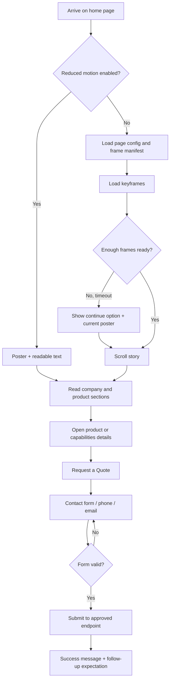

# 03 — Application Flow
**Project:** Modern Guideways corporate website  
**Version:** 1.0  
**Status:** Draft for owner review  
**Last updated:** 2026-11-04  
**Owner:** To be assigned  


## 1. Public navigation
```text
/ Home
  #hero-animation
  #about-preview
  #products
  #capabilities
  #gallery
  #vision-mission
  #contact-cta
/about/
/products/
/capabilities/
/gallery/
/contact/
/privacy/
/terms/
/admin/ (private, later release; no public navigation)
```

## 2. Visitor journey


## 3. Loading states
| State | Display | User action |
|---|---|---|
| `idle` | Poster and skeleton text | None |
| `loading-config` | Brand loader with progress label | Allow cancel/continue if delayed |
| `loading-keyframes` | Poster behind progress indicator | Continue after timeout |
| `ready` | Animation is scroll-controlled | Scroll normally |
| `partial` | Nearest loaded frame, clear loading notice | Continue scrolling |
| `static` | Poster + text story | Navigate normally |
| `error` | Poster + static text, no broken canvas | Retry or continue |

Never trap keyboard focus inside the loader. The page should remain understandable if JavaScript or Canvas fails.

## 4. Proposed scroll-storyboard map
The ranges below are placeholders for copy planning only. The actual video content and frame ranges must be confirmed by reviewing a contact sheet of the existing sequence.

| Progress | Story beat | Suggested overlay | Required visual confirmation |
|---|---|---|---|
| 0.00–0.12 | Brand / opening | Modern Guideways — Precision Protection for CNC, VMC & HMC Machines | Does the video establish the machine/brand? |
| 0.12–0.28 | Machine context | Protection components designed for machine movement | Confirm the moving machine view |
| 0.28–0.48 | Main product | Telescopic Covers | Confirm the cover is visible and identifiable |
| 0.48–0.65 | Product range | Roller Covers • Apron Covers • Bellows | Use only categories visually supported by approved stills |
| 0.65–0.82 | Precision / workshop | Guide Wipers • Enclosing Guards | Confirm workshop/product frame or replace with still gallery |
| 0.82–1.00 | Conversion | Discuss your machine-cover requirement | CTA remains readable over a stable end frame |

If the actual frames do not match a story beat, do not use misleading overlays. Keep the animation to an opening visual and explain the rest in normal page sections.

## 5. Section behavior
- Header: sticky or fixed only if it does not cover the Canvas or reduce usable viewport height.
- Hero: one pinned scene; scroll distance is configurable from the storyboard.
- About/product/capabilities: normal document flow, no scroll-jacking.
- Product cards: link to verified descriptions or enquiry anchors.
- Gallery: use real product/workshop photos with alt text.
- Contact: visible form and click-to-call/email choices.

## 6. Enquiry flow
Required fields: name, one reliable reply channel (email or phone), product interest and enquiry message. Company name, machine type, model and attachment can be optional after the owner approves what is needed. Consent text must explain the purpose of using the submitted details. On failure, preserve the user's entered values and provide a retry path.

## 7. Admin/editor journey (later release)
Invite-only sign-in → role check → edit draft copy/product descriptions → preview → publish → record audit event. Admin-only users may access enquiries. Public visitors never create accounts.

## 8. Edge states
- Empty or missing frame set: show poster and normal page content.
- Frame 404: log the missing index, draw nearest valid frame and continue.
- Slow network: progressive loading and continue option.
- Contact endpoint unavailable: preserve input and show phone/email alternatives.
- Form validation failure: announce the error beside the relevant field.
- No analytics consent: essential website functions remain available; optional analytics follow the approved consent policy.
