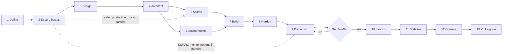
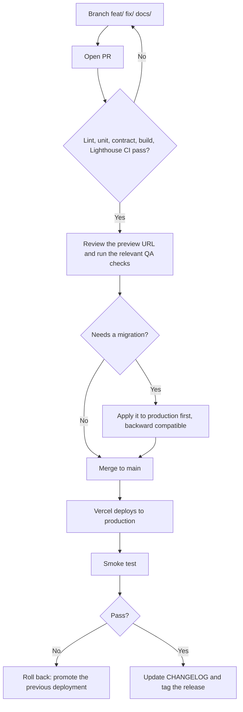
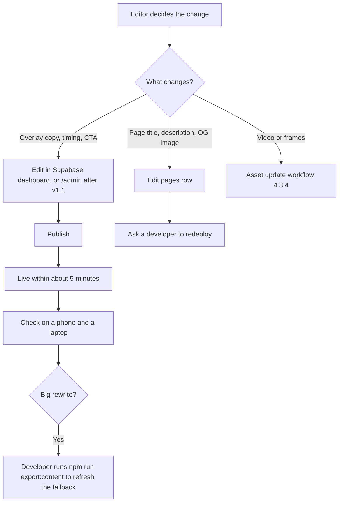
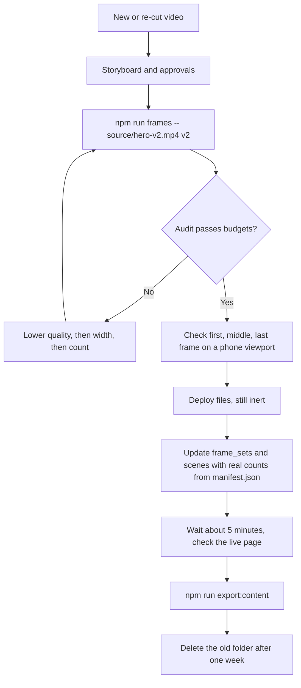
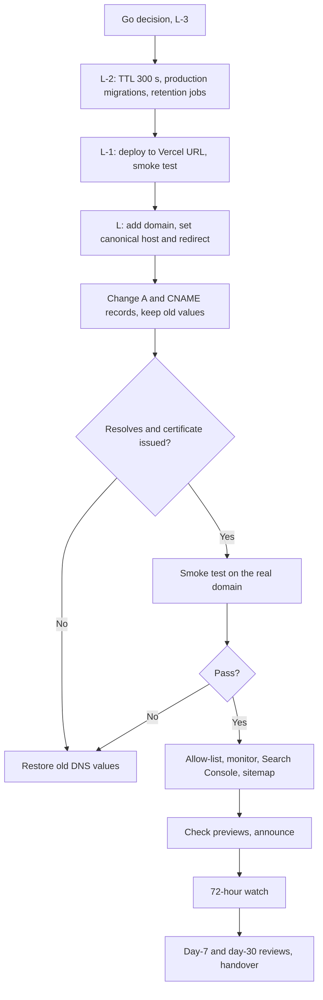
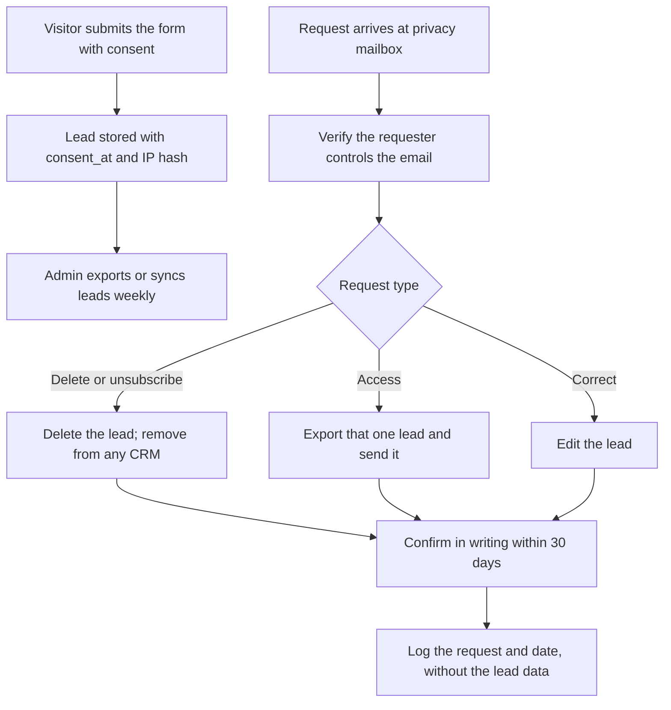
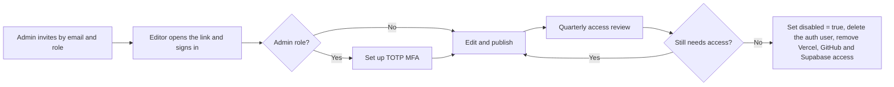
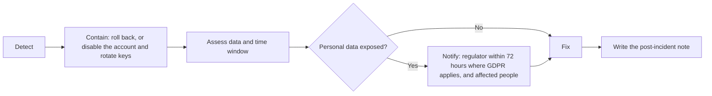

# 00 — README / MASTER BUILD GUIDE

# Scroll-Driven Video Website: Full Documentation Set

Seventeen documents for a `/docs` folder, plus `README.md` (the Build Guide) and `CHANGELOG.md` at the repo root. Together they cover the whole website life cycle: domain and accounts, design, video production, build, SEO, launch, and ongoing operation. The site is mostly static, so the backend stays small. It serves page content (scenes and text overlays) so it can be edited without a redeploy, saves CTA leads, records analytics events, and authenticates the editors and admins who manage content and leads.

```
scroll-video-site/
├── README.md                          Build Guide: setup, scripts, 13 stages, Phases 0-13
├── CHANGELOG.md                       Product releases + documentation revisions
├── index.html                         Public page (SEO_HEAD and NOSCRIPT_TEXT markers)
├── admin.html                         Admin entry (v1.1, noindex)
├── vite.config.js                     Two build entries + inject-content plugin
├── vercel.json                        Headers, rewrites, cleanUrls (docs/08)
├── package.json
├── .env.example                       Variables from docs/02-TRD section 9
├── .env.local                         Real values (never committed)
├── .gitignore                         Ignores .env*, source/, node_modules/, dist/
│
├── source/                            NOT committed: master video and licenses
│   ├── hero.mp4                       Generated master video goes here
│   ├── hero-v2.mp4                    Later re-cuts
│   └── licenses/                      Footage and rights documents (docs/07 section 10)
│
├── public/                            Served as-is
│   ├── frames/
│   │   ├── desktop/                   frame_0001.webp / .avif ... (150 frames, max 12 MB)
│   │   ├── mobile/                    frame_0001.webp / .avif ... (120 frames, max 5 MB)
│   │   ├── manifest.json              Real frame counts and sizes from the audit
│   │   └── v2/                        Next version (never overwrite live files)
│   │       ├── desktop/
│   │       ├── mobile/
│   │       └── manifest.json
│   ├── posters/
│   │   ├── hero.webp                  Reduced-motion and noscript poster
│   │   └── og.jpg                     1200x630 social preview
│   ├── content/
│   │   └── home.json                  Static fallback + metaDescription + ogImageUrl
│   ├── probe.avif                     1 px file to detect AVIF support
│   ├── robots.txt
│   ├── sitemap.xml
│   ├── favicon.ico
│   ├── icon.svg
│   ├── apple-touch-icon.png           180x180
│   ├── icon-192.png
│   ├── icon-512.png
│   ├── site.webmanifest
│   ├── privacy.html
│   ├── terms.html
│   └── 404.html
│
├── src/
│   ├── main.js                        Bootstraps modules
│   ├── contentLoader.js               GET /api/page/:slug, falls back to /content/home.json
│   ├── scrollCanvas.js                Preload, cover-fit draw, DPR cap 2
│   ├── overlays.js                    GSAP timeline from config
│   ├── smoothScroll.js                Lenis + ScrollTrigger
│   ├── leadForm.js                    Validate and POST /api/leads
│   ├── analytics.js                   track() + sendBeacon batches
│   ├── styles/                        Design tokens + CSS
│   └── admin/                         (v1.1, admin.html only)
│       ├── auth.js                    Sign-in, session, apiFetch
│       ├── guard.js                   /api/admin/me, role routing
│       └── mfa.js                     TOTP enroll and verify
│
├── api/                               Vercel serverless functions
│   ├── page/
│   │   └── [slug].js                  GET published PageConfig (cached 5 min)
│   ├── leads.js                       POST lead (honeypot, rate limit, consent)
│   ├── events.js                      POST analytics batch (204)
│   ├── _lib/
│   │   └── auth.js                    requireRole helper (v1.1)
│   └── admin/                         (v1.1, all role-checked)
│       ├── me.js
│       ├── pages/
│       │   ├── index.js               List pages
│       │   └── [id]/
│       │       ├── index.js           GET / PUT page
│       │       └── publish.js         POST publish
│       ├── leads/
│       │   ├── index.js               GET leads (admin + MFA)
│       │   └── [id].js                DELETE lead
│       ├── leads.csv.js               CSV export
│       ├── editors/
│       │   ├── index.js               GET / POST invite
│       │   └── [userId].js            PATCH role or disabled
│       └── audit.js                   GET audit log
│
├── supabase/
│   ├── migrations/
│   │   ├── 001_init.sql               pages, scenes, frame_sets, overlays, leads, analytics_events, RLS
│   │   └── 002_auth.sql               editors, audit_log (v1.1)
│   └── seed.sql                       Demo content (staging only)
│
├── scripts/
│   ├── export-frames.sh               ffmpeg > PNG > WebP + AVIF, poster, OG, probe
│   ├── audit-frames.mjs               Checks budgets, writes manifest.json
│   ├── export-content.mjs             DB > public/content/home.json
│   └── inject-content.mjs             Build-time title, description, OG, noscript text
│
├── tests/
│   ├── unit/                          Frame math, overlay timing, requireRole cases
│   ├── contract/                      Every /api/admin/* returns 401 without a token
│   └── e2e/                           Playwright: loader, scroll, lead; sign-in, edit, publish
│
├── .github/
│   └── workflows/
│       └── ci.yml                     lint, unit, build, Lighthouse CI
│
├── dist/                              Build output (generated, not committed)
│
└── docs/                              The 17 documents
    ├── 01-PRD.md                      What and why: goals, FRs, NFRs, scope, release criteria
    ├── 02-TRD.md                      Architecture, modules, PageConfig, budgets, API, security
    ├── 03-APP-FLOW.md                 Site map, visitor flow, loader states, editor/admin flows
    ├── 04-UI-UX-DESIGN-BRIEF.md       Tokens, grid, motion, components, screens, accessibility
    ├── 05-BACKEND-SCHEMA.md           ERD, SQL, RLS, page_config view, endpoints, retention
    ├── 06-AUTHENTICATION.md           Roles, admin API, requireRole, Supabase settings, tests
    ├── 07-ASSET-PIPELINE.md           Video to frames, scripts, budgets, versioning, production
    ├── 08-DEPLOYMENT-RUNBOOK.md       Environments, vercel.json, env vars, release, rollback
    ├── 09-QA-CHECKLIST.md             Test IDs F/L/N/P/A/S/D/E/X/U, sign-off block
    ├── 10-CONTENT-EDITOR-GUIDE.md     Editing rules, timing, dashboard and /admin steps
    ├── 11-PRIVACY-AND-LEGAL.md        Roles, data inventory, consent, deletion, policy outlines
    ├── 12-ANALYTICS-SPEC.md           Event catalog, delivery, funnel, SQL metrics
    ├── 13-DOMAIN-DNS-EMAIL.md         Domain, DNS records, Vercel, SPF/DKIM/DMARC, SMTP
    ├── 14-SEO-AND-DISCOVERABILITY.md  Injection, head tags, sitemap, icons, Search Console
    ├── 15-LAUNCH-AND-GO-LIVE.md       Roles, Go/No-Go, DNS cutover, 72-hour watch, handover
    ├── 16-MAINTENANCE-AND-OPERATIONS.md  Access, costs, routines, patching, restore test
    └── 17-IMPLEMENTATION-PLAN.md      Gantt, phases, milestones, risks, coverage map
```

**How they fit together**
- **README (Build Guide):** setup, scripts, folder layout, the 13-stage end-to-end process and the phase-by-phase build.
- **PRD:** what to build and why.
- **TRD:** how it's built technically.
- **App Flow:** how users move through the site.
- **UI/UX Design Brief:** how it looks and moves.
- **Backend Schema:** where the data lives.
- **Authentication:** how editors and admins sign in and what they may do.
- **Asset Pipeline:** how the video is produced, then becomes frames, posters and budgets.
- **Deployment Runbook:** environments, headers, release, rollback, monitoring.
- **QA Checklist:** the test script and sign-off for a release.
- **Content Editor Guide:** how non-developers change copy.
- **Privacy & Legal:** consent, data inventory, retention, policy outlines.
- **Analytics Spec:** event catalog, delivery, metrics queries.
- **Domain, DNS & Email:** domain registration, DNS records, mailboxes, email authentication, sign-in email sender.
- **SEO & Discoverability:** head tags, sitemap, icons, 404, Search Console.
- **Launch & Go-Live:** roles, Go/No-Go, DNS cutover, 72-hour watch, reviews, handover.
- **Maintenance & Operations:** access, costs, routines, patching, change control.
- **Implementation Plan:** when it all gets built and by whom. It covers every file above and ends with a coverage map.
- **CHANGELOG:** product releases and documentation revisions.

**Notes**
- Milestone dates assume a start on Monday, Oct 19, 2026. Change them to match your actual kickoff.
- Launch day (M5, 2026-11-27) is a Friday, the day after US Thanksgiving. See Launch & Go-Live §2 before confirming it.
- Overlays come from the `/api/page/:slug` config instead of being written into `index.html`. The `data-start` / `data-end` values become the `start_progress` / `end_progress` columns in the `overlays` table.
- Authentication covers **editors and admins only**. Visitor accounts remain a non-goal.
- The Privacy & Legal file is a template. Have counsel review it before launch.
- Prices, plan limits and provider policies change. Check each provider's current terms (Vercel, Supabase, email and DNS providers) before relying on the notes in the Domain, Runbook and Maintenance files.

---

# Scroll-Driven Video Website

A marketing landing page where scrolling scrubs a product video frame by frame, with synced text overlays, a lead-capture CTA, and (from v1.1) an invite-only admin area for editors.

**Status:** v1 in development · **Docs:** [`/docs`](./docs) (17 documents, index in §4)

## 1. Quick Start

### Prerequisites
| Tool | Version | Used for |
|---|---|---|
| Node.js | 20+ | Build, tests, scripts |
| FFmpeg (with `ffprobe`) | 6+ | Frame extraction |
| libwebp (`cwebp`) | Any recent | WebP encoding |
| libavif (`avifenc`) | 0.11+ | AVIF encoding |
| Vercel CLI | Latest | Running `/api/*` locally |
| Supabase CLI | Latest | Applying migrations |

### Run locally
```bash
git clone <repo-url> scroll-video-site && cd scroll-video-site
npm install
cp .env.example .env.local              # fill in values, see docs/02-TRD.md §9
npm run frames -- source/hero.mp4       # export frames, see docs/07-ASSET-PIPELINE.md
npm run dev                             # static site on http://localhost:5173
```
`npm run dev` serves the front end only. Run `vercel dev` instead when you need `/api/*` locally.

## 2. Scripts
| Script | What it does |
|---|---|
| `npm run dev` | Vite dev server |
| `npm run build` | Production build (`dist/index.html` and, from v1.1, `dist/admin.html`) |
| `npm run preview` | Serve the production build locally |
| `npm run frames -- <video> [version]` | Runs `scripts/export-frames.sh`, then the audit |
| `npm run export:content` | Writes `public/content/home.json` (static fallback, plus `metaDescription` and `ogImageUrl` for the build) from the database |
| `npm run lint` | ESLint + Prettier check |
| `npm test` | Vitest unit and contract tests |
| `npm run test:e2e` | Playwright end-to-end tests |
| `npm run lhci` | Lighthouse CI against the budgets in the TRD |

## 3. Repository Layout
```
scroll-video-site/
├── index.html                  public page
├── admin.html                  admin entry (v1.1, noindex)
├── vite.config.js              two build entries
├── vercel.json                 headers, rewrites (docs/08)
├── .env.example
├── public/
│   ├── frames/{desktop,mobile}/   frame_0001.webp / .avif
│   ├── posters/                   hero.webp, og.jpg
│   ├── content/home.json          static fallback
│   ├── probe.avif                 1 px file used to detect AVIF support
│   ├── robots.txt  sitemap.xml  favicon.ico  icon.svg
│   └── privacy.html  terms.html  404.html
├── src/
│   ├── main.js
│   ├── contentLoader.js  scrollCanvas.js  overlays.js
│   ├── smoothScroll.js   leadForm.js      analytics.js
│   ├── styles/
│   └── admin/              auth.js  guard.js  mfa.js   (v1.1)
├── api/
│   ├── _lib/auth.js                                      (v1.1)
│   ├── page/[slug].js  leads.js  events.js
│   └── admin/                                            (v1.1)
├── supabase/
│   ├── migrations/001_init.sql  002_auth.sql
│   └── seed.sql
├── scripts/
│   ├── export-frames.sh  audit-frames.mjs  export-content.mjs  inject-content.mjs
├── tests/{unit,contract,e2e}/
└── docs/                       the 17 documents below
```

## 4. Document Index
| # | File | Read it when you need to… |
|---|---|---|
| 01 | [PRD](./docs/01-PRD.md) | Know what is being built and why |
| 02 | [TRD](./docs/02-TRD.md) | Understand architecture, modules, budgets |
| 03 | [App Flow](./docs/03-APP-FLOW.md) | See user, editor and admin journeys |
| 04 | [UI/UX Design Brief](./docs/04-UI-UX-DESIGN-BRIEF.md) | Design or implement visuals and motion |
| 05 | [Backend Schema](./docs/05-BACKEND-SCHEMA.md) | Work with tables, RLS, endpoints |
| 06 | [Authentication](./docs/06-AUTHENTICATION.md) | Work on sign-in, roles, admin APIs |
| 07 | [Asset Pipeline](./docs/07-ASSET-PIPELINE.md) | Export or update video frames |
| 08 | [Deployment Runbook](./docs/08-DEPLOYMENT-RUNBOOK.md) | Set up, release, roll back, monitor |
| 09 | [QA Checklist](./docs/09-QA-CHECKLIST.md) | Test and sign off a release |
| 10 | [Content Editor Guide](./docs/10-CONTENT-EDITOR-GUIDE.md) | Edit copy without a developer |
| 11 | [Privacy & Legal](./docs/11-PRIVACY-AND-LEGAL.md) | Handle consent, retention, policies |
| 12 | [Analytics Spec](./docs/12-ANALYTICS-SPEC.md) | Add or read analytics events |
| 13 | [Domain, DNS & Email](./docs/13-DOMAIN-DNS-EMAIL.md) | Register the domain, set DNS, mailboxes, sign-in email |
| 14 | [SEO & Discoverability](./docs/14-SEO-AND-DISCOVERABILITY.md) | Set head tags, sitemap, icons, Search Console |
| 15 | [Launch & Go-Live](./docs/15-LAUNCH-AND-GO-LIVE.md) | Run Go/No-Go, DNS cutover, the 72-hour watch |
| 16 | [Maintenance & Operations](./docs/16-MAINTENANCE-AND-OPERATIONS.md) | Keep it running: access, costs, routines, patches |
| 17 | [Implementation Plan](./docs/17-IMPLEMENTATION-PLAN.md) | See schedule, owners, coverage |

### 4.1 End-to-End Process
The numbers (01 to 17) are the filing order. The order for doing the work, from the domain name to year-two maintenance, is below, because some files are needed earlier than their number suggests. Dates and owners for each stage are in the [Implementation Plan](./docs/17-IMPLEMENTATION-PLAN.md).

| Stage | Do this | Files, in order | Done when |
|---|---|---|---|
| 1. Define | Agree scope, goals, budget and legal decisions | [01](./docs/01-PRD.md) → [11](./docs/11-PRIVACY-AND-LEGAL.md) (§1–3) → [17](./docs/17-IMPLEMENTATION-PLAN.md) (§1–2) → [16](./docs/16-MAINTENANCE-AND-OPERATIONS.md) (§2, cost register) | PRD signed off; budget and owners confirmed |
| 2. Secure the basics | Register the domain, create accounts with 2FA, get DNS access | [13](./docs/13-DOMAIN-DNS-EMAIL.md) §2–3 → [16](./docs/16-MAINTENANCE-AND-OPERATIONS.md) §1 | Domain in the company's name; access register started |
| 3. Design | Map journeys, then design screens | [03](./docs/03-APP-FLOW.md) → [04](./docs/04-UI-UX-DESIGN-BRIEF.md) | Figma approved (M1) |
| 4. Architect | Fix the technical shape and data | [02](./docs/02-TRD.md) → [05](./docs/05-BACKEND-SCHEMA.md) | Modules, API contract and schema agreed |
| 5. Produce assets | Make the video, then export frames | [07](./docs/07-ASSET-PIPELINE.md) §10 (production) → §2–8 | Master approved; audit passes both budgets |
| 6. Set up | Create the repo and environments | Build Guide Phases 0–1 (§5) → [08](./docs/08-DEPLOYMENT-RUNBOOK.md) §2–3 → [13](./docs/13-DOMAIN-DNS-EMAIL.md) §4 | `npm run dev` works; Supabase, Vercel and a staging URL exist |
| 7. Build | Implement the site | Build Guide Phases 3–11, with [04](./docs/04-UI-UX-DESIGN-BRIEF.md) (visuals), [05](./docs/05-BACKEND-SCHEMA.md) (API) and [12](./docs/12-ANALYTICS-SPEC.md) (analytics) | Feature complete (M3) |
| 8. Harden | Optimize, add SEO assets, test | Build Guide Phase 12 → [14](./docs/14-SEO-AND-DISCOVERABILITY.md) → [08](./docs/08-DEPLOYMENT-RUNBOOK.md) §4 → [09](./docs/09-QA-CHECKLIST.md) | Budgets pass; SEO and domain checks pass; no open P0 or P1 |
| 9. Pre-launch | Legal pages, email authentication, editor training, Go/No-Go | [11](./docs/11-PRIVACY-AND-LEGAL.md) §9 → [13](./docs/13-DOMAIN-DNS-EMAIL.md) §5 → [10](./docs/10-CONTENT-EDITOR-GUIDE.md) → [15](./docs/15-LAUNCH-AND-GO-LIVE.md) §2–3 | Legal checklist done; editors trained; Go/No-Go passes (M4) |
| 10. Launch | DNS cutover, smoke test, announce | [15](./docs/15-LAUNCH-AND-GO-LIVE.md) §4–7 → [08](./docs/08-DEPLOYMENT-RUNBOOK.md) §5–7 → `CHANGELOG.md` | Site live on the domain; smoke test passes (M5) |
| 11. Stabilize | Watch, review, hand over | [15](./docs/15-LAUNCH-AND-GO-LIVE.md) §6, §8, §9 | 72-hour watch done; day-7 review done; owners named |
| 12. Operate | Keep it healthy, current and paid for | [16](./docs/16-MAINTENANCE-AND-OPERATIONS.md) → [08](./docs/08-DEPLOYMENT-RUNBOOK.md) §8–12 | Routines running; renewals and costs tracked |
| 13. v1.1 Sign-in | Add editor and admin sign-in | [06](./docs/06-AUTHENTICATION.md) → [13](./docs/13-DOMAIN-DNS-EMAIL.md) §5.3 → [05](./docs/05-BACKEND-SCHEMA.md) (`002_auth.sql`) → [09](./docs/09-QA-CHECKLIST.md) §11 → [10](./docs/10-CONTENT-EDITOR-GUIDE.md) | M6 reached |

Rules that keep the set consistent:
1. **Decide first, then write down.** Resolve open choices before building (the FR-9 scope mismatch, the launch day, company details, the Supabase backup plan), then update the PRD so later documents don't contradict it.
2. **Start the domain and email early.** Registrar and DNS changes can take days, and DMARC needs a few weeks of monitoring before it can be tightened.
3. **Keep the Implementation Plan open throughout.** It is last in the numbering but holds the schedule, owners and coverage map for every stage.
4. **Change documents in this order:** PRD → TRD and Backend Schema → Implementation Plan → CHANGELOG.

### 4.2 Master Checklist (correct order, domain to year-two maintenance)
Do the steps in this order. Each stage has a gate: do not start the next stage until the gate is met. The file in brackets holds the detail. Weeks assume a Monday, Oct 19, 2026 start.

**What changed from the first draft of this list:** email authentication moved to Week 1 (DMARC needs weeks of monitoring); the TRD and Backend Schema step was added; environment setup (staging, Supabase, Vercel) got its own stage; video production starts in Week 1 because it is the longest wait; legal *decisions* come first and legal *pages* come later; Search Console moved after the DNS cutover.

#### Stage 1: Define (Week 1)
- [ ] 1. Agree scope, goals and budget; sign off the PRD ([01](./docs/01-PRD.md))
- [ ] 2. Make the legal decisions: who is the controller, where data is hosted, what is collected ([11](./docs/11-PRIVACY-AND-LEGAL.md) §1–3)
- [ ] 3. Resolve the open items (table at the end of §4.2), then update the PRD
- [ ] 4. Confirm the schedule, owners and milestones ([17](./docs/17-IMPLEMENTATION-PLAN.md) §1–4) and start the cost register ([16](./docs/16-MAINTENANCE-AND-OPERATIONS.md) §2)
- **Gate:** PRD signed off; budget and owners confirmed

#### Stage 2: Secure the basics (Week 1)
- [ ] 5. Register the domain under the company name with a role mailbox as contact; 2FA, registrar lock, auto-renew, at least 2 years ([13](./docs/13-DOMAIN-DNS-EMAIL.md) §2)
- [ ] 6. Create accounts, each with 2FA: Vercel, Supabase (staging and production), GitHub, mailbox provider, SMTP provider; start the access register ([16](./docs/16-MAINTENANCE-AND-OPERATIONS.md) §1)
- [ ] 7. Choose one DNS provider; create mailboxes; add SPF and DKIM; add DMARC with `p=none` and reports to `dmarc@` ([13](./docs/13-DOMAIN-DNS-EMAIL.md) §3, §5.1–5.2)
- [ ] 8. Order the video: send the brief, agree 2 review rounds and the rights terms ([07](./docs/07-ASSET-PIPELINE.md) §10)
- **Gate:** domain in the company's name; access register started; DMARC monitoring running; video ordered

#### Stage 3: Design (Weeks 1–2)
- [ ] 9. Map the visitor, editor and admin journeys and write the scroll storyboard ([03](./docs/03-APP-FLOW.md))
- [ ] 10. Design tokens, components, desktop and mobile screens, and admin screens ([04](./docs/04-UI-UX-DESIGN-BRIEF.md))
- **Gate:** Figma approved by the stakeholder (M1, 2026-10-30)

#### Stage 4: Architect (Week 2)
- [ ] 11. Confirm modules, performance budgets and the API contract ([02](./docs/02-TRD.md))
- [ ] 12. Confirm tables, RLS and endpoints ([05](./docs/05-BACKEND-SCHEMA.md))
- **Gate:** modules, API contract and schema agreed

#### Stage 5: Produce assets (Weeks 2–3)
- [ ] 13. Video: shoot or render, edit, export the master, collect the rights documents ([07](./docs/07-ASSET-PIPELINE.md) §10)
- [ ] 14. Export desktop and mobile frames, run the audit, create the poster, OG image and AVIF probe ([07](./docs/07-ASSET-PIPELINE.md) §2–8)
- **Gate:** master approved; audit passes both budgets (12 MB desktop, 5 MB mobile). Use placeholder footage to keep building if the video is late, and replace it before launch.

#### Stage 6: Set up environments (Weeks 2–3)
- [ ] 15. Scaffold the repo and the two Vite entries; create `.env.example` (Build Guide Phases 0–1)
- [ ] 16. Create the staging and production Supabase projects; apply `001_init.sql`; seed staging only; create the `posters` bucket ([08](./docs/08-DEPLOYMENT-RUNBOOK.md) §2.1)
- [ ] 17. Create the Vercel project; set environment variables; get a staging URL ([08](./docs/08-DEPLOYMENT-RUNBOOK.md) §2.2)
- **Gate:** `npm run dev` works; staging URL exists

#### Stage 7: Build (Weeks 3–5)
- [ ] 18. Sticky layout, tokens, canvas renderer, loader, ScrollTrigger, overlays, Lenis (Build Guide Phases 3–9)
- [ ] 19. Responsive layout and reduced-motion mode (Build Guide Phase 10)
- [ ] 20. API endpoints, content loader with fallback, lead form, analytics client (Build Guide Phase 11; [05](./docs/05-BACKEND-SCHEMA.md); [12](./docs/12-ANALYTICS-SPEC.md))
- **Gate:** feature complete (M3, 2026-11-13); events appear in `analytics_events`; a lead submits end to end

#### Stage 8: Harden (Week 5)
- [ ] 21. AVIF with WebP fallback, `ImageBitmap` decoding, cache headers, CSP, Lighthouse CI (Build Guide Phase 12; [08](./docs/08-DEPLOYMENT-RUNBOOK.md) §4)
- [ ] 22. SEO: build-time injection, head tags, sitemap, robots.txt, favicons, 404 page ([14](./docs/14-SEO-AND-DISCOVERABILITY.md))
- **Gate:** all budgets pass in CI; SEO checks S-01 to S-09 pass

#### Stage 9: Pre-launch (Weeks 5–6)
- [ ] 23. Write `/privacy` and `/terms`; counsel reviews them; sign processor agreements ([11](./docs/11-PRIVACY-AND-LEGAL.md) §6–9)
- [ ] 24. Check DMARC reports; confirm SPF, DKIM and DMARC pass on test emails ([13](./docs/13-DOMAIN-DNS-EMAIL.md) §5)
- [ ] 25. Freeze content; train the editors ([10](./docs/10-CONTENT-EDITOR-GUIDE.md))
- [ ] 26. Build the release candidate; run the full QA checklist; fix all P0 and P1; complete the sign-off block ([09](./docs/09-QA-CHECKLIST.md))
- [ ] 27. Name the on-call person; set monitoring and alerts; test rollback on staging ([08](./docs/08-DEPLOYMENT-RUNBOOK.md) §7, §9)
- [ ] 28. Hold the Go/No-Go meeting; every line must be Yes ([15](./docs/15-LAUNCH-AND-GO-LIVE.md) §3)
- **Gate:** Go decision recorded (M4)

#### Stage 10: Launch (L − 2 to L)
- [ ] 29. L − 2: lower the DNS TTL to 300 s; apply production migrations; create the retention jobs ([13](./docs/13-DOMAIN-DNS-EMAIL.md) §7; [08](./docs/08-DEPLOYMENT-RUNBOOK.md) §3, §8)
- [ ] 30. L − 1: deploy to production on the Vercel URL; run the smoke test ([08](./docs/08-DEPLOYMENT-RUNBOOK.md) §7)
- [ ] 31. L: add the domain in Vercel, set the canonical host and redirect, change the A and CNAME records, check the certificate, smoke test again ([15](./docs/15-LAUNCH-AND-GO-LIVE.md) §4; [13](./docs/13-DOMAIN-DNS-EMAIL.md) §4)
- [ ] 32. L: update the Supabase redirect allow-list; point the uptime monitor at the real domain
- [ ] 33. L: verify Search Console and Bing; submit the sitemap ([14](./docs/14-SEO-AND-DISCOVERABILITY.md) §10)
- [ ] 34. L: check link previews, then announce with UTM links; tag the release and update the CHANGELOG ([15](./docs/15-LAUNCH-AND-GO-LIVE.md) §7)
- **Gate:** site live on the domain; smoke test passes (M5)

#### Stage 11: Stabilize (L + 1 to L + 30)
- [ ] 35. 72-hour watch ([15](./docs/15-LAUNCH-AND-GO-LIVE.md) §6)
- [ ] 36. Day-7 review; raise the DNS TTL; day-30 review and retro ([15](./docs/15-LAUNCH-AND-GO-LIVE.md) §8)
- [ ] 37. Handover: access register, cost register, routines, support contacts ([15](./docs/15-LAUNCH-AND-GO-LIVE.md) §9)
- **Gate:** watch done; reviews done; owners named

#### Stage 12: Operate (ongoing)
- [ ] 38. Weekly: lead exports and privacy requests, analytics review
- [ ] 39. Monthly: `npm audit`, usage and cost check, confirm retention jobs ran
- [ ] 40. Quarterly: key rotation, access review, restore test, device re-test, DMARC tightening
- [ ] 41. Yearly: domain and plan renewals, privacy policy and processor review ([16](./docs/16-MAINTENANCE-AND-OPERATIONS.md) §3, §7)

#### Stage 13: v1.1 sign-in (Weeks 7–8, after launch)
- [ ] 42. Configure custom SMTP, then Supabase Auth settings; apply `002_auth.sql`; seed the first admin ([06](./docs/06-AUTHENTICATION.md); [13](./docs/13-DOMAIN-DNS-EMAIL.md) §5.3)
- [ ] 43. `requireRole`, admin routes, audit log, admin headers
- [ ] 44. Admin pages (`admin.html`): sign-in, MFA, leads, audit log
- [ ] 45. Pass QA checks U-01 to U-09 and the security checks in Authentication §7; update the Editor Guide (M6, [09](./docs/09-QA-CHECKLIST.md) §11)
- **Gate:** FR-12 to FR-16 pass E2E

#### Open items to resolve in Stage 1
- [ ] Launch day: 2026-11-27 is the Friday after US Thanksgiving. Prefer a Tuesday or Wednesday and move M4 and M5 together ([15](./docs/15-LAUNCH-AND-GO-LIVE.md) §2)
- [ ] FR-9: PRD says v1.1, plan builds it in v1. Pick one and update the PRD ([17](./docs/17-IMPLEMENTATION-PLAN.md) §9.2)
- [ ] Supabase backups: fill in the plan and retention ([08](./docs/08-DEPLOYMENT-RUNBOOK.md) §10)
- [ ] Replace the `[Company]` and `[privacy@company.com]` placeholders in 11, 13 and 14
- [ ] Check current Vercel and Supabase plan limits and pricing, including commercial-use terms and database pausing ([16](./docs/16-MAINTENANCE-AND-OPERATIONS.md) §2)

### 4.3 Workflows
The recurring processes, each as a diagram. They summarize the detail in the files named in each heading.

#### 4.3.1 Project workflow (gates between stages)

Stages 5 and 6 run in parallel. Stage 7 starts when both are done, or earlier with placeholder footage.

#### 4.3.2 Release workflow (every change, [08](./docs/08-DEPLOYMENT-RUNBOOK.md) §6–7)


#### 4.3.3 Content change workflow ([10](./docs/10-CONTENT-EDITOR-GUIDE.md))


#### 4.3.4 Asset (frames) update workflow ([07](./docs/07-ASSET-PIPELINE.md) §8)

Never overwrite files that are live. Frames are cached as immutable.

#### 4.3.5 Launch-day workflow ([15](./docs/15-LAUNCH-AND-GO-LIVE.md))


#### 4.3.6 Lead and privacy-request workflow ([11](./docs/11-PRIVACY-AND-LEGAL.md) §4)


#### 4.3.7 Editor onboarding and offboarding workflow ([06](./docs/06-AUTHENTICATION.md), [08](./docs/08-DEPLOYMENT-RUNBOOK.md) §11)


#### 4.3.8 Incident workflow ([08](./docs/08-DEPLOYMENT-RUNBOOK.md) §12)


## 5. Build Guide
Phases 0 to 13. The [Implementation Plan](./docs/17-IMPLEMENTATION-PLAN.md) maps these to team phases: Build Guide 3–9 = Plan Phase 3, 10–11 = Plan Phase 5, 12 = Plan Phase 6, 13 = Plan Phase 7.

### Phase 0: Prerequisites
- Install the tools in §1. Create the Vercel and Supabase projects. Register or confirm the domain in the company's name ([13](./docs/13-DOMAIN-DNS-EMAIL.md) §2) and secure DNS access.
- **Done when:** `node -v`, `ffmpeg -version`, `cwebp -version`, `avifenc --version` all work.

### Phase 1: Scaffolding
- `npm create vite@latest` (vanilla), then `npm i gsap lenis @supabase/supabase-js` and dev dependencies (`vitest`, `playwright`, `supertest`, `eslint`, `prettier`, `@lhci/cli`).
- Configure the two build entries so the admin code never reaches the public bundle:
```js
// vite.config.js
import { defineConfig } from 'vite';
import { fileURLToPath } from 'node:url';

const entry = (f) => fileURLToPath(new URL(f, import.meta.url));

export default defineConfig({
  build: { rollupOptions: { input: { main: entry('./index.html'), admin: entry('./admin.html') } } },
});
```
- Create `.env.example` from [TRD §9](./docs/02-TRD.md).
- **Done when:** `npm run dev` and `npm run build` succeed.

### Phase 2: Asset pipeline
- Follow [07-ASSET-PIPELINE](./docs/07-ASSET-PIPELINE.md): export frames, run the audit, create posters.
- **Done when:** the audit passes both budgets (12 MB desktop, 5 MB mobile).

### Phase 3: HTML structure and sticky layout
- One tall section holds one sticky viewport. Its height comes from `scrollLengthVh`.
```html
<section id="scroll-section">           <!-- height set from scrollLengthVh, e.g. 400vh -->
  <div class="stage">
    <canvas id="scroll-canvas"></canvas>
    <div id="overlays"></div>
  </div>
</section>
```
```css
.stage { position: sticky; top: 0; height: 100vh; height: 100svh; overflow: hidden; }
#scroll-canvas { width: 100%; height: 100%; display: block; }
```
- **Done when:** the stage stays pinned for the whole section and scrolls away at the end.

### Phase 4: CSS and design tokens
- Implement the tokens from [04-UI-UX](./docs/04-UI-UX-DESIGN-BRIEF.md) §6 as CSS variables on `:root`.
- **Done when:** type scale, colors and the focus ring match the Figma file.

### Phase 5: Canvas renderer (`scrollCanvas.js`)
- Cover-fit drawing and a DPR cap of 2:
```js
function drawCover(ctx, img, cw, ch) {
  const s = Math.max(cw / img.width, ch / img.height);
  const w = img.width * s, h = img.height * s;
  ctx.drawImage(img, (cw - w) / 2, (ch - h) / 2, w, h);
}
```
- Progressive load order (every 4th frame, then every 2nd, then the rest):
```js
export function loadOrder(count) {
  const seen = new Set(), order = [];
  for (const step of [4, 2, 1])
    for (let i = 0; i < count; i += step) if (!seen.has(i)) { seen.add(i); order.push(i); }
  return order;
}
```
- Keyframes are every 4th index plus the last frame. `render()` draws the nearest loaded frame.
- **Done when:** frames draw correctly at any window size and after resize.

### Phase 6: Preloader and loader state machine
- Implement the state machine from [03-APP-FLOW](./docs/03-APP-FLOW.md) §3. Lock scroll until keyframes load; show "Continue anyway" after 10 s.
- **Done when:** throttled-network and 404-frame tests behave as in [09-QA](./docs/09-QA-CHECKLIST.md).

### Phase 7: ScrollTrigger mapping
```js
ScrollTrigger.create({
  trigger: '#scroll-section', start: 'top top', end: 'bottom bottom', scrub: 0.5,
  onUpdate: (self) => render(Math.round(self.progress * (count - 1))),
});
```
- Add the end-of-section canvas scale (1 → 0.85 between 85% and 100%).
- **Done when:** scrubbing is 1:1 in both directions.

### Phase 8: Overlays from config
- Build overlay DOM and a GSAP timeline from `PageConfig.scenes[].overlays` ([TRD §3.1](./docs/02-TRD.md)).
- **Done when:** timings match the storyboard.

### Phase 9: Smooth scrolling
```js
lenis.on('scroll', ScrollTrigger.update);
gsap.ticker.add((t) => lenis.raf(t * 1000));
gsap.ticker.lagSmoothing(0);
```
- **Done when:** no jitter, and in-page anchors scroll smoothly.

### Phase 10: Responsive and reduced motion
- Choose the frame set once with `matchMedia('(max-width: 768px)')`. Do not switch mid-session.
- If `prefers-reduced-motion: reduce`: skip frame loading, show the poster and stacked text, and fire `reduced_motion`.
- **Done when:** iOS Safari and Android Chrome pass the QA checklist; reduced-motion layout is verified.

### Phase 11: Lead form, content loader, analytics
- `contentLoader.js` ([TRD §3.2](./docs/02-TRD.md)), `leadForm.js` ([05 §5](./docs/05-BACKEND-SCHEMA.md), consent text from [11](./docs/11-PRIVACY-AND-LEGAL.md)), `analytics.js` ([12](./docs/12-ANALYTICS-SPEC.md)).
- **Done when:** editing copy in the database changes the site; a lead submits end to end; events appear in `analytics_events`.

### Phase 12: Optimization
- AVIF with WebP fallback, `createImageBitmap` decoding, cache headers and CSP ([08](./docs/08-DEPLOYMENT-RUNBOOK.md) §4), SEO assets and the build-time content injection ([14](./docs/14-SEO-AND-DISCOVERABILITY.md)), Lighthouse CI.
- **Done when:** all budgets in [TRD §5](./docs/02-TRD.md) pass in CI.

### Phase 13: QA and launch
- Run [09-QA-CHECKLIST](./docs/09-QA-CHECKLIST.md), publish the legal pages ([11](./docs/11-PRIVACY-AND-LEGAL.md)), train editors ([10](./docs/10-CONTENT-EDITOR-GUIDE.md)), set up email authentication ([13](./docs/13-DOMAIN-DNS-EMAIL.md) §5), then follow the go-live plan ([15](./docs/15-LAUNCH-AND-GO-LIVE.md)) to deploy ([08](./docs/08-DEPLOYMENT-RUNBOOK.md)) and cut over DNS. Hand over with [16](./docs/16-MAINTENANCE-AND-OPERATIONS.md) §1–3.
- **Done when:** the release criteria in [PRD §12](./docs/01-PRD.md) are met, the sign-off block in the QA checklist is complete and the Go/No-Go in [15 §3](./docs/15-LAUNCH-AND-GO-LIVE.md) passes.

## 6. Conventions
- Branches: `feat/…`, `fix/…`, `docs/…`. Commits follow Conventional Commits.
- Every PR must satisfy the Definition of Done in [Plan §5](./docs/17-IMPLEMENTATION-PLAN.md).
- Never commit `.env*` files, source video, or the service-role key.

## 7. Troubleshooting
| Symptom | Likely cause | Fix |
|---|---|---|
| Frames look stretched | Canvas drawn without cover-fit | Use `drawCover` with the canvas size in device pixels |
| Scroll jumps on iOS address-bar collapse | `100vh` used for the stage | Use `100svh` with a `100vh` fallback |
| `/api/*` returns 404 locally | Running `npm run dev` | Use `vercel dev` |
| Scrub stutters | Frames decoded on the main thread | `createImageBitmap` (Build Guide Phase 12) |
| Changes to frames don't show | Immutable caching | Re-export to a new version folder ([07 §8](./docs/07-ASSET-PIPELINE.md)) |

---
