# Scroll-Driven Video Website — Complete Documentation Master File

**Documentation set:** 35 numbered documents + `README.md` + `CHANGELOG.md`  
**Project stack in the supplied source documents:** Vite, Vanilla JavaScript, GSAP/ScrollTrigger, Lenis, Canvas 2D, Vercel, Supabase  
**Purpose:** One consolidated Markdown reference containing the original project documents and the expanded formats for documents 18–35.

> **Source integrity:** Documents `README.md` and `01`–`17`, plus `CHANGELOG.md`, are included from the uploaded project files without rewriting their technical decisions. Documents `18`–`35` are expanded templates tailored to this project. Where a value or decision is not specified in the original project, it is marked as a decision to be completed rather than invented.

## Master index

| No. | File | Document |
|---:|---|---|
| 00 | `README.md` | Master Build Guide |
| 01 | `01-PRD.md` | Product Requirements Document |
| 02 | `02-TRD.md` | Technical Requirements Document |
| 03 | `03-APP-FLOW.md` | Application Flow |
| 04 | `04-UI-UX-DESIGN-BRIEF.md` | UI/UX Design Brief |
| 05 | `05-BACKEND-SCHEMA.md` | Backend Schema |
| 06 | `06-AUTHENTICATION.md` | Authentication |
| 07 | `07-ASSET-PIPELINE.md` | Asset Pipeline |
| 08 | `08-DEPLOYMENT-RUNBOOK.md` | Deployment Runbook |
| 09 | `09-QA-CHECKLIST.md` | QA Checklist |
| 10 | `10-CONTENT-EDITOR-GUIDE.md` | Content Editor Guide |
| 11 | `11-PRIVACY-AND-LEGAL.md` | Privacy & Legal |
| 12 | `12-ANALYTICS-SPEC.md` | Analytics Specification |
| 13 | `13-DOMAIN-DNS-EMAIL.md` | Domain, DNS & Email |
| 14 | `14-SEO-AND-DISCOVERABILITY.md` | SEO & Discoverability |
| 15 | `15-LAUNCH-AND-GO-LIVE.md` | Launch & Go-Live |
| 16 | `16-MAINTENANCE-AND-OPERATIONS.md` | Maintenance & Operations |
| 17 | `18-FRONTEND-ARCHITECTURE.md` | Frontend Architecture |
| 18 | `19-BACKEND-ARCHITECTURE.md` | Backend Architecture |
| 19 | `20-COMPONENT-LIBRARY-DESIGN-SYSTEM.md` | Component Library & Design System |
| 20 | `21-STATE-MANAGEMENT.md` | State Management |
| 21 | `22-API-DOCUMENTATION.md` | Api Documentation |
| 22 | `23-INTEGRATION-DOCUMENTATION.md` | Integration Documentation |
| 23 | `24-FILE-MEDIA-MANAGEMENT.md` | File & Media Management |
| 24 | `25-PAYMENT-SUBSCRIPTION-DOCUMENTATION.md` | Payment & Subscription Documentation |
| 25 | `26-ACCESSIBILITY-STANDARD.md` | Accessibility Standard |
| 26 | `27-PERFORMANCE-ENGINEERING.md` | Performance Engineering |
| 27 | `28-DISASTER-RECOVERY-BACKUP-PLAN.md` | Disaster Recovery & Backup Plan |
| 28 | `29-LOGGING-MONITORING-OBSERVABILITY.md` | Logging, Monitoring & Observability |
| 29 | `30-GIT-VERSION-CONTROL-WORKFLOW.md` | Git & Version Control Workflow |
| 30 | `31-ENVIRONMENT-CONFIGURATION.md` | Environment Configuration |
| 31 | `32-USER-ROLE-PERMISSION-MANAGEMENT.md` | User, Role & Permission Management |
| 32 | `33-BROWSER-DEVICE-COMPATIBILITY.md` | Browser & Device Compatibility |
| 33 | `34-DATA-MIGRATION-PLAN.md` | Data Migration Plan |
| 34 | `35-USER-GUIDE-FAQ-TROUBLESHOOTING.md` | User Guide, Faq & Troubleshooting |
| 35 | `17-IMPLEMENTATION-PLAN.md` | Implementation Plan |
| — | `CHANGELOG.md` | Product releases and documentation revisions |

## How to use this master file

> **Reading order:** The master index uses serial numbers 01–35 in reading order. The Implementation Plan is serial number 35 and appears last; its original filename `17-IMPLEMENTATION-PLAN.md` and internal links remain unchanged.

1. The original documents below are retained as supplied.
2. Documents 18–35 are ready-to-fill formats. Replace bracketed placeholders only after the responsible owner confirms the decision.
3. Keep the separate repository files in sync with this consolidated file if the project continues to use one file per document.
4. Do not implement optional future scope simply because a template exists. In particular, payments remain out of v1 scope unless the PRD is formally changed.

---

# Part A — Original project documentation


---

# 00 — README / MASTER BUILD GUIDE

# Scroll-Driven Video Website: Full Documentation Set

Seventeen documents for a `/docs` folder, plus `README.md` (the Build Guide) and `CHANGELOG.md` at the repo root. Together they cover the whole website life cycle: domain and accounts, design, video production, build, SEO, launch, and ongoing operation. The site is mostly static, so the backend stays small. It serves page content (scenes and text overlays) so it can be edited without a redeploy, saves CTA leads, records analytics events, and authenticates the editors and admins who manage content and leads.

```
scroll-video-site/
├── README.md                          Build Guide: setup, scripts, 13 stages, Phases 0-13
├── CHANGELOG.md                       Product releases + documentation revisions
├── index.html                         Public page (SEO_HEAD and NOSCRIPT_TEXT markers)
├── admin.html                         Admin entry (v1.1, noindex)
├── vite.config.js                     Two build entries + inject-content plugin
├── vercel.json                        Headers, rewrites, cleanUrls (docs/08)
├── package.json
├── .env.example                       Variables from docs/02-TRD section 9
├── .env.local                         Real values (never committed)
├── .gitignore                         Ignores .env*, source/, node_modules/, dist/
│
├── source/                            NOT committed: master video and licenses
│   ├── hero.mp4                       Generated master video goes here
│   ├── hero-v2.mp4                    Later re-cuts
│   └── licenses/                      Footage and rights documents (docs/07 section 10)
│
├── public/                            Served as-is
│   ├── frames/
│   │   ├── desktop/                   frame_0001.webp / .avif ... (150 frames, max 12 MB)
│   │   ├── mobile/                    frame_0001.webp / .avif ... (120 frames, max 5 MB)
│   │   ├── manifest.json              Real frame counts and sizes from the audit
│   │   └── v2/                        Next version (never overwrite live files)
│   │       ├── desktop/
│   │       ├── mobile/
│   │       └── manifest.json
│   ├── posters/
│   │   ├── hero.webp                  Reduced-motion and noscript poster
│   │   └── og.jpg                     1200x630 social preview
│   ├── content/
│   │   └── home.json                  Static fallback + metaDescription + ogImageUrl
│   ├── probe.avif                     1 px file to detect AVIF support
│   ├── robots.txt
│   ├── sitemap.xml
│   ├── favicon.ico
│   ├── icon.svg
│   ├── apple-touch-icon.png           180x180
│   ├── icon-192.png
│   ├── icon-512.png
│   ├── site.webmanifest
│   ├── privacy.html
│   ├── terms.html
│   └── 404.html
│
├── src/
│   ├── main.js                        Bootstraps modules
│   ├── contentLoader.js               GET /api/page/:slug, falls back to /content/home.json
│   ├── scrollCanvas.js                Preload, cover-fit draw, DPR cap 2
│   ├── overlays.js                    GSAP timeline from config
│   ├── smoothScroll.js                Lenis + ScrollTrigger
│   ├── leadForm.js                    Validate and POST /api/leads
│   ├── analytics.js                   track() + sendBeacon batches
│   ├── styles/                        Design tokens + CSS
│   └── admin/                         (v1.1, admin.html only)
│       ├── auth.js                    Sign-in, session, apiFetch
│       ├── guard.js                   /api/admin/me, role routing
│       └── mfa.js                     TOTP enroll and verify
│
├── api/                               Vercel serverless functions
│   ├── page/
│   │   └── [slug].js                  GET published PageConfig (cached 5 min)
│   ├── leads.js                       POST lead (honeypot, rate limit, consent)
│   ├── events.js                      POST analytics batch (204)
│   ├── _lib/
│   │   └── auth.js                    requireRole helper (v1.1)
│   └── admin/                         (v1.1, all role-checked)
│       ├── me.js
│       ├── pages/
│       │   ├── index.js               List pages
│       │   └── [id]/
│       │       ├── index.js           GET / PUT page
│       │       └── publish.js         POST publish
│       ├── leads/
│       │   ├── index.js               GET leads (admin + MFA)
│       │   └── [id].js                DELETE lead
│       ├── leads.csv.js               CSV export
│       ├── editors/
│       │   ├── index.js               GET / POST invite
│       │   └── [userId].js            PATCH role or disabled
│       └── audit.js                   GET audit log
│
├── supabase/
│   ├── migrations/
│   │   ├── 001_init.sql               pages, scenes, frame_sets, overlays, leads, analytics_events, RLS
│   │   └── 002_auth.sql               editors, audit_log (v1.1)
│   └── seed.sql                       Demo content (staging only)
│
├── scripts/
│   ├── export-frames.sh               ffmpeg > PNG > WebP + AVIF, poster, OG, probe
│   ├── audit-frames.mjs               Checks budgets, writes manifest.json
│   ├── export-content.mjs             DB > public/content/home.json
│   └── inject-content.mjs             Build-time title, description, OG, noscript text
│
├── tests/
│   ├── unit/                          Frame math, overlay timing, requireRole cases
│   ├── contract/                      Every /api/admin/* returns 401 without a token
│   └── e2e/                           Playwright: loader, scroll, lead; sign-in, edit, publish
│
├── .github/
│   └── workflows/
│       └── ci.yml                     lint, unit, build, Lighthouse CI
│
├── dist/                              Build output (generated, not committed)
│
└── docs/                              The 17 documents
    ├── 01-PRD.md                      What and why: goals, FRs, NFRs, scope, release criteria
    ├── 02-TRD.md                      Architecture, modules, PageConfig, budgets, API, security
    ├── 03-APP-FLOW.md                 Site map, visitor flow, loader states, editor/admin flows
    ├── 04-UI-UX-DESIGN-BRIEF.md       Tokens, grid, motion, components, screens, accessibility
    ├── 05-BACKEND-SCHEMA.md           ERD, SQL, RLS, page_config view, endpoints, retention
    ├── 06-AUTHENTICATION.md           Roles, admin API, requireRole, Supabase settings, tests
    ├── 07-ASSET-PIPELINE.md           Video to frames, scripts, budgets, versioning, production
    ├── 08-DEPLOYMENT-RUNBOOK.md       Environments, vercel.json, env vars, release, rollback
    ├── 09-QA-CHECKLIST.md             Test IDs F/L/N/P/A/S/D/E/X/U, sign-off block
    ├── 10-CONTENT-EDITOR-GUIDE.md     Editing rules, timing, dashboard and /admin steps
    ├── 11-PRIVACY-AND-LEGAL.md        Roles, data inventory, consent, deletion, policy outlines
    ├── 12-ANALYTICS-SPEC.md           Event catalog, delivery, funnel, SQL metrics
    ├── 13-DOMAIN-DNS-EMAIL.md         Domain, DNS records, Vercel, SPF/DKIM/DMARC, SMTP
    ├── 14-SEO-AND-DISCOVERABILITY.md  Injection, head tags, sitemap, icons, Search Console
    ├── 15-LAUNCH-AND-GO-LIVE.md       Roles, Go/No-Go, DNS cutover, 72-hour watch, handover
    ├── 16-MAINTENANCE-AND-OPERATIONS.md  Access, costs, routines, patching, restore test
    └── 17-IMPLEMENTATION-PLAN.md      Gantt, phases, milestones, risks, coverage map
```

**How they fit together**
- **README (Build Guide):** setup, scripts, folder layout, the 13-stage end-to-end process and the phase-by-phase build.
- **PRD:** what to build and why.
- **TRD:** how it's built technically.
- **App Flow:** how users move through the site.
- **UI/UX Design Brief:** how it looks and moves.
- **Backend Schema:** where the data lives.
- **Authentication:** how editors and admins sign in and what they may do.
- **Asset Pipeline:** how the video is produced, then becomes frames, posters and budgets.
- **Deployment Runbook:** environments, headers, release, rollback, monitoring.
- **QA Checklist:** the test script and sign-off for a release.
- **Content Editor Guide:** how non-developers change copy.
- **Privacy & Legal:** consent, data inventory, retention, policy outlines.
- **Analytics Spec:** event catalog, delivery, metrics queries.
- **Domain, DNS & Email:** domain registration, DNS records, mailboxes, email authentication, sign-in email sender.
- **SEO & Discoverability:** head tags, sitemap, icons, 404, Search Console.
- **Launch & Go-Live:** roles, Go/No-Go, DNS cutover, 72-hour watch, reviews, handover.
- **Maintenance & Operations:** access, costs, routines, patching, change control.
- **Implementation Plan:** when it all gets built and by whom. It covers every file above and ends with a coverage map.
- **CHANGELOG:** product releases and documentation revisions.

**Notes**
- Milestone dates assume a start on Monday, Oct 19, 2026. Change them to match your actual kickoff.
- Launch day (M5, 2026-11-27) is a Friday, the day after US Thanksgiving. See Launch & Go-Live §2 before confirming it.
- Overlays come from the `/api/page/:slug` config instead of being written into `index.html`. The `data-start` / `data-end` values become the `start_progress` / `end_progress` columns in the `overlays` table.
- Authentication covers **editors and admins only**. Visitor accounts remain a non-goal.
- The Privacy & Legal file is a template. Have counsel review it before launch.
- Prices, plan limits and provider policies change. Check each provider's current terms (Vercel, Supabase, email and DNS providers) before relying on the notes in the Domain, Runbook and Maintenance files.

---

# Scroll-Driven Video Website

A marketing landing page where scrolling scrubs a product video frame by frame, with synced text overlays, a lead-capture CTA, and (from v1.1) an invite-only admin area for editors.

**Status:** v1 in development · **Docs:** [`/docs`](./docs) (17 documents, index in §4)

## 1. Quick Start

### Prerequisites
| Tool | Version | Used for |
|---|---|---|
| Node.js | 20+ | Build, tests, scripts |
| FFmpeg (with `ffprobe`) | 6+ | Frame extraction |
| libwebp (`cwebp`) | Any recent | WebP encoding |
| libavif (`avifenc`) | 0.11+ | AVIF encoding |
| Vercel CLI | Latest | Running `/api/*` locally |
| Supabase CLI | Latest | Applying migrations |

### Run locally
```bash
git clone <repo-url> scroll-video-site && cd scroll-video-site
npm install
cp .env.example .env.local              # fill in values, see docs/02-TRD.md §9
npm run frames -- source/hero.mp4       # export frames, see docs/07-ASSET-PIPELINE.md
npm run dev                             # static site on http://localhost:5173
```
`npm run dev` serves the front end only. Run `vercel dev` instead when you need `/api/*` locally.

## 2. Scripts
| Script | What it does |
|---|---|
| `npm run dev` | Vite dev server |
| `npm run build` | Production build (`dist/index.html` and, from v1.1, `dist/admin.html`) |
| `npm run preview` | Serve the production build locally |
| `npm run frames -- <video> [version]` | Runs `scripts/export-frames.sh`, then the audit |
| `npm run export:content` | Writes `public/content/home.json` (static fallback, plus `metaDescription` and `ogImageUrl` for the build) from the database |
| `npm run lint` | ESLint + Prettier check |
| `npm test` | Vitest unit and contract tests |
| `npm run test:e2e` | Playwright end-to-end tests |
| `npm run lhci` | Lighthouse CI against the budgets in the TRD |

## 3. Repository Layout
```
scroll-video-site/
├── index.html                  public page
├── admin.html                  admin entry (v1.1, noindex)
├── vite.config.js              two build entries
├── vercel.json                 headers, rewrites (docs/08)
├── .env.example
├── public/
│   ├── frames/{desktop,mobile}/   frame_0001.webp / .avif
│   ├── posters/                   hero.webp, og.jpg
│   ├── content/home.json          static fallback
│   ├── probe.avif                 1 px file used to detect AVIF support
│   ├── robots.txt  sitemap.xml  favicon.ico  icon.svg
│   └── privacy.html  terms.html  404.html
├── src/
│   ├── main.js
│   ├── contentLoader.js  scrollCanvas.js  overlays.js
│   ├── smoothScroll.js   leadForm.js      analytics.js
│   ├── styles/
│   └── admin/              auth.js  guard.js  mfa.js   (v1.1)
├── api/
│   ├── _lib/auth.js                                      (v1.1)
│   ├── page/[slug].js  leads.js  events.js
│   └── admin/                                            (v1.1)
├── supabase/
│   ├── migrations/001_init.sql  002_auth.sql
│   └── seed.sql
├── scripts/
│   ├── export-frames.sh  audit-frames.mjs  export-content.mjs  inject-content.mjs
├── tests/{unit,contract,e2e}/
└── docs/                       the 17 documents below
```

## 4. Document Index
| # | File | Read it when you need to… |
|---|---|---|
| 01 | [PRD](./docs/01-PRD.md) | Know what is being built and why |
| 02 | [TRD](./docs/02-TRD.md) | Understand architecture, modules, budgets |
| 03 | [App Flow](./docs/03-APP-FLOW.md) | See user, editor and admin journeys |
| 04 | [UI/UX Design Brief](./docs/04-UI-UX-DESIGN-BRIEF.md) | Design or implement visuals and motion |
| 05 | [Backend Schema](./docs/05-BACKEND-SCHEMA.md) | Work with tables, RLS, endpoints |
| 06 | [Authentication](./docs/06-AUTHENTICATION.md) | Work on sign-in, roles, admin APIs |
| 07 | [Asset Pipeline](./docs/07-ASSET-PIPELINE.md) | Export or update video frames |
| 08 | [Deployment Runbook](./docs/08-DEPLOYMENT-RUNBOOK.md) | Set up, release, roll back, monitor |
| 09 | [QA Checklist](./docs/09-QA-CHECKLIST.md) | Test and sign off a release |
| 10 | [Content Editor Guide](./docs/10-CONTENT-EDITOR-GUIDE.md) | Edit copy without a developer |
| 11 | [Privacy & Legal](./docs/11-PRIVACY-AND-LEGAL.md) | Handle consent, retention, policies |
| 12 | [Analytics Spec](./docs/12-ANALYTICS-SPEC.md) | Add or read analytics events |
| 13 | [Domain, DNS & Email](./docs/13-DOMAIN-DNS-EMAIL.md) | Register the domain, set DNS, mailboxes, sign-in email |
| 14 | [SEO & Discoverability](./docs/14-SEO-AND-DISCOVERABILITY.md) | Set head tags, sitemap, icons, Search Console |
| 15 | [Launch & Go-Live](./docs/15-LAUNCH-AND-GO-LIVE.md) | Run Go/No-Go, DNS cutover, the 72-hour watch |
| 16 | [Maintenance & Operations](./docs/16-MAINTENANCE-AND-OPERATIONS.md) | Keep it running: access, costs, routines, patches |
| 17 | [Implementation Plan](./docs/17-IMPLEMENTATION-PLAN.md) | See schedule, owners, coverage |

### 4.1 End-to-End Process
The numbers (01 to 17) are the filing order. The order for doing the work, from the domain name to year-two maintenance, is below, because some files are needed earlier than their number suggests. Dates and owners for each stage are in the [Implementation Plan](./docs/17-IMPLEMENTATION-PLAN.md).

| Stage | Do this | Files, in order | Done when |
|---|---|---|---|
| 1. Define | Agree scope, goals, budget and legal decisions | [01](./docs/01-PRD.md) → [11](./docs/11-PRIVACY-AND-LEGAL.md) (§1–3) → [17](./docs/17-IMPLEMENTATION-PLAN.md) (§1–2) → [16](./docs/16-MAINTENANCE-AND-OPERATIONS.md) (§2, cost register) | PRD signed off; budget and owners confirmed |
| 2. Secure the basics | Register the domain, create accounts with 2FA, get DNS access | [13](./docs/13-DOMAIN-DNS-EMAIL.md) §2–3 → [16](./docs/16-MAINTENANCE-AND-OPERATIONS.md) §1 | Domain in the company's name; access register started |
| 3. Design | Map journeys, then design screens | [03](./docs/03-APP-FLOW.md) → [04](./docs/04-UI-UX-DESIGN-BRIEF.md) | Figma approved (M1) |
| 4. Architect | Fix the technical shape and data | [02](./docs/02-TRD.md) → [05](./docs/05-BACKEND-SCHEMA.md) | Modules, API contract and schema agreed |
| 5. Produce assets | Make the video, then export frames | [07](./docs/07-ASSET-PIPELINE.md) §10 (production) → §2–8 | Master approved; audit passes both budgets |
| 6. Set up | Create the repo and environments | Build Guide Phases 0–1 (§5) → [08](./docs/08-DEPLOYMENT-RUNBOOK.md) §2–3 → [13](./docs/13-DOMAIN-DNS-EMAIL.md) §4 | `npm run dev` works; Supabase, Vercel and a staging URL exist |
| 7. Build | Implement the site | Build Guide Phases 3–11, with [04](./docs/04-UI-UX-DESIGN-BRIEF.md) (visuals), [05](./docs/05-BACKEND-SCHEMA.md) (API) and [12](./docs/12-ANALYTICS-SPEC.md) (analytics) | Feature complete (M3) |
| 8. Harden | Optimize, add SEO assets, test | Build Guide Phase 12 → [14](./docs/14-SEO-AND-DISCOVERABILITY.md) → [08](./docs/08-DEPLOYMENT-RUNBOOK.md) §4 → [09](./docs/09-QA-CHECKLIST.md) | Budgets pass; SEO and domain checks pass; no open P0 or P1 |
| 9. Pre-launch | Legal pages, email authentication, editor training, Go/No-Go | [11](./docs/11-PRIVACY-AND-LEGAL.md) §9 → [13](./docs/13-DOMAIN-DNS-EMAIL.md) §5 → [10](./docs/10-CONTENT-EDITOR-GUIDE.md) → [15](./docs/15-LAUNCH-AND-GO-LIVE.md) §2–3 | Legal checklist done; editors trained; Go/No-Go passes (M4) |
| 10. Launch | DNS cutover, smoke test, announce | [15](./docs/15-LAUNCH-AND-GO-LIVE.md) §4–7 → [08](./docs/08-DEPLOYMENT-RUNBOOK.md) §5–7 → `CHANGELOG.md` | Site live on the domain; smoke test passes (M5) |
| 11. Stabilize | Watch, review, hand over | [15](./docs/15-LAUNCH-AND-GO-LIVE.md) §6, §8, §9 | 72-hour watch done; day-7 review done; owners named |
| 12. Operate | Keep it healthy, current and paid for | [16](./docs/16-MAINTENANCE-AND-OPERATIONS.md) → [08](./docs/08-DEPLOYMENT-RUNBOOK.md) §8–12 | Routines running; renewals and costs tracked |
| 13. v1.1 Sign-in | Add editor and admin sign-in | [06](./docs/06-AUTHENTICATION.md) → [13](./docs/13-DOMAIN-DNS-EMAIL.md) §5.3 → [05](./docs/05-BACKEND-SCHEMA.md) (`002_auth.sql`) → [09](./docs/09-QA-CHECKLIST.md) §11 → [10](./docs/10-CONTENT-EDITOR-GUIDE.md) | M6 reached |

Rules that keep the set consistent:
1. **Decide first, then write down.** Resolve open choices before building (the FR-9 scope mismatch, the launch day, company details, the Supabase backup plan), then update the PRD so later documents don't contradict it.
2. **Start the domain and email early.** Registrar and DNS changes can take days, and DMARC needs a few weeks of monitoring before it can be tightened.
3. **Keep the Implementation Plan open throughout.** It is last in the numbering but holds the schedule, owners and coverage map for every stage.
4. **Change documents in this order:** PRD → TRD and Backend Schema → Implementation Plan → CHANGELOG.

### 4.2 Master Checklist (correct order, domain to year-two maintenance)
Do the steps in this order. Each stage has a gate: do not start the next stage until the gate is met. The file in brackets holds the detail. Weeks assume a Monday, Oct 19, 2026 start.

**What changed from the first draft of this list:** email authentication moved to Week 1 (DMARC needs weeks of monitoring); the TRD and Backend Schema step was added; environment setup (staging, Supabase, Vercel) got its own stage; video production starts in Week 1 because it is the longest wait; legal *decisions* come first and legal *pages* come later; Search Console moved after the DNS cutover.

#### Stage 1: Define (Week 1)
- [ ] 1. Agree scope, goals and budget; sign off the PRD ([01](./docs/01-PRD.md))
- [ ] 2. Make the legal decisions: who is the controller, where data is hosted, what is collected ([11](./docs/11-PRIVACY-AND-LEGAL.md) §1–3)
- [ ] 3. Resolve the open items (table at the end of §4.2), then update the PRD
- [ ] 4. Confirm the schedule, owners and milestones ([17](./docs/17-IMPLEMENTATION-PLAN.md) §1–4) and start the cost register ([16](./docs/16-MAINTENANCE-AND-OPERATIONS.md) §2)
- **Gate:** PRD signed off; budget and owners confirmed

#### Stage 2: Secure the basics (Week 1)
- [ ] 5. Register the domain under the company name with a role mailbox as contact; 2FA, registrar lock, auto-renew, at least 2 years ([13](./docs/13-DOMAIN-DNS-EMAIL.md) §2)
- [ ] 6. Create accounts, each with 2FA: Vercel, Supabase (staging and production), GitHub, mailbox provider, SMTP provider; start the access register ([16](./docs/16-MAINTENANCE-AND-OPERATIONS.md) §1)
- [ ] 7. Choose one DNS provider; create mailboxes; add SPF and DKIM; add DMARC with `p=none` and reports to `dmarc@` ([13](./docs/13-DOMAIN-DNS-EMAIL.md) §3, §5.1–5.2)
- [ ] 8. Order the video: send the brief, agree 2 review rounds and the rights terms ([07](./docs/07-ASSET-PIPELINE.md) §10)
- **Gate:** domain in the company's name; access register started; DMARC monitoring running; video ordered

#### Stage 3: Design (Weeks 1–2)
- [ ] 9. Map the visitor, editor and admin journeys and write the scroll storyboard ([03](./docs/03-APP-FLOW.md))
- [ ] 10. Design tokens, components, desktop and mobile screens, and admin screens ([04](./docs/04-UI-UX-DESIGN-BRIEF.md))
- **Gate:** Figma approved by the stakeholder (M1, 2026-10-30)

#### Stage 4: Architect (Week 2)
- [ ] 11. Confirm modules, performance budgets and the API contract ([02](./docs/02-TRD.md))
- [ ] 12. Confirm tables, RLS and endpoints ([05](./docs/05-BACKEND-SCHEMA.md))
- **Gate:** modules, API contract and schema agreed

#### Stage 5: Produce assets (Weeks 2–3)
- [ ] 13. Video: shoot or render, edit, export the master, collect the rights documents ([07](./docs/07-ASSET-PIPELINE.md) §10)
- [ ] 14. Export desktop and mobile frames, run the audit, create the poster, OG image and AVIF probe ([07](./docs/07-ASSET-PIPELINE.md) §2–8)
- **Gate:** master approved; audit passes both budgets (12 MB desktop, 5 MB mobile). Use placeholder footage to keep building if the video is late, and replace it before launch.

#### Stage 6: Set up environments (Weeks 2–3)
- [ ] 15. Scaffold the repo and the two Vite entries; create `.env.example` (Build Guide Phases 0–1)
- [ ] 16. Create the staging and production Supabase projects; apply `001_init.sql`; seed staging only; create the `posters` bucket ([08](./docs/08-DEPLOYMENT-RUNBOOK.md) §2.1)
- [ ] 17. Create the Vercel project; set environment variables; get a staging URL ([08](./docs/08-DEPLOYMENT-RUNBOOK.md) §2.2)
- **Gate:** `npm run dev` works; staging URL exists

#### Stage 7: Build (Weeks 3–5)
- [ ] 18. Sticky layout, tokens, canvas renderer, loader, ScrollTrigger, overlays, Lenis (Build Guide Phases 3–9)
- [ ] 19. Responsive layout and reduced-motion mode (Build Guide Phase 10)
- [ ] 20. API endpoints, content loader with fallback, lead form, analytics client (Build Guide Phase 11; [05](./docs/05-BACKEND-SCHEMA.md); [12](./docs/12-ANALYTICS-SPEC.md))
- **Gate:** feature complete (M3, 2026-11-13); events appear in `analytics_events`; a lead submits end to end

#### Stage 8: Harden (Week 5)
- [ ] 21. AVIF with WebP fallback, `ImageBitmap` decoding, cache headers, CSP, Lighthouse CI (Build Guide Phase 12; [08](./docs/08-DEPLOYMENT-RUNBOOK.md) §4)
- [ ] 22. SEO: build-time injection, head tags, sitemap, robots.txt, favicons, 404 page ([14](./docs/14-SEO-AND-DISCOVERABILITY.md))
- **Gate:** all budgets pass in CI; SEO checks S-01 to S-09 pass

#### Stage 9: Pre-launch (Weeks 5–6)
- [ ] 23. Write `/privacy` and `/terms`; counsel reviews them; sign processor agreements ([11](./docs/11-PRIVACY-AND-LEGAL.md) §6–9)
- [ ] 24. Check DMARC reports; confirm SPF, DKIM and DMARC pass on test emails ([13](./docs/13-DOMAIN-DNS-EMAIL.md) §5)
- [ ] 25. Freeze content; train the editors ([10](./docs/10-CONTENT-EDITOR-GUIDE.md))
- [ ] 26. Build the release candidate; run the full QA checklist; fix all P0 and P1; complete the sign-off block ([09](./docs/09-QA-CHECKLIST.md))
- [ ] 27. Name the on-call person; set monitoring and alerts; test rollback on staging ([08](./docs/08-DEPLOYMENT-RUNBOOK.md) §7, §9)
- [ ] 28. Hold the Go/No-Go meeting; every line must be Yes ([15](./docs/15-LAUNCH-AND-GO-LIVE.md) §3)
- **Gate:** Go decision recorded (M4)

#### Stage 10: Launch (L − 2 to L)
- [ ] 29. L − 2: lower the DNS TTL to 300 s; apply production migrations; create the retention jobs ([13](./docs/13-DOMAIN-DNS-EMAIL.md) §7; [08](./docs/08-DEPLOYMENT-RUNBOOK.md) §3, §8)
- [ ] 30. L − 1: deploy to production on the Vercel URL; run the smoke test ([08](./docs/08-DEPLOYMENT-RUNBOOK.md) §7)
- [ ] 31. L: add the domain in Vercel, set the canonical host and redirect, change the A and CNAME records, check the certificate, smoke test again ([15](./docs/15-LAUNCH-AND-GO-LIVE.md) §4; [13](./docs/13-DOMAIN-DNS-EMAIL.md) §4)
- [ ] 32. L: update the Supabase redirect allow-list; point the uptime monitor at the real domain
- [ ] 33. L: verify Search Console and Bing; submit the sitemap ([14](./docs/14-SEO-AND-DISCOVERABILITY.md) §10)
- [ ] 34. L: check link previews, then announce with UTM links; tag the release and update the CHANGELOG ([15](./docs/15-LAUNCH-AND-GO-LIVE.md) §7)
- **Gate:** site live on the domain; smoke test passes (M5)

#### Stage 11: Stabilize (L + 1 to L + 30)
- [ ] 35. 72-hour watch ([15](./docs/15-LAUNCH-AND-GO-LIVE.md) §6)
- [ ] 36. Day-7 review; raise the DNS TTL; day-30 review and retro ([15](./docs/15-LAUNCH-AND-GO-LIVE.md) §8)
- [ ] 37. Handover: access register, cost register, routines, support contacts ([15](./docs/15-LAUNCH-AND-GO-LIVE.md) §9)
- **Gate:** watch done; reviews done; owners named

#### Stage 12: Operate (ongoing)
- [ ] 38. Weekly: lead exports and privacy requests, analytics review
- [ ] 39. Monthly: `npm audit`, usage and cost check, confirm retention jobs ran
- [ ] 40. Quarterly: key rotation, access review, restore test, device re-test, DMARC tightening
- [ ] 41. Yearly: domain and plan renewals, privacy policy and processor review ([16](./docs/16-MAINTENANCE-AND-OPERATIONS.md) §3, §7)

#### Stage 13: v1.1 sign-in (Weeks 7–8, after launch)
- [ ] 42. Configure custom SMTP, then Supabase Auth settings; apply `002_auth.sql`; seed the first admin ([06](./docs/06-AUTHENTICATION.md); [13](./docs/13-DOMAIN-DNS-EMAIL.md) §5.3)
- [ ] 43. `requireRole`, admin routes, audit log, admin headers
- [ ] 44. Admin pages (`admin.html`): sign-in, MFA, leads, audit log
- [ ] 45. Pass QA checks U-01 to U-09 and the security checks in Authentication §7; update the Editor Guide (M6, [09](./docs/09-QA-CHECKLIST.md) §11)
- **Gate:** FR-12 to FR-16 pass E2E

#### Open items to resolve in Stage 1
- [ ] Launch day: 2026-11-27 is the Friday after US Thanksgiving. Prefer a Tuesday or Wednesday and move M4 and M5 together ([15](./docs/15-LAUNCH-AND-GO-LIVE.md) §2)
- [ ] FR-9: PRD says v1.1, plan builds it in v1. Pick one and update the PRD ([17](./docs/17-IMPLEMENTATION-PLAN.md) §9.2)
- [ ] Supabase backups: fill in the plan and retention ([08](./docs/08-DEPLOYMENT-RUNBOOK.md) §10)
- [ ] Replace the `[Company]` and `[privacy@company.com]` placeholders in 11, 13 and 14
- [ ] Check current Vercel and Supabase plan limits and pricing, including commercial-use terms and database pausing ([16](./docs/16-MAINTENANCE-AND-OPERATIONS.md) §2)

### 4.3 Workflows
The recurring processes, each as a diagram. They summarize the detail in the files named in each heading.

#### 4.3.1 Project workflow (gates between stages)
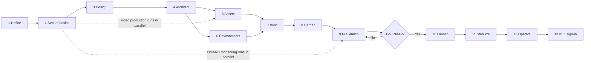
Stages 5 and 6 run in parallel. Stage 7 starts when both are done, or earlier with placeholder footage.

#### 4.3.2 Release workflow (every change, [08](./docs/08-DEPLOYMENT-RUNBOOK.md) §6–7)
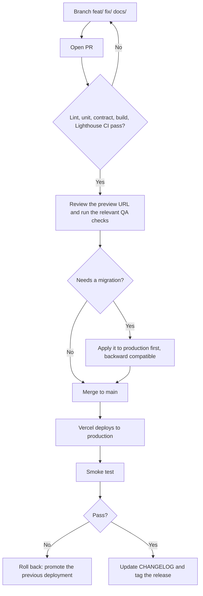

#### 4.3.3 Content change workflow ([10](./docs/10-CONTENT-EDITOR-GUIDE.md))
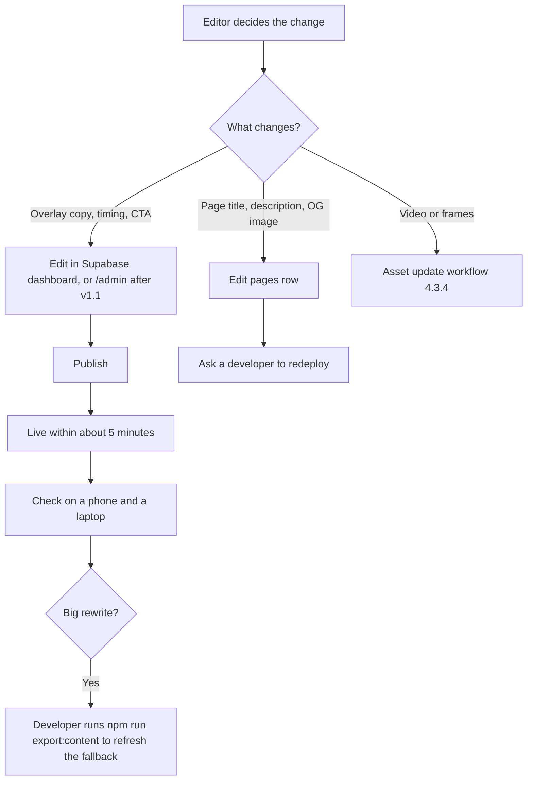

#### 4.3.4 Asset (frames) update workflow ([07](./docs/07-ASSET-PIPELINE.md) §8)
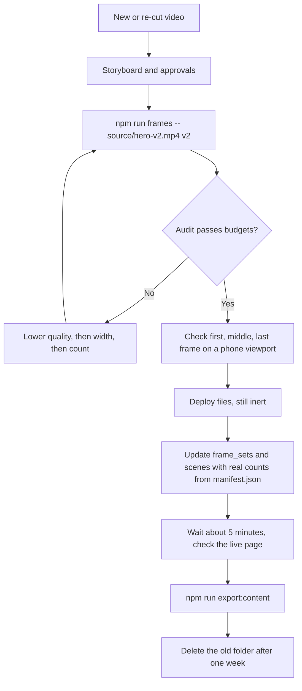
Never overwrite files that are live. Frames are cached as immutable.

#### 4.3.5 Launch-day workflow ([15](./docs/15-LAUNCH-AND-GO-LIVE.md))
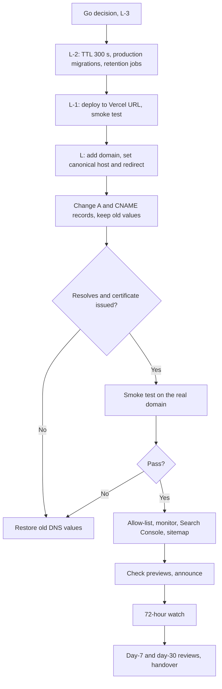

#### 4.3.6 Lead and privacy-request workflow ([11](./docs/11-PRIVACY-AND-LEGAL.md) §4)
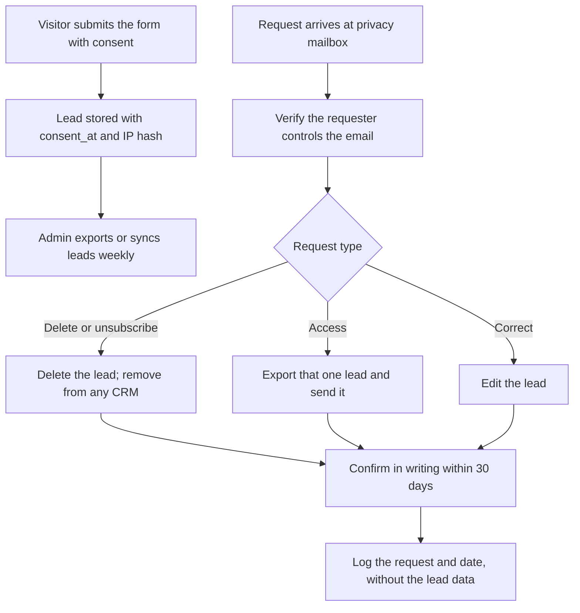

#### 4.3.7 Editor onboarding and offboarding workflow ([06](./docs/06-AUTHENTICATION.md), [08](./docs/08-DEPLOYMENT-RUNBOOK.md) §11)
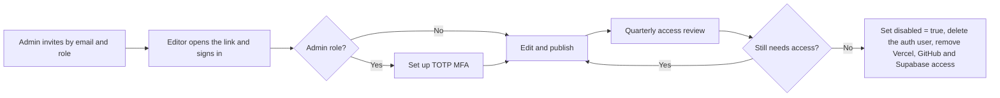

#### 4.3.8 Incident workflow ([08](./docs/08-DEPLOYMENT-RUNBOOK.md) §12)
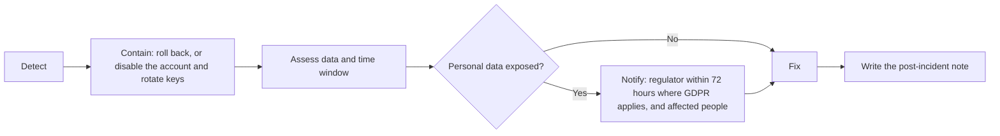

## 5. Build Guide
Phases 0 to 13. The [Implementation Plan](./docs/17-IMPLEMENTATION-PLAN.md) maps these to team phases: Build Guide 3–9 = Plan Phase 3, 10–11 = Plan Phase 5, 12 = Plan Phase 6, 13 = Plan Phase 7.

### Phase 0: Prerequisites
- Install the tools in §1. Create the Vercel and Supabase projects. Register or confirm the domain in the company's name ([13](./docs/13-DOMAIN-DNS-EMAIL.md) §2) and secure DNS access.
- **Done when:** `node -v`, `ffmpeg -version`, `cwebp -version`, `avifenc --version` all work.

### Phase 1: Scaffolding
- `npm create vite@latest` (vanilla), then `npm i gsap lenis @supabase/supabase-js` and dev dependencies (`vitest`, `playwright`, `supertest`, `eslint`, `prettier`, `@lhci/cli`).
- Configure the two build entries so the admin code never reaches the public bundle:
```js
// vite.config.js
import { defineConfig } from 'vite';
import { fileURLToPath } from 'node:url';

const entry = (f) => fileURLToPath(new URL(f, import.meta.url));

export default defineConfig({
  build: { rollupOptions: { input: { main: entry('./index.html'), admin: entry('./admin.html') } } },
});
```
- Create `.env.example` from [TRD §9](./docs/02-TRD.md).
- **Done when:** `npm run dev` and `npm run build` succeed.

### Phase 2: Asset pipeline
- Follow [07-ASSET-PIPELINE](./docs/07-ASSET-PIPELINE.md): export frames, run the audit, create posters.
- **Done when:** the audit passes both budgets (12 MB desktop, 5 MB mobile).

### Phase 3: HTML structure and sticky layout
- One tall section holds one sticky viewport. Its height comes from `scrollLengthVh`.
```html
<section id="scroll-section">           <!-- height set from scrollLengthVh, e.g. 400vh -->
  <div class="stage">
    <canvas id="scroll-canvas"></canvas>
    <div id="overlays"></div>
  </div>
</section>
```
```css
.stage { position: sticky; top: 0; height: 100vh; height: 100svh; overflow: hidden; }
#scroll-canvas { width: 100%; height: 100%; display: block; }
```
- **Done when:** the stage stays pinned for the whole section and scrolls away at the end.

### Phase 4: CSS and design tokens
- Implement the tokens from [04-UI-UX](./docs/04-UI-UX-DESIGN-BRIEF.md) §6 as CSS variables on `:root`.
- **Done when:** type scale, colors and the focus ring match the Figma file.

### Phase 5: Canvas renderer (`scrollCanvas.js`)
- Cover-fit drawing and a DPR cap of 2:
```js
function drawCover(ctx, img, cw, ch) {
  const s = Math.max(cw / img.width, ch / img.height);
  const w = img.width * s, h = img.height * s;
  ctx.drawImage(img, (cw - w) / 2, (ch - h) / 2, w, h);
}
```
- Progressive load order (every 4th frame, then every 2nd, then the rest):
```js
export function loadOrder(count) {
  const seen = new Set(), order = [];
  for (const step of [4, 2, 1])
    for (let i = 0; i < count; i += step) if (!seen.has(i)) { seen.add(i); order.push(i); }
  return order;
}
```
- Keyframes are every 4th index plus the last frame. `render()` draws the nearest loaded frame.
- **Done when:** frames draw correctly at any window size and after resize.

### Phase 6: Preloader and loader state machine
- Implement the state machine from [03-APP-FLOW](./docs/03-APP-FLOW.md) §3. Lock scroll until keyframes load; show "Continue anyway" after 10 s.
- **Done when:** throttled-network and 404-frame tests behave as in [09-QA](./docs/09-QA-CHECKLIST.md).

### Phase 7: ScrollTrigger mapping
```js
ScrollTrigger.create({
  trigger: '#scroll-section', start: 'top top', end: 'bottom bottom', scrub: 0.5,
  onUpdate: (self) => render(Math.round(self.progress * (count - 1))),
});
```
- Add the end-of-section canvas scale (1 → 0.85 between 85% and 100%).
- **Done when:** scrubbing is 1:1 in both directions.

### Phase 8: Overlays from config
- Build overlay DOM and a GSAP timeline from `PageConfig.scenes[].overlays` ([TRD §3.1](./docs/02-TRD.md)).
- **Done when:** timings match the storyboard.

### Phase 9: Smooth scrolling
```js
lenis.on('scroll', ScrollTrigger.update);
gsap.ticker.add((t) => lenis.raf(t * 1000));
gsap.ticker.lagSmoothing(0);
```
- **Done when:** no jitter, and in-page anchors scroll smoothly.

### Phase 10: Responsive and reduced motion
- Choose the frame set once with `matchMedia('(max-width: 768px)')`. Do not switch mid-session.
- If `prefers-reduced-motion: reduce`: skip frame loading, show the poster and stacked text, and fire `reduced_motion`.
- **Done when:** iOS Safari and Android Chrome pass the QA checklist; reduced-motion layout is verified.

### Phase 11: Lead form, content loader, analytics
- `contentLoader.js` ([TRD §3.2](./docs/02-TRD.md)), `leadForm.js` ([05 §5](./docs/05-BACKEND-SCHEMA.md), consent text from [11](./docs/11-PRIVACY-AND-LEGAL.md)), `analytics.js` ([12](./docs/12-ANALYTICS-SPEC.md)).
- **Done when:** editing copy in the database changes the site; a lead submits end to end; events appear in `analytics_events`.

### Phase 12: Optimization
- AVIF with WebP fallback, `createImageBitmap` decoding, cache headers and CSP ([08](./docs/08-DEPLOYMENT-RUNBOOK.md) §4), SEO assets and the build-time content injection ([14](./docs/14-SEO-AND-DISCOVERABILITY.md)), Lighthouse CI.
- **Done when:** all budgets in [TRD §5](./docs/02-TRD.md) pass in CI.

### Phase 13: QA and launch
- Run [09-QA-CHECKLIST](./docs/09-QA-CHECKLIST.md), publish the legal pages ([11](./docs/11-PRIVACY-AND-LEGAL.md)), train editors ([10](./docs/10-CONTENT-EDITOR-GUIDE.md)), set up email authentication ([13](./docs/13-DOMAIN-DNS-EMAIL.md) §5), then follow the go-live plan ([15](./docs/15-LAUNCH-AND-GO-LIVE.md)) to deploy ([08](./docs/08-DEPLOYMENT-RUNBOOK.md)) and cut over DNS. Hand over with [16](./docs/16-MAINTENANCE-AND-OPERATIONS.md) §1–3.
- **Done when:** the release criteria in [PRD §12](./docs/01-PRD.md) are met, the sign-off block in the QA checklist is complete and the Go/No-Go in [15 §3](./docs/15-LAUNCH-AND-GO-LIVE.md) passes.

## 6. Conventions
- Branches: `feat/…`, `fix/…`, `docs/…`. Commits follow Conventional Commits.
- Every PR must satisfy the Definition of Done in [Plan §5](./docs/17-IMPLEMENTATION-PLAN.md).
- Never commit `.env*` files, source video, or the service-role key.

## 7. Troubleshooting
| Symptom | Likely cause | Fix |
|---|---|---|
| Frames look stretched | Canvas drawn without cover-fit | Use `drawCover` with the canvas size in device pixels |
| Scroll jumps on iOS address-bar collapse | `100vh` used for the stage | Use `100svh` with a `100vh` fallback |
| `/api/*` returns 404 locally | Running `npm run dev` | Use `vercel dev` |
| Scrub stutters | Frames decoded on the main thread | `createImageBitmap` (Build Guide Phase 12) |
| Changes to frames don't show | Immutable caching | Re-export to a new version folder ([07 §8](./docs/07-ASSET-PIPELINE.md)) |

---

# 01 — Prd

# Product Requirements Document (PRD)
**Product:** Scroll-Driven Video Animation Website
**Version:** 1.2 · **Status:** Draft · **Last updated:** 2026-10-15
**Related:** [TRD](./02-TRD.md) · [Authentication](./06-AUTHENTICATION.md) · [Privacy & Legal](./11-PRIVACY-AND-LEGAL.md) · [Analytics Spec](./12-ANALYTICS-SPEC.md)

## 1. Overview
A marketing landing page where scrolling controls a cinematic product video, frame by frame, in both directions. Text overlays tell the product story in sync with the video, and the page ends with a call to action (CTA) that captures leads. A small, invite-only admin area lets the team edit content and manage leads.

## 2. Problem Statement
Static landing pages don't hold attention, and autoplay videos take control away from the user. Brands want an immersive page that the user controls, like Apple's product pages, without the cost of a WebGL/3D build.

## 3. Goals
| # | Goal | Metric |
|---|---|---|
| G1 | Engage visitors with an immersive story | Avg. scroll depth ≥ 70% |
| G2 | Convert interest into leads | CTA conversion ≥ 3% |
| G3 | Fast, smooth experience | LCP < 2.5s, 60 fps scrub on mid-range devices |
| G4 | Easy content updates | Overlay copy editable without a redeploy |
| G5 | Safe content and lead management | Only invited, role-checked users can change content or read leads |

## 4. Non-Goals (v1)
- E-commerce checkout or payments
- **User accounts for visitors.** Authentication covers editors and admins only.
- WebGL/3D real-time rendering
- Multi-language support (planned for v2)

## 5. Target Users
| Persona | Description | Need |
|---|---|---|
| **Visitor** | Prospective customer, desktop or mobile | Understand the product quickly and in an engaging way |
| **Marketing Editor** | Non-technical team member | Change headlines and CTAs and swap scenes |
| **Admin** | Owner of the site and its data | Control who has access, handle leads and deletion requests |
| **Developer** | Maintains the site | Simple, modular, documented codebase |

## 6. User Stories
| ID | As a… | I want to… | So that… |
|---|---|---|---|
| US-1 | Visitor | scroll and see the video respond instantly | I feel in control of the story |
| US-2 | Visitor | scroll backwards smoothly | I can re-watch details |
| US-3 | Visitor | see a loading indicator | I know the experience is coming |
| US-4 | Visitor | read clear text at each stage | I understand the key features |
| US-5 | Visitor | leave my email at the end | I get launch updates |
| US-6 | Visitor (reduced motion) | get a static version | I avoid motion discomfort |
| US-7 | Editor | edit overlay text and timing in a CMS | I don't need a developer |
| US-8 | Editor | see lead submissions | I can follow up |
| US-9 | Editor | sign in with my email, no password | I can edit copy securely |
| US-10 | Admin | invite and disable editors | I control who can change the site |
| US-11 | Admin | view, export and delete leads | I can follow up and honor deletion requests |
| US-12 | Admin | see who changed what | I can trace mistakes |

> **Note:** US-8 is now satisfied for admins only (FR-16). Editors do not see lead data, which contains personal information. If editors need lead access, grant the `admin` role or export a CSV for them.

## 7. Functional Requirements
| ID | Requirement | Priority |
|---|---|---|
| FR-1 | Scroll position maps 1:1 to a video frame inside a sticky section | P0 |
| FR-2 | Canvas image-sequence renderer with `object-fit: cover` behavior | P0 |
| FR-3 | Preloader with % progress; scroll locked until ready | P0 |
| FR-4 | Text overlays fade in and out at configured progress ranges (0–1) | P0 |
| FR-5 | Smooth scrolling (Lenis) synced with ScrollTrigger | P1 |
| FR-6 | Separate mobile frame set (smaller resolution and count) | P0 |
| FR-7 | Reduced-motion fallback (static image + stacked text) | P0 |
| FR-8 | Lead capture form (email, optional name) with validation | P0 |
| FR-9 | Page content (scenes, overlays) loaded from the API, with a static JSON fallback | P1 |
| FR-10 | Analytics events: scroll milestones, CTA clicks, lead submits | P1 |
| FR-11 | Admin access to leads and content via the Supabase dashboard (fallback once FR-12 to FR-16 ship) | P2 |
| FR-12 | Invite-only editor sign-in via Supabase Auth magic link at `/admin` | P1 |
| FR-13 | Role-based authorization (`editor`, `admin`) enforced server-side on every `/api/admin/*` route | P1 |
| FR-14 | TOTP MFA required for the `admin` role | P1 |
| FR-15 | Audit log of all admin writes | P1 |
| FR-16 | Leads viewer, CSV export and delete (admin only) | P2 |

## 8. Non-Functional Requirements
| Category | Requirement |
|---|---|
| Performance | LCP < 2.5s, CLS < 0.05, frames total ≤ 12 MB desktop / ≤ 5 MB mobile |
| Smoothness | ≥ 55 fps while scrubbing on a 2022 mid-range Android |
| Compatibility | Last 2 versions of Chrome, Safari, Firefox, Edge; iOS 15+ |
| Accessibility | WCAG 2.2 AA |
| SEO | Real HTML text, meta and OG tags, Lighthouse SEO ≥ 95 |
| Security | Rate-limited lead endpoint, no secrets on the client, GDPR consent checkbox |
| Auth security | No public sign-up; sign-in responses never reveal whether an email is registered; admin routes are `no-store` and `noindex`; a disabled editor is blocked within 1h (token expiry) at the latest |
| Availability | 99.9% (static CDN hosting) |

## 9. Scope
**MVP (v1):** FR-1 to FR-8, FR-10
**v1.1:** FR-9, FR-11, FR-12 to FR-16 (see [Implementation Plan](./17-IMPLEMENTATION-PLAN.md) §8 for the option to pull auth into v1)
**v2:** Multiple scroll scenes per page, i18n, A/B testing of copy

## 10. Assumptions & Dependencies
- The client supplies a 3–8s source video at 1080p+ with no baked-in text.
- Hosting on Vercel; data and authentication on Supabase (Postgres + Auth).
- GSAP's standard license covers this use (free for this case).
- Editors and admins have email addresses that can receive magic links.
- The company owns the domain registrar account and can edit DNS (see [Domain, DNS & Email](./13-DOMAIN-DNS-EMAIL.md)).

## 11. Risks
| Risk | Impact | Mitigation |
|---|---|---|
| Large frame payload on slow networks | High bounce rate | Progressive loading, mobile set, AVIF |
| iOS Safari quirks | Broken scrub | Canvas method (not `<video>`) |
| Motion sickness | Accessibility complaints | `prefers-reduced-motion` fallback |
| Spam leads | Bad data | Rate limit + honeypot field |
| Editor account compromised | Content defaced, leads exposed | Invite-only, MFA for admins, audit log, short sessions |

## 12. Release Criteria
- All P0 requirements done and tested on the device matrix
- Lighthouse: Performance ≥ 85, Accessibility ≥ 95, SEO ≥ 95
- No P0/P1 bugs open
- Stakeholder sign-off on the visual QA
- For the release that includes auth: every `/api/admin/*` route has passing 401/403 tests, and the anon key cannot read `leads`, `editors` or `audit_log`

---

# 02 — Trd

# Technical Requirements Document (TRD)
**Related:** [PRD](./01-PRD.md) · [Backend Schema](./05-BACKEND-SCHEMA.md) · [Authentication](./06-AUTHENTICATION.md) · [Asset Pipeline](./07-ASSET-PIPELINE.md) · [Deployment Runbook](./08-DEPLOYMENT-RUNBOOK.md) · [Analytics Spec](./12-ANALYTICS-SPEC.md)

## 1. Architecture Overview

```
┌──────────────────────────── Browser ────────────────────────────┐
│  index.html (static, public)                                     │
│   ├─ main.js ── bootstraps modules                               │
│   ├─ contentLoader.js ── GET /api/page/:slug (fallback: JSON)    │
│   ├─ scrollCanvas.js ── preload frames → draw on <canvas>        │
│   ├─ overlays.js ──── GSAP timeline from content config          │
│   ├─ smoothScroll.js ─ Lenis ↔ ScrollTrigger                     │
│   ├─ leadForm.js ──── POST /api/leads                            │
│   └─ analytics.js ─── POST /api/events (sendBeacon)              │
│                                                                  │
│  admin.html (separate entry, noindex)                            │
│   ├─ admin/auth.js ── Supabase Auth sign-in only                 │
│   ├─ admin/guard.js ─ GET /api/admin/me, role routing            │
│   └─ admin/*.js ───── Bearer-token calls to /api/admin/*         │
└──────────────┬───────────────────────────────┬───────────────────┘
               │ static assets (frames, JS)    │ API calls
        ┌──────▼──────┐                 ┌──────▼───────────────────┐
        │ Vercel CDN  │                 │ Vercel Serverless        │
        │ /frames/*   │                 │ /api/page, /api/leads    │
        │ immutable   │                 │ /api/events              │
        └─────────────┘                 │ /api/admin/* (role-checked)
                                        └──────┬───────────────────┘
                                               │ service-role key
                                        ┌──────▼──────┐
                                        │  Supabase   │
                                        │  Postgres   │
                                        │  + Auth     │
                                        │  + Storage  │
                                        └─────────────┘
```

## 2. Tech Stack
| Layer | Choice | Reason |
|---|---|---|
| Build | Vite 5 (two entries: `index.html`, `admin.html`) | Fast dev server; admin code stays out of the public bundle |
| Language | Vanilla JS (ES2022 modules) | No framework overhead |
| Animation | GSAP 3 + ScrollTrigger | Industry standard, reliable scrub |
| Smooth scroll | Lenis | Lightweight, works with ScrollTrigger |
| Rendering | Canvas 2D + WebP/AVIF sequence | Smooth across browsers |
| Hosting | Vercel | CDN + serverless functions in one place |
| Database | Supabase Postgres | Managed, built-in dashboard for editors |
| Authentication | Supabase Auth (magic link + TOTP MFA) | Already in the stack; no password storage |
| Asset processing | FFmpeg | Frame extraction and compression |
| Analytics | Custom events table (+ optional Plausible) | Privacy-friendly |

## 3. Frontend Modules

### Public site
| Module | Responsibility | Public API |
|---|---|---|
| `contentLoader.js` | Fetch page config, fall back to `/content/home.json` | `loadContent(slug) → Promise<PageConfig>` |
| `scrollCanvas.js` | Preload, resize, render frames | `initScrollCanvas({ scene, onProgress, onComplete })` |
| `overlays.js` | Build overlay DOM and timeline | `initOverlays(overlays[])` |
| `smoothScroll.js` | Lenis setup | `initSmoothScroll() → lenis` |
| `leadForm.js` | Validate and submit leads | `initLeadForm(formEl)` |
| `analytics.js` | Track events, debounced | `track(name, props)` |

### Admin (loaded only by `admin.html`)
| Module | Responsibility | Public API |
|---|---|---|
| `admin/auth.js` | Sign-in, session, authenticated fetch | `signIn(email)`, `signOut()`, `apiFetch(path, init)` |
| `admin/guard.js` | Call `/api/admin/me`, route by role, handle `mfa_required` | `initGuard() → { role }` |
| `admin/mfa.js` | TOTP enroll and challenge | `enrollTotp()`, `verifyTotp(code)` |

### 3.1 PageConfig Contract
```ts
type PageConfig = {
  slug: string;
  title: string;
  scenes: Array<{
    id: string;
    scrollLengthVh: number;          // e.g. 400
    frames: {
      desktop: { basePath: string; count: number; ext: 'webp' | 'avif' };
      mobile:  { basePath: string; count: number; ext: 'webp' | 'avif' };
    };
    posterUrl: string;               // reduced-motion / noscript fallback
    overlays: Array<{
      id: string;
      start: number;                 // 0–1
      end: number;                   // 0–1
      heading: string;
      body?: string;
      cta?: { label: string; href: string };
      align: 'center' | 'left' | 'right';
    }>;
  }>;
};
```

The static file `/content/<slug>.json` also carries `metaDescription` and `ogImageUrl`. They are used at build time only, to fill the page's head tags ([SEO & Discoverability §3](./14-SEO-AND-DISCOVERABILITY.md)); the API response does not include them.

### 3.2 Content Loading With Fallback
```js
// src/contentLoader.js
export async function loadContent(slug = 'home') {
  try {
    const res = await fetch(`/api/page/${slug}`, { signal: AbortSignal.timeout(2500) });
    if (!res.ok) throw new Error(res.status);
    return await res.json();
  } catch {
    return (await fetch(`/content/${slug}.json`)).json();   // static fallback
  }
}
```

## 4. Rendering Pipeline
1. `loadContent()` picks the frame set (desktop or mobile) via `matchMedia('(max-width: 768px)')`.
2. Frames are preloaded in progressive order (every 4th → 2nd → all).
3. The loader hides once **keyframes (every 4th) are loaded**, not all frames. The rest load in the background.
4. ScrollTrigger maps `progress (0–1)` → `frameIndex = round(progress × (count − 1))`.
5. `render()` draws the nearest loaded frame. Canvas DPR is capped at 2.

## 5. Performance Budgets
| Asset | Desktop | Mobile |
|---|---|---|
| JS (gzipped), public bundle | ≤ 60 KB | ≤ 60 KB |
| CSS (gzipped), public bundle | ≤ 10 KB | ≤ 10 KB |
| Frames total | ≤ 12 MB (150 × ~80 KB) | ≤ 5 MB (120 × ~40 KB) |
| Time to interactive scrub | ≤ 3s on 4G | ≤ 4s on 4G |
| Main-thread work per frame | ≤ 8 ms | ≤ 12 ms |

The admin bundle (`admin.html`, includes `supabase-js`) is **not** counted against these budgets, and must never be imported by the public entry. Frame export and the audit that enforces the frame budgets are in the [Asset Pipeline](./07-ASSET-PIPELINE.md).

## 6. Browser Support
- Chrome/Edge/Firefox: last 2 versions
- Safari macOS 15+, iOS 15+
- No IE support. A `<noscript>` poster image is the fallback.

## 7. API Contract (summary; details in [Backend Schema](./05-BACKEND-SCHEMA.md) and [Authentication](./06-AUTHENTICATION.md) §4)
| Method | Endpoint | Auth | Purpose |
|---|---|---|---|
| GET | `/api/page/:slug` | Public | Published page config (cached 5 min) |
| POST | `/api/leads` | Public + rate limit | Create lead |
| POST | `/api/events` | Public + rate limit | Batch analytics events |
| GET | `/api/admin/me` | Editor | Current user and role |
| GET / PUT | `/api/admin/pages/:id` | Editor | Read or update a page (drafts included) |
| POST | `/api/admin/pages/:id/publish` | Editor | Publish a page |
| GET | `/api/admin/leads`, `/api/admin/leads.csv` | Admin (+ MFA) | View and export leads |
| DELETE | `/api/admin/leads/:id` | Admin (+ MFA) | Delete a lead |
| GET / POST / PATCH | `/api/admin/editors` | Admin (+ MFA) | List, invite, change or disable editors |
| GET | `/api/admin/audit` | Admin (+ MFA) | Audit log |

## 8. Security
- The Supabase **service-role key lives only in Vercel env vars**. The client never talks to the DB directly. The admin client uses Supabase JS **for sign-in only**.
- The Supabase **anon key is public by design** (it ships in the admin bundle). It is safe only because RLS denies by default (see Backend Schema §3).
- Leads: server-side validation, honeypot field, rate limit of 5/min per IP hash.
- IPs are stored only as a salted SHA-256 hash.
- A GDPR consent checkbox is required. The consent timestamp is stored.
- **Public pages** CSP: `default-src 'self'; img-src 'self' data:; connect-src 'self'`.
- **`/admin*`** CSP: same, plus `connect-src 'self' https://<project>.supabase.co`. Also `X-Robots-Tag: noindex, nofollow` and `Cache-Control: no-store`.
- Admin APIs use `Authorization: Bearer` headers, not cookies, so CSRF does not apply. CORS stays closed (same-origin only).
- No public sign-up. Every `/api/admin/*` route goes through one `requireRole` helper.

## 9. Environment Variables
| Name | Where | Description |
|---|---|---|
| `SUPABASE_URL` | Server | Project URL |
| `SUPABASE_SERVICE_ROLE_KEY` | Server | Server-only key. Never `VITE_`-prefixed. |
| `IP_HASH_SALT` | Server | Salt for IP hashing |
| `VITE_PAGE_SLUG` | Client | Default slug (`home`) |
| `SITE_URL` | Build | Public site URL for canonical and OG tags |
| `VITE_SUPABASE_URL` | Client (`/admin` only) | Project URL |
| `VITE_SUPABASE_ANON_KEY` | Client (`/admin` only) | Public anon key |

## 10. Error Handling
| Failure | Behavior |
|---|---|
| API down | Use static JSON fallback |
| Frame 404 | Skip it and render the nearest loaded frame |
| Frames slow (> 10s) | Show "Continue anyway"; enable scroll with partial frames |
| Lead submit fails | Inline error message, keep the form values |
| Admin call returns 401 | Try one silent token refresh; otherwise return to sign-in |
| Admin call returns 403 | Show "You don't have access"; for `mfa_required`, route to the MFA step |

## 11. Testing Strategy
| Type | Tool | Scope |
|---|---|---|
| Unit | Vitest | Frame index math, overlay timing, validation, `requireRole` (all role/MFA combinations) |
| Contract | Vitest + supertest | Every `/api/admin/*` route returns 401 without a token |
| E2E | Playwright | Loader → scroll → CTA → lead submit; magic-link sign-in → edit → publish; editor gets 403 on leads |
| Visual | Playwright screenshots at 0/25/50/75/100% scroll | Regressions |
| Performance | Lighthouse CI | Budgets in §5 |
| Manual | BrowserStack device matrix | iOS Safari, Android Chrome |

## 12. CI/CD
- GitHub → Vercel preview deploy on every PR
- GitHub Actions: lint → unit → build → Lighthouse CI (fails if budgets are exceeded)
- Merge to `main` → production deploy
- Release steps, smoke test and rollback: [Deployment Runbook](./08-DEPLOYMENT-RUNBOOK.md)

---

# 03 — App Flow

# App Flow
**Related:** [PRD](./01-PRD.md) · [TRD](./02-TRD.md) · [Authentication](./06-AUTHENTICATION.md)

## 1. Site Map
```
/ (Home)
├── #intro           Hero title + scroll hint
├── #scroll-section  Sticky canvas + overlays (the main experience)
├── #features        Static feature content
├── #signup          Lead capture form
└── footer           Links: Privacy, Terms
/privacy
/terms

/admin            Sign-in + dashboard (noindex, not linked from the public site)
/admin/leads      Leads viewer (admin)
/admin/audit      Audit log (admin)
```

## 2. Visitor Journey
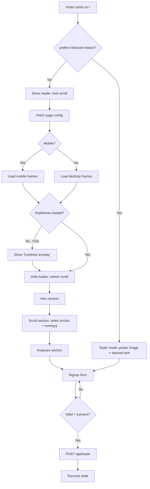

## 3. Loader State Machine
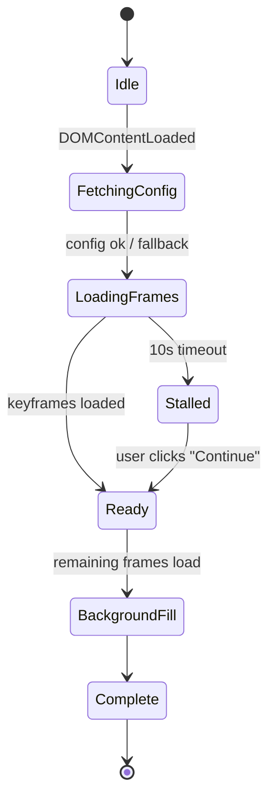

## 4. Scroll → Render Loop
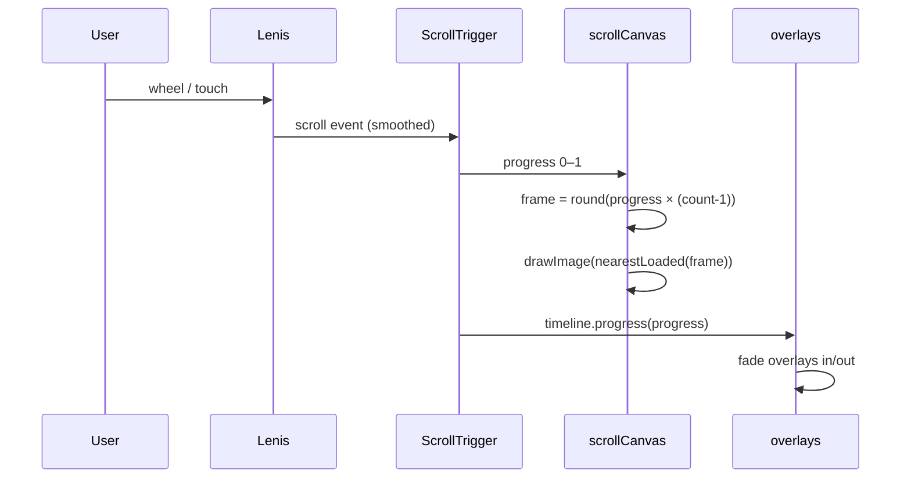

## 5. Scroll Section Timeline (default content)
```
progress  0.0 ──── 0.25 ──── 0.50 ──── 0.75 ──── 1.0
frames    1 ───────────────────────────────────── 150
overlay1  [██ Introducing X ██]
overlay2            [██ Designed for performance ██]
overlay3                      [██ Every detail ██]
overlay4                                [██ Available now + CTA ██]
canvas                                        [scale 1 → 0.85]
analytics ▲25%       ▲50%       ▲75%       ▲100%   (scroll_milestone)
```

## 6. Lead Form Flow
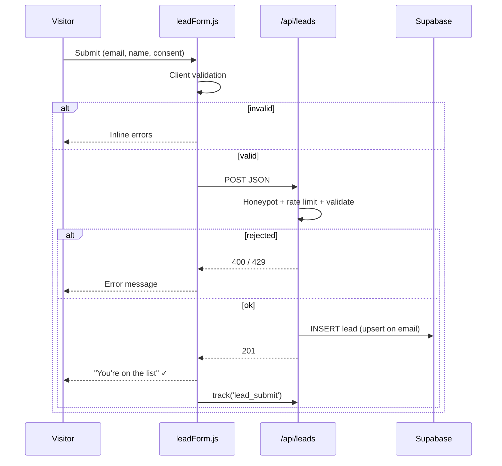

## 7. Editor & Admin Flow

### 7.1 Sign-in
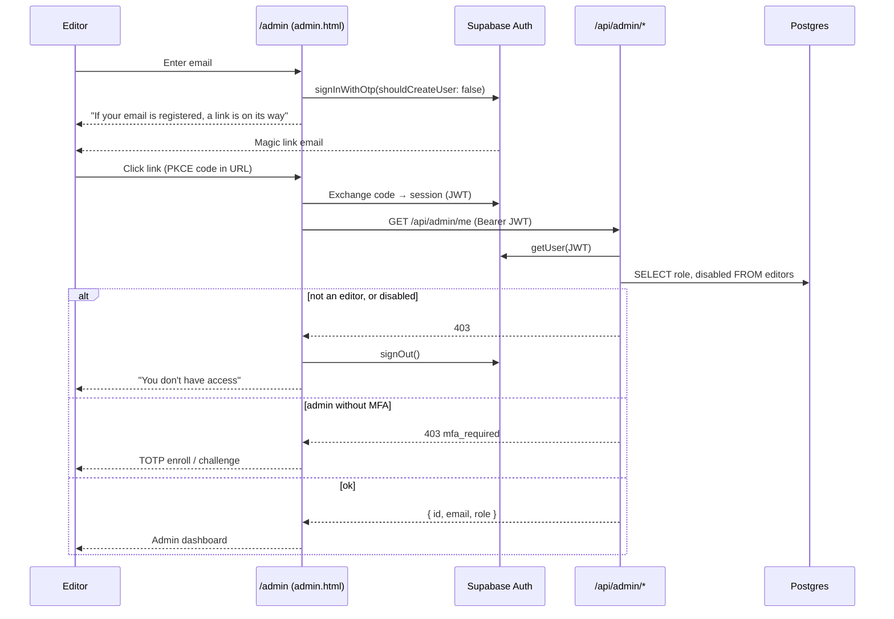

### 7.2 Request authorization
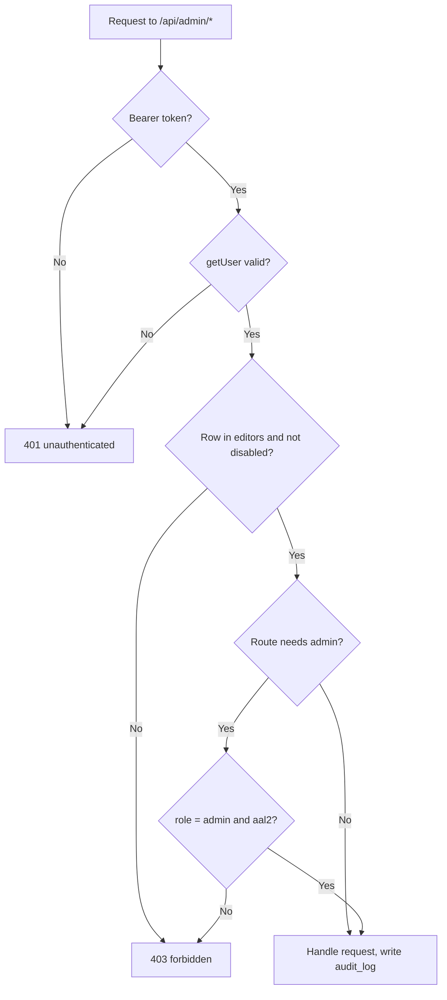

### 7.3 Editor lifecycle
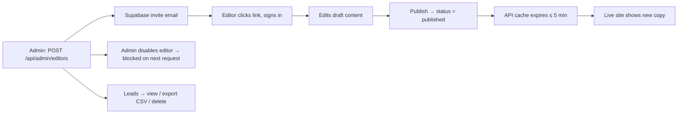

Until FR-12 to FR-16 ship, editors use the Supabase dashboard instead (FR-11): edit the `overlays` table, set the page `status = published`, export leads as CSV.

## 8. Error & Edge States
| Situation | What the user sees |
|---|---|
| JS disabled | `<noscript>` poster + all text |
| API unavailable | Normal experience from static JSON |
| Slow network | Progress bar → "Continue anyway" button |
| Window resized mid-scroll | Canvas resizes, frame redrawn, ScrollTrigger refreshes |
| Rotating a mobile device | Same as resize; frame set does not switch mid-session |
| Duplicate email | Success message (no leak of existing emails) |
| Not signed in at `/admin` | Sign-in form |
| Unknown or unregistered email at sign-in | Same message as a registered email |
| Disabled editor, or not in `editors` | "You don't have access", then signed out |
| Admin without MFA | TOTP enroll / challenge step |
| Expired session | Silent refresh; if that fails, back to sign-in |

---

# 04 — Ui Ux Design Brief

# UI/UX Design Brief
**Related:** [PRD](./01-PRD.md) · [App Flow](./03-APP-FLOW.md)

## 1. Project Summary
Design a premium, cinematic landing page where the product video is the hero. The UI stays minimal so the motion and product stay in focus. A small functional admin area ships alongside it.

## 2. Objectives
1. **Wow in 3 seconds:** the first scroll should feel magical.
2. **Clarity:** each scroll stage communicates one idea.
3. **Conversion:** the story ends naturally at the CTA.

## 3. Audience
Tech-savvy consumers aged 22–45. About 60% mobile and 40% desktop. They expect Apple/Nothing-level polish. The admin area is used by a handful of internal staff on desktop.

## 4. Brand & Tone
| Attribute | Is | Is not |
|---|---|---|
| Voice | Confident, concise | Salesy, jargon-heavy |
| Visual | Dark, cinematic, spacious | Busy, gradient-heavy |
| Motion | Smooth, purposeful | Bouncy, gimmicky |

## 5. Design Principles
1. **Content is the video.** UI elements never compete with the frames.
2. **One message per screen.** Max 6 words per headline.
3. **Motion follows scroll.** No autoplay animation inside the scroll section.
4. **Readable everywhere.** Text always has contrast support (scrim or shadow).
5. **Admin is plain.** Functional, fast, accessible. It reuses the tokens and has no motion.

## 6. Design Tokens

### Color
| Token | Value | Use |
|---|---|---|
| `--bg` | `#000000` | Page background |
| `--surface` | `#111113` | Cards, form |
| `--fg` | `#F5F5F7` | Primary text |
| `--fg-muted` | `#86868B` | Secondary text |
| `--accent` | `#2997FF` | CTA, links, focus ring |
| `--danger` | `#FF453A` | Form errors |
| `--success` | `#30D158` | Success state |

### Typography (Inter / system)
| Style | Size (clamp) | Weight | Line height |
|---|---|---|---|
| Display | `clamp(2.5rem, 8vw, 6rem)` | 700 | 1.05 |
| H2 overlay | `clamp(2rem, 6vw, 5rem)` | 700 | 1.1 |
| H3 | `clamp(1.5rem, 3vw, 2.25rem)` | 600 | 1.2 |
| Body | `1.125rem` | 400 | 1.6 |
| Caption | `0.875rem` | 500 | 1.4 |

### Spacing & Radius
- Spacing scale: `4, 8, 12, 16, 24, 32, 48, 64, 96, 128 px`
- Radius: `8px` inputs, `16px` cards, `999px` buttons

## 7. Layout & Grid
| Breakpoint | Width | Columns | Gutter | Margin |
|---|---|---|---|---|
| Mobile | < 768px | 4 | 16px | 20px |
| Tablet | 768–1199px | 8 | 24px | 40px |
| Desktop | ≥ 1200px | 12 | 24px | auto (max 1200px) |

## 8. Motion Spec
| Element | Trigger | Animation | Easing |
|---|---|---|---|
| Canvas frames | Scroll (scrub 0.5s) | frame index | linear |
| Overlay in | Progress = `start` | opacity 0→1, y 40→0 | `power2.out` |
| Overlay out | Progress = `end − fade` | opacity 1→0, y 0→−40 | `power2.in` |
| Canvas end | 85–100% | scale 1→0.85, radius 0→24px | linear |
| Loader exit | Ready | opacity 1→0, 600ms | `ease` |
| Buttons | Hover | scale 1.03, 200ms | `ease-out` |
| Scroll hint | Idle | translateY 0→10px loop, 2s | `ease-in-out` |

**Reduced motion:** remove all transforms, fades ≤ 150ms, static poster.

## 9. Components
| Component | States | Notes |
|---|---|---|
| Header | default, scrolled (blur bg) | Fixed, 64px tall, hides on scroll down (mobile) |
| Loader | loading, stalled, exit | Thin 200px bar + % text |
| Overlay block | hidden, entering, visible, exiting | Center / left / right alignments |
| CTA button | default, hover, focus, active, disabled | Min 44×44px touch target |
| Input | default, focus, error, disabled | Label above, error below |
| Consent checkbox | unchecked, checked, error | Links to /privacy |
| Toast / inline status | success, error | `aria-live="polite"` |
| Sign-in form (admin) | default, sending, sent, error | Email field + button. The "sent" message is identical for every email. |
| MFA code input (admin) | default, error, verifying | 6 digits, `inputmode="numeric"`, `autocomplete="one-time-code"` |
| Data table (admin) | loading, empty, populated | Leads and audit log. Sticky header, keyboard navigable. |
| Role badge (admin) | editor, admin | Text label, never color alone |
| Confirm dialog (admin) | open, busy | Required for delete lead, disable editor |

## 10. Key Screens to Design
1. Loader (loading + stalled)
2. Intro hero
3. Scroll section at 0%, 25%, 50%, 75%, 100% (desktop + mobile)
4. Features section
5. Signup form (default, error, success)
6. Reduced-motion version (full page)
7. Footer + Privacy page
8. Admin sign-in (default, link sent, no access)
9. Admin MFA step
10. Admin dashboard, leads table, audit log (desktop only)

## 11. Accessibility Requirements
- Text contrast ≥ 4.5:1. Over video, use a `linear-gradient(transparent, rgba(0,0,0,.6))` scrim.
- Visible focus ring: `2px solid var(--accent)`, offset 3px.
- Respect `prefers-reduced-motion`.
- Overlay text is real HTML in reading order.
- Form fields have labels and errors linked via `aria-describedby`.
- Admin screens meet the same WCAG 2.2 AA bar: keyboard-only operation, labelled tables, focus returned after dialogs close.

## 12. Video Art Direction
- Dark or neutral background, so it blends with `--bg` at the edges.
- Subject centered with **safe zones**: keep the key product within the central 60% (for mobile `cover` cropping).
- Leave negative space where overlays appear (e.g. left third for left-aligned text).
- Slow, continuous camera motion. No hard cuts.

## 13. Deliverables
- [ ] Figma file: tokens, components, all screens (desktop 1440 + mobile 390)
- [ ] Prototype showing the scroll storyboard
- [ ] Exported poster image (final frame)
- [ ] Motion reference video (screen recording of prototype)
- [ ] Admin screens (desktop 1440 only)

---

# 05 — Backend Schema

# Backend Schema
**Stack:** Supabase (Postgres 15 + Auth) + Vercel Serverless Functions
**Related:** [TRD](./02-TRD.md) · [Authentication](./06-AUTHENTICATION.md) · [Deployment Runbook](./08-DEPLOYMENT-RUNBOOK.md) · [Privacy & Legal](./11-PRIVACY-AND-LEGAL.md)

## 1. Entity Relationship Diagram
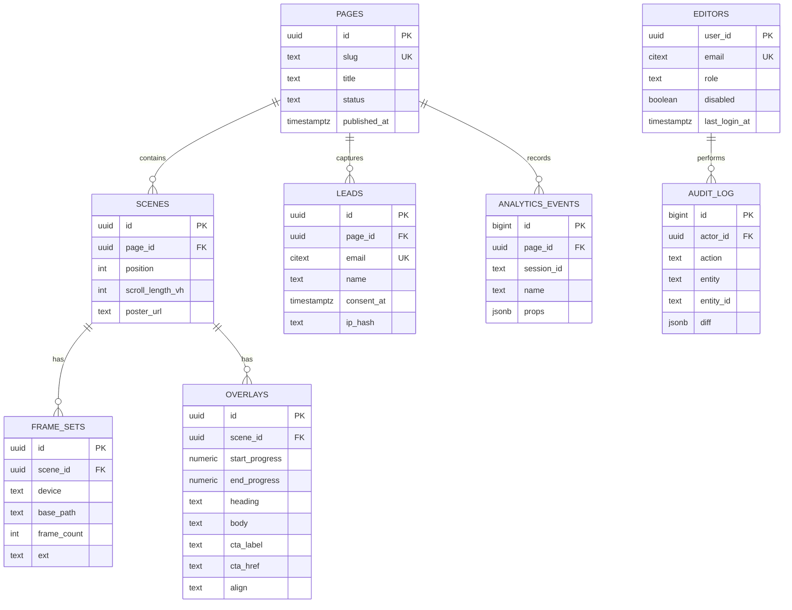
`EDITORS.user_id` references Supabase's `auth.users(id)`.

## 2. SQL

### Migration `001_init.sql`
```sql
create extension if not exists citext;
create extension if not exists pgcrypto;

-- ---------- Enums ----------
create type page_status   as enum ('draft', 'published', 'archived');
create type device_type   as enum ('desktop', 'mobile');
create type overlay_align as enum ('center', 'left', 'right');

-- ---------- Pages ----------
create table pages (
  id               uuid primary key default gen_random_uuid(),
  slug             text not null unique check (slug ~ '^[a-z0-9-]+$'),
  title            text not null,
  meta_description text,
  og_image_url     text,
  status           page_status not null default 'draft',
  published_at     timestamptz,
  created_at       timestamptz not null default now(),
  updated_at       timestamptz not null default now()
);

-- ---------- Scenes ----------
create table scenes (
  id               uuid primary key default gen_random_uuid(),
  page_id          uuid not null references pages(id) on delete cascade,
  position         int  not null default 0,
  scroll_length_vh int  not null default 400 check (scroll_length_vh between 100 and 1500),
  poster_url       text not null,
  created_at       timestamptz not null default now(),
  unique (page_id, position)
);

-- ---------- Frame sets ----------
create table frame_sets (
  id          uuid primary key default gen_random_uuid(),
  scene_id    uuid not null references scenes(id) on delete cascade,
  device      device_type not null,
  base_path   text not null,               -- e.g. /frames/hero-desktop
  frame_count int  not null check (frame_count > 0),
  ext         text not null default 'webp' check (ext in ('webp', 'avif', 'jpg')),
  total_bytes bigint,
  unique (scene_id, device)
);

-- ---------- Overlays ----------
create table overlays (
  id             uuid primary key default gen_random_uuid(),
  scene_id       uuid not null references scenes(id) on delete cascade,
  start_progress numeric(4,3) not null check (start_progress between 0 and 1),
  end_progress   numeric(4,3) not null check (end_progress between 0 and 1),
  heading        text not null check (char_length(heading) <= 80),
  body           text check (char_length(body) <= 240),
  cta_label      text,
  cta_href       text,
  align          overlay_align not null default 'center',
  created_at     timestamptz not null default now(),
  check (end_progress > start_progress),
  check ((cta_label is null) = (cta_href is null))
);
create index overlays_scene_start_idx on overlays (scene_id, start_progress);

-- ---------- Leads ----------
create table leads (
  id          uuid primary key default gen_random_uuid(),
  page_id     uuid references pages(id) on delete set null,
  email       citext not null unique check (email ~* '^[^@\s]+@[^@\s]+\.[^@\s]+$'),
  name        text check (char_length(name) <= 100),
  consent_at  timestamptz not null,
  source      text,                         -- utm_source
  utm         jsonb not null default '{}',
  ip_hash     text,
  user_agent  text,
  created_at  timestamptz not null default now()
);
create index leads_created_idx on leads (created_at desc);

-- ---------- Analytics ----------
create table analytics_events (
  id          bigint generated always as identity primary key,
  page_id     uuid references pages(id) on delete cascade,
  session_id  text not null,
  name        text not null check (name in
                ('page_view','loader_complete','loader_stalled',
                 'scroll_milestone','cta_click','lead_submit','reduced_motion')),
  props       jsonb not null default '{}',
  device      device_type,
  created_at  timestamptz not null default now()
);
create index analytics_page_name_time_idx on analytics_events (page_id, name, created_at desc);

-- ---------- updated_at trigger ----------
create or replace function set_updated_at() returns trigger as $$
begin new.updated_at = now(); return new; end;
$$ language plpgsql;

create trigger pages_updated_at before update on pages
  for each row execute function set_updated_at();
```

### Migration `002_auth.sql`
```sql
create type editor_role as enum ('editor', 'admin');

create table editors (
  user_id       uuid primary key references auth.users(id) on delete cascade,
  email         citext not null unique,
  role          editor_role not null default 'editor',
  disabled      boolean not null default false,
  invited_by    uuid references auth.users(id) on delete set null,
  created_at    timestamptz not null default now(),
  last_login_at timestamptz
);

create table audit_log (
  id         bigint generated always as identity primary key,
  actor_id   uuid references auth.users(id) on delete set null,
  action     text not null,                 -- e.g. 'page.publish', 'lead.delete'
  entity     text not null,                 -- e.g. 'page', 'overlay', 'lead', 'editor'
  entity_id  text,
  diff       jsonb not null default '{}',
  ip_hash    text,
  created_at timestamptz not null default now()
);
create index audit_log_created_idx on audit_log (created_at desc);

alter table editors   enable row level security;
alter table audit_log enable row level security;
-- No policies: only the service role can read or write these tables.
```

**First admin** (run once, after creating the user in the Supabase Auth dashboard):
```sql
insert into editors (user_id, email, role)
select id, email, 'admin' from auth.users where email = 'you@company.com';
```

## 3. Row Level Security
The client never connects directly. All writes go through serverless functions that use the service-role key. RLS stays enabled as defense-in-depth.

```sql
alter table pages            enable row level security;
alter table scenes           enable row level security;
alter table frame_sets       enable row level security;
alter table overlays         enable row level security;
alter table leads            enable row level security;
alter table analytics_events enable row level security;

-- Anonymous users may read published content only
create policy "public read published pages" on pages
  for select using (status = 'published');

create policy "public read scenes of published pages" on scenes
  for select using (exists (select 1 from pages p where p.id = page_id and p.status = 'published'));

create policy "public read frame_sets" on frame_sets
  for select using (exists (
    select 1 from scenes s join pages p on p.id = s.page_id
    where s.id = scene_id and p.status = 'published'));

create policy "public read overlays" on overlays
  for select using (exists (
    select 1 from scenes s join pages p on p.id = s.page_id
    where s.id = scene_id and p.status = 'published'));

-- leads, analytics_events, editors, audit_log: no policies → only the service role can access
```

**Do not add policies for the `authenticated` role.** A signed-in editor holds the public anon key and a valid JWT. Without policies, that still cannot read `leads`, `editors` or `audit_log` directly. Everything privileged goes through `/api/admin/*`.

## 4. Page Config View (used by `GET /api/page/:slug`)
```sql
create or replace view page_config as
select
  p.slug,
  p.title,
  jsonb_agg(
    jsonb_build_object(
      'id', s.id,
      'scrollLengthVh', s.scroll_length_vh,
      'posterUrl', s.poster_url,
      'frames', (
        select jsonb_object_agg(f.device, jsonb_build_object(
          'basePath', f.base_path, 'count', f.frame_count, 'ext', f.ext))
        from frame_sets f where f.scene_id = s.id),
      'overlays', coalesce((
        select jsonb_agg(jsonb_build_object(
          'id', o.id, 'start', o.start_progress, 'end', o.end_progress,
          'heading', o.heading, 'body', o.body, 'align', o.align,
          'cta', case when o.cta_label is null then null
                 else jsonb_build_object('label', o.cta_label, 'href', o.cta_href) end
        ) order by o.start_progress)
        from overlays o where o.scene_id = s.id), '[]'::jsonb)
    ) order by s.position
  ) as scenes
from pages p
join scenes s on s.page_id = p.id
where p.status = 'published'
group by p.id;
```

## 5. API Endpoints

### `GET /api/page/:slug`
- **Cache:** `Cache-Control: public, s-maxage=300, stale-while-revalidate=600`
- **200:** `PageConfig` (see TRD §3.1) · **404:** `{ "error": "not_found" }`

### `POST /api/leads`
**Request**
```json
{
  "email": "jane@example.com",
  "name": "Jane",
  "consent": true,
  "pageSlug": "home",
  "utm": { "source": "instagram", "campaign": "launch" },
  "website": ""
}
```
> `website` is a honeypot. If it is filled, the server returns 201 but does not save anything.

| Status | Body | When |
|---|---|---|
| 201 | `{ "ok": true }` | Created, or duplicate email (no info leak) |
| 400 | `{ "error": "invalid_email" \| "consent_required" }` | Validation failed |
| 429 | `{ "error": "rate_limited" }` | > 5 requests/min per IP hash |

### `POST /api/events`
```json
{
  "pageSlug": "home",
  "sessionId": "c1f9…",
  "device": "mobile",
  "events": [
    { "name": "scroll_milestone", "props": { "pct": 50 } },
    { "name": "cta_click", "props": { "overlayId": "…" } }
  ]
}
```
- Max 20 events per batch. Sent with `navigator.sendBeacon`. Returns **204**.

### `/api/admin/*`
Authenticated, role-checked routes. Full contract, error codes and rules are in [Authentication §4](./06-AUTHENTICATION.md). Every mutation writes a row to `audit_log`.

## 6. Example Serverless Function
```js
// api/leads.js
import { createClient } from '@supabase/supabase-js';
import crypto from 'node:crypto';

const db = createClient(process.env.SUPABASE_URL, process.env.SUPABASE_SERVICE_ROLE_KEY);
const EMAIL_RE = /^[^@\s]+@[^@\s]+\.[^@\s]+$/;

export default async function handler(req, res) {
  if (req.method !== 'POST') return res.status(405).end();
  const { email, name, consent, pageSlug = 'home', utm = {}, website } = req.body ?? {};

  if (website) return res.status(201).json({ ok: true });                 // honeypot
  if (!EMAIL_RE.test(email ?? '')) return res.status(400).json({ error: 'invalid_email' });
  if (consent !== true) return res.status(400).json({ error: 'consent_required' });

  const ip = req.headers['x-forwarded-for']?.split(',')[0] ?? '';
  const ipHash = crypto.createHash('sha256').update(ip + process.env.IP_HASH_SALT).digest('hex');

  const since = new Date(Date.now() - 60_000).toISOString();
  const { count } = await db.from('leads')
    .select('id', { count: 'exact', head: true })
    .eq('ip_hash', ipHash).gte('created_at', since);
  if (count >= 5) return res.status(429).json({ error: 'rate_limited' });

  const { data: page } = await db.from('pages').select('id').eq('slug', pageSlug).single();

  await db.from('leads').upsert({
    page_id: page?.id ?? null,
    email: email.trim().toLowerCase(),
    name: name?.trim() || null,
    consent_at: new Date().toISOString(),
    source: utm.source ?? null,
    utm,
    ip_hash: ipHash,
    user_agent: req.headers['user-agent']?.slice(0, 300),
  }, { onConflict: 'email', ignoreDuplicates: true });

  return res.status(201).json({ ok: true });
}
```

## 7. Seed Data (`seed.sql`)
```sql
with p as (
  insert into pages (slug, title, status, published_at)
  values ('home', 'Introducing X', 'published', now()) returning id
), s as (
  insert into scenes (page_id, position, scroll_length_vh, poster_url)
  select id, 0, 400, '/frames/desktop/frame_0150.webp' from p returning id
), f as (
  insert into frame_sets (scene_id, device, base_path, frame_count, ext)
  select id, 'desktop', '/frames/desktop', 150, 'webp' from s
  union all
  select id, 'mobile',  '/frames/mobile',  120, 'webp' from s
)
insert into overlays (scene_id, start_progress, end_progress, heading, cta_label, cta_href)
select s.id, v.start_p, v.end_p, v.heading, v.cta_label, v.cta_href
from s, (values
  (0.05, 0.25, 'Introducing X',            null,      null),
  (0.30, 0.50, 'Designed for performance', null,      null),
  (0.55, 0.75, 'Every detail matters',     null,      null),
  (0.80, 1.00, 'Available now',            'Buy Now', '#signup')
) as v(start_p, end_p, heading, cta_label, cta_href);
```

## 8. Storage
| Bucket | Public | Contents |
|---|---|---|
| `posters` | Yes | Poster / OG images uploaded by editors |

> Frame sequences ship in `/public/frames` and are served by the Vercel CDN with immutable caching. That is faster and cheaper than DB storage for hundreds of small files.

## 9. Data Retention
| Table | Retention |
|---|---|
| `leads` | Until the user unsubscribes / requests deletion (GDPR). Admins delete via `DELETE /api/admin/leads/:id`. |
| `analytics_events` | 13 months (monthly cron `delete … where created_at < now() - interval '13 months'`) |
| `audit_log` | 24 months (monthly cron, same pattern) |
| `editors` | While the person has access; deleted on offboarding |

The cron jobs that enforce these retention periods are in the [Deployment Runbook](./08-DEPLOYMENT-RUNBOOK.md) §8.

---

# 06 — Authentication

# Authentication
**Related:** [PRD](./01-PRD.md) · [TRD](./02-TRD.md) · [App Flow](./03-APP-FLOW.md) · [Backend Schema](./05-BACKEND-SCHEMA.md) · [Implementation Plan](./17-IMPLEMENTATION-PLAN.md)

Requirements (FR-12 to FR-16, US-9 to US-12) live in the PRD, flow diagrams in App Flow §7, and the SQL in Backend Schema (`002_auth.sql`). This document holds the decisions, the API contract, the code and the checklists.

## 1. Scope and Decisions
The PRD lists **user accounts for visitors** as a non-goal, so visitors stay anonymous. Authentication covers **editors and admins**.

| Question | Decision |
|---|---|
| Who signs in? | Invited editors and admins only. No public sign-up. |
| Provider | Supabase Auth (already in the stack) |
| Method | Email magic link (OTP). TOTP MFA required for admins, optional for editors. |
| Session | Supabase JWT: access token 1h, refresh token rotated |
| Authorization | `editors` table (`editor` / `admin`), checked server-side on every request |
| DB access | Unchanged. The browser never queries Postgres. Supabase JS is used for sign-in only. |

### Roles
| Capability | Editor | Admin |
|---|---|---|
| Edit scenes and overlays (draft) | ✅ | ✅ |
| Publish / unpublish a page | ✅ | ✅ |
| View leads | ❌ | ✅ |
| Export leads (CSV) | ❌ | ✅ |
| Delete a lead (GDPR request) | ❌ | ✅ |
| Invite, disable, or change editors | ❌ | ✅ |
| View audit log | ❌ | ✅ |

## 2. API Contract
All routes require `Authorization: Bearer <access_token>`, return `Cache-Control: no-store`, and are same-origin only.

| Method | Endpoint | Role | Purpose |
|---|---|---|---|
| GET | `/api/admin/me` | editor | Current user and role |
| GET | `/api/admin/pages` | editor | List pages, including drafts |
| GET / PUT | `/api/admin/pages/:id` | editor | Read or update a page with its scenes and overlays |
| POST | `/api/admin/pages/:id/publish` | editor | Set `status = published`, `published_at = now()` |
| GET | `/api/admin/leads?cursor=` | admin | Paged leads |
| GET | `/api/admin/leads.csv` | admin | CSV export |
| DELETE | `/api/admin/leads/:id` | admin | Delete a lead |
| GET | `/api/admin/editors` | admin | List editors |
| POST | `/api/admin/editors` | admin | Invite `{ email, role }` |
| PATCH | `/api/admin/editors/:userId` | admin | Change role or `disabled` |
| GET | `/api/admin/audit?cursor=` | admin | Audit log |

### Errors
| Status | Body | When |
|---|---|---|
| 401 | `{ "error": "unauthenticated" }` | Missing, invalid or expired token |
| 403 | `{ "error": "forbidden" }` | Not an editor, disabled, or lacks the role |
| 403 | `{ "error": "mfa_required" }` | Admin route without an `aal2` session |
| 429 | `{ "error": "rate_limited" }` | More than 60 requests/min per user |

### Rules
- An admin cannot disable or demote themselves, and the last active admin cannot be removed.
- Every write calls `audit(actor, action, entity, id, diff)`.
- Bearer tokens in a header (not cookies) mean CSRF does not apply. Keep CORS closed.

## 3. Server Middleware
```js
// api/_lib/auth.js
import { createClient } from '@supabase/supabase-js';

const db = createClient(process.env.SUPABASE_URL, process.env.SUPABASE_SERVICE_ROLE_KEY);
const RANK = { editor: 1, admin: 2 };

export async function requireRole(req, res, minRole = 'editor') {
  res.setHeader('Cache-Control', 'no-store');

  const token = req.headers.authorization?.replace(/^Bearer /, '');
  if (!token) return deny(res, 401, 'unauthenticated');

  const { data, error } = await db.auth.getUser(token);      // verifies signature + expiry
  if (error || !data?.user) return deny(res, 401, 'unauthenticated');

  const { data: editor } = await db
    .from('editors').select('role, disabled').eq('user_id', data.user.id).maybeSingle();
  if (!editor || editor.disabled) return deny(res, 403, 'forbidden');
  if (RANK[editor.role] < RANK[minRole]) return deny(res, 403, 'forbidden');

  if (editor.role === 'admin') {                              // admins need MFA
    const claims = JSON.parse(Buffer.from(token.split('.')[1], 'base64url').toString());
    if (claims.aal !== 'aal2') return deny(res, 403, 'mfa_required');
  }
  return { user: data.user, role: editor.role, db };
}

function deny(res, status, error) { res.status(status).json({ error }); return null; }
```

Usage:
```js
// api/admin/leads.js
import { requireRole } from '../_lib/auth.js';

export default async function handler(req, res) {
  const ctx = await requireRole(req, res, 'admin');
  if (!ctx) return;
  const { data } = await ctx.db.from('leads').select('*')
    .order('created_at', { ascending: false }).limit(100);
  res.status(200).json(data);
}
```

## 4. Client
```js
// src/admin/auth.js  (loaded only by admin.html, so the public bundle stays within budget)
import { createClient } from '@supabase/supabase-js';

export const supabase = createClient(
  import.meta.env.VITE_SUPABASE_URL,
  import.meta.env.VITE_SUPABASE_ANON_KEY,
  { auth: { flowType: 'pkce', persistSession: true, autoRefreshToken: true, detectSessionInUrl: true } }
);

export const signIn = (email) =>
  supabase.auth.signInWithOtp({
    email,
    options: { shouldCreateUser: false, emailRedirectTo: `${location.origin}/admin` },
  });                                   // always show the same message, whatever the result

export const signOut = () => supabase.auth.signOut();

export async function apiFetch(path, init = {}) {
  const { data: { session } } = await supabase.auth.getSession();
  if (!session) throw new Error('unauthenticated');
  return fetch(path, {
    ...init,
    headers: { 'Content-Type': 'application/json', ...init.headers,
               Authorization: `Bearer ${session.access_token}` },
  });
}
```

## 5. Supabase Dashboard Settings
- Authentication → Providers → Email: **disable "Allow new users to sign up"**, enable magic link / OTP
- URL configuration: site URL = production domain; redirect allow-list = `https://<domain>/admin` plus the Vercel preview pattern
- JWT expiry: 3600 s; refresh token rotation on
- MFA: enable TOTP
- Bot protection: enable CAPTCHA (Turnstile) on auth requests
- Custom SMTP: send auth emails from your own domain ([Domain, DNS & Email §5.3](./13-DOMAIN-DNS-EMAIL.md)). The built-in sender is for testing only, so do this before inviting real editors.
- Invite editors with `supabase.auth.admin.inviteUserByEmail()` from `POST /api/admin/editors` (service role, server only)

## 6. Headers (`vercel.json`)
```json
{
  "headers": [{
    "source": "/admin(.*)",
    "headers": [
      { "key": "X-Robots-Tag", "value": "noindex, nofollow" },
      { "key": "Cache-Control", "value": "no-store" },
      { "key": "Content-Security-Policy",
        "value": "default-src 'self'; img-src 'self' data:; connect-src 'self' https://<project>.supabase.co" }
    ]
  }]
}
```
The public CSP is unchanged (`connect-src 'self'`). Only `/admin` may reach Supabase Auth.

## 7. Testing & Security Checks
| Type | Tool | Scope |
|---|---|---|
| Unit | Vitest | `requireRole`: no token, bad token, non-editor, disabled, editor on an admin route, admin without `aal2` |
| Contract | Vitest + supertest | Every `/api/admin/*` route returns 401 without a token |
| E2E | Playwright | Magic-link sign-in (Supabase test inbox), editor edits and publishes, editor gets 403 on leads, disabled editor is blocked |
| Manual | | Anon key cannot `select` from `leads`, `editors` or `audit_log` |
| Manual | | An unknown email shows the same message as a registered one |
| Manual | | `/admin` is absent from the sitemap and has `noindex` |
| Manual | | No `SUPABASE_SERVICE_ROLE_KEY` string in either built bundle |

## 8. Risks
| Risk | Likelihood | Impact | Mitigation |
|---|---|---|---|
| Editor mailbox compromised, magic link stolen | Low | High | Short link expiry, MFA for admins, invite-only, audit log |
| Service-role key leak | Low | Critical | Server env only, never `VITE_`-prefixed, rotate on staff changes |
| Bug in one route skips the auth check | Medium | High | Single `requireRole` helper; contract test fails if any admin route lacks a 401 case |
| Offboarded editor keeps access | Medium | Medium | Disable in `editors` (blocked on the next request); tokens expire within 1h |
| Account enumeration | Low | Low | Generic sign-in message |

## 9. Where Auth Appears in the Other Docs
| Doc | Sections touched |
|---|---|
| 01-PRD | Non-goals, personas, US-9 to US-12, FR-11 to FR-16, auth NFR, scope, risks, release criteria |
| 02-TRD | Architecture, stack, admin modules, API contract, security, env vars, errors, tests |
| 03-APP-FLOW | Site map, §7 editor and admin flow, edge states |
| 04-UI-UX | Admin components, screens, accessibility, deliverables |
| 05-BACKEND-SCHEMA | ER diagram, `002_auth.sql`, RLS note, admin endpoints, retention |
| 17-IMPLEMENTATION-PLAN | Phase 8, Gantt, M6, risks, Definition of Done, §8 option |

---

# 07 — Asset Pipeline

# Asset Pipeline
**Related:** [TRD](./02-TRD.md) §4–5 · [Backend Schema](./05-BACKEND-SCHEMA.md) (`frame_sets`) · [Deployment Runbook](./08-DEPLOYMENT-RUNBOOK.md)

## 1. Purpose
Turn one source video into the files the site needs: a desktop frame set, a mobile frame set (each in WebP and AVIF), a poster, an OG image and an AVIF probe file. Everything is produced by two scripts so any developer can repeat it.

| Output | Location | Consumed by |
|---|---|---|
| Desktop frames | `public/frames/desktop/frame_0001.webp` / `.avif` | `scrollCanvas.js`, `frame_sets.base_path` |
| Mobile frames | `public/frames/mobile/frame_0001.webp` / `.avif` | same |
| Poster | `public/posters/hero.webp` | Reduced-motion mode, `<noscript>`, `scenes.poster_url` |
| OG image | `public/posters/og.jpg` (1200×630) | Social previews |
| AVIF probe | `public/probe.avif` | Format detection (§6) |
| Manifest | `public/frames/manifest.json` | Updating `frame_sets` (§8) |

## 2. Source Video Requirements
| Item | Requirement |
|---|---|
| Length | 3–8 seconds |
| Resolution | 1080p or higher, 16:9 |
| Frame rate | Constant (no variable frame rate) |
| Content | No baked-in text. Dark or neutral background so edges blend with `--bg`. |
| Framing | Key subject inside the central 60% (mobile crops with `cover`). Negative space where overlays appear. |
| Motion | Slow, continuous camera movement. No hard cuts. |
| Format | H.264 MP4 or ProRes. Keep the original in `source/` (not committed). |

## 3. Budgets
| Set | Frames | Width | Target per frame | Total cap |
|---|---|---|---|---|
| Desktop | 150 | 1920 px | ~80 KB | 12 MB |
| Mobile | 120 | 960 px | ~40 KB | 5 MB |

The caps apply to **each format** (WebP and AVIF). Only one format is downloaded per visitor.

## 4. Export Script
```bash
#!/usr/bin/env bash
# scripts/export-frames.sh
# Usage: scripts/export-frames.sh <source.mp4> [version]
# Without [version] the output goes to public/frames/{desktop,mobile}.
# With a version (e.g. v2) it goes to public/frames/v2/{desktop,mobile}.
set -euo pipefail

SRC="${1:?source video required}"
VER="${2:-}"
OUT="public/frames${VER:+/$VER}"
TMP="$(mktemp -d)"
trap 'rm -rf "$TMP"' EXIT

DESKTOP_COUNT=150; DESKTOP_W=1920; DESKTOP_Q=75
MOBILE_COUNT=120;  MOBILE_W=960;   MOBILE_Q=70

DURATION="$(ffprobe -v error -show_entries format=duration -of csv=p=0 "$SRC")"

export_set () {
  local name="$1" count="$2" width="$3" quality="$4"
  local dir="$OUT/$name"
  mkdir -p "$dir" "$TMP/$name"

  # pick the sample rate so the clip yields about <count> frames
  local fps
  fps="$(awk -v c="$count" -v d="$DURATION" 'BEGIN { printf "%.4f", c / d }')"

  ffmpeg -v error -i "$SRC" \
    -vf "fps=$fps,scale=$width:-2:flags=lanczos" \
    -frames:v "$count" -start_number 1 "$TMP/$name/frame_%04d.png"

  for png in "$TMP/$name"/frame_*.png; do
    base="$(basename "${png%.png}")"
    cwebp -quiet -q "$quality" -m 6 "$png" -o "$dir/$base.webp"
    avifenc -q "$((quality - 15))" -s 6 -j all "$png" "$dir/$base.avif" >/dev/null
  done
  echo "exported $name: $(ls "$dir"/*.webp | wc -l) frames"
}

export_set desktop "$DESKTOP_COUNT" "$DESKTOP_W" "$DESKTOP_Q"
export_set mobile  "$MOBILE_COUNT"  "$MOBILE_W"  "$MOBILE_Q"

# Poster and OG image from the last desktop frame
LAST="$(ls "$OUT"/desktop/frame_*.webp | tail -n 1)"
mkdir -p public/posters
cp "$LAST" public/posters/hero.webp
ffmpeg -v error -y -i "$LAST" \
  -vf "scale=1200:630:force_original_aspect_ratio=increase,crop=1200:630" \
  -q:v 3 public/posters/og.jpg

# 1 px AVIF used to detect decoder support
ffmpeg -v error -y -f lavfi -i color=black:s=2x2 -frames:v 1 "$TMP/probe.png"
avifenc "$TMP/probe.png" public/probe.avif >/dev/null
```
Frame counts can come out one short because of rounding. The audit records the real count (§5). That number, not the target, goes into the database.

## 5. Audit Script
```js
// scripts/audit-frames.mjs
// Usage: node scripts/audit-frames.mjs [version]
import { readdirSync, statSync, writeFileSync } from 'node:fs';
import { join } from 'node:path';

const version = process.argv[2] ?? '';
const root = join('public', 'frames', version);
const BUDGET = { desktop: 12 * 1024 * 1024, mobile: 5 * 1024 * 1024 };

let failed = false;
const manifest = {};

for (const device of ['desktop', 'mobile']) {
  const dir = join(root, device);
  for (const ext of ['webp', 'avif']) {
    const files = readdirSync(dir).filter((f) => f.endsWith(`.${ext}`)).sort();
    const bytes = files.reduce((sum, f) => sum + statSync(join(dir, f)).size, 0);
    const ok = files.length > 0 && bytes <= BUDGET[device];
    manifest[`${device}.${ext}`] = { count: files.length, bytes, ok };
    console.log(`${device}/${ext}: ${files.length} frames, ${(bytes / 1048576).toFixed(1)} MB ${ok ? 'OK' : 'FAIL'}`);
    if (!ok) failed = true;
  }
}

writeFileSync(join(root, 'manifest.json'), JSON.stringify(manifest, null, 2));
process.exit(failed ? 1 : 0);
```
`npm run frames -- <video> [version]` runs the export and then this audit.

If a set is over budget, change in this order: lower the quality (`*_Q`), then the width, then the frame count. Update the counts in the script and the PRD together.

## 6. Format Selection (AVIF with WebP fallback)
Both formats are always exported into the same folder, so the fallback works without extra configuration. `PageConfig.frames.*.ext` states the **preferred** format. The loader downgrades to WebP when the browser cannot decode AVIF:

```js
export async function supportsAvif() {
  try {
    const res = await fetch('/probe.avif');
    await createImageBitmap(await res.blob());   // rejects when AVIF is unsupported
    return true;
  } catch {
    return false;
  }
}
// frameUrl = `${basePath}/frame_${String(i).padStart(4, '0')}.${useAvif ? 'avif' : 'webp'}`
```
Until the Phase 6 optimization task ships, set `ext = 'webp'` and skip the probe.

## 7. Caching and Versioning
Frames are served with `Cache-Control: public, max-age=31536000, immutable` (see [Deployment Runbook](./08-DEPLOYMENT-RUNBOOK.md) §4). Because browsers will never re-fetch them:

- **Never overwrite** files that are already live.
- The first release may use the unversioned folder. Every later re-export **must** use a version folder (`v2`, `v3`, …).

## 8. Updating Frames
1. Export to a new folder: `npm run frames -- source/hero-v2.mp4 v2`.
2. Check the audit output and open a few frames (first, middle, last) on a phone-sized viewport.
3. Deploy the new files (they are inert until the database points at them).
4. Point the database at them, using the real counts from `public/frames/v2/manifest.json`:
```sql
update frame_sets set base_path = '/frames/v2/desktop', frame_count = 150, total_bytes = 11800000
 where device = 'desktop' and scene_id = '<scene-id>';
update frame_sets set base_path = '/frames/v2/mobile',  frame_count = 120, total_bytes = 4700000
 where device = 'mobile'  and scene_id = '<scene-id>';
update scenes set poster_url = '/posters/hero.webp' where id = '<scene-id>';
```
5. Wait for the page cache to expire (about 5 minutes), then check the live page.
6. Run `npm run export:content` so the static fallback matches.
7. Delete the old folder once the new set has been live for a week.

`total_bytes` is the size of the format served by default (WebP), taken from the manifest.

## 9. Troubleshooting
| Symptom | Cause | Fix |
|---|---|---|
| Fewer frames than the target | Rounding in `fps` | Use the manifest count in `frame_sets` |
| Over budget | Detailed or noisy footage | Lower quality, then width, then count |
| Banding in dark areas | Aggressive AVIF quantization | Raise AVIF quality by 5–10 |
| Mobile subject cropped | Subject outside the central 60% | Re-frame the source or crop in the script |
| New frames don't appear | Old path cached as immutable | Use a version folder and update `base_path` |
| `avifenc: unknown option -q` | Old libavif | Upgrade to 0.11+ |

## 10. Production Process (Upstream of the Pipeline)
This is how the source video gets made and approved before §4 runs.

| Step | Owner | Output | Approval |
|---|---|---|---|
| Brief | PM + Designer | Video brief: goal, length, tone, safe zones, no baked-in text (§2) | Stakeholder |
| Storyboard | Designer | Scroll storyboard (progress % → frame → copy), see [App Flow §5](./03-APP-FLOW.md) | Stakeholder |
| Production (shoot, 3D render or licensed footage) | Video vendor | Raw footage | PM |
| Edit and color | Vendor | Rough cut, then fine cut. **Limit review to 2 rounds** in the contract. | Designer + Stakeholder |
| Master export | Vendor | H.264 or ProRes master that meets §2 | Designer checks safe zones and that no text is baked in |
| Rights | PM | Written licenses for footage, music (none planned), people and locations; ownership of the master | Legal |
| Handoff | Vendor → Frontend | `source/hero.mp4` plus the license documents | Frontend runs the pipeline and the audit |

Rules:
- Placeholder footage used during the build must be replaced before launch. Check that its license also covers a public site.
- Keep the master and the licenses in a shared, access-controlled location outside the repo.
- A re-shoot or a new cut restarts at the storyboard step and goes live through the versioned process in §8.

---

# 08 — Deployment Runbook

# Deployment Runbook
**Related:** [TRD](./02-TRD.md) §8–9, §12 · [Backend Schema](./05-BACKEND-SCHEMA.md) · [Authentication](./06-AUTHENTICATION.md) §5–6 · [Asset Pipeline](./07-ASSET-PIPELINE.md)

## 1. Environments
| Environment | Front end + API | Database | Purpose |
|---|---|---|---|
| Local | `vercel dev` | A staging Supabase project | Development |
| Preview | Vercel preview (one per PR) | Staging Supabase project | Review and QA |
| Production | Vercel production (`main`) | Production Supabase project | Live site |

Use **two Supabase projects** (staging and production) so test leads and test editors never reach production.

## 2. One-Time Setup

### 2.1 Supabase (create twice: staging, production)
1. Create the project. Pick a region close to the audience (EU for EU audiences, see [Privacy & Legal](./11-PRIVACY-AND-LEGAL.md)).
2. Link and apply migrations in order:
```bash
supabase link --project-ref <ref>
supabase db push          # applies 001_init.sql, then 002_auth.sql
psql "$DATABASE_URL" -f supabase/seed.sql      # staging only; production gets real content
```
3. Create the public Storage bucket `posters`.
4. Enable the `pg_cron` extension (Database → Extensions) for §8.
5. Configure Auth exactly as in [Authentication §5](./06-AUTHENTICATION.md). Seed the first admin with the SQL in [Backend Schema §2](./05-BACKEND-SCHEMA.md).

### 2.2 Vercel
1. Import the GitHub repo. Framework preset: **Vite**. Build command `npm run export:content && npm run build`, output `dist`. The export needs `SUPABASE_URL` and `SUPABASE_SERVICE_ROLE_KEY` at build time ([SEO §3](./14-SEO-AND-DISCOVERABILITY.md)). If you want deploys to continue during a database outage, commit the last good `public/content/home.json` and let the export step fall back to it.
2. Add the environment variables from §5 for each environment.
3. Add the production domain, then set the Supabase redirect allow-list to `https://<domain>/admin` (and the preview pattern).

### 2.3 Domain and DNS
Full process, record table and email authentication: [Domain, DNS & Email](./13-DOMAIN-DNS-EMAIL.md).

- Point the apex and `www` records at Vercel. Redirect `www` to the apex (or the reverse), one canonical host only.
- HTTPS is automatic. Confirm HSTS is on after the first stable week.

## 3. Migration Order
| Step | File | Environment |
|---|---|---|
| 1 | `001_init.sql` | Staging, then production |
| 2 | `002_auth.sql` | Staging, then production (v1.1) |
| 3 | `seed.sql` | Staging only |

Rules:
- Apply migrations **before** deploying the code that needs them. Make each migration backward compatible with the code that is currently live.
- Do not edit a migration that has been applied. Add a new numbered file.
- There are no automatic down migrations. A bad migration is fixed forward (§7).

## 4. `vercel.json`
```json
{
  "cleanUrls": true,
  "rewrites": [{ "source": "/admin(.*)", "destination": "/admin.html" }],
  "headers": [
    {
      "source": "/frames/(.*)",
      "headers": [{ "key": "Cache-Control", "value": "public, max-age=31536000, immutable" }]
    },
    {
      "source": "/((?!admin).*)",
      "headers": [
        { "key": "Content-Security-Policy",
          "value": "default-src 'self'; img-src 'self' data:; connect-src 'self'" },
        { "key": "X-Content-Type-Options", "value": "nosniff" },
        { "key": "Referrer-Policy", "value": "strict-origin-when-cross-origin" }
      ]
    },
    {
      "source": "/admin(.*)",
      "headers": [
        { "key": "X-Robots-Tag", "value": "noindex, nofollow" },
        { "key": "Cache-Control", "value": "no-store" },
        { "key": "Content-Security-Policy",
          "value": "default-src 'self'; img-src 'self' data:; connect-src 'self' https://<project>.supabase.co" },
        { "key": "X-Content-Type-Options", "value": "nosniff" },
        { "key": "Referrer-Policy", "value": "no-referrer" }
      ]
    }
  ]
}
```
- The public rule **excludes** `/admin`. Two CSP headers on one response are combined and both must pass, which would block the admin's calls to Supabase.
- `/api/page/:slug` sets its own `Cache-Control` ([Backend Schema §5](./05-BACKEND-SCHEMA.md)).
- Replace `<project>` with the Supabase project ref of that environment.

## 5. Environment Variables
| Name | Local | Preview | Production | Notes |
|---|---|---|---|---|
| `SUPABASE_URL` | staging | staging | production | Server |
| `SUPABASE_SERVICE_ROLE_KEY` | staging | staging | production | Server only. Mark as sensitive in Vercel. |
| `IP_HASH_SALT` | any | random | random, different from preview | Server |
| `VITE_PAGE_SLUG` | `home` | `home` | `home` | Client |
| `SITE_URL` | `http://localhost:5173` | `https://$VERCEL_URL` | `https://<domain>` | Build time. Canonical and OG URLs ([SEO §3](./14-SEO-AND-DISCOVERABILITY.md)). |
| `VITE_SUPABASE_URL` | staging | staging | production | Client, `/admin` only |
| `VITE_SUPABASE_ANON_KEY` | staging | staging | production | Client, `/admin` only. Public by design. |

Before every release: confirm that `SUPABASE_SERVICE_ROLE_KEY` does not appear in `dist/` (`grep -r "service_role" dist/` returns nothing).

## 6. Release Procedure
For the first production launch (DNS cutover, 72-hour watch) use [Launch & Go-Live](./15-LAUNCH-AND-GO-LIVE.md). The steps below are for every release.

1. PR is green: lint, unit, contract, build, Lighthouse CI budgets.
2. Review the preview URL. Run the relevant parts of the [QA Checklist](./09-QA-CHECKLIST.md).
3. If the release needs a migration, apply it to production **first** (§3).
4. Merge to `main`. Vercel deploys to production.
5. Run the smoke test (§7).
6. Add a line to `CHANGELOG.md` and tag the release (`v1.0.0`).

## 7. Smoke Test and Rollback

### Smoke test (after every production deploy)
| # | Check | Expected |
|---|---|---|
| 1 | `GET /` | 200, public CSP header present |
| 2 | `GET /api/page/home` | 200, valid `PageConfig` |
| 3 | `GET /frames/desktop/frame_0001.webp` | 200, `immutable` cache header |
| 4 | Scroll the page to the end | Video scrubs, overlays appear, no console errors |
| 5 | Submit the form with a test email | 201, success message |
| 6 | `POST /api/events` with one `page_view` | 204 |
| 7 | Delete the test lead (Supabase dashboard, or admin once v1.1 is live) | Row gone |
| 8 | `GET /admin` (v1.1) | 200, `X-Robots-Tag: noindex`, admin CSP |
| 9 | `GET /api/admin/me` without a token (v1.1) | 401 |

### Rollback
| Problem | Action |
|---|---|
| Bad front-end or API deploy | Vercel → Deployments → promote the previous production deployment (instant rollback) |
| Bad content | Edit the rows in Supabase, or set the page `status` to `draft` to take it offline |
| Bad frames | Point `frame_sets.base_path` back to the previous version folder |
| Bad migration | Write a new forward migration. Restore from backup only for data loss. |

## 8. Scheduled Jobs
```sql
-- Retention (see Backend Schema §9). Runs at 03:00 UTC on the 1st of each month.
select cron.schedule('purge-analytics', '0 3 1 * *',
  $$delete from analytics_events where created_at < now() - interval '13 months'$$);

select cron.schedule('purge-audit-log', '15 3 1 * *',
  $$delete from audit_log where created_at < now() - interval '24 months'$$);
```
Check `cron.job_run_details` after the first run of each. Both jobs are created in staging and production.

## 9. Monitoring and Alerts
| What | How | Alert when |
|---|---|---|
| Uptime of `/` and `/api/page/home` | External uptime monitor, 1-minute interval | 2 failures in a row |
| API errors | Vercel function logs and error rate | 5xx rate above 2% for 10 minutes |
| Lead submissions | Weekly count | A week with zero leads after launch |
| Database size and connections | Supabase dashboard | 80% of plan limit |
| Performance regressions | Lighthouse CI on every PR | Any budget failure blocks the merge |

The availability target is 99.9% ([PRD §8](./01-PRD.md)).

## 10. Backups and Exports
- Confirm what backup coverage your Supabase plan includes, and write it here: `[plan] / [retention]`.
- Until that is confirmed, an admin exports leads weekly (`/api/admin/leads.csv`, or a dashboard CSV before v1.1).
- Exports contain personal data. Store them encrypted, share them only with people who need them, and delete old copies.

## 11. Secrets and Offboarding
| Event | Action |
|---|---|
| Quarterly | Rotate `SUPABASE_SERVICE_ROLE_KEY` and `IP_HASH_SALT`. Update every Vercel environment, redeploy. |
| Suspected leak | Rotate immediately. Review `audit_log` and Supabase logs for the exposure window. |
| Editor leaves | Set `disabled = true` in `editors`, delete the user in Supabase Auth, remove Vercel, GitHub and Supabase org access. |
| Developer leaves | Remove repo, Vercel and Supabase access. Rotate keys they could read. |

## 12. Incident Response
1. **Detect:** alert, or a report from the team or a visitor.
2. **Contain:** roll back (§7). For a suspected account compromise, disable the editor and rotate keys.
3. **Assess:** what data or content was affected, and for how long.
4. **Notify:** if personal data was exposed, follow the breach steps in [Privacy & Legal §8](./11-PRIVACY-AND-LEGAL.md).
5. **Fix and record:** write a short post-incident note (cause, impact, fix, follow-ups) in the repo.

---

# 09 — Qa Checklist

# QA Checklist
**Related:** [PRD](./01-PRD.md) §8, §12 · [TRD](./02-TRD.md) §5, §11 · [App Flow](./03-APP-FLOW.md) · [Authentication](./06-AUTHENTICATION.md) §7 · [Implementation Plan](./17-IMPLEMENTATION-PLAN.md) §3

## 1. How to Use This
Run the full list on the release-candidate preview URL. Record each result as Pass, Fail (with a ticket) or N/A. A release can ship only when no P0 or P1 checks fail.

| Severity | Meaning | Example |
|---|---|---|
| P0 | Core experience or data safety broken | Scrub does not work on iOS; leads readable by anyone |
| P1 | Major issue with a workaround | Overlay timing wrong; error message missing |
| P2 | Minor | Small spacing issue |

## 2. Device Matrix
| Device | Browser | Priority |
|---|---|---|
| MacBook (Retina) | Safari, Chrome | P0 |
| Windows laptop | Chrome, Edge, Firefox | P0 |
| iPhone 13+ | Safari | P0 |
| Pixel 7 / Galaxy A54 | Chrome | P0 |
| iPad | Safari | P1 |
| Low-end Android (4 GB RAM) | Chrome | P1 |

## 3. Functional Checks
| ID | Check | Expected |
|---|---|---|
| F-01 | Open `/`, scroll through the scroll section | Frames change 1:1 with scroll |
| F-02 | Scroll back up | Frames reverse smoothly, no skipped images |
| F-03 | Watch the loader on a cold load | Progress rises to 100%, scroll is locked until ready |
| F-04 | Compare overlays with the storyboard at 0, 25, 50, 75, 100% | Text fades in and out at the configured ranges |
| F-05 | Reach the end of the scroll section | Canvas scales to 0.85 with rounded corners |
| F-06 | Click the overlay CTA | Page scrolls to `#signup` |
| F-07 | Resize the window mid-scroll | Canvas redraws, no blank frame, no layout break |
| F-08 | Rotate a phone mid-scroll | Same as F-07; the frame set does not switch |
| F-09 | Turn on reduced motion in the OS | Poster image and stacked text, no scrub, no animation beyond 150 ms fades |
| F-10 | Disable JavaScript | `<noscript>` poster and all text visible |
| F-11 | Use anchors and the footer links | Smooth scroll; `/privacy` and `/terms` load |

## 4. Lead Form
| ID | Check | Expected |
|---|---|---|
| L-01 | Submit a valid email with consent | Success state, one row in `leads` |
| L-02 | Submit an invalid email | Inline error linked with `aria-describedby`, values kept |
| L-03 | Submit without ticking consent | Inline error, nothing sent |
| L-04 | Submit the same email twice | Success message both times, one row only |
| L-05 | Fill the hidden `website` field (via dev tools) | Looks successful, no row saved |
| L-06 | Submit 6 times within a minute | The sixth is rejected with a rate-limit message |
| L-07 | Block `/api/leads` (offline) | Inline error, form values kept |
| L-08 | Check the consent text and link | Matches [Privacy & Legal §3](./11-PRIVACY-AND-LEGAL.md); the checkbox starts unchecked |

## 5. Failure and Network Scenarios
| ID | Scenario | Expected |
|---|---|---|
| N-01 | Throttle to slow 3G | Loader stays honest; "Continue anyway" after 10 s |
| N-02 | Click "Continue anyway" with partial frames | Scroll unlocks; scrub uses the nearest loaded frame |
| N-03 | Block `/api/page/home` | Page loads from `/content/home.json` |
| N-04 | Make one frame return 404 | No error shown; the nearest loaded frame is drawn |
| N-05 | Block `/api/events` | No visible effect |
| N-06 | Go offline after load | Page remains usable; form shows an error |

## 6. Performance
| ID | Check | Target |
|---|---|---|
| P-01 | Lighthouse Performance | ≥ 85 |
| P-02 | LCP | < 2.5 s |
| P-03 | CLS | < 0.05 |
| P-04 | Public JS / CSS (gzipped) | ≤ 60 KB / ≤ 10 KB |
| P-05 | Frames total | ≤ 12 MB desktop, ≤ 5 MB mobile |
| P-06 | Time to interactive scrub on 4G | ≤ 3 s desktop, ≤ 4 s mobile |
| P-07 | Scrub frame rate on a 2022 mid-range Android | ≥ 55 fps |
| P-08 | Main-thread work per frame | ≤ 8 ms desktop, ≤ 12 ms mobile |
| P-09 | `/admin` code in the public bundle | None (`supabase-js` absent from public JS) |

## 7. Accessibility (WCAG 2.2 AA)
| ID | Check | Expected |
|---|---|---|
| A-01 | Lighthouse Accessibility and an axe scan | ≥ 95, no critical issues |
| A-02 | Keyboard only: tab through the page | Logical order, visible 2 px focus ring |
| A-03 | Screen reader (VoiceOver, NVDA) | Overlay text is read in order; form labels and errors announced |
| A-04 | Text over video | Contrast ≥ 4.5:1 with the scrim |
| A-05 | Touch targets | ≥ 44×44 px |
| A-06 | Zoom to 200% | No loss of content |
| A-07 | Admin screens (v1.1) | Keyboard-only sign-in and table use; focus returns after dialogs close |

## 8. SEO, Domain and Email
| ID | Check | Expected |
|---|---|---|
| S-01 | Lighthouse SEO | ≥ 95 |
| S-02 | Page source | Real HTML text for overlays and features, title, meta description, OG tags |
| S-03 | `robots.txt` and sitemap | Public pages listed; `/admin` absent |
| S-04 | Share the URL in a chat app | OG image and title render |
| S-05 | View source of the built page | Title, description, canonical, OG tags and overlay text are present without running JavaScript |
| S-06 | Open every URL in `sitemap.xml` | All return 200 on the canonical host |
| S-07 | Run the structured data in a validator | No errors |
| S-08 | Open an unknown URL | Custom 404 page with a 404 status |
| S-09 | Favicons and manifest | All icons load in a browser tab and on an iOS home screen |
| D-01 | Open the canonical `https://` URL | Valid certificate, 200 |
| D-02 | Open the other host (`www` or apex) and the `http://` version | Redirect to the canonical HTTPS URL |
| D-03 | Send a test email from each mailbox and the auth sender, then view the original message | SPF, DKIM and DMARC pass |
| D-04 | Request a sign-in link (v1.1) | Arrives in the inbox, not spam, from the domain sender |
| D-05 | Compare live DNS (`dig`) with the table in [Domain §3](./13-DOMAIN-DNS-EMAIL.md) | Match; exactly one SPF record |

## 9. Analytics
| ID | Check | Expected |
|---|---|---|
| E-01 | Load, scroll to the end, submit a lead, then query `analytics_events` for the session | `page_view`, `loader_complete`, four `scroll_milestone` rows, `lead_submit` (see [Analytics Spec](./12-ANALYTICS-SPEC.md)) |
| E-02 | Reload the page in the same tab | Same `session_id`; milestones fire again only once per page load |
| E-03 | Check payloads | No email, name or other personal data in `props` |

## 10. Security and Privacy
| ID | Check | Expected |
|---|---|---|
| X-01 | Query `leads` with the anon key | Denied |
| X-02 | `grep -r "service_role" dist/` | No matches |
| X-03 | Response headers on `/` | Public CSP, `nosniff`, referrer policy |
| X-04 | Response headers on `/frames/*` | `immutable` cache header |
| X-05 | Inspect a stored lead | IP stored only as a hash |
| X-06 | `/privacy` and `/terms` | Live, reviewed, consent text matches |

## 11. Admin and Authentication (v1.1)
| ID | Check | Expected |
|---|---|---|
| U-01 | Call every `/api/admin/*` route without a token | 401 on all |
| U-02 | Sign in as an editor, call a leads route | 403 |
| U-03 | Sign in as an admin without MFA, call a leads route | 403 `mfa_required` |
| U-04 | Disable an editor, then use their existing session | 403 on the next request |
| U-05 | Request a link for an unknown email | Same message as for a known email |
| U-06 | Try to disable the last active admin | Rejected |
| U-07 | Edit and publish a page as an editor | Change is live within the cache window; an `audit_log` row exists |
| U-08 | Check `/admin` response headers | `noindex`, `no-store`, admin CSP |
| U-09 | Delete a test lead as an admin | Row gone; `audit_log` row written |

## 12. Sign-Off
| Item | Result |
|---|---|
| Release / version | |
| Preview URL | |
| Date | |
| P0 failures | |
| P1 failures | |
| Lighthouse (Perf / A11y / SEO) | / / |
| Devices covered | |
| QA sign-off | Name: ______  Date: ______ |
| Product sign-off | Name: ______  Date: ______ |

---

# 10 — Content Editor Guide

# Content Editor Guide
**Audience:** Marketing editors (no coding needed) · **Related:** [PRD](./01-PRD.md) (US-7, US-9) · [Backend Schema](./05-BACKEND-SCHEMA.md) · [Authentication](./06-AUTHENTICATION.md)

## 1. What You Can Change
| You can | You cannot (ask a developer) |
|---|---|
| Overlay headline, body text, CTA label and link | Video frames, frame counts, `base_path` |
| When each overlay appears and disappears | Scroll length of a scene |
| Overlay alignment (center, left, right) | Page slug, layout, colors, fonts |
| Page title and meta description (search and social tags update at the next site build, so ask a developer to redeploy) | Anything in `leads`, `editors` or `audit_log` |
| Publish or unpublish a page | Replace the video (needs the [Asset Pipeline](./07-ASSET-PIPELINE.md)) |

Leads are visible to **admins** only, because they contain personal data.

## 2. The Rules
The database rejects a save that breaks these rules.

| Field | Rule |
|---|---|
| Headline (`heading`) | Required, up to 80 characters. Aim for 6 words or fewer. |
| Body (`body`) | Optional, up to 240 characters |
| `start_progress`, `end_progress` | Numbers from 0 to 1. `end_progress` must be larger than `start_progress`. |
| CTA | Fill **both** `cta_label` and `cta_href`, or leave both empty |
| `align` | `center`, `left` or `right` |

### How timing works
The numbers mean how far through the scroll section the visitor is. `0` is the start and `1` is the end.

| Value | Position |
|---|---|
| 0.25 | A quarter of the way |
| 0.50 | Halfway |
| 0.75 | Three quarters |
| 1.00 | The end |

The default content, as an example:

| Headline | Start | End |
|---|---|---|
| Introducing X | 0.05 | 0.25 |
| Designed for performance | 0.30 | 0.50 |
| Every detail matters | 0.55 | 0.75 |
| Available now (+ CTA) | 0.80 | 1.00 |

Leave small gaps between overlays so only one message is on screen at a time. A short overlay (under 0.10) goes by too fast to read.

## 3. Writing Guidance
- One idea per overlay. Short, confident sentences. No jargon.
- Write for a phone first. If the headline needs more than two lines on a phone, shorten it.
- A CTA label is a verb: "Buy now", "Join the list". The link is usually `#signup`.
- Don't put the key message in the first or last 3% of the scroll, where it is easy to miss.

## 4. Editing Today (Supabase dashboard, before `/admin` ships)
1. Open the Supabase project and go to **Table Editor**.
2. **Change text or timing:** open `overlays`, click the cell, edit, save.
3. **Add an overlay:** in `overlays`, insert a row. Copy the `scene_id` from an existing overlay. Fill the fields from §2.
4. **Remove an overlay:** delete its row.
5. **Page title or description:** edit the row in `pages`. The search and social tags are fixed at build time, so ask a developer to redeploy for them to change.
6. **Take a page offline:** set `pages.status` to `draft`. Set it back to `published` to restore it.

## 5. Editing After v1.1 (`/admin`)
1. Go to `/admin`, enter your work email and open the link we send. The message is the same whether or not your email is registered.
2. Open the page, change the overlays, and check the preview.
3. Click **Publish**.
4. Sign out when you're done. Admins are asked for a one-time code from their authenticator app.

If you can't sign in, ask an admin to check that you're invited and not disabled.

## 6. Checking Your Change
- A published change shows up on the live site within about 5 minutes. When traffic is very low it can take longer. Reload the page twice.
- Check it on a phone and on a laptop.
- If the site's data service is down, visitors see a saved copy of the content. A developer refreshes that copy (`npm run export:content`) after big copy changes. Ask for it after a major rewrite.

## 7. Troubleshooting
| Problem | Likely cause | What to do |
|---|---|---|
| Save is rejected with a "check constraint" message | A rule in §2 is broken | Check lengths, that end is larger than start, and that the CTA fields are both filled or both empty |
| Change isn't visible | Cache, or the page isn't `published` | Wait 5 minutes and reload twice. Check `pages.status`. |
| An overlay never appears | Start and end are too close, or the overlay overlaps another | Make the range at least 0.10 wide and leave a gap |
| The CTA doesn't scroll to the form | The link is wrong | Use `#signup` |
| Can't see leads | Editors don't have access | Ask an admin for an export |

## 8. Known Limitation
Editing a **published** page changes the live site. The schema has no separate draft version of a live page. To prepare a big rewrite privately, ask a developer for a copy on a staging site. Revisions and staging for live pages are planned for v2 (see the [Implementation Plan](./17-IMPLEMENTATION-PLAN.md) §7).

---

# 11 — Privacy And Legal

# Privacy & Legal
> **This is a working template, not legal advice.** Have a qualified lawyer review the consent text, policies and retention rules before launch, in each region you serve.

**Related:** [PRD](./01-PRD.md) §8 · [Backend Schema](./05-BACKEND-SCHEMA.md) §9 · [Analytics Spec](./12-ANALYTICS-SPEC.md) · [Deployment Runbook](./08-DEPLOYMENT-RUNBOOK.md) §10–12

## 1. Roles
| Party | Role |
|---|---|
| `[Company legal name]` | Controller of visitor and lead data. Contact: `[privacy@company.com]` |
| Vercel | Processor: hosting, serverless functions, logs |
| Supabase | Processor: database, authentication, storage |
| CRM or email tool (if added, see Plan §7) | Processor, once leads are exported to it |
| Email provider (mailboxes and sign-in emails) | Processor: holds editor emails, sends sign-in links, receives privacy requests |
| Plausible (optional) | Processor for cookieless analytics |

Sign a data processing agreement with each processor. Choose hosting regions to match your audience.

## 2. Data Inventory
| Data | Where | Why | Retention |
|---|---|---|---|
| Lead email, name | `leads` | Follow up on interest | Until deletion or unsubscribe request |
| Consent timestamp (`consent_at`) | `leads` | Proof of consent | Same as the lead |
| UTM source and campaign | `leads` | Measure campaigns | Same as the lead |
| IP hash, user agent | `leads` | Spam control. The salted hash is still personal data. | Same as the lead |
| Session id, event name, device, event props | `analytics_events` | Understand usage. Contains no name or email. | 13 months |
| Editor email, role | `editors`, Supabase Auth | Access control | While access is needed |
| Admin actions, IP hash | `audit_log` | Accountability | 24 months |

Do not add new fields without updating this table and the privacy policy.

## 3. Consent (Lead Form)
- The checkbox is **unchecked by default** and required. It is not bundled with anything else.
- Suggested text (adapt to your purpose):

  > ☐ I agree to receive launch updates from **[Company]**. I can unsubscribe at any time. See our [Privacy Policy](/privacy).

- The server refuses a submission without `consent: true` and stores the time in `consent_at`.
- The text next to the checkbox must say what the email will be used for. If the use changes (for example newsletters), collect new consent.

## 4. Retention and Deletion
| Request | How it is handled |
|---|---|
| Delete my data | An admin deletes the lead (`DELETE /api/admin/leads/:id`, or the dashboard before v1.1) |
| Unsubscribe | Reply to the request and delete the lead. If the lead was exported to a CRM, remove or suppress it there too. |
| Access or copy of my data | Admin exports the single lead and sends it to the verified requester |
| Correct my data | Admin edits the lead in the dashboard |

Process:
1. Requests arrive at `[privacy@company.com]`.
2. Verify the requester controls the email address.
3. Complete the request within 30 days and confirm it in writing.
4. Record the request and the date (a simple log is enough; do not store the lead data in it).

## 5. Cookies and Browser Storage
| Item | Purpose | Notes |
|---|---|---|
| `sessionStorage` `sid` | Random session id for analytics | Cleared when the tab closes. Not shared across sites. |
| `localStorage` (Supabase session) | Keeps editors signed in at `/admin` | Admin area only; strictly necessary |

No advertising or tracking cookies are used. With this setup a cookie banner is probably not required for visitors, but confirm with counsel for each region. Adding any third-party script or cookie changes this answer.

## 6. Privacy Policy Outline (`/privacy`)
1. Who we are and how to contact us
2. What we collect (table from §2, in plain language)
3. Why we use it and the legal basis (consent for leads; legitimate interest for security and analytics, if your counsel agrees)
4. Who receives it (processors in §1) and where it is stored
5. How long we keep it
6. Your rights: access, correction, deletion, portability, objection, withdrawing consent, complaint to the regulator
7. Cookies and storage (§5)
8. Children: the site is not directed at children `[confirm age limit]`
9. Changes to the policy and the last-updated date

## 7. Terms Outline (`/terms`)
1. Acceptance and eligibility
2. Use of the site and acceptable use
3. Intellectual property (video, text, brand)
4. Disclaimers and limitation of liability
5. Links to third parties
6. Governing law and contact `[jurisdiction]`
7. Changes and the last-updated date

## 8. Data Breach Response
1. Contain the problem ([Deployment Runbook](./08-DEPLOYMENT-RUNBOOK.md) §12).
2. Record what happened, which data, how many people, and when it was found.
3. Where the GDPR applies, report a breach that risks people's rights to the supervisory authority **within 72 hours** of becoming aware. Tell affected people without undue delay when the risk is high.
4. Keep the record even when no report is required.

## 9. Pre-Launch Legal Checklist
- [ ] `/privacy` and `/terms` written, reviewed by counsel and linked in the footer
- [ ] Consent text approved and matching the form
- [ ] Processor agreements signed (Vercel, Supabase, any CRM)
- [ ] Hosting regions confirmed
- [ ] Deletion process and `[privacy@company.com]` mailbox in place
- [ ] Data inventory (§2) matches what the code stores
- [ ] Retention jobs created ([Deployment Runbook](./08-DEPLOYMENT-RUNBOOK.md) §8)
- [ ] Cookie and storage review done for every region served

---

# 12 — Analytics Spec

# Analytics Spec
**Related:** [PRD](./01-PRD.md) (G1, G2, FR-10) · [App Flow](./03-APP-FLOW.md) §5 · [Backend Schema](./05-BACKEND-SCHEMA.md) (`analytics_events`, `POST /api/events`) · [Privacy & Legal](./11-PRIVACY-AND-LEGAL.md)

## 1. Principles
- **No personal data in events.** Never send an email, name or free text.
- **No cookies.** A random session id lives in `sessionStorage` and ends with the tab.
- **Fire and forget.** Analytics must never block scrolling or show an error.
- **Small and fixed.** Only the events in §2. The database rejects any other name.

## 2. Event Catalog
The names match the `check` constraint on `analytics_events.name`.

| Event | Fires when | `props` |
|---|---|---|
| `page_view` | Once per page load, after the config is loaded | `referrerHost?` (host only), `utmSource?` |
| `loader_complete` | Keyframes are loaded and scroll unlocks | `ms` (time since page load), `keyframes` (count) |
| `loader_stalled` | The 10-second stall message appears | `loadedPct` (0–100) |
| `scroll_milestone` | The scroll section reaches 25, 50, 75 or 100% for the first time in this page load | `pct` (25, 50, 75 or 100) |
| `cta_click` | A CTA is clicked | `target` (`overlay` or `signup`), `overlayId?` |
| `lead_submit` | The server confirms a lead (201) | none |
| `reduced_motion` | Static mode is chosen because of the OS setting | none |

`scroll_milestone` measures progress of the **scroll section** (0–1), the same scale used for overlays.

## 3. Payload and Delivery
- The `session_id` and `device` (`desktop` or `mobile`) are sent once per batch, not per event.
- Events are queued and sent in batches of up to 20, after 2 seconds of quiet, when the tab is hidden, and on `pagehide`.
- Delivery uses `navigator.sendBeacon`. The server answers 204 ([Backend Schema §5](./05-BACKEND-SCHEMA.md)).
- Keep each event's `props` under 1 KB. The server should drop oversize props.

```js
// src/analytics.js
const ENDPOINT = '/api/events';
const SLUG = import.meta.env.VITE_PAGE_SLUG ?? 'home';
const MAX_BATCH = 20;

const sessionId = (() => {
  try {
    let id = sessionStorage.getItem('sid');
    if (!id) { id = crypto.randomUUID(); sessionStorage.setItem('sid', id); }
    return id;
  } catch {
    return crypto.randomUUID();
  }
})();

const device = matchMedia('(max-width: 768px)').matches ? 'mobile' : 'desktop';
const queue = [];
let timer;

export function track(name, props = {}) {
  queue.push({ name, props });
  if (queue.length >= MAX_BATCH) return flush();
  clearTimeout(timer);
  timer = setTimeout(flush, 2000);
}

function flush() {
  if (!queue.length) return;
  const body = JSON.stringify({ pageSlug: SLUG, sessionId, device, events: queue.splice(0, MAX_BATCH) });
  navigator.sendBeacon(ENDPOINT, new Blob([body], { type: 'application/json' }));
}

addEventListener('visibilitychange', () => { if (document.visibilityState === 'hidden') flush(); });
addEventListener('pagehide', flush);
```

Milestones fire once each per page load:
```js
const fired = new Set();
export function onSectionProgress(p) {
  for (const pct of [25, 50, 75, 100]) {
    if (p * 100 >= pct && !fired.has(pct)) { fired.add(pct); track('scroll_milestone', { pct }); }
  }
}
```

## 4. Funnel
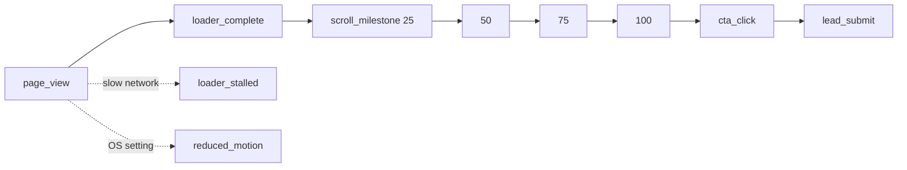

## 5. Metrics and Queries
| Metric | Definition | Goal |
|---|---|---|
| Average scroll depth | Highest milestone per session (0 when none), averaged over sessions with a `page_view` | ≥ 70% (G1) |
| CTA conversion | Sessions with `lead_submit` ÷ sessions with `page_view` | ≥ 3% (G2) |
| Loader stall rate | Sessions with `loader_stalled` ÷ sessions with `page_view` | Watch for increases |
| Loader time (median) | Median `ms` of `loader_complete` | ≤ 3000 desktop, ≤ 4000 mobile |

Depth only has four steps, so the average is an approximation. Read it as a trend.

```sql
-- Conversion rate, last 30 days
select
  count(distinct session_id) filter (where name = 'lead_submit')::numeric
  / nullif(count(distinct session_id) filter (where name = 'page_view'), 0) as conversion
from analytics_events
where created_at > now() - interval '30 days';

-- Average scroll depth, last 30 days
with views as (
  select distinct session_id from analytics_events
  where name = 'page_view' and created_at > now() - interval '30 days'
), depth as (
  select session_id, max((props->>'pct')::int) as pct
  from analytics_events
  where name = 'scroll_milestone' and created_at > now() - interval '30 days'
  group by session_id
)
select avg(coalesce(d.pct, 0)) as avg_depth
from views v left join depth d using (session_id);

-- Loader stall rate and median loader time by device
select device,
  count(distinct session_id) filter (where name = 'loader_stalled')::numeric
    / nullif(count(distinct session_id) filter (where name = 'page_view'), 0) as stall_rate,
  percentile_cont(0.5) within group (order by (props->>'ms')::numeric)
    filter (where name = 'loader_complete') as median_ms
from analytics_events
where created_at > now() - interval '30 days'
group by device;
```

## 6. Verifying Events
```sql
select name, props, created_at
from analytics_events
where session_id = '<id from sessionStorage "sid">'
order by created_at;
```
Expected for a full visit: `page_view`, `loader_complete`, four `scroll_milestone` rows, then `cta_click` and `lead_submit` if the form was used. This is check E-01 in the [QA Checklist](./09-QA-CHECKLIST.md).

## 7. Limits and Retention
- Ad blockers and privacy tools will drop some events. Treat the numbers as a floor.
- Bots may create `page_view` rows. Filter obvious ones by user agent if the numbers look inflated.
- Rows are deleted after 13 months ([Deployment Runbook](./08-DEPLOYMENT-RUNBOOK.md) §8).
- Plausible (optional, cookieless) can run alongside. It is not a replacement for the lead and funnel data above.

---

# 13 — Domain Dns Email

# Domain, DNS & Email
**Related:** [Deployment Runbook](./08-DEPLOYMENT-RUNBOOK.md) §2.3 · [Authentication](./06-AUTHENTICATION.md) §5 · [SEO & Discoverability](./14-SEO-AND-DISCOVERABILITY.md) · [Launch & Go-Live](./15-LAUNCH-AND-GO-LIVE.md) §4 · [Maintenance & Operations](./16-MAINTENANCE-AND-OPERATIONS.md) §1, §7

## 1. Purpose and Ownership
This document covers everything between "we need an address" and "mail and pages arrive reliably": registering the domain, DNS records, connecting Vercel, email authentication, and the email sender Supabase uses for sign-in links.

Start it in **week 1**. Registrar changes can take days, and email authentication needs a few weeks of monitoring before it can be tightened.

| Item | Owner | Where it is recorded |
|---|---|---|
| Registrar account | `[Company]` (a role mailbox, not a person's email) | Access register ([Maintenance §1](./16-MAINTENANCE-AND-OPERATIONS.md)) |
| DNS zone | DevOps | Record table in §3 |
| Mailboxes | `[Company]` admin | Access register |
| Renewal dates | PM | Calendar in [Maintenance §7](./16-MAINTENANCE-AND-OPERATIONS.md) |

## 2. Register the Domain
| Step | Detail |
|---|---|
| Choose the name | Short, easy to say, no hyphens or numbers if possible. Check trademarks and social handles before buying. |
| Choose the TLD | `.com` if available, plus the country TLD you serve. Register obvious typo variants only if they matter. |
| Pick a registrar | One with two-factor login, registrar lock and clear transfer rules. |
| Register under the company | Company name as registrant, role mailbox as contact. Never a freelancer's or employee's personal account. |
| Turn on protection | 2FA on the account, registrar lock, WHOIS privacy where the registry allows it, auto-renew on. |
| Register for several years | At least 2. Put the expiry date in the renewal calendar. |
| Record it | Registrar, account owner, expiry date and 2FA method go in the access register. |

## 3. DNS Plan
Keep DNS in **one** place. Use the registrar's DNS, Vercel DNS or a DNS provider such as Cloudflare. Mixing them is the most common cause of "it works for me" problems.

If you use a proxy (for example Cloudflare's orange cloud), set the records that point at Vercel to **DNS only**, unless you have tested the proxy with the CSP, caching and the `/frames/*` immutable headers.

| Type | Host | Value | Purpose |
|---|---|---|---|
| A | `@` | Value Vercel shows for the apex | Site (apex) |
| CNAME | `www` | Value Vercel shows | Site (`www`), redirected to the apex |
| MX | `@` | Your mail provider's MX records | Mailboxes |
| TXT | `@` | `v=spf1 include:<provider> ~all` | SPF. **One** SPF record only, see §5.2 |
| TXT or CNAME | `<selector>._domainkey` | From the mail or SMTP provider | DKIM |
| TXT | `_dmarc` | `v=DMARC1; p=none; rua=mailto:dmarc@<domain>` | DMARC, see §5.2 |
| TXT | `@` | From Search Console | Ownership check ([SEO §10](./14-SEO-AND-DISCOVERABILITY.md)) |
| CAA (optional) | `@` | `0 issue "letsencrypt.org"` | Restricts who may issue certificates. Vercel certificates come from Let's Encrypt, so leaving it out of a CAA record breaks issuance. |

Use the exact apex and `www` values shown in Vercel (Project → Settings → Domains). They can differ per project, so do not copy them from another site.

## 4. Connect the Domain to Vercel
1. Add the apex and `www` in Vercel. Choose the canonical host (apex recommended).
2. Set the other host to **redirect** to it (308). Do not serve the site on both.
3. Add the DNS records from §3. Wait until Vercel shows both as valid and the certificate as issued (HTTPS is automatic).
4. Staging: use the Vercel preview URL, or add `staging.<domain>` pointing at a staging deployment.
5. In Supabase Auth, add the production and staging URLs to the redirect allow-list ([Authentication §5](./06-AUTHENTICATION.md)).
6. Set `SITE_URL` in Vercel to the canonical URL ([SEO §3](./14-SEO-AND-DISCOVERABILITY.md)).
7. HSTS: once the site has been stable for a week and every subdomain you use is HTTPS, add the header:
```json
{ "key": "Strict-Transport-Security", "value": "max-age=31536000; includeSubDomains" }
```
Add it to the public header rule in `vercel.json`. Do not submit the domain to the HSTS preload list until you are sure you never need plain HTTP anywhere.

## 5. Email

### 5.1 Mailboxes
Create role mailboxes on the domain, not personal ones:

| Address | Used for |
|---|---|
| `hello@` | Public contact |
| `privacy@` | Privacy and deletion requests ([Privacy & Legal §4](./11-PRIVACY-AND-LEGAL.md)) |
| `dmarc@` | DMARC reports (§5.2) |
| `no-reply@` (or `auth@`) | Sender for sign-in emails (§5.3), usually without a mailbox |

Use a mailbox provider (Google Workspace, Microsoft 365, Zoho or similar). Add its MX records.

### 5.2 SPF, DKIM, DMARC
| Record | What it does | Rule |
|---|---|---|
| SPF | Lists who may send for the domain | Exactly one `v=spf1` record. Merge providers into it: `v=spf1 include:<mailbox provider> include:<smtp provider> ~all` |
| DKIM | Signs each message | Add the selector records each provider gives you |
| DMARC | Tells receivers what to do when SPF or DKIM fail | Roll out in stages |

DMARC rollout:
1. `p=none` with reports to `dmarc@`. Run for 2 to 4 weeks and fix any legitimate sender that fails.
2. `p=quarantine` (start with `pct=25`, then 100).
3. `p=reject` once reports are clean.

### 5.3 Sign-in Emails (Supabase Auth, v1.1)
The built-in Supabase sender is intended for testing, is heavily rate-limited, and may only deliver to your project's team members. Check the current Supabase documentation. Do not invite real editors until you have configured your own sender.

1. Pick a transactional email provider (for example Postmark, Resend, SendGrid or Amazon SES). Verify the sending domain there and add its SPF and DKIM records (§5.2).
2. In Supabase → Authentication → SMTP settings: enter host, port, username, password, and sender `no-reply@<domain>` with a clear sender name.
3. Edit the magic-link and invite templates: plain wording, the company name, and no promotional content.
4. Raise the auth email rate limit only as far as you need, after the custom sender works.
5. Test with a real inbox on each major provider you expect editors to use. In Gmail, "Show original" must show `SPF: PASS`, `DKIM: PASS`, `DMARC: PASS`.
6. Add the provider to the access register and the cost register ([Maintenance §1–2](./16-MAINTENANCE-AND-OPERATIONS.md)).

## 6. Other Verifications
Search Console and Bing Webmaster use a DNS TXT record to prove ownership. Add them after the site is live ([SEO §10](./14-SEO-AND-DISCOVERABILITY.md)). Keep the records in place permanently, since removing them revokes access.

## 7. TTL and Cutover
- Normal TTL: 3600 s.
- One to two days before the cutover, lower the TTL on the records you will change to 300 s ([Launch & Go-Live §4](./15-LAUNCH-AND-GO-LIVE.md)).
- After the site has been stable for a week, raise it back.

## 8. Verification Commands
```bash
dig +short A example.com                 # points at Vercel?
dig +short CNAME www.example.com
dig +short MX example.com
dig +short TXT example.com               # exactly one v=spf1 record?
dig +short TXT _dmarc.example.com
dig +short TXT <selector>._domainkey.example.com
curl -sI https://example.com | head -n 20           # 200, security headers
curl -sI http://www.example.com | grep -i location  # 308 to the canonical host
```
Also check the certificate and headers with a public SSL test and a security-headers scanner.

## 9. Renewals and Risks
| Risk | Impact | Prevention |
|---|---|---|
| Domain expires | Site and email go offline; the name can be taken | Auto-renew, 2+ year term, two calendar reminders (60 and 14 days) |
| Registrar account lost or hijacked | Loss of the domain | Company-owned account, 2FA, registrar lock, two named admins |
| Payment card expires | Auto-renew fails | Use a company card with a shared billing mailbox |
| Second SPF record added | Mail starts failing SPF | Merge into one record (§5.2) |
| DNS changed by accident | Outage | Change DNS only through the change process ([Maintenance §5](./16-MAINTENANCE-AND-OPERATIONS.md)); keep a copy of the record table |

## 10. Troubleshooting
| Symptom | Likely cause | Fix |
|---|---|---|
| Vercel says "Invalid configuration" | Records not saved or not propagated, or wrong values | Re-check §3 against the values in Vercel; wait up to the TTL |
| Certificate not issued | CAA record excludes Let's Encrypt, or the DNS still points elsewhere | Fix the CAA record or the A/CNAME |
| Site loads on `www` but not the apex (or reverse) | One record missing | Add the missing record and confirm the redirect |
| Sign-in emails land in spam | SPF/DKIM/DMARC not aligned for the sender domain | Verify the sending domain at the provider; check headers (§5.3) |
| Sign-in emails never arrive | Using the built-in Supabase sender, or rate limits | Configure custom SMTP (§5.3) |
| Mail from the mailbox fails SPF | Two SPF records, or a provider missing from the record | Merge into one |

---

# 14 — Seo And Discoverability

# SEO & Discoverability
**Related:** [PRD](./01-PRD.md) §8 · [TRD](./02-TRD.md) §3.1 · [Domain, DNS & Email](./13-DOMAIN-DNS-EMAIL.md) · [QA Checklist](./09-QA-CHECKLIST.md) §8 · [Analytics Spec](./12-ANALYTICS-SPEC.md)

## 1. Scope and Goals
| Goal | Target |
|---|---|
| Lighthouse SEO | ≥ 95 |
| Page text readable without running the video or the API | Yes |
| Correct title, description and preview image when the link is shared | Yes |
| Indexed by Google and Bing within 2 weeks of launch | Yes |

The site is one main page, so SEO here is about correctness and discoverability, not a content strategy.

## 2. Page Inventory
| URL | Indexed | Notes |
|---|---|---|
| `/` | Yes | Main page |
| `/privacy`, `/terms` | Yes | Static HTML files in `public/` |
| `/admin`, `/admin/*` | **No** | `noindex` header ([Runbook §4](./08-DEPLOYMENT-RUNBOOK.md)). Do not list in the sitemap. Do **not** block it in `robots.txt`, or crawlers cannot see the `noindex` header. |
| `/api/*` | No | Disallowed in `robots.txt` |
| `/404` | No | Served for unknown URLs (§8) |

## 3. Build-Time Injection
Search and social crawlers read the **HTML as served**. Many do not run JavaScript, and the title, description and overlay text live in the database. So they are written into `index.html` **at build time**.

1. `npm run export:content` writes `public/content/home.json`. In addition to the `PageConfig`, the file carries two static-only fields read from `pages`: `metaDescription` and `ogImageUrl`.
2. A small Vite plugin reads that file during the build and fills markers in `index.html`.

```html
<!-- index.html -->
<head>
  <meta charset="utf-8" />
  <meta name="viewport" content="width=device-width, initial-scale=1" />
  <!--SEO_HEAD-->
</head>
<body>
  ...
  <noscript><main><!--NOSCRIPT_TEXT--></main></noscript>
</body>
```
```js
// scripts/inject-content.mjs  (add to the plugins array in vite.config.js)
import { readFileSync } from 'node:fs';

const esc = (s = '') => String(s).replace(/&/g, '&amp;').replace(/</g, '&lt;').replace(/"/g, '&quot;');

export function injectContent(file = 'public/content/home.json') {
  return {
    name: 'inject-content',
    transformIndexHtml(html) {
      const c = JSON.parse(readFileSync(file, 'utf8'));
      const site = process.env.SITE_URL;               // https://example.com, no trailing slash
      const head = [
        `<title>${esc(c.title)}</title>`,
        `<meta name="description" content="${esc(c.metaDescription)}" />`,
        `<link rel="canonical" href="${site}/" />`,
        `<meta property="og:type" content="website" />`,
        `<meta property="og:title" content="${esc(c.title)}" />`,
        `<meta property="og:description" content="${esc(c.metaDescription)}" />`,
        `<meta property="og:url" content="${site}/" />`,
        `<meta property="og:image" content="${site}${esc(c.ogImageUrl)}" />`,
        `<meta name="twitter:card" content="summary_large_image" />`,
      ].join('\n  ');
      const text = c.scenes.flatMap((s) => s.overlays)
        .map((o) => `<h2>${esc(o.heading)}</h2>${o.body ? `<p>${esc(o.body)}</p>` : ''}`)
        .join('\n');
      return html.replace('<!--SEO_HEAD-->', head).replace('<!--NOSCRIPT_TEXT-->', text);
    },
  };
}
```
Consequences:
- Changing the page title, description or OG image in the database does **not** change the HTML until the next build. Trigger a redeploy after editing them.
- Overlay text is in the HTML for no-JavaScript visitors and simple crawlers. Googlebot runs JavaScript and will also see the text the page renders.
- Run `npm run export:content` before every production build (add it to the build command or the CI step).

## 4. Head Tags
| Tag | Rule |
|---|---|
| `<title>` | Up to 60 characters. `[Primary message] \| [Company]` |
| Meta description | Up to 155 characters, one clear benefit and a call to action |
| Canonical | Absolute URL of the canonical host |
| `og:image` | **Absolute** URL, 1200×630 (`/posters/og.jpg`, [Asset Pipeline](./07-ASSET-PIPELINE.md)) |
| `twitter:card` | `summary_large_image` |
| Headings | One `<h1>` (the hero title), then `<h2>` per overlay |
| Images | Meaningful `alt` text; the poster described, decorative images `alt=""` |
| `lang` | `<html lang="en">` |

Also keep these static tags in `index.html`:
```html
<meta name="theme-color" content="#000000" />
<link rel="icon" href="/favicon.ico" sizes="32x32" />
<link rel="icon" href="/icon.svg" type="image/svg+xml" />
<link rel="apple-touch-icon" href="/apple-touch-icon.png" />
<link rel="manifest" href="/site.webmanifest" />
```

## 5. `robots.txt` and Sitemap
```
# public/robots.txt
User-agent: *
Allow: /
Disallow: /api/
Sitemap: https://example.com/sitemap.xml
```
```xml
<!-- public/sitemap.xml -->
<?xml version="1.0" encoding="UTF-8"?>
<urlset xmlns="http://www.sitemaps.org/schemas/sitemap/0.9">
  <url><loc>https://example.com/</loc><lastmod>2026-11-27</lastmod></url>
  <url><loc>https://example.com/privacy</loc></url>
  <url><loc>https://example.com/terms</loc></url>
</urlset>
```
Replace the domain and dates. Set `"cleanUrls": true` in `vercel.json` ([Runbook §4](./08-DEPLOYMENT-RUNBOOK.md)) so `privacy.html` is served at `/privacy`. Update `lastmod` when the content changes.

## 6. Structured Data
Add one JSON-LD block to `index.html`. It is a data block, so the public CSP does not affect it.
```html
<script type="application/ld+json">
{
  "@context": "https://schema.org",
  "@type": "Organization",
  "name": "[Company]",
  "url": "https://example.com",
  "logo": "https://example.com/icon-512.png"
}
</script>
```
Validate it with a structured-data testing tool after every change.

## 7. Favicons and Icons
| File | Size | Used for |
|---|---|---|
| `favicon.ico` | 32×32 | Browsers |
| `icon.svg` | Vector | Modern browsers |
| `apple-touch-icon.png` | 180×180 | iOS home screen |
| `icon-192.png`, `icon-512.png` | 192, 512 | Web manifest and structured data |
| `site.webmanifest` | | Name, icons, `theme_color` |

## 8. Error Pages and Redirects
- `public/404.html` in the site's style: a short message and a link home. Vercel serves it for unknown URLs with a 404 status.
- One canonical host: the other host redirects with 308 ([Domain §4](./13-DOMAIN-DNS-EMAIL.md)).
- If the domain replaces an older site, map every old URL to its new target ([Launch & Go-Live §4](./15-LAUNCH-AND-GO-LIVE.md)). Use permanent redirects, never "everything to the homepage".

## 9. UTM Convention
Campaign links carry UTM parameters. The lead form stores `utm_source` in `leads.source` and the full set in `leads.utm`, and `page_view` records `utmSource` ([Analytics Spec §2](./12-ANALYTICS-SPEC.md)).

| Parameter | Rule | Examples |
|---|---|---|
| `utm_source` | Where the link lives | `instagram`, `newsletter`, `partner-name` |
| `utm_medium` | Type of channel | `social`, `email`, `cpc`, `referral` |
| `utm_campaign` | Campaign and month | `launch-2026-11` |

Lowercase only, words separated by hyphens, never spaces. Keep a shared sheet of live links.

## 10. Search Console and Bing Webmaster
1. After launch, add the domain as a **Domain property** (verified with the DNS TXT record, [Domain §6](./13-DOMAIN-DNS-EMAIL.md)).
2. Submit `https://<domain>/sitemap.xml`.
3. Request indexing for `/`.
4. Check the Page indexing report after 3 days and again after 2 weeks.
5. Once there is enough traffic, watch the Core Web Vitals report. It uses real-user data, which complements Lighthouse CI.
6. Repeat for Bing Webmaster Tools.

## 11. SEO Checks
These are run as part of the [QA Checklist §8](./09-QA-CHECKLIST.md) (S-01 to S-09).

| Check | Pass |
|---|---|
| View source of the built page | Title, description, canonical, OG tags and overlay text are present without running JavaScript |
| Share the URL in a chat app and on a social network | Correct title, description and image |
| `robots.txt` and `sitemap.xml` open at the root | Yes; sitemap lists only public pages |
| Structured data validates | No errors |
| `/admin` | `noindex`, absent from the sitemap |
| Unknown URL | Custom 404 with a 404 status |

---

# 15 — Launch And Go Live

# Launch & Go-Live
**Related:** [PRD](./01-PRD.md) §12 · [Deployment Runbook](./08-DEPLOYMENT-RUNBOOK.md) §5–7, §12 · [QA Checklist](./09-QA-CHECKLIST.md) · [Domain, DNS & Email](./13-DOMAIN-DNS-EMAIL.md) · [Implementation Plan](./17-IMPLEMENTATION-PLAN.md) §4

## 1. Roles
R = does the work, A = accountable (one person), C = consulted, I = informed.

| Activity | PM | Designer | Frontend | Backend / DevOps | QA | Legal / Counsel | Marketing / Editor | Stakeholder |
|---|---|---|---|---|---|---|---|---|
| Go / No-Go decision | R | I | C | C | C | C | C | A |
| QA sign-off | I | I | C | C | A/R | | | I |
| Legal checklist ([Privacy §9](./11-PRIVACY-AND-LEGAL.md)) | A | | | C | | R | I | I |
| DNS cutover | A | | I | R | C | | I | I |
| Smoke test and monitoring | I | | C | A/R | C | | | |
| Launch communications | A | | | | | | R | C |
| 72-hour watch | A | | C | R | C | | C | I |
| Day-7 / day-30 review | A/R | C | C | C | | | C | C |

## 2. Timeline
`L` is launch day. The plan's milestones are M4 (release candidate and Go/No-Go) and M5 (launch, 2026-11-27) in the [Implementation Plan](./17-IMPLEMENTATION-PLAN.md).

| When | What | Owner |
|---|---|---|
| L − 14 days | Domain and email set up ([Domain §2–5](./13-DOMAIN-DNS-EMAIL.md)); legal drafts with counsel | DevOps, PM |
| L − 10 | Content freeze; editors trained ([Editor Guide](./10-CONTENT-EDITOR-GUIDE.md)) | PM |
| L − 7 | Release candidate on a preview URL; full [QA Checklist](./09-QA-CHECKLIST.md) run | QA |
| L − 5 | Fix all P0 and P1 findings; re-test | FE, BE |
| L − 3 | **Go / No-Go meeting** (§3) | PM, Stakeholder |
| L − 2 | Lower DNS TTL to 300 s ([Domain §7](./13-DOMAIN-DNS-EMAIL.md)); apply production migrations | DevOps |
| L − 1 | Production deploy to the Vercel URL (domain not switched yet); smoke test (§4 step 3) | DevOps |
| **L** | DNS cutover (§4); launch communications (§7) | DevOps, Marketing |
| L + 1 to L + 3 | 72-hour watch (§6) | DevOps |
| L + 7 | Review (§8); raise DNS TTL | PM |
| L + 30 | Review (§8); retro; backlog | PM |

> **Check the launch day.** The plan's M5 date (2026-11-27) is a Friday, and in the US it is the Friday after Thanksgiving. A Friday launch puts most of the 72-hour watch on a weekend, and busy shopping days can crowd out your launch message. Unless someone is on call all weekend, prefer a Tuesday or Wednesday. If you move it, move M4 and M5 together.

## 3. Go / No-Go
Every line must be **Yes**. One **No** means no-go until it is fixed or the Stakeholder accepts the risk in writing.

| # | Criterion | Evidence |
|---|---|---|
| 1 | All P0 requirements done; no open P0 or P1 bugs | Issue tracker |
| 2 | QA sign-off block complete | [QA Checklist §12](./09-QA-CHECKLIST.md) |
| 3 | Lighthouse: Performance ≥ 85, Accessibility ≥ 95, SEO ≥ 95; budgets pass | Lighthouse CI report |
| 4 | Legal checklist complete; policy pages live on the preview | [Privacy & Legal §9](./11-PRIVACY-AND-LEGAL.md) |
| 5 | Production environment ready: env vars set, migrations applied, retention jobs created | [Runbook §2–3, §8](./08-DEPLOYMENT-RUNBOOK.md) |
| 6 | Domain registered, DNS prepared, certificate ready, mailboxes and email authentication working | [Domain §2–5](./13-DOMAIN-DNS-EMAIL.md) |
| 7 | SEO assets in place (sitemap, robots, icons, 404) | [SEO §11](./14-SEO-AND-DISCOVERABILITY.md) |
| 8 | Monitoring and alerts set; the on-call person for the next 72 hours is named | [Runbook §9](./08-DEPLOYMENT-RUNBOOK.md) |
| 9 | Rollback tested on the preview or staging deployment | [Runbook §7](./08-DEPLOYMENT-RUNBOOK.md) |
| 10 | Editors can change copy unaided | [Editor Guide](./10-CONTENT-EDITOR-GUIDE.md) |
| 11 | Stakeholder approved the visual QA | Written approval |

Record the decision, the date, who attended and any accepted risks.

## 4. DNS Cutover
Run in this order. The person who runs each step ticks it.

| # | Step | Done |
|---|---|---|
| 1 | TTL on the records to be changed is 300 s (set at L − 2) | ☐ |
| 2 | Production `main` is deployed; `SITE_URL` is the final domain | ☐ |
| 3 | Smoke test on the Vercel URL passes ([Runbook §7](./08-DEPLOYMENT-RUNBOOK.md)) | ☐ |
| 4 | Domains added in Vercel, canonical host chosen, redirect set ([Domain §4](./13-DOMAIN-DNS-EMAIL.md)) | ☐ |
| 5 | If the domain served an old site: redirect map ready and tested (table below) | ☐ |
| 6 | Change the A and CNAME records. Keep a copy of the old values. | ☐ |
| 7 | Confirm resolution with `dig` and that the certificate is issued | ☐ |
| 8 | Smoke test again on the real domain | ☐ |
| 9 | Supabase redirect allow-list and Auth site URL use the final domain | ☐ |
| 10 | Uptime monitor and alerts point at the real domain | ☐ |
| 11 | Search Console and Bing verified; sitemap submitted ([SEO §10](./14-SEO-AND-DISCOVERABILITY.md)) | ☐ |
| 12 | Share a link in a chat app and on one social network and check the preview | ☐ |
| 13 | Announce (§7) | ☐ |

Redirect map for an existing site (permanent redirects only):

| Old URL | New URL | Tested |
|---|---|---|
| `/old-page` | `/` or the closest page | ☐ |

Keep the old hosting running for at least 7 days so a DNS rollback is possible.

## 5. Rollback Triggers
Decide these before launch, so nobody debates them during an incident.

| Trigger | Action |
|---|---|
| A P0 bug with no fix within 2 hours | Roll back the deployment ([Runbook §7](./08-DEPLOYMENT-RUNBOOK.md)) |
| API 5xx rate above 5% for 15 minutes | Investigate; roll back the deployment if it started with the release |
| Lead form failing for all users | Fix or roll back immediately. Leads are the main conversion. |
| Site unreachable or wrong certificate after the cutover | Restore the old DNS values (they propagate within the 300 s TTL) |
| Personal data exposed | Follow [Runbook §12](./08-DEPLOYMENT-RUNBOOK.md) and [Privacy & Legal §8](./11-PRIVACY-AND-LEGAL.md) |

## 6. 72-Hour Watch
One named person owns each check. Write down what you saw each time, even if it is "all normal".

| When | Check | Look for |
|---|---|---|
| L + 1 h | Smoke test; uptime monitor; error logs | Any 5xx, console errors, certificate warnings |
| L + 1 h | Submit a test lead, then delete it | Works end to end |
| L + 4 h | `analytics_events` volume by event name | `page_view` growing; `loader_stalled` rate normal ([Analytics §5](./12-ANALYTICS-SPEC.md)) |
| L + 24 h | Lead count; function error rate; database usage | Leads arriving; no limit warnings |
| L + 24 h | Real device check (one iPhone, one Android) | Scrub smooth; loader behaves |
| L + 48 h | Search Console: coverage, sitemap status | Pages discovered, no errors |
| L + 72 h | Summary note to the team | Issues found, fixed and open |

## 7. Communications
| Audience | What | Owner | Link rule |
|---|---|---|---|
| Internal team | Launch message with the URL and who to contact | PM | |
| Stakeholders | Go-live confirmation and the first-day numbers | PM | |
| Customers and social followers | Announcement | Marketing | Every link has UTM parameters ([SEO §9](./14-SEO-AND-DISCOVERABILITY.md)) |
| Partners and press | Short note with the OG preview checked | Marketing | UTM `medium=referral` |
| Support mailbox | Draft replies for common questions | Marketing | |

Keep the announcement for after DNS and the smoke test (§4 step 13).

## 8. Day-7 and Day-30 Review
Use the SQL in the [Analytics Spec §5](./12-ANALYTICS-SPEC.md).

| Goal | Measure | Target | Result |
|---|---|---|---|
| G1 Engagement | Average scroll depth | ≥ 70% | |
| G2 Conversion | CTA conversion | ≥ 3% | |
| G3 Speed | LCP, median loader time, scrub smoothness | LCP < 2.5 s; loader ≤ 3 s desktop / ≤ 4 s mobile | |
| G4 Easy updates | Copy changes made without a developer | At least one | |
| G5 Safe management | Access review; no unexplained admin actions in `audit_log` (v1.1) | Clean | |

Then hold a short retro: what worked, what slipped, what to change. Put follow-ups in the backlog and note scope decisions in the [CHANGELOG](../CHANGELOG.md).

## 9. Handover
Complete before the project team stands down.

| Item | Done |
|---|---|
| Access register complete, every account has two named admins ([Maintenance §1](./16-MAINTENANCE-AND-OPERATIONS.md)) | ☐ |
| Cost register and renewal calendar filled in ([Maintenance §2, §7](./16-MAINTENANCE-AND-OPERATIONS.md)) | ☐ |
| Routine tasks scheduled with owners ([Maintenance §3](./16-MAINTENANCE-AND-OPERATIONS.md)) | ☐ |
| Editors trained; Editor Guide handed over | ☐ |
| On-call and support contacts published | ☐ |
| Documentation set stored in the repo and up to date | ☐ |

---

# 16 — Maintenance And Operations

# Maintenance & Operations
**Related:** [Deployment Runbook](./08-DEPLOYMENT-RUNBOOK.md) §7–12 · [Domain, DNS & Email](./13-DOMAIN-DNS-EMAIL.md) · [Launch & Go-Live](./15-LAUNCH-AND-GO-LIVE.md) §9 · [Privacy & Legal](./11-PRIVACY-AND-LEGAL.md) · [Authentication](./06-AUTHENTICATION.md)

## 1. Ownership and Access
Every account has an owner and a backup, so one person leaving never locks the team out.

| Account | Owner | Backup | 2FA | Notes |
|---|---|---|---|---|
| Domain registrar | `[name]` | `[name]` | ☐ | Company-owned ([Domain §2](./13-DOMAIN-DNS-EMAIL.md)) |
| DNS provider (if separate) | | | ☐ | |
| Vercel | | | ☐ | Team plan, not a personal account |
| Supabase (staging, production) | | | ☐ | |
| GitHub | | | ☐ | Branch protection on `main` |
| Mailbox provider | | | ☐ | |
| Transactional email / SMTP | | | ☐ | |
| Uptime monitoring | | | ☐ | |
| Search Console, Bing Webmaster | | | ☐ | |
| Figma | | | ☐ | |
| Password manager (shared vault) | | | ☐ | Holds all shared credentials |

Rules:
- Shared credentials live in the password manager, never in chat or the repo.
- Review the list quarterly and on every staff change ([Runbook §11](./08-DEPLOYMENT-RUNBOOK.md)).
- Editors and admins of the site itself are listed in the `editors` table (v1.1) and reviewed with the same cadence.

### Who does what in operation
| Task | Owner | Backup |
|---|---|---|
| Site health, deploys, incidents | DevOps | Frontend lead |
| Content changes | Marketing editor | Admin |
| Leads and privacy requests | Admin | PM |
| Budget and renewals | PM | Stakeholder |
| Legal and policy updates | Counsel via PM | |

## 2. Cost Register
Fill in the amounts from your own invoices. Prices and plan limits change, so check each provider's current terms.

| Item | Cycle | Renewal date | Cost | Owner |
|---|---|---|---|---|
| Domain(s) | Yearly | | `[ ]` | PM |
| Vercel plan | Monthly | | `[ ]` | DevOps |
| Supabase plan (production) | Monthly | | `[ ]` | DevOps |
| Supabase (staging) | Monthly | | `[ ]` | DevOps |
| Mailbox provider | Per user, monthly | | `[ ]` | PM |
| Transactional email / SMTP | Monthly | | `[ ]` | DevOps |
| Uptime monitoring | Monthly | | `[ ]` | DevOps |
| Optional: Plausible | Monthly | | `[ ]` | Marketing |
| Optional: CRM / email marketing | Monthly | | `[ ]` | Marketing |
| Design tool seats | Yearly | | `[ ]` | Designer |

Points that change the bill:
- **Bandwidth is the main variable cost.** A visitor who loads the full desktop set downloads up to about 12 MB. 10,000 such visits are about 120 GB. Compare that with the bandwidth included in your hosting plan. Mobile (≈ 5 MB) and AVIF reduce it.
- **Commercial use needs a paid hosting plan.** Free hobby tiers are usually restricted to non-commercial projects. Check the current Vercel terms before launch.
- **Free database projects may be paused when inactive.** A paused database would break the lead form. Use a paid production plan and check the provider's current policy.
- Review the register monthly against the invoices and set a spending alert where the provider offers one.

## 3. Routine Tasks
| Cadence | Task | Owner |
|---|---|---|
| Daily (first month), then weekly | Uptime alerts and error logs | DevOps |
| Weekly | Export or sync new leads to the CRM; check for privacy requests | Admin |
| Weekly | Review analytics (conversion, depth, stalls) ([Analytics §5](./12-ANALYTICS-SPEC.md)) | Marketing |
| Monthly | `npm outdated` and `npm audit`; apply updates (§4) | Frontend |
| Monthly | Check hosting and database usage against plan limits; reconcile the cost register | DevOps |
| Monthly | Confirm the retention jobs ran (`cron.job_run_details`, [Runbook §8](./08-DEPLOYMENT-RUNBOOK.md)) | DevOps |
| Quarterly | Rotate keys and salts ([Runbook §11](./08-DEPLOYMENT-RUNBOOK.md)) | DevOps |
| Quarterly | Access review (§1); remove unused editors | Admin |
| Quarterly | Restore test (§6) | DevOps |
| Quarterly | Re-run Lighthouse CI, accessibility spot check, and the device matrix when a new iOS or Android major version ships | QA |
| Quarterly | Check DMARC reports; tighten the policy when clean ([Domain §5.2](./13-DOMAIN-DNS-EMAIL.md)) | DevOps |
| Yearly | Review privacy policy, terms and processor agreements ([Privacy & Legal](./11-PRIVACY-AND-LEGAL.md)) | PM, Counsel |
| Yearly | Renew the domain and other annual items (§7) | PM |

## 4. Dependency and Security Patching
| Severity | Target time to patch |
|---|---|
| Critical (actively exploited, or exposes data) | 48 hours |
| High | 7 days |
| Medium | 30 days |
| Low | Next routine update |

Process:
1. Enable automated update PRs (Dependabot or Renovate) and security alerts on GitHub.
2. Every update goes through the normal PR checks: lint, unit, contract, build, Lighthouse CI.
3. Pin GSAP, Lenis and `supabase-js` to exact versions. Test their upgrades on a preview first, because they affect the scrub and the sign-in flow.
4. Record notable updates in the [CHANGELOG](../CHANGELOG.md).

## 5. Requests and Change Control
| Type of change | Examples | Who approves | How |
|---|---|---|---|
| Content | Overlay copy, timing, CTA | Marketing lead | Editor makes it directly ([Editor Guide](./10-CONTENT-EDITOR-GUIDE.md)) |
| Build-time content | Page title, meta description, OG image | Marketing lead | Developer redeploys ([SEO §3](./14-SEO-AND-DISCOVERABILITY.md)) |
| Assets | New video or frames | PM + Designer | Follow [Asset Pipeline §8](./07-ASSET-PIPELINE.md) with a version folder |
| Code | Features, fixes | PM | PR, review, checks, release ([Runbook §6](./08-DEPLOYMENT-RUNBOOK.md)) |
| Infrastructure | DNS, headers, keys, plans | PM + DevOps | Written request; DevOps keeps a copy of the previous values |
| Scope during the build | New scene, new page, new tracking | PM + Stakeholder | Add to the backlog; scope creep is rated High in the plan's risk register ([Plan §6](./17-IMPLEMENTATION-PLAN.md)). Large items go to v2. |

Support requests go to a single mailbox or channel. Target first reply: 1 business day. Production-down issues follow [Runbook §12](./08-DEPLOYMENT-RUNBOOK.md).

## 6. Restore Test (quarterly)
1. Restore the latest backup into a scratch Supabase project, or import a recent export. Confirm what your plan's backups cover ([Runbook §10](./08-DEPLOYMENT-RUNBOOK.md)).
2. Check that `pages`, `scenes`, `overlays` and `frame_sets` return the live `PageConfig`.
3. Check that the lead count is within a day of production.
4. Delete the scratch project and any exported personal data.
5. Record the date, the result and the time it took.

## 7. Annual Calendar
| Item | When | Reminder |
|---|---|---|
| Domain renewal | `[date]` | 60 and 14 days before |
| Hosting and database plan renewals | `[dates]` | 30 days before |
| SMTP, mailbox, monitoring renewals | `[dates]` | 30 days before |
| Privacy policy and terms review | `[month]` | 30 days before |
| Processor agreement review | `[month]` | 30 days before |
| Key and salt rotation | Quarterly | Calendar series |
| Accessibility and device re-test | Quarterly | Calendar series |

## 8. Retiring the Site
If the site is ever taken down:
1. Export what you must keep (leads, if you still have consent to hold them) and delete the rest.
2. Redirect the domain to a successor page, or keep a minimal notice page.
3. Keep the domain registered, so the name cannot be taken over.
4. Close or downgrade paid plans, remove access, and cancel processor agreements.
5. Record the date and decisions in the [CHANGELOG](../CHANGELOG.md).

---

# 18 — FRONTEND ARCHITECTURE

**Suggested filename:** `18-FRONTEND-ARCHITECTURE.md`  
**Purpose:** Frontend application structure, module boundaries, rendering lifecycle, routing, and coding conventions.

## 1. Purpose and scope
Describe the browser application and its responsibilities. Keep public visitor code separate from the admin entry point.

## 2. Frontend architecture
Document the runtime flow from `index.html` to `main.js`, content loading, frame loading, canvas rendering, overlays, lead form, and analytics. Include a Mermaid component diagram.

## 3. Application entry points
| Entry | File | Audience | Responsibilities |
|---|---|---|---|
| Public | `index.html` | Visitors | Landing page and scroll experience |
| Admin | `admin.html` | Invited staff | Sign-in and content administration |

## 4. Source and folder structure
Record the actual `src/` tree. For every module specify its purpose, public exports, dependencies, and owner. Keep the documented tree synchronized with the repository.

## 5. Rendering lifecycle
Specify initialization order, config retrieval, frame-set selection, preload strategy, canvas sizing, draw scheduling, resize handling, and cleanup.

## 6. Routing and navigation
Document supported public routes, admin routes, anchors, 404 behavior, and direct-navigation behavior. State which routes are `noindex`.

## 7. Browser state and error boundaries
Define loading, ready, stalled, reduced-motion, offline, API-failure, and empty-content states. Explain the user-visible fallback for each.

## 8. Security boundaries
The browser must not contain the Supabase service-role key or query Postgres directly. Document which calls are public and which require server-side authorization.

## 9. Performance constraints
Record bundle budgets, frame loading budgets, rendering targets, lazy-loading rules, and measurement method. Link to Performance Engineering.

## 10. Testing strategy
List unit, integration, browser, visual-regression, and device tests. Link each critical requirement to a test ID.

## 11. Decisions and open questions
| ID | Decision / question | Owner | Status | Due date |
|---|---|---|---|---|
| FE-001 | `[decision]` | `[owner]` | Open | `[date]` |


---

# 19 — BACKEND ARCHITECTURE

**Suggested filename:** `19-BACKEND-ARCHITECTURE.md`  
**Purpose:** Server-side layers, request lifecycle, data access, validation, authorization, and failure handling.

## 1. Purpose and scope
Describe the server-side responsibilities hosted as Vercel Serverless Functions and backed by Supabase.

## 2. Architecture diagram
Add a Mermaid diagram showing browser → Vercel API functions → validation/authorization → Supabase Postgres/Auth/Storage. Mark trust boundaries and secret-bearing components.

## 3. Backend components
| Component | Responsibility | Runtime | Source location |
|---|---|---|---|
| Page content API | Return published page configuration | Vercel Function | `api/page/` |
| Lead API | Validate consent and store lead | Vercel Function | `api/leads` |
| Events API | Accept allow-listed analytics batches | Vercel Function | `api/events` |
| Admin API | Enforce role checks and perform admin actions | Vercel Function | `api/admin/` |

## 4. Request lifecycle
For each route document parsing, schema validation, authentication, authorization, database operation, response serialization, logging, and error mapping.

## 5. Data access
Document use of the Supabase service-role key on the server only, connection behavior, query limits, transactions, indexes, and migration ownership. Explain why browser clients do not access Postgres directly.

## 6. Authentication and authorization
Reference `06-AUTHENTICATION.md`. Define public, editor, and admin route classes and deny-by-default behavior.

## 7. Validation and abuse prevention
Specify input schemas, maximum payload sizes, rate limits, honeypot behavior, duplicate handling, CORS/origin policy, and safe error messages.

## 8. Reliability
Define timeouts, retries (only where safe), idempotency, database outage behavior, static content fallback, and degraded-mode behavior.

## 9. Observability
Specify structured log fields, request IDs, error reporting, alert thresholds, and sensitive-data redaction.

## 10. Capacity and scaling
Record expected traffic, concurrency assumptions, database limits, function limits, and load-test results.

## 11. Open decisions
Track unresolved architecture decisions with owner, impact, and due date.


---

# 20 — COMPONENT LIBRARY & DESIGN SYSTEM

**Suggested filename:** `20-COMPONENT-LIBRARY-DESIGN-SYSTEM.md`  
**Purpose:** Reusable UI components, tokens, variants, accessibility, and usage rules.

## 1. Principles
Use the existing visual direction: dark, cinematic, spacious, concise, and purposeful. The public experience prioritizes the video; admin screens prioritize clarity and speed.

## 2. Design tokens
Reference `04-UI-UX-DESIGN-BRIEF.md`. Maintain one source of truth for color, typography, spacing, radius, shadows, breakpoints, and motion durations.

## 3. Component inventory
| Component | Variants | States | Used in | Owner |
|---|---|---|---|---|
| Button | Primary, secondary, text | Default, hover, focus, disabled, loading | Public/admin | `[owner]` |
| Overlay | Center, left, right | Hidden, entering, visible, exiting | Public | `[owner]` |
| Lead form | Default, success, error | Idle, submitting, success, invalid | Public | `[owner]` |
| Loader | Initial, stalled | Loading, stalled, complete | Public | `[owner]` |
| Admin table | Default, empty | Loading, populated, empty, error | Admin | `[owner]` |

## 4. Component specification template
For each component record purpose, anatomy, variants, properties, responsive behavior, keyboard behavior, screen-reader labels, visual states, examples, and prohibited usage.

## 5. Naming and implementation rules
Define file naming, CSS class conventions, token usage, composition rules, and when a component should remain page-specific.

## 6. Motion
Document duration, easing, reduced-motion alternative, and which movement is scroll-driven. Do not add decorative animation that competes with the video.

## 7. Governance
Describe how a new token or component is proposed, reviewed, tested, documented, and deprecated.


---

# 21 — STATE MANAGEMENT

**Suggested filename:** `21-STATE-MANAGEMENT.md`  
**Purpose:** Client-side state, server state, cache rules, persistence, and state transitions.

## 1. State inventory
| State | Owner | Lifetime | Persistence | Source of truth |
|---|---|---|---|---|
| Page configuration | Content loader | Page session | Static JSON fallback | API / fallback JSON |
| Frame preload status | Canvas module | Page session | None | Image load events |
| Scroll progress | Scroll controller | Current page | None | Scroll position |
| Overlay visibility | Overlay module | Current page | None | Scroll progress + config |
| Lead form status | Lead form module | Current page | None | API response |
| Admin session | Supabase Auth | Session | Supabase-managed | Supabase Auth |

## 2. State ownership rules
Each state has one owner. Avoid duplicated state between modules. Document which values are derived and must not be stored independently.

## 3. State machines
Add diagrams for loader, lead form, content editor save/publish, and authentication states. Define valid transitions and rejected transitions.

## 4. Persistence
Document session-only values such as the analytics session ID, authentication-managed tokens, and values that must never be stored in local storage. Do not persist sensitive lead data in the browser.

## 5. Server cache and invalidation
Specify cache headers for public content, admin responses, static assets, and fallback JSON. Document when publishing content takes effect.

## 6. Loading, empty, and error states
For every asynchronous operation define loading UI, timeout, retry behavior, empty state, recoverable error, and fatal error.

## 7. Race conditions and concurrency
Document stale responses, duplicate submits, rapid scroll/resize events, cancellation, and editor simultaneous updates.

## 8. Test cases
Provide transition tests, persistence tests, stale-response tests, and reduced-motion tests.


---

# 22 — API DOCUMENTATION

**Suggested filename:** `22-API-DOCUMENTATION.md`  
**Purpose:** Endpoint catalog and exact HTTP contracts for public and admin APIs.

## 1. Conventions
Document base URL, JSON encoding, date format, pagination, request IDs, cache headers, and versioning policy. All examples must use placeholder values, never real secrets or personal data.

## 2. Endpoint index
| Method | Endpoint | Auth | Purpose | Spec section |
|---|---|---|---|---|
| GET | `/api/page/:slug` | Public | Published page configuration | §3 |
| POST | `/api/leads` | Public + abuse controls | Create or deduplicate lead | §4 |
| POST | `/api/events` | Public + allow-list | Record analytics batch | §5 |
| `/api/admin/*` | As defined in Authentication | Editor/admin | Admin operations | §6 |

## 3. Page content endpoint
Document path parameters, response schema, published-only behavior, cache policy, static fallback, and 404 response.

## 4. Lead submission endpoint
Document request fields, required consent, validation, honeypot, rate limit, duplicate behavior, success response, and error responses.

## 5. Analytics endpoint
Document event allow-list, batch size, payload limits, accepted device values, fire-and-forget behavior, and 204 response.

## 6. Admin endpoints
For every route specify method, path, required role, headers, query parameters, request body, response body, status codes, and audit-log side effects. Reference `06-AUTHENTICATION.md` for the authoritative role matrix.

## 7. Error model
| HTTP status | Error code | Meaning | Client action |
|---|---|---|---|
| 400 | `validation_error` | Invalid input | Show field-level message |
| 401 | `unauthenticated` | Missing/invalid session | Sign in again |
| 403 | `forbidden` | Insufficient role | Show access denied |
| 429 | `rate_limited` | Request threshold reached | Wait and retry if appropriate |
| 500 | `internal_error` | Unexpected server failure | Show safe generic message |

## 8. Security and compatibility
Document origin checks, authorization, payload limits, PII redaction, deprecation policy, and contract tests.


---

# 23 — INTEGRATION DOCUMENTATION

**Suggested filename:** `23-INTEGRATION-DOCUMENTATION.md`  
**Purpose:** External service integrations, credentials, event flows, retries, and ownership.

## 1. Integration inventory
| Service | Purpose | Environment | Credential owner | Criticality |
|---|---|---|---|---|
| Vercel | Hosting and serverless functions | Preview/production | DevOps | Critical |
| Supabase | Database, Auth, Storage | Staging/production | DevOps | Critical |
| GitHub | Source control and CI | Repository | Tech lead | Critical |
| SMTP provider | Sign-in email delivery | Production | DevOps | High |
| Analytics provider | Optional external analytics | If enabled | Marketing | Optional |

## 2. Per-integration specification
Record business purpose, data exchanged, endpoints/scopes, authentication method, secret storage, environments, rate limits, timeouts, retries, idempotency, webhook verification, failure behavior, support contact, and offboarding procedure.

## 3. Data-flow and privacy review
Map each field sent to each provider. Confirm data minimization, retention, region, data-processing agreement, and privacy-policy disclosure before enabling a service.

## 4. Failure and recovery matrix
| Failure | User impact | Detection | Fallback | Owner |
|---|---|---|---|---|
| Supabase unavailable | Dynamic content/API may fail | API errors | Last-good static content where supported | DevOps |
| SMTP delivery delayed | Editor cannot receive sign-in link promptly | Delivery metrics | Provider support / resend policy | DevOps |
| Analytics unavailable | Metrics delayed/lost | Delivery monitoring | Site continues; never block scroll | Frontend |

## 5. Change management
Require sandbox testing, secret rotation, staging verification, production approval, and rollback notes for integration changes.


---

# 24 — FILE & MEDIA MANAGEMENT

**Suggested filename:** `24-FILE-MEDIA-MANAGEMENT.md`  
**Purpose:** File validation, upload rules, media transformations, storage, delivery, and retention.

## 1. Scope
Describe source footage, generated frame sequences, posters, social images, icons, and any admin-uploaded media. The current asset-generation workflow is defined in `07-ASSET-PIPELINE.md`.

## 2. File inventory
| Asset | Accepted format | Location | Public/private | Retention |
|---|---|---|---|---|
| Master source video | MP4 / ProRes | `source/` | Private, not committed | Per rights policy |
| Desktop frames | WebP / AVIF | `public/frames/desktop/` | Public | Versioned |
| Mobile frames | WebP / AVIF | `public/frames/mobile/` | Public | Versioned |
| Poster | WebP | `public/posters/` | Public | Current + prior version |
| OG image | JPG | `public/posters/` | Public | Current |
| Rights documents | PDF / source files | `source/licenses/` | Private | Legal retention |

## 3. Upload validation
If uploads are introduced, specify MIME and extension allow-lists, maximum file size, dimensions, malware scanning, filename normalization, authorization, and rejection messages. Do not imply the current v1 editor uploads raw video unless scope is changed.

## 4. Processing pipeline
Document source inspection, frame extraction, responsive crops, WebP/AVIF encoding, poster generation, manifest generation, QA, and publication. Link to exact commands in the Asset Pipeline.

## 5. Storage and delivery
Specify Supabase Storage bucket purpose, public/private access, Vercel CDN behavior, immutable versioned paths, cache headers, and access controls.

## 6. Versioning and rollback
Never overwrite the live frame set in place. Define version naming, manifest checks, cutover procedure, rollback, and cleanup of unused versions.

## 7. Rights, retention, and deletion
Record source/license owner, permitted channels, attribution, expiry, takedown contact, and deletion proof.


---

# 25 — PAYMENT & SUBSCRIPTION DOCUMENTATION

**Suggested filename:** `25-PAYMENT-SUBSCRIPTION-DOCUMENTATION.md`  
**Purpose:** Optional future billing design; not part of the current v1 product scope.

> **Scope warning:** The current PRD explicitly lists e-commerce checkout and payments as v1 non-goals. This document is a reserved template only. Do not implement billing unless the product owner approves a PRD change and a new release scope.

## 1. Business decision
State whether payment is required, what is sold, target markets, currencies, tax obligations, refund policy, and approval reference.

## 2. Provider evaluation
Compare approved providers for supported countries, payment methods, fees, subscriptions, tax handling, disputes, settlement, and compliance. Record the selected provider only after review.

## 3. Plans and pricing
| Plan ID | Name | Price | Currency | Billing interval | Entitlements | Status |
|---|---|---:|---|---|---|---|
| `[id]` | `[name]` | `[amount]` | `[currency]` | `[monthly/annual]` | `[features]` | Proposed |

## 4. Checkout and subscription lifecycle
Diagram checkout creation, hosted payment page, verified webhook, subscription state update, entitlement enforcement, cancellation, renewal, failed payment, and refund.

## 5. Security
Never store raw card data. Verify webhook signatures, enforce idempotency, validate server-side entitlements, and protect provider secrets.

## 6. Reconciliation and support
Document invoices, refunds, chargebacks, failed renewals, reconciliation cadence, customer support, and audit records.

## 7. Release gate
Require legal, tax, security, privacy, finance, QA, and product sign-off before enabling payments.


---

# 26 — ACCESSIBILITY STANDARD

**Suggested filename:** `26-ACCESSIBILITY-STANDARD.md`  
**Purpose:** Accessibility requirements and test procedures for public and admin experiences.

## 1. Standard and target
State the applicable WCAG version and conformance target approved for the project. Record any jurisdiction-specific obligations. Treat this as an engineering target, not a certification claim.

## 2. Requirements
| Area | Requirement | Verification |
|---|---|---|
| Keyboard | All interactive controls reachable and operable | Keyboard-only test |
| Focus | Visible focus and logical order | Manual + automated |
| Contrast | Text and controls meet selected contrast target | Contrast analyzer |
| Forms | Labels, instructions, errors and status announcements | Screen reader test |
| Motion | Respect `prefers-reduced-motion` | OS setting test |
| Canvas | Provide equivalent meaningful text and static poster | No-canvas / reduced-motion test |
| Images | Useful alternative text for informative images | Content review |

## 3. Scroll-driven experience
Document keyboard scrolling, focus behavior, loader announcements, canvas fallback, text availability without JavaScript, and how users can reach the CTA without relying on animation.

## 4. Admin accessibility
Specify accessible tables, dialogs, form validation, status messages, MFA flows, and session-expiry handling.

## 5. Testing
Record automated tools, manual screen-reader/browser combinations, test owners, defects, severity, and remediation dates.

## 6. Exceptions
Document each exception, user impact, mitigation, owner, approval, and expiry date. No exception is silently accepted.


---

# 27 — PERFORMANCE ENGINEERING

**Suggested filename:** `27-PERFORMANCE-ENGINEERING.md`  
**Purpose:** Performance budgets, measurement, optimization, and regression controls.

## 1. Goals and budgets
Use the targets in the PRD and TRD as the baseline. Record measured values separately from targets.

## 2. Performance budget
| Metric | Target | Measurement | Release gate |
|---|---|---|---|
| LCP | PRD target: < 2.5 s | Field + lab | Required |
| Scroll rendering | Target: 60 fps on mid-range devices | Frame timing / profiling | Required |
| Desktop frame set | Asset Pipeline cap: 12 MB per format | Manifest audit | Required |
| Mobile frame set | Asset Pipeline cap: 5 MB per format | Manifest audit | Required |
| JS bundle | `[set budget]` | Build analyzer | Pending decision |
| API latency | `[set target]` | Production telemetry | Pending decision |

## 3. Measurement protocol
Record device model, browser, network profile, cache state, viewport, test URL, tool/version, date, and repeated-run statistics.

## 4. Optimization areas
Cover critical CSS, JS splitting, frame preload priority, responsive frame selection, AVIF/WebP negotiation, canvas draw scheduling, memory management, CDN caching, API payload size, and database indexes.

## 5. Regression prevention
Define CI checks, Lighthouse runs, asset-manifest checks, bundle-size thresholds, and performance review for every release.

## 6. Results log
| Date | Build | Device/network | Metric | Result | Pass/fail | Issue |
|---|---|---|---|---|---|---|
| `[date]` | `[commit]` | `[profile]` | `[metric]` | `[value]` | `[status]` | `[ticket]` |


---

# 28 — DISASTER RECOVERY & BACKUP PLAN

**Suggested filename:** `28-DISASTER-RECOVERY-BACKUP-PLAN.md`  
**Purpose:** Backup, restore, recovery objectives, incident roles, and verification.

## 1. Critical assets and systems
List GitHub source, Vercel configuration, Supabase production database, Storage assets, domain/DNS, SMTP, and credentials held in the password manager.

## 2. Recovery objectives
| System | RPO | RTO | Approved by | Notes |
|---|---|---|---|---|
| Supabase database | `[decide]` | `[decide]` | `[owner]` | Confirm plan capabilities |
| Public site | `[decide]` | `[decide]` | `[owner]` | Redeploy last known-good build |
| Frame assets | `[decide]` | `[decide]` | `[owner]` | Preserve versioned copies |
| Domain/DNS | `[decide]` | `[decide]` | `[owner]` | Keep registrar access current |

## 3. Backup policy
Specify backup frequency, retention, encryption, access restrictions, off-site copy, backup owner, and evidence of successful completion. Confirm provider-specific backup limits rather than assuming a feature is enabled.

## 4. Restore procedures
Write tested, step-by-step procedures for database restore, static asset restore, Vercel redeploy, DNS recovery, and credential rotation. Include commands only after validating them in staging.

## 5. Incident roles and communications
Define incident commander, technical lead, communications owner, escalation path, status updates, and decision authority.

## 6. Recovery tests
| Test date | Scenario | Restore duration | Data loss | Result | Follow-up |
|---|---|---:|---:|---|---|
| `[date]` | `[scenario]` | `[time]` | `[amount]` | `[pass/fail]` | `[ticket]` |

## 7. Post-incident review
Capture timeline, root cause, impact, recovery actions, prevention, and assigned owners.


---

# 29 — LOGGING, MONITORING & OBSERVABILITY

**Suggested filename:** `29-LOGGING-MONITORING-OBSERVABILITY.md`  
**Purpose:** Operational signals, dashboards, alerting, log retention, and incident diagnosis.

## 1. Observability goals
Detect broken visitor journeys, API failures, slow frame loading, database issues, authentication failures, and deployment regressions without collecting unnecessary personal data.

## 2. Signals
| Signal | Source | Dashboard | Alert threshold | Owner |
|---|---|---|---|---|
| HTTP 5xx rate | Vercel functions | `[link]` | `[define]` | DevOps |
| Page/API availability | Uptime monitor | `[link]` | `[define]` | DevOps |
| Loader stall rate | Analytics events | `[link]` | `[define]` | Frontend |
| Lead submission failures | API logs / metrics | `[link]` | `[define]` | Backend |
| Auth/MFA failures | Supabase Auth | `[link]` | `[define]` | Admin |
| Database health | Supabase | `[link]` | `[define]` | DevOps |

## 3. Structured logging
Define timestamp, severity, environment, service, route, request ID, duration, status, and safe error code. Never log access tokens, service-role keys, raw lead emails, or free-form personal data.

## 4. Alerts and escalation
For each alert specify trigger, severity, deduplication, notification destination, on-call owner, response target, and runbook link.

## 5. Dashboards
Maintain separate views for public experience, APIs, database, authentication, deployments, and cost.

## 6. Retention and privacy
Set retention by log category, restrict access, redact identifiers, and align with `11-PRIVACY-AND-LEGAL.md`.

## 7. Operational review
Review alert noise, incidents, capacity, costs, and service-level trends monthly.


---

# 30 — GIT & VERSION CONTROL WORKFLOW

**Suggested filename:** `30-GIT-VERSION-CONTROL-WORKFLOW.md`  
**Purpose:** Branching, commits, pull requests, code review, releases, and rollback discipline.

## 1. Repository rules
Record repository URL, default branch, owners, branch protection, required checks, and access review cadence.

## 2. Branch model
| Branch | Purpose | Deployment |
|---|---|---|
| `main` | Production-ready code | Production |
| `feature/*` | Feature development | Preview |
| `fix/*` | Bug fixes | Preview |
| `release/*` | Optional release stabilization | Preview / controlled |

## 3. Commit conventions
Define a consistent commit format, examples, scope naming, and rules for generated assets, migrations, secrets, and large source video files.

## 4. Pull request checklist
- [ ] Linked requirement or issue
- [ ] Scope and screenshots described
- [ ] Tests added and passing
- [ ] Accessibility and responsive behavior checked
- [ ] No secrets or personal data committed
- [ ] Database migration reviewed for compatibility
- [ ] Performance and asset budgets checked
- [ ] Documentation updated

## 5. Review and merge
Specify minimum reviewers, code-owner approval, CI checks, merge strategy, and emergency exception process.

## 6. Release and rollback
Document tags, changelog update, deployment approval, smoke tests, rollback trigger, and rollback owner.

## 7. Repository hygiene
Document dependency updates, vulnerability alerts, stale branch cleanup, and source-video/license file handling.


---

# 31 — ENVIRONMENT CONFIGURATION

**Suggested filename:** `31-ENVIRONMENT-CONFIGURATION.md`  
**Purpose:** Environment separation, configuration variables, secret handling, and validation.

## 1. Environments
Use the existing Local, Preview, and Production model in `08-DEPLOYMENT-RUNBOOK.md`. Preview must use staging Supabase; production must use production Supabase.

## 2. Variable register
| Variable | Client/server | Required in | Secret? | Purpose |
|---|---|---|---|---|
| `SITE_URL` | Build/server | All deployed | No | Canonical site URL |
| `SUPABASE_URL` | Build/server | All | No | Supabase project URL |
| `SUPABASE_ANON_KEY` | Client if used | Relevant env | No (public key) | Supabase client auth |
| `SUPABASE_SERVICE_ROLE_KEY` | Server/build only | All deployed | **Yes** | Privileged server access |
| `VITE_PAGE_SLUG` | Client | All | No | Page slug |

Reconcile this table against the authoritative `.env.example` and TRD before use. Never expose server-only secrets through `VITE_` variables.

## 3. Secret management
Specify approved secret store, access roles, rotation schedule, emergency rotation, audit evidence, and removal from logs/history.

## 4. Configuration validation
Define startup/build-time checks for missing values, malformed URLs, wrong environment/project pairing, and unsafe production defaults.

## 5. Local setup
Document how developers obtain access, create `.env.local`, run local services, and verify they are connected to staging.

## 6. Change procedure
Require update to `.env.example`, deployment settings, documentation, and validation in preview when variables change.


---

# 32 — USER, ROLE & PERMISSION MANAGEMENT

**Suggested filename:** `32-USER-ROLE-PERMISSION-MANAGEMENT.md`  
**Purpose:** User lifecycle and authorization governance for editors and admins.

## 1. Scope
The current product supports invited editors and admins only. Visitor accounts are explicitly out of scope in the PRD.

## 2. Role matrix
Use `06-AUTHENTICATION.md` as the source of truth. Copy the approved capabilities into a maintained matrix and do not create conflicting permissions here.

## 3. User lifecycle
Document invitation, email verification/magic link, first login, MFA enrollment, role change, temporary suspension, disablement, reactivation, and removal.

## 4. Permission enforcement
Every privileged operation must be checked server-side. Hiding a UI control is not authorization. Specify deny-by-default behavior and tests for each role and endpoint.

## 5. Access reviews
| Review cadence | Reviewer | Check | Evidence |
|---|---|---|---|
| Quarterly | Admin / owner | Active accounts and least privilege | Signed review |
| Staff departure | Admin | Disable account and revoke sessions | Audit record |
| Role change | Admin | Confirm new permissions | Audit record |

## 6. Audit requirements
Record actor, action, target entity, timestamp, and safe before/after diff. Exclude secrets and unnecessary personal data.

## 7. Break-glass access
Define emergency admin access, approval, credential protection, monitoring, and post-use review.


---

# 33 — BROWSER & DEVICE COMPATIBILITY

**Suggested filename:** `33-BROWSER-DEVICE-COMPATIBILITY.md`  
**Purpose:** Supported browsers, devices, viewport matrix, and fallback behavior.

## 1. Support policy
Use the device matrix in `09-QA-CHECKLIST.md` as the baseline. Record minimum supported browser versions only after product approval.

## 2. Compatibility matrix
| Platform | Browser | Viewport/device | Priority | Last verified |
|---|---|---|---|---|
| macOS | Safari, Chrome | Retina laptop | P0 | `[date]` |
| Windows | Chrome, Edge, Firefox | Laptop | P0 | `[date]` |
| iOS | Safari | iPhone 13+ | P0 | `[date]` |
| Android | Chrome | Pixel 7 / Galaxy A54 | P0 | `[date]` |
| iPadOS | Safari | iPad | P1 | `[date]` |
| Android low-end | Chrome | 4 GB RAM device | P1 | `[date]` |

## 3. Feature support
Document Canvas 2D, AVIF, WebP, `sendBeacon`, `prefers-reduced-motion`, sessionStorage, and required JavaScript features. Define a fallback for each unsupported capability.

## 4. Responsive behavior
Record breakpoints, frame-set choice, crop rules, orientation changes, safe areas, touch behavior, and layout constraints.

## 5. Test protocol
Record actual hardware, OS/browser versions, network, cache state, test date, test results, and reproducible defects.

## 6. Known limitations
List limitations, user impact, workaround, owner, and review date.


---

# 34 — DATA MIGRATION PLAN

**Suggested filename:** `34-DATA-MIGRATION-PLAN.md`  
**Purpose:** Database and content migrations, compatibility, verification, and rollback.

## 1. Scope and principles
Database migrations are versioned, ordered, reviewed, and applied to staging before production. Do not edit a migration that has already been applied; add a new numbered migration.

## 2. Migration inventory
| Version | File | Change | Dependencies | Environments | Status |
|---|---|---|---|---|---|
| 001 | `001_init.sql` | Initial schema | None | Staging, production | Existing |
| 002 | `002_auth.sql` | Editors and audit log | Supabase Auth | Staging, production | Planned/current plan |

## 3. Migration design
Document schema changes, data transformations, indexes, constraints, defaults, backfill strategy, expected locks/downtime, and compatibility with the currently deployed code.

## 4. Execution procedure
Include backup verification, staging apply, test suite, row-count/data checks, approval, production apply, deployment order, and post-migration monitoring.

## 5. Rollback and forward-fix
State whether each migration is reversible. Prefer a tested forward-fix when destructive rollback is unsafe. Document recovery from partial application.

## 6. Data verification
Define pre/post counts, null checks, uniqueness checks, sample records, referential integrity, and application smoke tests.

## 7. Content migration
If pages, scenes, overlays, or frame-set paths change, document export/import format, mapping, validation, and publishing steps.

## 8. Evidence
Store migration owner, commit, timestamp, environment, result, approver, and follow-up ticket.


---

# 35 — USER GUIDE, FAQ & TROUBLESHOOTING

**Suggested filename:** `35-USER-GUIDE-FAQ-TROUBLESHOOTING.md`  
**Purpose:** End-user instructions for visitors, editors, admins, and support staff.

## 1. Audience and scope
Separate public visitor help from internal editor/admin instructions. Do not expose admin-only operational details in public help.

## 2. Visitor guide
Explain how to scroll through the story, use the CTA, submit the lead form, access privacy/terms pages, and use the reduced-motion/static experience.

## 3. Editor guide
Link to `10-CONTENT-EDITOR-GUIDE.md`. Explain sign-in, editing overlay text and timing, previewing, publishing, and requesting a video/frame update.

## 4. Admin guide
Link to `06-AUTHENTICATION.md`. Explain invitations, MFA, role management, leads access, CSV export, deletion requests, and audit log access.

## 5. FAQ
| Question | Answer | Audience |
|---|---|---|
| Why is the video not moving? | Check reduced-motion settings; the site may intentionally show the static experience. | Visitor |
| Why is the page loading slowly? | Explain frame loading and the continue fallback; provide support contact. | Visitor |
| Why can I not see leads? | Leads are restricted to admins. | Editor |
| Why did my content change not update search previews? | SEO metadata is injected at build time; a redeploy is required. | Editor |

## 6. Troubleshooting format
For each issue record symptoms, likely cause, safe checks, resolution, escalation contact, and related runbook. Never ask users to share passwords, tokens, or sensitive lead data.

## 7. Support and feedback
Provide approved support channels, expected response times, escalation policy, and document owner/review date.


---

---


# 35 — Implementation Plan

# Implementation Plan
**Duration:** 6 weeks for v1, plus about 2 weeks for v1.1 auth · **Team:** 1 Designer, 1–2 Frontend Devs, 1 Backend/DevOps (part-time), 1 QA (part-time)
**Covers:** every file in this set: the [Build Guide](../README.md), [CHANGELOG](../CHANGELOG.md) and documents [01](./01-PRD.md) to [16](./16-MAINTENANCE-AND-OPERATIONS.md). Section 9 maps each one to a phase.

## 1. Timeline Overview
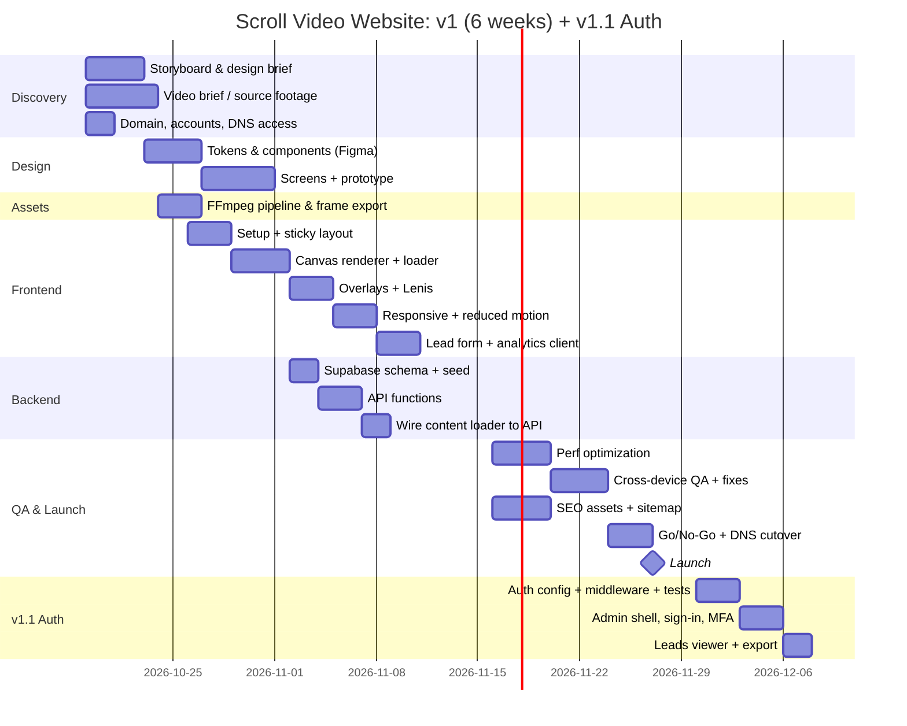

## 2. Phases & Tasks

### Phase 0: Discovery (Week 1)
| Task | Owner | Output |
|---|---|---|
| Kickoff, confirm PRD scope | PM | Signed-off PRD |
| Scroll storyboard (progress % → frame → copy) | Designer | Storyboard doc |
| Video art-direction brief (safe zones, length), production process per [Asset Pipeline](./07-ASSET-PIPELINE.md) §10 | Designer | Brief for the videographer |
| Repo scaffolded per the [Build Guide](../README.md) Phases 0–1; Vercel and Supabase projects created per the [Deployment Runbook](./08-DEPLOYMENT-RUNBOOK.md) §2 | DevOps | Access for team, `npm run dev` works |
| Domain registered in the company's name, DNS access secured, access register started ([Domain, DNS & Email](./13-DOMAIN-DNS-EMAIL.md) §2–3, [Maintenance](./16-MAINTENANCE-AND-OPERATIONS.md) §1) | PM + DevOps | Domain in DNS, 2FA on the registrar |

**Exit criteria:** PRD approved, source video ordered or received.

### Phase 1: Design (Weeks 1–2)
| Task | Owner | Output |
|---|---|---|
| Design tokens + component library | Designer | Figma library |
| Desktop + mobile screens (incl. 0/25/50/75/100% states) | Designer | Figma screens |
| Clickable/scroll prototype | Designer | Prototype link |
| Admin screens (desktop 1440): sign-in, MFA, dashboard, leads, audit log. Can slip to Week 6, but must be done before Phase 8. | Designer | Figma screens |
| Design review & sign-off | PM + Stakeholders | Approved designs |

### Phase 2: Asset Pipeline (Week 2)
| Task | Owner | Output |
|---|---|---|
| `scripts/export-frames.sh` (desktop + mobile, WebP + AVIF) per the [Asset Pipeline](./07-ASSET-PIPELINE.md) | Frontend | Repeatable script |
| Frame count/size audit vs. budget (`scripts/audit-frames.mjs`) | Frontend | Passing audit and manifest |
| Poster + OG image export | Designer | `/public/posters` |

### Phase 3: Frontend Core (Weeks 2–3) → *Build Guide Phases 3–9*
| Task | Owner | Done when |
|---|---|---|
| Vite setup, folder structure, lint/prettier | FE | `npm run dev` works |
| HTML structure + sticky layout | FE | Section pins correctly |
| `scrollCanvas.js` (cover-fit, DPR, progressive load) | FE | 60 fps scrub on desktop |
| Loader with stall fallback | FE | State machine matches App Flow §3 |
| `overlays.js` driven by config | FE | Overlays match storyboard timing |
| Lenis integration | FE | No jitter, anchors smooth-scroll |

### Phase 4: Backend (Week 3)
| Task | Owner | Done when |
|---|---|---|
| Run `001_init.sql`, RLS, `page_config` view | BE | Migration in repo |
| Seed data | BE | `/api/page/home` returns config |
| `/api/page/:slug`, `/api/leads`, `/api/events` | BE | Contract tests pass |
| Static JSON fallback generated from DB | BE | `npm run export:content` |

### Phase 5: Integration & Features (Week 4) → *Build Guide Phases 10–11*
| Task | Owner | Done when |
|---|---|---|
| `contentLoader.js` wired to the API | FE | Copy changes in DB appear on the site |
| Mobile frame set + `svh` fixes | FE | Works on iOS Safari & Android |
| Reduced-motion mode | FE | Static layout verified |
| Lead form (validation, honeypot, consent text per [Privacy & Legal](./11-PRIVACY-AND-LEGAL.md) §3, states) | FE | E2E test passes |
| Analytics client per the [Analytics Spec](./12-ANALYTICS-SPEC.md) | FE | Events visible in DB; QA check E-01 passes |

### Phase 6: Optimization (Week 5) → *Build Guide Phase 12*
| Task | Owner | Done when |
|---|---|---|
| AVIF with WebP fallback (probe per [Asset Pipeline](./07-ASSET-PIPELINE.md) §6) | FE | ~30% payload reduction |
| `ImageBitmap` decoding | FE | Main thread ≤ 8 ms/frame |
| Cache headers & CSP (`vercel.json`, [Deployment Runbook](./08-DEPLOYMENT-RUNBOOK.md) §4) | DevOps | Headers verified |
| Lighthouse CI budgets in GitHub Actions | DevOps | Pipeline fails on regression |
| SEO assets: `inject-content` build step, head tags, `robots.txt`, `sitemap.xml`, favicons, `404.html` ([SEO & Discoverability](./14-SEO-AND-DISCOVERABILITY.md)) | FE | QA checks S-01 to S-09 pass |

### Phase 7: QA & Launch (Weeks 5–6) → *Build Guide Phase 13*
| Task | Owner | Done when |
|---|---|---|
| Device matrix testing (see §3) and the [QA Checklist](./09-QA-CHECKLIST.md) | QA | All P0 pass, sign-off block complete |
| Accessibility audit (axe + manual keyboard/screen reader) | QA | WCAG 2.2 AA |
| Visual regression screenshots | QA | Baselines approved |
| Content freeze, editor training with the [Content Editor Guide](./10-CONTENT-EDITOR-GUIDE.md) (Supabase dashboard) | PM | Editor can update copy unaided |
| `/privacy`, `/terms` and consent text written and reviewed by counsel ([Privacy & Legal](./11-PRIVACY-AND-LEGAL.md) §9) | PM | Pages live, legal checklist complete |
| Domain mailboxes and email authentication: SPF, DKIM, DMARC ([Domain, DNS & Email](./13-DOMAIN-DNS-EMAIL.md) §5.1–5.2) | DevOps | Test emails pass authentication |
| Go/No-Go meeting, DNS cutover, 72-hour watch ([Launch & Go-Live](./15-LAUNCH-AND-GO-LIVE.md)) | PM + DevOps | Cutover done, watch complete |
| Production deploy, domain, monitoring and retention jobs per the [Deployment Runbook](./08-DEPLOYMENT-RUNBOOK.md) | DevOps | Live, smoke test passes |
| Handover: access register, cost register, routines ([Maintenance & Operations](./16-MAINTENANCE-AND-OPERATIONS.md) §1–3) | PM | Owners named, routines scheduled |

### Phase 8: Authentication & Admin (v1.1, Weeks 7–8)
Starts after launch, so the 2026-11-27 date is unaffected. Until it ships, editors use the Supabase dashboard (FR-11).

| Task | Owner | Done when |
|---|---|---|
| Custom SMTP sender on the domain ([Domain, DNS & Email](./13-DOMAIN-DNS-EMAIL.md) §5.3) configured and tested | BE + DevOps | Magic link arrives from the domain and passes SPF, DKIM and DMARC |
| Supabase Auth config (sign-up off, magic link, TOTP, CAPTCHA, redirect allow-list), first admin seeded | BE | Admin can sign in |
| `002_auth.sql` migration (`editors`, `audit_log`) | BE | Migration in repo |
| `requireRole` middleware plus unit tests | BE | All role/MFA cases pass |
| `/api/admin/me`, `pages`, `publish`, `editors`, `audit` | BE | Contract tests pass (401/403 on every route) |
| `admin.html` as a second Vite entry: sign-in, guard, MFA | FE | Editor signs in and out; admin forced through TOTP |
| Leads viewer, CSV export, delete (admin only) | FE + BE | Covered by E2E |
| Admin CSP, `noindex`, `no-store` headers | DevOps | Headers verified |
| Audit log write on every admin mutation | BE | A row appears for each action |

## 3. Device Test Matrix
| Device | Browser | Priority |
|---|---|---|
| MacBook (Retina) | Safari, Chrome | P0 |
| Windows laptop | Chrome, Edge, Firefox | P0 |
| iPhone 13+ | Safari | P0 |
| Pixel 7 / Galaxy A54 | Chrome | P0 |
| iPad | Safari | P1 |
| Low-end Android (4GB RAM) | Chrome | P1 |

## 4. Milestones
| # | Milestone | Date | Criteria |
|---|---|---|---|
| M1 | Design approved | 2026-10-30 | Figma signed off |
| M2 | Scroll experience demo | 2026-11-06 | Canvas + overlays on preview URL |
| M3 | Feature complete | 2026-11-13 | All P0 FRs done |
| M4 | Release candidate and Go/No-Go | 2026-11-24 | QA passed, budgets met, Go/No-Go criteria met ([Launch & Go-Live](./15-LAUNCH-AND-GO-LIVE.md) §3) |
| M5 | Launch | 2026-11-27 | Live on production domain |
| M6 | Auth & admin live (v1.1) | 2026-12-10 | FR-12 to FR-16 pass E2E; security checks in Authentication §7 pass |

## 5. Definition of Done (per task)
- [ ] Code reviewed and merged via PR
- [ ] Unit/E2E tests added where relevant
- [ ] Works on the P0 device matrix
- [ ] No Lighthouse budget regressions
- [ ] Accessibility checked (keyboard + contrast)
- [ ] Docs updated if behavior changed
- [ ] Every new admin route has a 401 and a 403 test; no secret in the client bundle; an audit row is written for each mutation

## 6. Risk Register
| Risk | Likelihood | Impact | Owner | Mitigation |
|---|---|---|---|---|
| Source video late | Medium | High | PM | Build with placeholder footage (stock clip) |
| Frame payload over budget | Medium | High | FE | Lower fps, AVIF, mobile set |
| iOS rendering bugs | Medium | Medium | FE | Test on real devices from Week 3 |
| Scope creep (more scenes) | High | Medium | PM | Multi-scene moved to v2 |
| Lead spam | Low | Medium | BE | Honeypot + rate limit, add Turnstile if needed |
| Auth check missed on one admin route | Medium | High | BE | Single `requireRole` helper; contract test fails if a route lacks a 401 case |
| Service-role key leak | Low | Critical | DevOps | Server env only; rotate on staff changes |

## 7. Post-Launch (Weeks 7+)
- Monitor analytics: scroll depth, loader stall rate, conversion
- Day-7 and day-30 reviews ([Launch & Go-Live](./15-LAUNCH-AND-GO-LIVE.md) §8) and the routine tasks in [Maintenance & Operations](./16-MAINTENANCE-AND-OPERATIONS.md) §3
- A/B test overlay copy (v2)
- Multi-scene pages and i18n (v2)
- Content revisions and staging for live pages (v2, see [Content Editor Guide](./10-CONTENT-EDITOR-GUIDE.md) §8)
- Weekly lead export / CRM integration (HubSpot / Mailchimp webhook)

## 8. Option: Pull Auth Into v1
Auth and admin add about 8 working days of mostly serial work. Shipping it before launch moves M4 and M5 out by roughly 1.5 weeks, unless a second backend developer joins. The v1.1 plan above is the default because it matches the PRD scope (FR-9 and FR-11 are already v1.1).

## 9. Coverage Map
Every document and requirement in this file maps to a phase, so nothing is left unscheduled.

### 9.1 Files → phases
| File | Built or verified in |
|---|---|
| `README.md` (Build Guide) | Phases 0 to 7 (the Build Guide phases map as listed in its §5) |
| `CHANGELOG.md` | Updated at each release (Runbook §6) |
| 01-PRD | Phase 0 (scope sign-off), Phase 7 (release criteria) |
| 02-TRD | Phases 3 and 5 (modules, rendering, security headers), Phase 6 (budgets, CI/CD) |
| 03-APP-FLOW | Phases 3 and 5 (visitor flows, loader, lead form), Phase 8 (editor and admin flow) |
| 04-UI-UX-DESIGN-BRIEF | Phase 1 (tokens, screens, admin screens), Phases 3 and 5 (implementation), Phase 7 (accessibility audit) |
| 05-BACKEND-SCHEMA | Phase 4 (`001_init.sql`, RLS, endpoints, seed), Phase 8 (`002_auth.sql`) |
| 06-AUTHENTICATION | Phase 8 (all of it), release gate in M6 |
| 07-ASSET-PIPELINE | Phase 0 (production process §10), Phase 2 (export and audit), Phase 6 (AVIF probe) |
| 08-DEPLOYMENT-RUNBOOK | Phase 0 (setup), Phase 6 (headers), Phase 7 (release, monitoring, jobs), Phase 8 (admin headers) |
| 09-QA-CHECKLIST | Phase 7 (full run and sign-off), Phase 8 (admin checks U-01 to U-09) |
| 10-CONTENT-EDITOR-GUIDE | Phase 7 (editor training), updated when `/admin` ships in Phase 8 |
| 11-PRIVACY-AND-LEGAL | Phase 5 (consent text), Phase 7 (policy pages and checklist) |
| 12-ANALYTICS-SPEC | Phase 4 (events API), Phase 5 (client), Phase 7 (QA check E-01) |
| 13-DOMAIN-DNS-EMAIL | Phase 0 (registration, DNS access), Phase 7 (mailboxes, authentication, cutover records), Phase 8 (custom SMTP) |
| 14-SEO-AND-DISCOVERABILITY | Phase 6 (build-time injection, head tags, sitemap, icons, 404), Phase 7 (Search Console after launch) |
| 15-LAUNCH-AND-GO-LIVE | Phase 7 (Go/No-Go at M4, cutover, 72-hour watch, handover) |
| 16-MAINTENANCE-AND-OPERATIONS | Phase 7 (handover), then ongoing after launch |
| 17-IMPLEMENTATION-PLAN | This document |

### 9.2 Requirements → phases
| Requirement | Phase | Version |
|---|---|---|
| FR-1 Scroll-to-frame mapping | 3 | v1 |
| FR-2 Canvas renderer | 3 | v1 |
| FR-3 Preloader, scroll lock | 3 | v1 |
| FR-4 Overlay timeline | 3 | v1 |
| FR-5 Smooth scrolling | 3 | v1 |
| FR-6 Mobile frame set | 2 (export), 5 (integration) | v1 |
| FR-7 Reduced-motion fallback | 5 | v1 |
| FR-8 Lead capture | 4 (API), 5 (form) | v1 |
| FR-9 Content from API with fallback | 4, 5 | v1.1 in the PRD; built in v1 in this plan (see the mismatch note below) |
| FR-10 Analytics events | 4 (API), 5 (client) | v1 |
| FR-11 Supabase dashboard access | 7 (editor training) | v1.1 |
| FR-12 Invite-only sign-in | 8 | v1.1 |
| FR-13 Role-based authorization | 8 | v1.1 |
| FR-14 Admin MFA | 8 | v1.1 |
| FR-15 Audit log | 8 | v1.1 |
| FR-16 Leads viewer, export, delete | 8 | v1.1 |

> **Mismatch to resolve:** the PRD marks FR-9 as v1.1, while Phases 4 and 5 build it before launch. Either change the PRD scope to v1, or move the wiring out of Phase 5.

### 9.3 Cross-cutting checks
| Check | Where it is enforced |
|---|---|
| Performance budgets | Phase 6 Lighthouse CI; release criteria in the PRD |
| Accessibility (WCAG 2.2 AA), public and admin | Phase 7 audit; per-task Definition of Done |
| Security headers (public CSP, admin CSP, `noindex`) | Phase 6 (public), Phase 8 (admin) |
| Auth tests (401/403 on every admin route, anon key cannot read `leads`) | Phase 8; Definition of Done; M6 |
| Data retention crons ([Runbook](./08-DEPLOYMENT-RUNBOOK.md) §8) | Phase 7 (analytics), Phase 8 (audit log) |
| Legal pages, consent text, processor agreements | Phase 7 ([Privacy & Legal](./11-PRIVACY-AND-LEGAL.md) §9) |
| Release sign-off | Phase 7 ([QA Checklist](./09-QA-CHECKLIST.md) §12) |
| Domain, DNS and email authentication | Phase 0 (registration), Phase 7 (mailboxes, SPF/DKIM/DMARC), Phase 8 (custom SMTP); QA checks D-01 to D-05 |
| SEO | Phase 6; QA checks S-01 to S-09 |
| Costs, renewals and access ownership | Phase 7 handover ([Maintenance & Operations](./16-MAINTENANCE-AND-OPERATIONS.md) §1–2, §7) |

---

# CHANGELOG

# Changelog
Product releases follow [Semantic Versioning](https://semver.org). The format follows [Keep a Changelog](https://keepachangelog.com). Documentation revisions are listed separately at the bottom.

## [Unreleased]
### Added
- Nothing yet.

## [1.1.0] — planned 2026-12-10
### Added
- Invite-only editor sign-in at `/admin` with Supabase Auth magic links (FR-12)
- Role-based authorization (`editor`, `admin`) on all `/api/admin/*` routes (FR-13)
- TOTP MFA for admins (FR-14)
- Audit log of admin writes (FR-15)
- Leads viewer, CSV export and delete for admins (FR-16)
- `002_auth.sql` migration (`editors`, `audit_log`)

## [1.0.0] — planned 2026-11-27
### Added
- Scroll-driven canvas video with desktop and mobile frame sets (FR-1, FR-2, FR-6)
- Preloader with stall fallback (FR-3), overlays (FR-4), smooth scrolling (FR-5)
- Reduced-motion fallback (FR-7), lead capture (FR-8), analytics events (FR-10)
- Content API with static fallback (FR-9, see the scope note in the Implementation Plan §9.2)
- `001_init.sql` migration and seed data

---

## Documentation revisions
### Docs 1.4 — 2026-10-15
- README: added §4.2 Master Checklist, a 45-step tick-box list in the correct order with a gate per stage (email authentication moved to Week 1; TRD and schema, environment setup and video ordering added), and §4.3 Workflows (project, release, content change, frame update, launch day, privacy request, editor lifecycle, incident)

### Docs 1.3 — 2026-10-15
- Added `13-DOMAIN-DNS-EMAIL`, `14-SEO-AND-DISCOVERABILITY`, `15-LAUNCH-AND-GO-LIVE` and `16-MAINTENANCE-AND-OPERATIONS`
- Added the video production process to `07-ASSET-PIPELINE` (§10)
- Renumbered the Implementation Plan from 13 to 17 so it stays last
- README: the order-of-work table is now a 13-stage end-to-end process
- Added build-time injection of page title, description and overlay text for search and social crawlers (SEO §3); the Editor Guide now says these update at the next build
- Custom SMTP for sign-in emails added to Authentication §5; `SITE_URL` added to the environment variables; QA checks S-05 to S-09 and D-01 to D-05 added

### Docs 1.2 — 2026-10-15
- Added `07-ASSET-PIPELINE`, `08-DEPLOYMENT-RUNBOOK`, `09-QA-CHECKLIST`, `10-CONTENT-EDITOR-GUIDE`, `11-PRIVACY-AND-LEGAL`, `12-ANALYTICS-SPEC`
- Added the repo-root `README.md` (Build Guide) and this `CHANGELOG.md`
- Renumbered the Implementation Plan from 06 to 13 so it stays last
- Implementation Plan now links every document and phase to the new files
- Added the order-of-work table to the README (§4.1)

### Docs 1.1 — 2026-10-14
- Added `06-AUTHENTICATION` and folded authentication into the PRD, TRD, App Flow, UI/UX Brief, Backend Schema and Implementation Plan
- Added the coverage map to the Implementation Plan

### Docs 1.0
- Initial set: PRD, TRD, App Flow, UI/UX Design Brief, Backend Schema, Implementation Plan

---

# Part B — Expanded document formats (18–35)

---

# Final documentation governance checklist

- [ ] All 35 numbered documents have an owner.
- [ ] Each document has a version, status, and last-reviewed date.
- [ ] Cross-document links and filenames match the repository.
- [ ] PRD scope remains the authority for product features.
- [ ] TRD and backend schema remain the authority for technical architecture and data structure.
- [ ] Authentication and role permissions remain consistent across API docs and admin guides.
- [ ] Privacy inventory matches actual data collection and integrations.
- [ ] Environment variables and secrets are never copied into documentation.
- [ ] All unresolved values are tracked with an owner and due date.
- [ ] Documentation is reviewed as part of every release.
